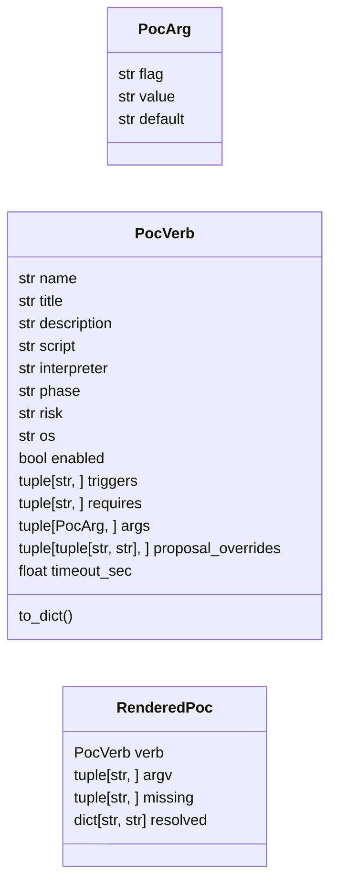
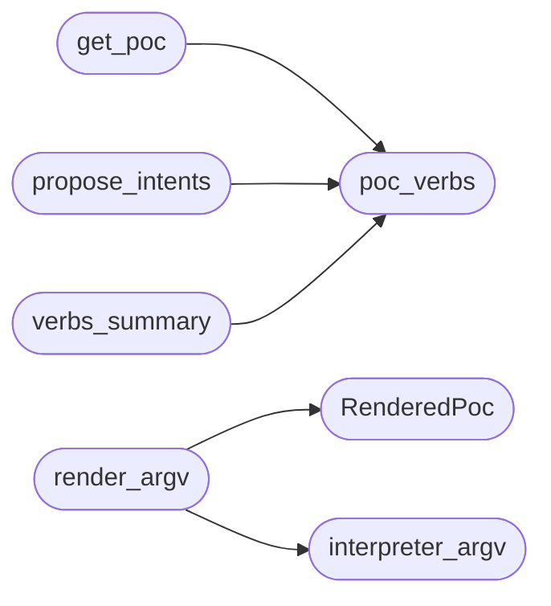

# `modules.poc_registry`

> Source: [modules/poc_registry.py:1](../../modules/poc_registry.py#L1) | language `py` | coverage 100.0% | [API index](../index.md)

Reusable PoC verbs: standalone exploit scripts as loop-routable actions.

The `[`modules`](modules.__init__.py.md)` directory ships standalone proof-of-concept scripts
(``49803.py``, ``CVE-2023-28432.py``, ``CVE-2018-15133.php``, ...). Until
now each was a one-shot file an operator had to remember and invoke by
hand: the autonomous loop, the apt_chain pipeline and the lazy
orchestrator could not reach a single one. This module turns every
catalogued PoC into a first-class verb:

- ``config/poc_verbs.yaml`` declares the script, interpreter, phase,
  risk, trigger keywords and argument templates;
- argument templates reference ``payload.json`` placeholders
  (``{rhost}``, ``{rport}``, ``{lhost}``, ``{lport}``, ``{user}``,
  ``{password}``, ``{domain}``, ``{url}``) so one declaration serves any
  target the operator assigns;
- [`render_argv`](#render_argv) expands the templates into an `[`argv`](#renderedpoc-argv)` list
  (never a shell string) plus the list of placeholders that stayed
  unresolved;
- [`propose_intents`](#propose_intents) maps discovered service tokens to
  ``lazy_poc run <name> <target>`` lines the planner and the daemon can
  queue, mirroring the lazyaddon trigger flow;
- the shell verb ``lazy_poc`` executes the rendered `[`argv`](#renderedpoc-argv)` with the
  shared safe-subprocess primitive, so the PoCs ride the same Guard,
  scope and audit path as every other loop verb.

Parsing is fail-safe like the verb catalog: an unreadable or oversized
YAML degrades to an empty registry instead of breaking the loop.

## Contents

- **Classes:** [`PocArg`](#pocarg), [`PocVerb`](#pocverb), [`RenderedPoc`](#renderedpoc)
- **Functions:** [`poc_verbs`](#poc_verbs), [`get_poc`](#get_poc), [`interpreter_argv`](#interpreter_argv), [`render_argv`](#render_argv), [`missing_requirements`](#missing_requirements), [`propose_intents`](#propose_intents), [`verbs_summary`](#verbs_summary)

## Type Diagram



## Call Graph

Solid arrows stay in this module, dashed arrows leave it.



## Classes

<a id="pocarg"></a>

### `PocArg`

`class` `dataclass` | [modules/poc_registry.py:77](../../modules/poc_registry.py#L77)

Decorators: `@dataclass(frozen=True)`

```python
class PocArg
```

One rendered argument of a PoC verb.

**Attributes**

| Name | Type | Default | Description |
|---|---|---|---|
| [`flag`](#pocarg-flag) | `str` | `''` | Option flag prepended to the value (``-u``); may be empty for positional arguments. |
| [`value`](#pocarg-value) | `str` | `''` | Template or literal; ``{placeholder}`` tokens expand from the operator payload. |
| [`default`](#pocarg-default) | `str` | `''` | Literal used when every placeholder inside `[`value`](#pocarg-value)` stays unresolved. |

---

<a id="pocverb"></a>

### `PocVerb`

`class` `dataclass` | [modules/poc_registry.py:95](../../modules/poc_registry.py#L95)

Decorators: `@dataclass(frozen=True)`

```python
class PocVerb
```

One catalogued proof-of-concept verb.

**Attributes**

| Name | Type | Default | Description |
|---|---|---|---|
| [`name`](#pocverb-name) | `str` |  | Verb name used in ``lazy_poc run <name>``. |
| [`title`](#pocverb-title) | `str` | `''` | Human title. |
| [`description`](#pocverb-description) | `str` | `''` | One-line description. |
| [`script`](#pocverb-script) | `str` | `''` | Script path relative to ``modules/``. |
| [`interpreter`](#pocverb-interpreter) | `str` | `'python3'` | Runner key (``python3``/``php``/``mitmdump``). |
| [`phase`](#pocverb-phase) | `str` | `'exploit'` | Kill-chain phase. |
| [`risk`](#pocverb-risk) | `str` | `'exploit'` | Risk class routed by the Guard. |
| [`os`](#pocverb-os) | `str` | `'any'` | Target platform (``any``/``linux``/``windows``). |
| [`enabled`](#pocverb-enabled) | `bool` | `True` | Whether the loop may propose and run it. |
| [`triggers`](#pocverb-triggers) | `tuple[str, ...]` | `()` | Service/keyword tokens that make the selector fire. |
| [`requires`](#pocverb-requires) | `tuple[str, ...]` | `()` | Binaries that must exist before execution. |
| [`args`](#pocverb-args) | `tuple[PocArg, ...]` | `()` | Ordered argument templates. |
| [`proposal_overrides`](#pocverb-proposal_overrides) | `tuple[tuple[str, str], ...]` | `()` |  |
| [`timeout_sec`](#pocverb-timeout_sec) | `float` | `120.0` | Per-run wall-clock cap. |

**Members**

| Member | Kind | Summary |
|---|---|---|
| [`to_dict`](#pocverb-to_dict) | method | Return a JSON-serialisable summary for the orchestrator surfaces. |

<a id="pocverb-to_dict"></a>

#### `PocVerb.to_dict`

`method` | [modules/poc_registry.py:129](../../modules/poc_registry.py#L129)

```python
def to_dict(self) -> dict
```

Return a JSON-serialisable summary for the orchestrator surfaces.

**Returns:** `dict`

---

<a id="renderedpoc"></a>

### `RenderedPoc`

`class` `dataclass` | [modules/poc_registry.py:152](../../modules/poc_registry.py#L152)

Decorators: `@dataclass(frozen=True)`

```python
class RenderedPoc
```

The expansion result of one PoC verb against operator input.

**Attributes**

| Name | Type | Default | Description |
|---|---|---|---|
| [`verb`](#renderedpoc-verb) | `PocVerb` |  | Source [`PocVerb`](#pocverb). |
| [`argv`](#renderedpoc-argv) | `tuple[str, ...]` |  | Full `[`argv`](#renderedpoc-argv)` list ready for ``subprocess`` (``shell=False``). |
| [`missing`](#renderedpoc-missing) | `tuple[str, ...]` |  | Placeholders that stayed unresolved (run is refused). |
| [`resolved`](#renderedpoc-resolved) | `dict[str, str]` | `field(default_factory=dict)` | Placeholder values actually used, masked secrets aside. |

---

## Functions

<a id="poc_verbs"></a>

### `poc_verbs`

`function` | [modules/poc_registry.py:283](../../modules/poc_registry.py#L283)

```python
def poc_verbs(catalog_path: str | Path | None = None) -> dict[str, PocVerb]
```

Return the catalogued PoC verbs (cached, fail-safe).

**Parameters**

| Name | Type | Default | Description |
|---|---|---|---|
| `catalog_path` | `str \| Path \| None` | `None` | Optional override path (tests and sandboxes). |

**Returns:** `dict[str, PocVerb]` - Mapping of verb name to [`PocVerb`](#pocverb); empty when no catalog
is readable.

*Called by:* [`get_poc`](#get_poc), [`propose_intents`](#propose_intents), [`verbs_summary`](#verbs_summary), [`PoCSelector.propose`](modules.selection.poc.py.md#pocselector-propose)

---

<a id="get_poc"></a>

### `get_poc`

`function` | [modules/poc_registry.py:312](../../modules/poc_registry.py#L312)

```python
def get_poc(name: str, catalog_path: str | Path | None = None) -> PocVerb | None
```

Return one PoC verb by name, or None when unknown/disabled-less.

**Parameters**

| Name | Type | Default | Description |
|---|---|---|---|
| `name` | `str` |  | Verb name as used in ``lazy_poc run <name>``. |
| `catalog_path` | `str \| Path \| None` | `None` | Optional catalog override. |

**Returns:** `PocVerb | None` - The [`PocVerb`](#pocverb), or None when absent.

*Calls:* [`poc_verbs`](#poc_verbs)

*Called by:* [`steps_for`](modules.auto_registry.py.md#steps_for)

---

<a id="interpreter_argv"></a>

### `interpreter_argv`

`function` | [modules/poc_registry.py:325](../../modules/poc_registry.py#L325)

```python
def interpreter_argv(verb: PocVerb) -> tuple[str, ...]
```

Return the `[`argv`](#renderedpoc-argv)` prefix that launches the PoC script.

``mitmdump`` addons run as ``mitmdump -s <script>``; every other
interpreter runs the script directly.

**Parameters**

| Name | Type | Default | Description |
|---|---|---|---|
| `verb` | `PocVerb` |  |  |

**Returns:** `tuple[str, ...]`

*Called by:* [`render_argv`](#render_argv)

---

<a id="render_argv"></a>

### `render_argv`

`function` | [modules/poc_registry.py:337](../../modules/poc_registry.py#L337)

```python
def render_argv(verb: PocVerb, params: dict, target: str = '', overrides: dict[str, str] | None = None) -> RenderedPoc
```

Expand one PoC verb into a safe `[`argv`](#renderedpoc-argv)` list.

Resolution order per placeholder: runtime overrides, the positional
target (binds ``{rhost}``), then ``payload.json`` values through the
alias table. When every placeholder in a template resolves empty the
literal `[`default`](#pocarg-default)` applies; an argument that still resolves empty
is dropped so half-configured PoCs never run with stale flags.

**Parameters**

| Name | Type | Default | Description |
|---|---|---|---|
| `verb` | `PocVerb` |  | The catalogued PoC. |
| `params` | `dict` |  | Operator payload mapping (``payload.json``). |
| `target` | `str` | `''` | Target host that overrides ``{rhost}``. |
| `overrides` | `dict[str, str] \| None` | `None` | Explicit runtime ``key=value`` overrides. |

**Returns:** `RenderedPoc` - A [`RenderedPoc`](#renderedpoc); `[`missing`](#renderedpoc-missing)` lists unresolved placeholder
names that carry no default, which the caller treats as refuse.

*Calls:* [`RenderedPoc`](#renderedpoc), [`interpreter_argv`](#interpreter_argv)

---

<a id="missing_requirements"></a>

### `missing_requirements`

`function` | [modules/poc_registry.py:392](../../modules/poc_registry.py#L392)

```python
def missing_requirements(verb: PocVerb) -> list[str]
```

Return the PoC's required binaries that are absent on this host.

**Parameters**

| Name | Type | Default | Description |
|---|---|---|---|
| `verb` | `PocVerb` |  |  |

**Returns:** `list[str]`

*Called by:* [`PoCSelector.propose`](modules.selection.poc.py.md#pocselector-propose)

---

<a id="propose_intents"></a>

### `propose_intents`

`function` | [modules/poc_registry.py:409](../../modules/poc_registry.py#L409)

```python
def propose_intents(service_texts: list[str] | tuple[str, ...], target: str = '', limit: int = 4, catalog_path: str | Path | None = None) -> list[str]
```

Propose ``lazy_poc run`` intent lines for matching service tokens.

Mirrors the lazyaddon trigger flow: every enabled PoC whose trigger
token appears in the discovered service text becomes a
``lazy_poc run <name> <target>`` line the planner can queue. Known
lines are never duplicated, and the cap keeps one service burst from
flooding the round.

**Parameters**

| Name | Type | Default | Description |
|---|---|---|---|
| `service_texts` | `list[str] \| tuple[str, ...]` |  | Discovered service strings for the target. |
| `target` | `str` | `''` | Host under test appended to the intent line. |
| `limit` | `int` | `4` | Maximum intents returned. |
| `catalog_path` | `str \| Path \| None` | `None` |  |

**Returns:** `list[str]` - Intent summary lines, most specific trigger first.

*Calls:* [`poc_verbs`](#poc_verbs)

---

<a id="verbs_summary"></a>

### `verbs_summary`

`function` | [modules/poc_registry.py:449](../../modules/poc_registry.py#L449)

```python
def verbs_summary(catalog_path: str | Path | None = None) -> list[dict]
```

Return every PoC verb as a dict for TUI and MCP surfaces.

**Parameters**

| Name | Type | Default | Description |
|---|---|---|---|
| `catalog_path` | `str \| Path \| None` | `None` |  |

**Returns:** `list[dict]`

*Calls:* [`poc_verbs`](#poc_verbs)

---
