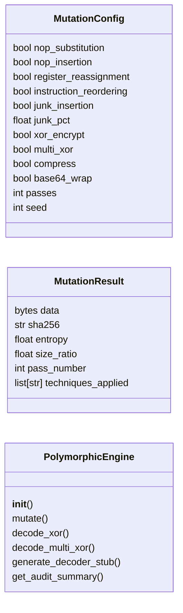
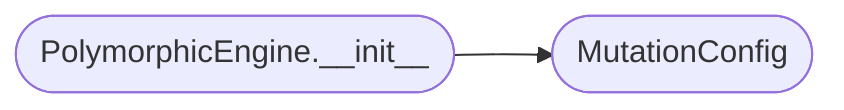

# `modules.polymorphic_engine`

> Source: [modules/polymorphic_engine.py:1](../../modules/polymorphic_engine.py#L1) | language `py` | coverage 90.0% | [API index](../index.md)

Polymorphic code generation engine — shellcode mutation and obfuscation.

Transforms shellcode through multiple mutation passes: NOP-equivalent
substitution, register reassignment, instruction reordering, junk code
insertion, XOR/ROT encryption, and compression. Each generated variant
is functionally equivalent but structurally unique — defeating static
signature detection.

The engine tracks mutation entropy and produces audit logs for operators.

## Contents

- **Classes:** [`MutationConfig`](#mutationconfig), [`MutationResult`](#mutationresult), [`PolymorphicEngine`](#polymorphicengine)
- **Constants:** [`SESSIONS_DIR`](#sessions_dir), [`NOP_EQUIVALENTS_X64`](#nop_equivalents_x64), [`NOP_EQUIVALENTS_X86`](#nop_equivalents_x86), [`JUNK_SNIPPETS_X64`](#junk_snippets_x64), [`JUNK_SNIPPETS_X86`](#junk_snippets_x86), [`XOR_KEY_SIZES`](#xor_key_sizes), [`CHUNK_MIN`](#chunk_min), [`CHUNK_MAX`](#chunk_max)

## Type Diagram



## Call Graph

Solid arrows stay in this module, dashed arrows leave it.



## Classes

<a id="mutationconfig"></a>

### `MutationConfig`

`class` `dataclass` | [modules/polymorphic_engine.py:93](../../modules/polymorphic_engine.py#L93)

Decorators: `@dataclass`

```python
class MutationConfig
```

Configuration for polymorphic mutation passes.

**Attributes**

| Name | Type | Default | Description |
|---|---|---|---|
| [`nop_substitution`](#mutationconfig-nop_substitution) | `bool` | `True` | Replace NOPs with random equivalents. |
| [`nop_insertion`](#mutationconfig-nop_insertion) | `bool` | `True` | Insert random NOP-equivalents between real instructions. |
| [`register_reassignment`](#mutationconfig-register_reassignment) | `bool` | `True` | Remap registers to unused equivalents. |
| [`instruction_reordering`](#mutationconfig-instruction_reordering) | `bool` | `False` | Reorder independent instructions. |
| [`junk_insertion`](#mutationconfig-junk_insertion) | `bool` | `True` | Insert semantically-neutral junk code blocks. |
| [`junk_pct`](#mutationconfig-junk_pct) | `float` | `0.15` | Percentage of total output to fill with junk (0.0 to 0.5). |
| [`xor_encrypt`](#mutationconfig-xor_encrypt) | `bool` | `True` | Apply XOR encryption layer with random key. |
| [`multi_xor`](#mutationconfig-multi_xor) | `bool` | `True` | Use multiple XOR keys across chunks. |
| [`compress`](#mutationconfig-compress) | `bool` | `True` | zlib-compress payload before encryption. |
| [`base64_wrap`](#mutationconfig-base64_wrap) | `bool` | `True` | Wrap final output in base64 with decoder stub. |
| [`passes`](#mutationconfig-passes) | `int` | `3` | Number of mutation passes (each pass applies all enabled transforms). |
| [`seed`](#mutationconfig-seed) | `int` | `0` | Random seed for reproducibility (None = random). |

---

<a id="mutationresult"></a>

### `MutationResult`

`class` `dataclass` | [modules/polymorphic_engine.py:126](../../modules/polymorphic_engine.py#L126)

Decorators: `@dataclass`

```python
class MutationResult
```

Output of a single mutation pass.

**Attributes**

| Name | Type | Default | Description |
|---|---|---|---|
| [`data`](#mutationresult-data) | `bytes` | `b''` | Mutated shellcode bytes. |
| [`sha256`](#mutationresult-sha256) | `str` | `''` | SHA-256 hash of the output. |
| [`entropy`](#mutationresult-entropy) | `float` | `0.0` | Shannon entropy estimate (0.0-8.0). |
| [`size_ratio`](#mutationresult-size_ratio) | `float` | `1.0` | Ratio of mutated size to original size. |
| [`pass_number`](#mutationresult-pass_number) | `int` | `0` | Which mutation pass this represents. |
| [`techniques_applied`](#mutationresult-techniques_applied) | `list[str]` | `field(default_factory=list)` | List of techniques applied in this pass. |

---

<a id="polymorphicengine"></a>

### `PolymorphicEngine`

`class` | [modules/polymorphic_engine.py:146](../../modules/polymorphic_engine.py#L146)

```python
class PolymorphicEngine
```

Generate functionally-equivalent but structurally-unique shellcode variants.

Each invocation of mutate() produces a different output for the same input,
defeating signature-based detection. Tracks all variants with audit hashes.

**Members**

| Member | Kind | Summary |
|---|---|---|
| [`__init__`](#polymorphicengine-__init__) | constructor |  |
| [`mutate`](#polymorphicengine-mutate) | method | Apply all configured mutation passes to shellcode. |
| [`decode_xor`](#polymorphicengine-decode_xor) | staticmethod | Decode single-byte XOR encrypted shellcode. |
| [`decode_multi_xor`](#polymorphicengine-decode_multi_xor) | staticmethod | Decode multi-byte XOR encrypted shellcode. |
| [`generate_decoder_stub`](#polymorphicengine-generate_decoder_stub) | method | Generate a self-decrypting stub shellcode template. |
| [`get_audit_summary`](#polymorphicengine-get_audit_summary) | method | Return a summary of all mutations applied. |

<a id="polymorphicengine-__init__"></a>

#### `PolymorphicEngine.__init__`

`constructor` | [modules/polymorphic_engine.py:159](../../modules/polymorphic_engine.py#L159)

```python
def __init__(self, config: MutationConfig | None = None)
```

**Parameters**

| Name | Type | Default | Description |
|---|---|---|---|
| `config` | `MutationConfig \| None` | `None` |  |

*Calls:* [`MutationConfig`](#mutationconfig)

*Called by:* [`PayloadArsenalCommandSet.do_polymorphic`](cli.commands.payload_arsenal.py.md#payloadarsenalcommandset-do_polymorphic)

<a id="polymorphicengine-mutate"></a>

#### `PolymorphicEngine.mutate`

`method` | [modules/polymorphic_engine.py:163](../../modules/polymorphic_engine.py#L163)

```python
def mutate(self, shellcode: bytes, arch: str = 'x64') -> bytes
```

Apply all configured mutation passes to shellcode.

**Parameters**

| Name | Type | Default | Description |
|---|---|---|---|
| `shellcode` | `bytes` |  | Raw shellcode bytes to mutate. |
| `arch` | `str` | `'x64'` | CPU architecture ('x64' or 'x86'). |

**Returns:** `bytes` - Mutated shellcode bytes.

*Called by:* [`PayloadArsenalCommandSet.do_polymorphic`](cli.commands.payload_arsenal.py.md#payloadarsenalcommandset-do_polymorphic)

<a id="polymorphicengine-decode_xor"></a>

#### `PolymorphicEngine.decode_xor`

`staticmethod` | [modules/polymorphic_engine.py:361](../../modules/polymorphic_engine.py#L361)

Decorators: `@staticmethod`

```python
def decode_xor(data: bytes) -> bytes
```

Decode single-byte XOR encrypted shellcode.

**Parameters**

| Name | Type | Default | Description |
|---|---|---|---|
| `data` | `bytes` |  | XOR-encrypted bytes with key as last byte. |

**Returns:** `bytes` - Decrypted shellcode bytes.

<a id="polymorphicengine-decode_multi_xor"></a>

#### `PolymorphicEngine.decode_multi_xor`

`staticmethod` | [modules/polymorphic_engine.py:377](../../modules/polymorphic_engine.py#L377)

Decorators: `@staticmethod`

```python
def decode_multi_xor(data: bytes) -> bytes
```

Decode multi-byte XOR encrypted shellcode.

**Parameters**

| Name | Type | Default | Description |
|---|---|---|---|
| `data` | `bytes` |  | Multi-XOR encrypted bytes with header. |

**Returns:** `bytes` - Decrypted shellcode bytes.

<a id="polymorphicengine-generate_decoder_stub"></a>

#### `PolymorphicEngine.generate_decoder_stub`

`method` | [modules/polymorphic_engine.py:397](../../modules/polymorphic_engine.py#L397)

```python
def generate_decoder_stub(self, arch: str = 'x64') -> bytes
```

Generate a self-decrypting stub shellcode template.

The stub decodes XOR-encrypted payload that follows it, then jumps
to the decoded shellcode. This is the core of polymorphic wrapping.

**Parameters**

| Name | Type | Default | Description |
|---|---|---|---|
| `arch` | `str` | `'x64'` | Target architecture ('x64' or 'x86'). |

**Returns:** `bytes` - Decoder stub shellcode bytes.

<a id="polymorphicengine-get_audit_summary"></a>

#### `PolymorphicEngine.get_audit_summary`

`method` | [modules/polymorphic_engine.py:422](../../modules/polymorphic_engine.py#L422)

```python
def get_audit_summary(self) -> dict[str, Any]
```

Return a summary of all mutations applied.

**Returns:** `dict[str, Any]` - Dict with variant count, entropy range, size ratios, and SHA-256 list.

*Called by:* [`PayloadArsenalCommandSet.do_polymorphic`](cli.commands.payload_arsenal.py.md#payloadarsenalcommandset-do_polymorphic)

---

## Constants

<a id="sessions_dir"></a>

### `SESSIONS_DIR`

`constant` | [modules/polymorphic_engine.py:23](../../modules/polymorphic_engine.py#L23)

```python
SESSIONS_DIR = Path(__file__).resolve().parent.parent / 'sessions'
```

---

<a id="nop_equivalents_x64"></a>

### `NOP_EQUIVALENTS_X64`

`constant` | [modules/polymorphic_engine.py:25](../../modules/polymorphic_engine.py#L25)

```python
NOP_EQUIVALENTS_X64
```

---

<a id="nop_equivalents_x86"></a>

### `NOP_EQUIVALENTS_X86`

`constant` | [modules/polymorphic_engine.py:48](../../modules/polymorphic_engine.py#L48)

```python
NOP_EQUIVALENTS_X86
```

---

<a id="junk_snippets_x64"></a>

### `JUNK_SNIPPETS_X64`

`constant` | [modules/polymorphic_engine.py:68](../../modules/polymorphic_engine.py#L68)

```python
JUNK_SNIPPETS_X64
```

---

<a id="junk_snippets_x86"></a>

### `JUNK_SNIPPETS_X86`

`constant` | [modules/polymorphic_engine.py:79](../../modules/polymorphic_engine.py#L79)

```python
JUNK_SNIPPETS_X86
```

---

<a id="xor_key_sizes"></a>

### `XOR_KEY_SIZES`

`constant` | [modules/polymorphic_engine.py:87](../../modules/polymorphic_engine.py#L87)

```python
XOR_KEY_SIZES = [1, 2, 4, 8, 16, 32]
```

---

<a id="chunk_min"></a>

### `CHUNK_MIN`

`constant` | [modules/polymorphic_engine.py:88](../../modules/polymorphic_engine.py#L88)

```python
CHUNK_MIN = 64
```

---

<a id="chunk_max"></a>

### `CHUNK_MAX`

`constant` | [modules/polymorphic_engine.py:89](../../modules/polymorphic_engine.py#L89)

```python
CHUNK_MAX = 512
```

---
