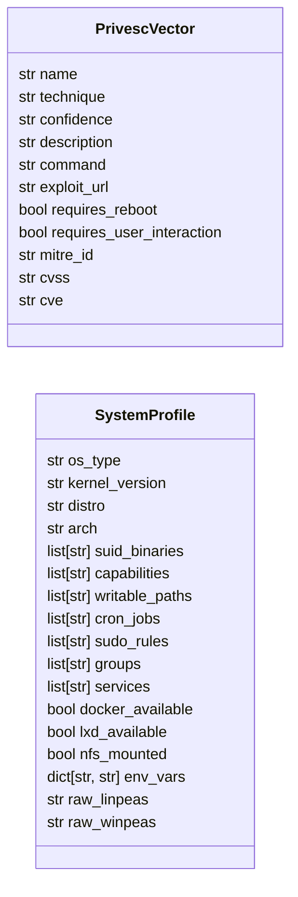
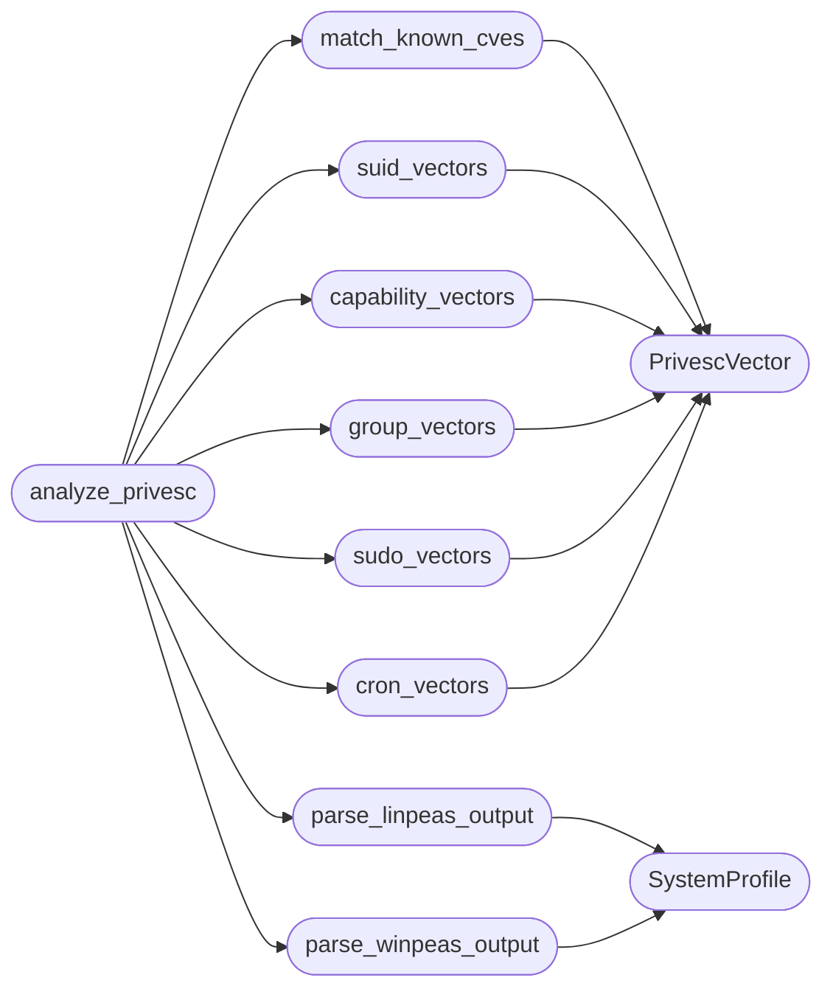

# `modules.privesc_predictor`

> Source: [modules/privesc_predictor.py:1](../../modules/privesc_predictor.py#L1) | language `py` | coverage 100.0% | [API index](../index.md)

Crystal Ball — privilege escalation vector prediction engine.

Parses system enumeration output (linpeas, winpeas, pspy) and kernel
information to generate a ranked list of specific privilege escalation
vectors with exact commands.

When an LLM backend is available the engine also analyses the target
context through the model to surface vectors that keyword-based scanners
often miss (e.g. subtle cron races, PATH-based hijacks in non-standard
locations, LXD group membership, Docker socket access, etc.).

## Contents

- **Classes:** [`PrivescVector`](#privescvector), [`SystemProfile`](#systemprofile)
- **Functions:** [`parse_linpeas_output`](#parse_linpeas_output), [`parse_winpeas_output`](#parse_winpeas_output), [`match_known_cves`](#match_known_cves), [`suid_vectors`](#suid_vectors), [`capability_vectors`](#capability_vectors), [`group_vectors`](#group_vectors), [`sudo_vectors`](#sudo_vectors), [`cron_vectors`](#cron_vectors), [`analyze_privesc`](#analyze_privesc), [`format_crystal_ball_output`](#format_crystal_ball_output)

## Type Diagram



## Call Graph

Solid arrows stay in this module, dashed arrows leave it.



## Classes

<a id="privescvector"></a>

### `PrivescVector`

`class` `dataclass` | [modules/privesc_predictor.py:97](../../modules/privesc_predictor.py#L97)

Decorators: `@dataclass`

```python
class PrivescVector
```

A single privilege escalation vector with ranked confidence.

**Attributes**

| Name | Type | Default | Description |
|---|---|---|---|
| [`name`](#privescvector-name) | `str` |  |  |
| [`technique`](#privescvector-technique) | `str` |  |  |
| [`confidence`](#privescvector-confidence) | `str` |  |  |
| [`description`](#privescvector-description) | `str` |  |  |
| [`command`](#privescvector-command) | `str` |  |  |
| [`exploit_url`](#privescvector-exploit_url) | `str` | `''` |  |
| [`requires_reboot`](#privescvector-requires_reboot) | `bool` | `False` |  |
| [`requires_user_interaction`](#privescvector-requires_user_interaction) | `bool` | `False` |  |
| [`mitre_id`](#privescvector-mitre_id) | `str` | `''` |  |
| [`cvss`](#privescvector-cvss) | `str` | `''` |  |
| [`cve`](#privescvector-cve) | `str` | `''` |  |

---

<a id="systemprofile"></a>

### `SystemProfile`

`class` `dataclass` | [modules/privesc_predictor.py:114](../../modules/privesc_predictor.py#L114)

Decorators: `@dataclass`

```python
class SystemProfile
```

Parsed target system profile used for vector matching.

**Attributes**

| Name | Type | Default | Description |
|---|---|---|---|
| [`os_type`](#systemprofile-os_type) | `str` | `'linux'` |  |
| [`kernel_version`](#systemprofile-kernel_version) | `str` | `''` |  |
| [`distro`](#systemprofile-distro) | `str` | `''` |  |
| [`arch`](#systemprofile-arch) | `str` | `''` |  |
| [`suid_binaries`](#systemprofile-suid_binaries) | `list[str]` | `field(default_factory=list)` |  |
| [`capabilities`](#systemprofile-capabilities) | `list[str]` | `field(default_factory=list)` |  |
| [`writable_paths`](#systemprofile-writable_paths) | `list[str]` | `field(default_factory=list)` |  |
| [`cron_jobs`](#systemprofile-cron_jobs) | `list[str]` | `field(default_factory=list)` |  |
| [`sudo_rules`](#systemprofile-sudo_rules) | `list[str]` | `field(default_factory=list)` |  |
| [`groups`](#systemprofile-groups) | `list[str]` | `field(default_factory=list)` |  |
| [`services`](#systemprofile-services) | `list[str]` | `field(default_factory=list)` |  |
| [`docker_available`](#systemprofile-docker_available) | `bool` | `False` |  |
| [`lxd_available`](#systemprofile-lxd_available) | `bool` | `False` |  |
| [`nfs_mounted`](#systemprofile-nfs_mounted) | `bool` | `False` |  |
| [`env_vars`](#systemprofile-env_vars) | `dict[str, str]` | `field(default_factory=dict)` |  |
| [`raw_linpeas`](#systemprofile-raw_linpeas) | `str` | `''` |  |
| [`raw_winpeas`](#systemprofile-raw_winpeas) | `str` | `''` |  |

---

## Functions

<a id="parse_linpeas_output"></a>

### `parse_linpeas_output`

`function` | [modules/privesc_predictor.py:165](../../modules/privesc_predictor.py#L165)

```python
def parse_linpeas_output(text: str) -> SystemProfile
```

Extract a structured SystemProfile from linpeas output text.

**Parameters**

| Name | Type | Default | Description |
|---|---|---|---|
| `text` | `str` |  | Raw linpeas.sh stdout. |

**Returns:** `SystemProfile` - Populated SystemProfile instance.

*Calls:* [`SystemProfile`](#systemprofile)

*Called by:* [`analyze_privesc`](#analyze_privesc)

---

<a id="parse_winpeas_output"></a>

### `parse_winpeas_output`

`function` | [modules/privesc_predictor.py:218](../../modules/privesc_predictor.py#L218)

```python
def parse_winpeas_output(text: str) -> SystemProfile
```

Extract a structured SystemProfile from winpeas output text.

**Parameters**

| Name | Type | Default | Description |
|---|---|---|---|
| `text` | `str` |  | Raw winpeas.exe stdout. |

**Returns:** `SystemProfile` - Populated SystemProfile instance.

*Calls:* [`SystemProfile`](#systemprofile)

*Called by:* [`analyze_privesc`](#analyze_privesc)

---

<a id="match_known_cves"></a>

### `match_known_cves`

`function` | [modules/privesc_predictor.py:249](../../modules/privesc_predictor.py#L249)

```python
def match_known_cves(profile: SystemProfile) -> list[PrivescVector]
```

Match kernel version against the built-in CVE database.

**Parameters**

| Name | Type | Default | Description |
|---|---|---|---|
| `profile` | `SystemProfile` |  | Parsed system profile with kernel_version set. |

**Returns:** `list[PrivescVector]` - Matching privilege escalation vectors sorted by applicability.

*Calls:* [`PrivescVector`](#privescvector)

*Called by:* [`analyze_privesc`](#analyze_privesc)

---

<a id="suid_vectors"></a>

### `suid_vectors`

`function` | [modules/privesc_predictor.py:287](../../modules/privesc_predictor.py#L287)

```python
def suid_vectors(profile: SystemProfile) -> list[PrivescVector]
```

Generate privilege escalation vectors from SUID binaries.

**Parameters**

| Name | Type | Default | Description |
|---|---|---|---|
| `profile` | `SystemProfile` |  | Parsed system profile. |

**Returns:** `list[PrivescVector]` - Vectors for exploitable SUID binaries.

*Calls:* [`PrivescVector`](#privescvector)

*Called by:* [`analyze_privesc`](#analyze_privesc)

---

<a id="capability_vectors"></a>

### `capability_vectors`

`function` | [modules/privesc_predictor.py:361](../../modules/privesc_predictor.py#L361)

```python
def capability_vectors(profile: SystemProfile) -> list[PrivescVector]
```

Generate privilege escalation vectors from Linux capabilities.

**Parameters**

| Name | Type | Default | Description |
|---|---|---|---|
| `profile` | `SystemProfile` |  | Parsed system profile with capabilities list. |

**Returns:** `list[PrivescVector]` - Vectors based on dangerous capabilities.

*Calls:* [`PrivescVector`](#privescvector)

*Called by:* [`analyze_privesc`](#analyze_privesc)

---

<a id="group_vectors"></a>

### `group_vectors`

`function` | [modules/privesc_predictor.py:463](../../modules/privesc_predictor.py#L463)

```python
def group_vectors(profile: SystemProfile) -> list[PrivescVector]
```

Generate privilege escalation vectors from group memberships.

**Parameters**

| Name | Type | Default | Description |
|---|---|---|---|
| `profile` | `SystemProfile` |  | Parsed system profile with groups list. |

**Returns:** `list[PrivescVector]` - Vectors based on special group memberships.

*Calls:* [`PrivescVector`](#privescvector)

*Called by:* [`analyze_privesc`](#analyze_privesc)

---

<a id="sudo_vectors"></a>

### `sudo_vectors`

`function` | [modules/privesc_predictor.py:501](../../modules/privesc_predictor.py#L501)

```python
def sudo_vectors(profile: SystemProfile) -> list[PrivescVector]
```

Generate privilege escalation vectors from sudo rules.

**Parameters**

| Name | Type | Default | Description |
|---|---|---|---|
| `profile` | `SystemProfile` |  | Parsed system profile with sudo rules. |

**Returns:** `list[PrivescVector]` - Vectors for exploitable sudo configurations.

*Calls:* [`PrivescVector`](#privescvector)

*Called by:* [`analyze_privesc`](#analyze_privesc)

---

<a id="cron_vectors"></a>

### `cron_vectors`

`function` | [modules/privesc_predictor.py:578](../../modules/privesc_predictor.py#L578)

```python
def cron_vectors(profile: SystemProfile) -> list[PrivescVector]
```

Generate vectors from writable cron jobs and PATH manipulation.

**Parameters**

| Name | Type | Default | Description |
|---|---|---|---|
| `profile` | `SystemProfile` |  | Parsed system profile. |

**Returns:** `list[PrivescVector]` - Vectors based on cron misconfigurations.

*Calls:* [`PrivescVector`](#privescvector)

*Called by:* [`analyze_privesc`](#analyze_privesc)

---

<a id="analyze_privesc"></a>

### `analyze_privesc`

`function` | [modules/privesc_predictor.py:742](../../modules/privesc_predictor.py#L742)

```python
def analyze_privesc(filepath: str | None = None, text: str | None = None) -> dict[str, Any]
```

Main entry point — analyse a system for privilege escalation vectors.

**Parameters**

| Name | Type | Default | Description |
|---|---|---|---|
| `filepath` | `str \| None` | `None` | Path to linpeas/winpeas output file. |
| `text` | `str \| None` | `None` | Raw enumeration output text (alternative to filepath). |

**Returns:** `dict[str, Any]` - Dict with system_profile and ranked vectors.

*Calls:* [`capability_vectors`](#capability_vectors), [`cron_vectors`](#cron_vectors), [`group_vectors`](#group_vectors), [`match_known_cves`](#match_known_cves), [`parse_linpeas_output`](#parse_linpeas_output), [`parse_winpeas_output`](#parse_winpeas_output), [`sudo_vectors`](#sudo_vectors), [`suid_vectors`](#suid_vectors)

*Called by:* [`CrystalBallCommandSet.do_crystal_ball`](cli.commands.crystal_ball.py.md#crystalballcommandset-do_crystal_ball)

---

<a id="format_crystal_ball_output"></a>

### `format_crystal_ball_output`

`function` | [modules/privesc_predictor.py:827](../../modules/privesc_predictor.py#L827)

```python
def format_crystal_ball_output(result: dict[str, Any]) -> str
```

Format the analysis result as a human-readable terminal report.

**Parameters**

| Name | Type | Default | Description |
|---|---|---|---|
| `result` | `dict[str, Any]` |  | Output from [`analyze_privesc`](#analyze_privesc). |

**Returns:** `str` - Formatted multi-line string with ANSI colours.

*Called by:* [`CrystalBallCommandSet.do_crystal_ball`](cli.commands.crystal_ball.py.md#crystalballcommandset-do_crystal_ball)

---
