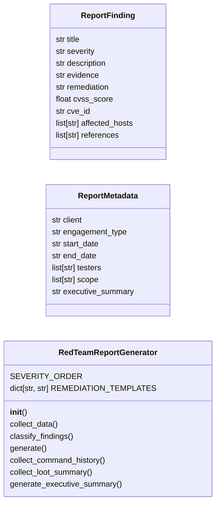
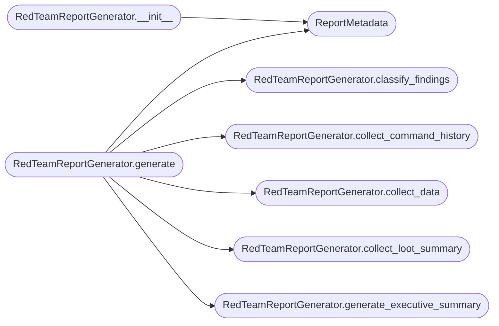

# `modules.professional_report`

> Source: [modules/professional_report.py:1](../../modules/professional_report.py#L1) | language `py` | coverage 90.9% | [API index](../index.md)

Professional Red Team Report Generator.

Produces client-ready pentest/red-team reports in HTML, PDF, and Markdown
formats. Reads from the world model, session data, and credential stores to
auto-generate structured findings with CVSS scores, evidence, and
remediation recommendations.

Architecture:
    DataCollector -> FindingClassifier -> RiskScorer -> ReportAssembler -> OutputWriter

Output formats:
    HTML  — standalone responsive page with collapsible sections and dark mode.
    PDF   — via wkhtmltopdf (if available) or weasyprint.
    MD    — markdown for further editing or wiki integration.
    JSON  — machine-readable findings for API/CI integration.

Security:
    No credentials in rendered reports by default — only usernames and hashes
    are included if ``include_credentials`` is explicitly set.

Usage:
    from modules.professional_report import RedTeamReportGenerator
    gen = RedTeamReportGenerator()
    gen.generate(output_dir="reports/")

## Contents

- **Classes:** [`ReportFinding`](#reportfinding), [`ReportMetadata`](#reportmetadata), [`RedTeamReportGenerator`](#redteamreportgenerator)

## Type Diagram



## Call Graph

Solid arrows stay in this module, dashed arrows leave it.



## Classes

<a id="reportfinding"></a>

### `ReportFinding`

`class` `dataclass` | [modules/professional_report.py:87](../../modules/professional_report.py#L87)

Decorators: `@dataclass`

```python
class ReportFinding
```

A single security finding for the report.

**Attributes**

| Name | Type | Default | Description |
|---|---|---|---|
| [`title`](#reportfinding-title) | `str` |  |  |
| [`severity`](#reportfinding-severity) | `str` |  |  |
| [`description`](#reportfinding-description) | `str` |  |  |
| [`evidence`](#reportfinding-evidence) | `str` | `''` |  |
| [`remediation`](#reportfinding-remediation) | `str` | `''` |  |
| [`cvss_score`](#reportfinding-cvss_score) | `float` | `0.0` |  |
| [`cve_id`](#reportfinding-cve_id) | `str` | `''` |  |
| [`affected_hosts`](#reportfinding-affected_hosts) | `list[str]` | `field(default_factory=list)` |  |
| [`references`](#reportfinding-references) | `list[str]` | `field(default_factory=list)` |  |

---

<a id="reportmetadata"></a>

### `ReportMetadata`

`class` `dataclass` | [modules/professional_report.py:102](../../modules/professional_report.py#L102)

Decorators: `@dataclass`

```python
class ReportMetadata
```

Report header metadata.

**Attributes**

| Name | Type | Default | Description |
|---|---|---|---|
| [`client`](#reportmetadata-client) | `str` | `'REDACTED'` |  |
| [`engagement_type`](#reportmetadata-engagement_type) | `str` | `'External Penetration Test'` |  |
| [`start_date`](#reportmetadata-start_date) | `str` | `''` |  |
| [`end_date`](#reportmetadata-end_date) | `str` | `''` |  |
| [`testers`](#reportmetadata-testers) | `list[str]` | `field(default_factory=list)` |  |
| [`scope`](#reportmetadata-scope) | `list[str]` | `field(default_factory=list)` |  |
| [`executive_summary`](#reportmetadata-executive_summary) | `str` | `''` |  |

---

<a id="redteamreportgenerator"></a>

### `RedTeamReportGenerator`

`class` | [modules/professional_report.py:114](../../modules/professional_report.py#L114)

```python
class RedTeamReportGenerator
```

Generate professional red team reports from session data.

Public methods:
    collect_data() -> dict
    classify_findings(data) -> list[ReportFinding]
    generate(output_dir, format) -> str

**Attributes**

| Name | Type | Default | Description |
|---|---|---|---|
| [`SEVERITY_ORDER`](#redteamreportgenerator-severity_order) |  | `{'critical': 0, 'high': 1, 'medium': 2, 'low': 3, 'info': 4}` |  |
| [`REMEDIATION_TEMPLATES`](#redteamreportgenerator-remediation_templates) | `dict[str, str]` | `{'default_credentials': 'Change all default credentials immediately. Implement a password policy requiring minimum 14 characters with complexity requirements. Enable account lockout after 5 failed attempts.', 'weak_password': 'Enforce strong password policies across all accounts. Require minimum 14 characters, uppercase, lowercase, numbers, and special characters. Implement MFA where possible.', 'unpatched_service': 'Apply vendor security patches immediately. Implement a regular patch management cycle with vulnerability scanning. Subscribe to vendor security advisories.', 'smb_signing_disabled': 'Enable SMB signing across all Windows systems via Group Policy. This prevents NTLM relay attacks and SMB man-in-the-middle.', 'ldap_signing': 'Enable LDAP signing and channel binding to prevent relay attacks. Configure via Group Policy: Network security: LDAP client signing requirements.', 'null_session': 'Disable anonymous SMB/NetBIOS access. Configure RestrictAnonymous=1 in the registry. Block ports 139/445 at the perimeter firewall.', 'kerberoasting': 'Use managed service accounts (MSAs/gMSAs) with long complex passwords. Audit SPNs regularly. Monitor Event ID 4769 for unusual TGS requests.', 'asrep_roasting': 'Disable Kerberos pre-authentication requirement only when absolutely necessary. Audit accounts with DONT_REQUIRE_PREAUTH flag.', 'exposed_service': 'Restrict exposed services to required IP ranges only. Implement network segmentation and zero-trust architecture. Use a VPN or bastion host for administrative access.', 'insecure_protocol': 'Disable legacy protocols (FTP, Telnet, SMBv1, HTTP where HTTPS is available). Migrate to encrypted alternatives with modern cipher suites.'}` |  |

**Members**

| Member | Kind | Summary |
|---|---|---|
| [`__init__`](#redteamreportgenerator-__init__) | constructor |  |
| [`collect_data`](#redteamreportgenerator-collect_data) | method | Collect all available engagement data from sessions directory. |
| [`classify_findings`](#redteamreportgenerator-classify_findings) | method | Classify collected data into structured findings. |
| [`generate`](#redteamreportgenerator-generate) | method | Generate the report in the specified format. |
| [`collect_command_history`](#redteamreportgenerator-collect_command_history) | method | Collect operator command history for the engagement timeline. |
| [`collect_loot_summary`](#redteamreportgenerator-collect_loot_summary) | method | Summarize exfiltrated loot without embedding sensitive content. |
| [`generate_executive_summary`](#redteamreportgenerator-generate_executive_summary) | method | Build the executive summary in business language. |

<a id="redteamreportgenerator-__init__"></a>

#### `RedTeamReportGenerator.__init__`

`constructor` | [modules/professional_report.py:173](../../modules/professional_report.py#L173)

```python
def __init__(self, include_credentials: bool = False) -> None
```

**Parameters**

| Name | Type | Default | Description |
|---|---|---|---|
| `include_credentials` | `bool` | `False` |  |

*Calls:* [`ReportMetadata`](#reportmetadata)

<a id="redteamreportgenerator-collect_data"></a>

#### `RedTeamReportGenerator.collect_data`

`method` | [modules/professional_report.py:179](../../modules/professional_report.py#L179)

```python
def collect_data(self) -> dict[str, Any]
```

Collect all available engagement data from sessions directory.

**Returns:** `dict[str, Any]` - Dict with world_model, scan_data, credentials, sessions, timeline.

*Called by:* [`RedTeamReportGenerator.generate`](#redteamreportgenerator-generate)

<a id="redteamreportgenerator-classify_findings"></a>

#### `RedTeamReportGenerator.classify_findings`

`method` | [modules/professional_report.py:217](../../modules/professional_report.py#L217)

```python
def classify_findings(self, data: dict[str, Any]) -> list[ReportFinding]
```

Classify collected data into structured findings.

**Parameters**

| Name | Type | Default | Description |
|---|---|---|---|
| `data` | `dict[str, Any]` |  | Data dict from collect_data(). |

**Returns:** `list[ReportFinding]` - List of classified ReportFinding objects.

*Called by:* [`RedTeamReportGenerator.generate`](#redteamreportgenerator-generate)

<a id="redteamreportgenerator-generate"></a>

#### `RedTeamReportGenerator.generate`

`method` | [modules/professional_report.py:244](../../modules/professional_report.py#L244)

```python
def generate(self, output_dir: str = 'reports', output_format: str = 'html', client_name: str = '', engagement_type: str = '', with_ai: bool = False, ai_backend: str = 'auto') -> str
```

Generate the report in the specified format.

**Parameters**

| Name | Type | Default | Description |
|---|---|---|---|
| `output_dir` | `str` | `'reports'` | Directory to write the report. |
| `output_format` | `str` | `'html'` | One of html, pdf, md, json. |
| `client_name` | `str` | `''` | Client name for the header. |
| `engagement_type` | `str` | `''` | Engagement type string. |
| `with_ai` | `bool` | `False` | When True, draft the executive summary with the LLM backend (Groq/Ollama via ``llm_factory``). |
| `ai_backend` | `str` | `'auto'` | Backend id passed to ``llm_factory``. |

**Returns:** `str` - Path to the generated report.

*Calls:* [`RedTeamReportGenerator.classify_findings`](#redteamreportgenerator-classify_findings), [`RedTeamReportGenerator.collect_command_history`](#redteamreportgenerator-collect_command_history), [`RedTeamReportGenerator.collect_data`](#redteamreportgenerator-collect_data), [`RedTeamReportGenerator.collect_loot_summary`](#redteamreportgenerator-collect_loot_summary), [`RedTeamReportGenerator.generate_executive_summary`](#redteamreportgenerator-generate_executive_summary), [`ReportMetadata`](#reportmetadata)

<a id="redteamreportgenerator-collect_command_history"></a>

#### `RedTeamReportGenerator.collect_command_history`

`method` | [modules/professional_report.py:841](../../modules/professional_report.py#L841)

```python
def collect_command_history(self, max_entries: int = 200) -> list[str]
```

Collect operator command history for the engagement timeline.

Sources: ``LazyOwn_history.dat`` and ``sessions/*.log`` tails.

**Parameters**

| Name | Type | Default | Description |
|---|---|---|---|
| `max_entries` | `int` | `200` | Maximum history lines to keep. |

**Returns:** `list[str]` - Ordered command history lines.

*Called by:* [`RedTeamReportGenerator.generate`](#redteamreportgenerator-generate)

<a id="redteamreportgenerator-collect_loot_summary"></a>

#### `RedTeamReportGenerator.collect_loot_summary`

`method` | [modules/professional_report.py:865](../../modules/professional_report.py#L865)

```python
def collect_loot_summary(self) -> dict[str, Any]
```

Summarize exfiltrated loot without embedding sensitive content.

Scans ``sessions/`` loot artefacts (QuantumVault output, credential
files, uploads) counting files and bytes per category. File names
are kept, file contents are never included.

**Returns:** `dict[str, Any]` - Dict with counts and total bytes per loot category.

*Called by:* [`RedTeamReportGenerator.generate`](#redteamreportgenerator-generate)

<a id="redteamreportgenerator-generate_executive_summary"></a>

#### `RedTeamReportGenerator.generate_executive_summary`

`method` | [modules/professional_report.py:911](../../modules/professional_report.py#L911)

```python
def generate_executive_summary(self, data: dict[str, Any], with_ai: bool = False, ai_backend: str = 'auto') -> str
```

Build the executive summary in business language.

Without AI this renders a deterministic template from finding
counts, loot stats, and command history depth. With ``with_ai``
the same context is sent to the ``llm_factory`` backend
(Groq/Ollama) to draft financial-risk prose; any backend failure
falls back to the template so reporting never blocks.

**Parameters**

| Name | Type | Default | Description |
|---|---|---|---|
| `data` | `dict[str, Any]` |  | Engagement data dict from `[`collect_data`](#redteamreportgenerator-collect_data)`. |
| `with_ai` | `bool` | `False` | Draft prose with the LLM backend. |
| `ai_backend` | `str` | `'auto'` | Backend id for ``llm_factory``. |

**Returns:** `str` - Executive summary string.

*Called by:* [`RedTeamReportGenerator.generate`](#redteamreportgenerator-generate)

---
