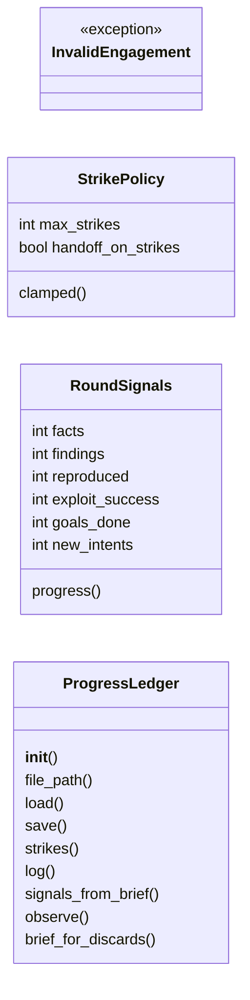
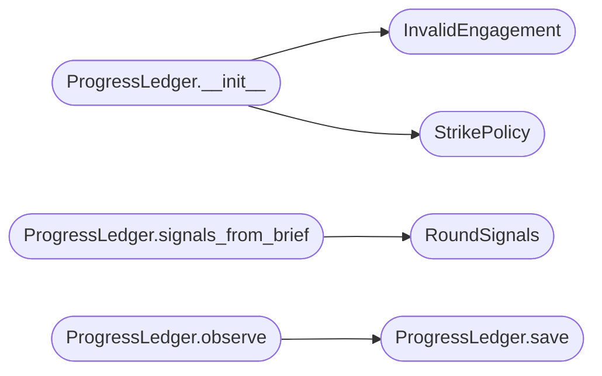

# `modules.progress_ledger`

> Source: [modules/progress_ledger.py:1](../../modules/progress_ledger.py#L1) | language `py` | coverage 100.0% | [API index](../index.md)

Objective-progress ledger: qualitative strikes against goal stagnation.

Contract: one small JSON state per engagement tracks consecutive rounds
without objective progress. Generating hypotheses (new intents) is never
progress; real evidence is: new facts or findings persisted, a retest
verdict that reproduced the issue, a confirmed exploit-class outcome, or a
goal marked done. Reaching `[`max_strikes`](#strikepolicy-max_strikes)` (operator-configurable, default
3) tells the engine to stop burning rounds and hand the decision back to
the operator with the durable finding ledger as context.

State lives at ``sessions/findings/progress_<task>.json`` so a crash or a
resume continues the strike count instead of resetting silently.

## Contents

- **Classes:** [`StrikePolicy`](#strikepolicy), [`RoundSignals`](#roundsignals), [`ProgressLedger`](#progressledger)
- **Exceptions:** [`InvalidEngagement`](#invalidengagement)
- **Constants:** [`PROGRESS_DIRNAME`](#progress_dirname), [`SIGNALS`](#signals), [`DEFAULT_MAX_STRIKES`](#default_max_strikes)

## Type Diagram



## Call Graph

Solid arrows stay in this module, dashed arrows leave it.



## Classes

<a id="strikepolicy"></a>

### `StrikePolicy`

`class` `dataclass` | [modules/progress_ledger.py:45](../../modules/progress_ledger.py#L45)

Decorators: `@dataclass(frozen=True)`

```python
class StrikePolicy
```

Numeric knobs of the strike rule, injected by the caller.

**Attributes**

| Name | Type | Default | Description |
|---|---|---|---|
| [`max_strikes`](#strikepolicy-max_strikes) | `int` | `DEFAULT_MAX_STRIKES` | Consecutive no-progress rounds before handoff. |
| [`handoff_on_strikes`](#strikepolicy-handoff_on_strikes) | `bool` | `True` | Whether reaching the cap ends the loop. |

**Members**

| Member | Kind | Summary |
|---|---|---|
| [`clamped`](#strikepolicy-clamped) | method | Return a copy with the strike cap forced into range. |

<a id="strikepolicy-clamped"></a>

#### `StrikePolicy.clamped`

`method` | [modules/progress_ledger.py:56](../../modules/progress_ledger.py#L56)

```python
def clamped(self) -> StrikePolicy
```

Return a copy with the strike cap forced into range.

**Returns:** `StrikePolicy`

---

<a id="roundsignals"></a>

### `RoundSignals`

`class` `dataclass` | [modules/progress_ledger.py:62](../../modules/progress_ledger.py#L62)

Decorators: `@dataclass(frozen=True)`

```python
class RoundSignals
```

Objective evidence delta of one round.

**Attributes**

| Name | Type | Default | Description |
|---|---|---|---|
| [`facts`](#roundsignals-facts) | `int` | `0` | New fact count over the round. |
| [`findings`](#roundsignals-findings) | `int` | `0` | New finding count over the round. |
| [`reproduced`](#roundsignals-reproduced) | `int` | `0` | Retest verdicts that reproduced a finding. |
| [`exploit_success`](#roundsignals-exploit_success) | `int` | `0` | Successful exploit-class outcomes. |
| [`goals_done`](#roundsignals-goals_done) | `int` | `0` | Goals newly marked done. |
| [`new_intents`](#roundsignals-new_intents) | `int` | `0` | Intents created by the planner (hypotheses). |

**Members**

| Member | Kind | Summary |
|---|---|---|
| [`progress`](#roundsignals-progress) | property | Return True when any objective-evidence signal fired. |

<a id="roundsignals-progress"></a>

#### `RoundSignals.progress`

`property` | [modules/progress_ledger.py:82](../../modules/progress_ledger.py#L82)

Decorators: `@property`

```python
def progress(self) -> bool
```

Return True when any objective-evidence signal fired.

**Returns:** `bool`

---

<a id="progressledger"></a>

### `ProgressLedger`

`class` | [modules/progress_ledger.py:100](../../modules/progress_ledger.py#L100)

```python
class ProgressLedger
```

Persisted strike counter for one engagement.

**Members**

| Member | Kind | Summary |
|---|---|---|
| [`__init__`](#progressledger-__init__) | constructor | Bind the ledger to one engagement. |
| [`file_path`](#progressledger-file_path) | property | Return the persisted strike state path. |
| [`load`](#progressledger-load) | method | Load persisted state, keeping any file intact on parse failure. |
| [`save`](#progressledger-save) | method | Persist the strike state with owner-only permissions. |
| [`strikes`](#progressledger-strikes) | property | Return the current consecutive no-progress strike count. |
| [`log`](#progressledger-log) | property | Return the recent strike/progress log rows. |
| [`signals_from_brief`](#progressledger-signals_from_brief) | method | Diff one graph/orchestrator brief against the stored previous one. |
| [`observe`](#progressledger-observe) | method | Record one round of signals and update the strike counter. |
| [`brief_for_discards`](#progressledger-brief_for_discards) | method | Return durable rows for the finding-ledger discard recorder. |

<a id="progressledger-__init__"></a>

#### `ProgressLedger.__init__`

`constructor` | [modules/progress_ledger.py:103](../../modules/progress_ledger.py#L103)

```python
def __init__(self, engagement_id: str, base_dir: str | os.PathLike[str], policy: StrikePolicy | None = None) -> None
```

Bind the ledger to one engagement.

**Parameters**

| Name | Type | Default | Description |
|---|---|---|---|
| `engagement_id` | `str` |  | Engagement/task id (safe path segment). |
| `base_dir` | `str \| os.PathLike[str]` |  | Root directory holding the `[`findings`](#roundsignals-findings)` folder. |
| `policy` | `StrikePolicy \| None` | `None` | Strike thresholds. |

**Raises**

- [`InvalidEngagement`](#invalidengagement): Unsafe engagement id.

*Calls:* [`InvalidEngagement`](#invalidengagement), [`StrikePolicy`](#strikepolicy)

<a id="progressledger-file_path"></a>

#### `ProgressLedger.file_path`

`property` | [modules/progress_ledger.py:128](../../modules/progress_ledger.py#L128)

Decorators: `@property`

```python
def file_path(self) -> Path
```

Return the persisted strike state path.

**Returns:** `Path`

<a id="progressledger-load"></a>

#### `ProgressLedger.load`

`method` | [modules/progress_ledger.py:132](../../modules/progress_ledger.py#L132)

```python
def load(self) -> ProgressLedger
```

Load persisted state, keeping any file intact on parse failure.

**Returns:** `ProgressLedger` - Self, for call chaining.

<a id="progressledger-save"></a>

#### `ProgressLedger.save`

`method` | [modules/progress_ledger.py:152](../../modules/progress_ledger.py#L152)

```python
def save(self) -> None
```

Persist the strike state with owner-only permissions.

*Called by:* [`ProgressLedger.observe`](#progressledger-observe)

<a id="progressledger-strikes"></a>

#### `ProgressLedger.strikes`

`property` | [modules/progress_ledger.py:167](../../modules/progress_ledger.py#L167)

Decorators: `@property`

```python
def strikes(self) -> int
```

Return the current consecutive no-progress strike count.

**Returns:** `int`

<a id="progressledger-log"></a>

#### `ProgressLedger.log`

`property` | [modules/progress_ledger.py:172](../../modules/progress_ledger.py#L172)

Decorators: `@property`

```python
def log(self) -> list[dict]
```

Return the recent strike/progress log rows.

**Returns:** `list[dict]`

<a id="progressledger-signals_from_brief"></a>

#### `ProgressLedger.signals_from_brief`

`method` | [modules/progress_ledger.py:176](../../modules/progress_ledger.py#L176)

```python
def signals_from_brief(self, brief: dict) -> RoundSignals
```

Diff one graph/orchestrator brief against the stored previous one.

The brief carries the objective counters (facts, findings, goals
done) accumulated by the engine and the per-round hypothesis count;
the diff yields positive evidence only when counters grew.

**Parameters**

| Name | Type | Default | Description |
|---|---|---|---|
| `brief` | `dict` |  | Mapping with `[`facts`](#roundsignals-facts)`/`[`findings`](#roundsignals-findings)`/`[`goals_done`](#roundsignals-goals_done)`/`[`new_intents`](#roundsignals-new_intents)`. |

**Returns:** `RoundSignals` - RoundSignals delta of this round.

*Calls:* [`RoundSignals`](#roundsignals)

<a id="progressledger-observe"></a>

#### `ProgressLedger.observe`

`method` | [modules/progress_ledger.py:208](../../modules/progress_ledger.py#L208)

```python
def observe(self, signals: RoundSignals, note: str = '') -> dict
```

Record one round of signals and update the strike counter.

Objective progress resets the strikes to zero; a hypothesis-only or
idle round increments. The decision field tells the engine whether
the cap was reached this round.

**Parameters**

| Name | Type | Default | Description |
|---|---|---|---|
| `signals` | `RoundSignals` |  | Round evidence delta. |
| `note` | `str` | `''` | Optional operator-visible context line. |

**Returns:** `dict` - ``{"progress": bool, "strikes": int, "decision": str, "max_strikes": int}``
where ``decision`` is ``"progress"``, ``"strike"`` or ``"handoff"``.

*Calls:* [`ProgressLedger.save`](#progressledger-save)

<a id="progressledger-brief_for_discards"></a>

#### `ProgressLedger.brief_for_discards`

`method` | [modules/progress_ledger.py:250](../../modules/progress_ledger.py#L250)

```python
def brief_for_discards(self) -> list[dict]
```

Return durable rows for the finding-ledger discard recorder.

**Returns:** `list[dict]` - Empty placeholder list; discarded vectors come from the
engine's round results, not this counter state.

---

## Exceptions

<a id="invalidengagement"></a>

### `InvalidEngagement`

`exception` | [modules/progress_ledger.py:40](../../modules/progress_ledger.py#L40)

```python
class InvalidEngagement(ValueError)
```

Bases: `ValueError`

The engagement id is not a safe path segment.

---

## Constants

<a id="progress_dirname"></a>

### `PROGRESS_DIRNAME`

`constant` | [modules/progress_ledger.py:24](../../modules/progress_ledger.py#L24)

```python
PROGRESS_DIRNAME = 'findings'
```

---

<a id="signals"></a>

### `SIGNALS`

`constant` | [modules/progress_ledger.py:28](../../modules/progress_ledger.py#L28)

```python
SIGNALS: tuple[str, ...] = ('facts', 'findings', 'reproduced', 'exploit_success', 'goals_done')
```

---

<a id="default_max_strikes"></a>

### `DEFAULT_MAX_STRIKES`

`constant` | [modules/progress_ledger.py:30](../../modules/progress_ledger.py#L30)

```python
DEFAULT_MAX_STRIKES = 3
```

---
