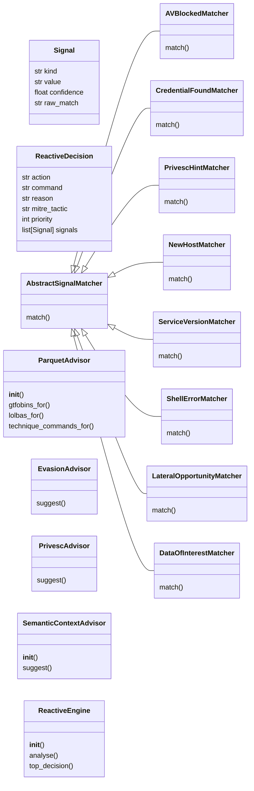

# `modules.reactive_engine`

> Source: [modules/reactive_engine.py:1](../../modules/reactive_engine.py#L1) | language `py` | coverage 57.9% | [API index](../index.md)

modules/reactive_engine.py =========================== Parses command output and produces concrete next-action recommendations: - PrivEsc advice (GTFOBins / LOLBas / lazyaddons YAML) - Evasion advice when AV/EDR signatures detected in output - Parquet technique lookup (Atomic Red Team + MITRE) - Output-driven state inference (new creds, new host, shells)

Design (SOLID)
--------------
- Single Responsibility : OutputParser, PrivescAdvisor, EvasionAdvisor,
                          ParquetLookup each own one concern.
- Open/Closed           : new signal detectors via new SignalMatcher subclass.
- Liskov                : all SignalMatcher subclasses honour Optional[Signal].
- Interface Segregation : ReactiveEngine exposes only analyse() to callers.
- Dependency Inversion  : ReactiveEngine depends on AbstractSignalMatcher.

## Contents

- **Classes:** [`Signal`](#signal), [`ReactiveDecision`](#reactivedecision), [`AbstractSignalMatcher`](#abstractsignalmatcher), [`AVBlockedMatcher`](#avblockedmatcher), [`CredentialFoundMatcher`](#credentialfoundmatcher), [`PrivescHintMatcher`](#priveschintmatcher), [`NewHostMatcher`](#newhostmatcher), [`ServiceVersionMatcher`](#serviceversionmatcher), [`ShellErrorMatcher`](#shellerrormatcher), [`LateralOpportunityMatcher`](#lateralopportunitymatcher), [`DataOfInterestMatcher`](#dataofinterestmatcher), [`ParquetAdvisor`](#parquetadvisor), [`EvasionAdvisor`](#evasionadvisor), [`PrivescAdvisor`](#privescadvisor), [`SemanticContextAdvisor`](#semanticcontextadvisor), [`ReactiveEngine`](#reactiveengine)
- **Functions:** [`get_engine`](#get_engine)
- **Constants:** [`SEMANTIC_MIN_SCORE`](#semantic_min_score), [`SEMANTIC_QUERY_LIMIT`](#semantic_query_limit), [`SEMANTIC_OUTPUT_LIMIT`](#semantic_output_limit), [`SEMANTIC_REASON_LIMIT`](#semantic_reason_limit), [`SEMANTIC_MITRE_TACTIC`](#semantic_mitre_tactic), [`SEMANTIC_PRIORITY`](#semantic_priority), [`SEMANTIC_FILENAME_PATTERN`](#semantic_filename_pattern), [`SEMANTIC_PAYLOAD_KEY`](#semantic_payload_key)

## Type Diagram



## Call Graph

Solid arrows stay in this module, dashed arrows leave it.

```mermaid
flowchart LR
    n_modules_reactive_engine_py__AVBlockedMatcher_match(["AVBlockedMatcher.match"])
    n_modules_reactive_engine_py__Signal(["Signal"])
    n_modules_reactive_engine_py__CredentialFoundMatcher_match(["CredentialFoundMatcher.match"])
    n_modules_reactive_engine_py__PrivescHintMatcher_match(["PrivescHintMatcher.match"])
    n_modules_reactive_engine_py__NewHostMatcher_match(["NewHostMatcher.match"])
    n_modules_reactive_engine_py__ServiceVersionMatcher_match(["ServiceVersionMatcher.match"])
    n_modules_reactive_engine_py__ShellErrorMatcher_match(["ShellErrorMatcher.match"])
    n_modules_reactive_engine_py__LateralOpportunityMatcher_match(["LateralOpportunityMatcher.match"])
    n_modules_reactive_engine_py__DataOfInterestMatcher_match(["DataOfInterestMatcher.match"])
    n_modules_reactive_engine_py__EvasionAdvisor_suggest(["EvasionAdvisor.suggest"])
    n_modules_reactive_engine_py__ReactiveDecision(["ReactiveDecision"])
    n_modules_reactive_engine_py__PrivescAdvisor_suggest(["PrivescAdvisor.suggest"])
    n_modules_reactive_engine_py__ParquetAdvisor_gtfobins_for(["ParquetAdvisor.gtfobins_for"])
    n_modules_reactive_engine_py__SemanticContextAdvisor_suggest(["SemanticContextAdvisor.suggest"])
    n_modules_reactive_engine_py__ReactiveEngine___init__(["ReactiveEngine.__init__"])
    n_modules_reactive_engine_py__AVBlockedMatcher(["AVBlockedMatcher"])
    n_modules_reactive_engine_py__CredentialFoundMatcher(["CredentialFoundMatcher"])
    n_modules_reactive_engine_py__DataOfInterestMatcher(["DataOfInterestMatcher"])
    n_modules_reactive_engine_py__EvasionAdvisor(["EvasionAdvisor"])
    n_modules_reactive_engine_py__LateralOpportunityMatcher(["LateralOpportunityMatcher"])
    n_modules_reactive_engine_py__NewHostMatcher(["NewHostMatcher"])
    n_modules_reactive_engine_py__ParquetAdvisor___init__(["ParquetAdvisor.__init__"])
    n_modules_reactive_engine_py__PrivescAdvisor(["PrivescAdvisor"])
    n_modules_reactive_engine_py__PrivescHintMatcher(["PrivescHintMatcher"])
    n_modules_reactive_engine_py__SemanticContextAdvisor___init__(["SemanticContextAdvisor.__init__"])
    n_modules_reactive_engine_py__ServiceVersionMatcher(["ServiceVersionMatcher"])
    n_modules_reactive_engine_py__ShellErrorMatcher(["ShellErrorMatcher"])
    n_modules_reactive_engine_py__AVBlockedMatcher_match --> n_modules_reactive_engine_py__Signal
    n_modules_reactive_engine_py__CredentialFoundMatcher_match --> n_modules_reactive_engine_py__Signal
    n_modules_reactive_engine_py__PrivescHintMatcher_match --> n_modules_reactive_engine_py__Signal
    n_modules_reactive_engine_py__NewHostMatcher_match --> n_modules_reactive_engine_py__Signal
    n_modules_reactive_engine_py__ServiceVersionMatcher_match --> n_modules_reactive_engine_py__Signal
    n_modules_reactive_engine_py__ShellErrorMatcher_match --> n_modules_reactive_engine_py__Signal
    n_modules_reactive_engine_py__LateralOpportunityMatcher_match --> n_modules_reactive_engine_py__Signal
    n_modules_reactive_engine_py__DataOfInterestMatcher_match --> n_modules_reactive_engine_py__Signal
    n_modules_reactive_engine_py__EvasionAdvisor_suggest --> n_modules_reactive_engine_py__ReactiveDecision
    n_modules_reactive_engine_py__PrivescAdvisor_suggest --> n_modules_reactive_engine_py__ParquetAdvisor_gtfobins_for
    n_modules_reactive_engine_py__PrivescAdvisor_suggest --> n_modules_reactive_engine_py__ReactiveDecision
    n_modules_reactive_engine_py__SemanticContextAdvisor_suggest --> n_modules_reactive_engine_py__ReactiveDecision
    n_modules_reactive_engine_py__ReactiveEngine___init__ --> n_modules_reactive_engine_py__AVBlockedMatcher
    n_modules_reactive_engine_py__ReactiveEngine___init__ --> n_modules_reactive_engine_py__CredentialFoundMatcher
    n_modules_reactive_engine_py__ReactiveEngine___init__ --> n_modules_reactive_engine_py__DataOfInterestMatcher
    n_modules_reactive_engine_py__ReactiveEngine___init__ --> n_modules_reactive_engine_py__EvasionAdvisor
    n_modules_reactive_engine_py__ReactiveEngine___init__ --> n_modules_reactive_engine_py__LateralOpportunityMatcher
    n_modules_reactive_engine_py__ReactiveEngine___init__ --> n_modules_reactive_engine_py__NewHostMatcher
    n_modules_reactive_engine_py__ReactiveEngine___init__ --> n_modules_reactive_engine_py__ParquetAdvisor___init__
    n_modules_reactive_engine_py__ReactiveEngine___init__ --> n_modules_reactive_engine_py__PrivescAdvisor
    n_modules_reactive_engine_py__ReactiveEngine___init__ --> n_modules_reactive_engine_py__PrivescHintMatcher
    n_modules_reactive_engine_py__ReactiveEngine___init__ --> n_modules_reactive_engine_py__SemanticContextAdvisor___init__
    n_modules_reactive_engine_py__ReactiveEngine___init__ --> n_modules_reactive_engine_py__ServiceVersionMatcher
    n_modules_reactive_engine_py__ReactiveEngine___init__ --> n_modules_reactive_engine_py__ShellErrorMatcher
```



## Classes

<a id="signal"></a>

### `Signal`

`class` `dataclass` | [modules/reactive_engine.py:69](../../modules/reactive_engine.py#L69)

Decorators: `@dataclass`

```python
class Signal
```

A detected indicator in command output.

**Attributes**

| Name | Type | Default | Description |
|---|---|---|---|
| [`kind`](#signal-kind) | `str` |  |  |
| [`value`](#signal-value) | `str` |  |  |
| [`confidence`](#signal-confidence) | `float` |  |  |
| [`raw_match`](#signal-raw_match) | `str` |  |  |

---

<a id="reactivedecision"></a>

### `ReactiveDecision`

`class` `dataclass` | [modules/reactive_engine.py:80](../../modules/reactive_engine.py#L80)

Decorators: `@dataclass`

```python
class ReactiveDecision
```

What the autonomous loop should do next given the signals.

**Attributes**

| Name | Type | Default | Description |
|---|---|---|---|
| [`action`](#reactivedecision-action) | `str` |  |  |
| [`command`](#reactivedecision-command) | `str` |  |  |
| [`reason`](#reactivedecision-reason) | `str` |  |  |
| [`mitre_tactic`](#reactivedecision-mitre_tactic) | `str` | `''` |  |
| [`priority`](#reactivedecision-priority) | `int` | `5` |  |
| [`signals`](#reactivedecision-signals) | `list[Signal]` | `field(default_factory=list)` |  |

---

<a id="abstractsignalmatcher"></a>

### `AbstractSignalMatcher`

`class` `abstract` | [modules/reactive_engine.py:97](../../modules/reactive_engine.py#L97)

```python
class AbstractSignalMatcher(ABC)
```

Bases: `ABC`

Subclasses: [`AVBlockedMatcher`](#avblockedmatcher), [`CredentialFoundMatcher`](#credentialfoundmatcher), [`DataOfInterestMatcher`](#dataofinterestmatcher), [`LateralOpportunityMatcher`](#lateralopportunitymatcher), [`NewHostMatcher`](#newhostmatcher), [`PrivescHintMatcher`](#priveschintmatcher), [`ServiceVersionMatcher`](#serviceversionmatcher), [`ShellErrorMatcher`](#shellerrormatcher)

**Members**

| Member | Kind | Summary |
|---|---|---|
| [`match`](#abstractsignalmatcher-match) | method |  |

<a id="abstractsignalmatcher-match"></a>

#### `AbstractSignalMatcher.match`

`method` `abstract` | [modules/reactive_engine.py:99](../../modules/reactive_engine.py#L99)

Decorators: `@abstractmethod`

```python
def match(self, output: str, context: dict) -> list[Signal]
```

**Parameters**

| Name | Type | Default | Description |
|---|---|---|---|
| `output` | `str` |  |  |
| `context` | `dict` |  |  |

**Returns:** `list[Signal]`

---

<a id="avblockedmatcher"></a>

### `AVBlockedMatcher`

`class` | [modules/reactive_engine.py:102](../../modules/reactive_engine.py#L102)

```python
class AVBlockedMatcher(AbstractSignalMatcher)
```

Bases: [`AbstractSignalMatcher`](#abstractsignalmatcher)

Detects AV/EDR blocking patterns in tool output.

**Members**

| Member | Kind | Summary |
|---|---|---|
| [`match`](#avblockedmatcher-match) | method |  |

<a id="avblockedmatcher-match"></a>

#### `AVBlockedMatcher.match`

`method` | [modules/reactive_engine.py:128](../../modules/reactive_engine.py#L128)

```python
def match(self, output: str, context: dict) -> list[Signal]
```

**Parameters**

| Name | Type | Default | Description |
|---|---|---|---|
| `output` | `str` |  |  |
| `context` | `dict` |  |  |

**Returns:** `list[Signal]`

*Calls:* [`Signal`](#signal)

---

<a id="credentialfoundmatcher"></a>

### `CredentialFoundMatcher`

`class` | [modules/reactive_engine.py:147](../../modules/reactive_engine.py#L147)

```python
class CredentialFoundMatcher(AbstractSignalMatcher)
```

Bases: [`AbstractSignalMatcher`](#abstractsignalmatcher)

Detects credentials in command output.

**Members**

| Member | Kind | Summary |
|---|---|---|
| [`match`](#credentialfoundmatcher-match) | method |  |

<a id="credentialfoundmatcher-match"></a>

#### `CredentialFoundMatcher.match`

`method` | [modules/reactive_engine.py:159](../../modules/reactive_engine.py#L159)

```python
def match(self, output: str, context: dict) -> list[Signal]
```

**Parameters**

| Name | Type | Default | Description |
|---|---|---|---|
| `output` | `str` |  |  |
| `context` | `dict` |  |  |

**Returns:** `list[Signal]`

*Calls:* [`Signal`](#signal)

---

<a id="priveschintmatcher"></a>

### `PrivescHintMatcher`

`class` | [modules/reactive_engine.py:174](../../modules/reactive_engine.py#L174)

```python
class PrivescHintMatcher(AbstractSignalMatcher)
```

Bases: [`AbstractSignalMatcher`](#abstractsignalmatcher)

Detects indicators that privesc may be possible.

**Members**

| Member | Kind | Summary |
|---|---|---|
| [`match`](#priveschintmatcher-match) | method |  |

<a id="priveschintmatcher-match"></a>

#### `PrivescHintMatcher.match`

`method` | [modules/reactive_engine.py:192](../../modules/reactive_engine.py#L192)

```python
def match(self, output: str, context: dict) -> list[Signal]
```

**Parameters**

| Name | Type | Default | Description |
|---|---|---|---|
| `output` | `str` |  |  |
| `context` | `dict` |  |  |

**Returns:** `list[Signal]`

*Calls:* [`Signal`](#signal)

---

<a id="newhostmatcher"></a>

### `NewHostMatcher`

`class` | [modules/reactive_engine.py:209](../../modules/reactive_engine.py#L209)

```python
class NewHostMatcher(AbstractSignalMatcher)
```

Bases: [`AbstractSignalMatcher`](#abstractsignalmatcher)

Detects new IP addresses in command output.

**Members**

| Member | Kind | Summary |
|---|---|---|
| [`match`](#newhostmatcher-match) | method |  |

<a id="newhostmatcher-match"></a>

#### `NewHostMatcher.match`

`method` | [modules/reactive_engine.py:214](../../modules/reactive_engine.py#L214)

```python
def match(self, output: str, context: dict) -> list[Signal]
```

**Parameters**

| Name | Type | Default | Description |
|---|---|---|---|
| `output` | `str` |  |  |
| `context` | `dict` |  |  |

**Returns:** `list[Signal]`

*Calls:* [`Signal`](#signal)

---

<a id="serviceversionmatcher"></a>

### `ServiceVersionMatcher`

`class` | [modules/reactive_engine.py:232](../../modules/reactive_engine.py#L232)

```python
class ServiceVersionMatcher(AbstractSignalMatcher)
```

Bases: [`AbstractSignalMatcher`](#abstractsignalmatcher)

Extracts service version strings for exploit matching.

**Members**

| Member | Kind | Summary |
|---|---|---|
| [`match`](#serviceversionmatcher-match) | method |  |

<a id="serviceversionmatcher-match"></a>

#### `ServiceVersionMatcher.match`

`method` | [modules/reactive_engine.py:247](../../modules/reactive_engine.py#L247)

```python
def match(self, output: str, context: dict) -> list[Signal]
```

**Parameters**

| Name | Type | Default | Description |
|---|---|---|---|
| `output` | `str` |  |  |
| `context` | `dict` |  |  |

**Returns:** `list[Signal]`

*Calls:* [`Signal`](#signal)

---

<a id="shellerrormatcher"></a>

### `ShellErrorMatcher`

`class` | [modules/reactive_engine.py:262](../../modules/reactive_engine.py#L262)

```python
class ShellErrorMatcher(AbstractSignalMatcher)
```

Bases: [`AbstractSignalMatcher`](#abstractsignalmatcher)

Detects tool errors that warrant switching techniques.

**Members**

| Member | Kind | Summary |
|---|---|---|
| [`match`](#shellerrormatcher-match) | method |  |

<a id="shellerrormatcher-match"></a>

#### `ShellErrorMatcher.match`

`method` | [modules/reactive_engine.py:276](../../modules/reactive_engine.py#L276)

```python
def match(self, output: str, context: dict) -> list[Signal]
```

**Parameters**

| Name | Type | Default | Description |
|---|---|---|---|
| `output` | `str` |  |  |
| `context` | `dict` |  |  |

**Returns:** `list[Signal]`

*Calls:* [`Signal`](#signal)

---

<a id="lateralopportunitymatcher"></a>

### `LateralOpportunityMatcher`

`class` | [modules/reactive_engine.py:293](../../modules/reactive_engine.py#L293)

```python
class LateralOpportunityMatcher(AbstractSignalMatcher)
```

Bases: [`AbstractSignalMatcher`](#abstractsignalmatcher)

Detects opportunities for lateral movement in command output.

**Members**

| Member | Kind | Summary |
|---|---|---|
| [`match`](#lateralopportunitymatcher-match) | method |  |

<a id="lateralopportunitymatcher-match"></a>

#### `LateralOpportunityMatcher.match`

`method` | [modules/reactive_engine.py:307](../../modules/reactive_engine.py#L307)

```python
def match(self, output: str, context: dict) -> list[Signal]
```

**Parameters**

| Name | Type | Default | Description |
|---|---|---|---|
| `output` | `str` |  |  |
| `context` | `dict` |  |  |

**Returns:** `list[Signal]`

*Calls:* [`Signal`](#signal)

---

<a id="dataofinterestmatcher"></a>

### `DataOfInterestMatcher`

`class` | [modules/reactive_engine.py:323](../../modules/reactive_engine.py#L323)

```python
class DataOfInterestMatcher(AbstractSignalMatcher)
```

Bases: [`AbstractSignalMatcher`](#abstractsignalmatcher)

Detects data of interest for exfiltration in command output.

**Members**

| Member | Kind | Summary |
|---|---|---|
| [`match`](#dataofinterestmatcher-match) | method |  |

<a id="dataofinterestmatcher-match"></a>

#### `DataOfInterestMatcher.match`

`method` | [modules/reactive_engine.py:349](../../modules/reactive_engine.py#L349)

```python
def match(self, output: str, context: dict) -> list[Signal]
```

**Parameters**

| Name | Type | Default | Description |
|---|---|---|---|
| `output` | `str` |  |  |
| `context` | `dict` |  |  |

**Returns:** `list[Signal]`

*Calls:* [`Signal`](#signal)

---

<a id="parquetadvisor"></a>

### `ParquetAdvisor`

`class` | [modules/reactive_engine.py:389](../../modules/reactive_engine.py#L389)

```python
class ParquetAdvisor
```

Queries parquet DBs for binary-based privesc and LOLBas opportunities.

Gracefully returns [] when pandas or parquet files are unavailable.

**Members**

| Member | Kind | Summary |
|---|---|---|
| [`__init__`](#parquetadvisor-__init__) | constructor |  |
| [`gtfobins_for`](#parquetadvisor-gtfobins_for) | method |  |
| [`lolbas_for`](#parquetadvisor-lolbas_for) | method | Returns [(function_name, att&ck_technique), ...]. |
| [`technique_commands_for`](#parquetadvisor-technique_commands_for) | method | Return atomic test commands for platform matching keyword. |

<a id="parquetadvisor-__init__"></a>

#### `ParquetAdvisor.__init__`

`constructor` | [modules/reactive_engine.py:395](../../modules/reactive_engine.py#L395)

```python
def __init__(self, root: Path = _ROOT) -> None
```

**Parameters**

| Name | Type | Default | Description |
|---|---|---|---|
| `root` | `Path` | `_ROOT` |  |

*Called by:* [`ReactiveEngine.__init__`](#reactiveengine-__init__)

<a id="parquetadvisor-gtfobins_for"></a>

#### `ParquetAdvisor.gtfobins_for`

`method` | [modules/reactive_engine.py:421](../../modules/reactive_engine.py#L421)

```python
def gtfobins_for(self, binary: str) -> list[str]
```

**Parameters**

| Name | Type | Default | Description |
|---|---|---|---|
| `binary` | `str` |  |  |

**Returns:** `list[str]`

*Called by:* [`PrivescAdvisor.suggest`](#privescadvisor-suggest)

<a id="parquetadvisor-lolbas_for"></a>

#### `ParquetAdvisor.lolbas_for`

`method` | [modules/reactive_engine.py:434](../../modules/reactive_engine.py#L434)

```python
def lolbas_for(self, binary: str) -> list[tuple[str, str]]
```

Returns [(function_name, att&ck_technique), ...].

**Parameters**

| Name | Type | Default | Description |
|---|---|---|---|
| `binary` | `str` |  |  |

**Returns:** `list[tuple[str, str]]`

<a id="parquetadvisor-technique_commands_for"></a>

#### `ParquetAdvisor.technique_commands_for`

`method` | [modules/reactive_engine.py:448](../../modules/reactive_engine.py#L448)

```python
def technique_commands_for(self, platform: str, keyword: str) -> list[str]
```

Return atomic test commands for platform matching keyword.

**Parameters**

| Name | Type | Default | Description |
|---|---|---|---|
| `platform` | `str` |  |  |
| `keyword` | `str` |  |  |

**Returns:** `list[str]`

---

<a id="evasionadvisor"></a>

### `EvasionAdvisor`

`class` | [modules/reactive_engine.py:481](../../modules/reactive_engine.py#L481)

```python
class EvasionAdvisor
```

Maps detected AV/EDR signals to concrete LazyOwn evasion commands.

Uses lazyaddons YAML (adversary_yaml) for Windows; native commands for Linux.

**Members**

| Member | Kind | Summary |
|---|---|---|
| [`suggest`](#evasionadvisor-suggest) | method |  |

<a id="evasionadvisor-suggest"></a>

#### `EvasionAdvisor.suggest`

`method` | [modules/reactive_engine.py:504](../../modules/reactive_engine.py#L504)

```python
def suggest(self, signals: list[Signal], platform: str) -> list[ReactiveDecision]
```

**Parameters**

| Name | Type | Default | Description |
|---|---|---|---|
| `signals` | `list[Signal]` |  |  |
| `platform` | `str` |  |  |

**Returns:** `list[ReactiveDecision]`

*Calls:* [`ReactiveDecision`](#reactivedecision)

---

<a id="privescadvisor"></a>

### `PrivescAdvisor`

`class` | [modules/reactive_engine.py:537](../../modules/reactive_engine.py#L537)

```python
class PrivescAdvisor
```

Suggests privilege escalation commands based on: - detected privesc hints in output - platform (linux vs windows) - GTFOBins / LOLBas parquet lookup - lazyaddons YAML (adversary_yaml)

**Members**

| Member | Kind | Summary |
|---|---|---|
| [`suggest`](#privescadvisor-suggest) | method |  |

<a id="privescadvisor-suggest"></a>

#### `PrivescAdvisor.suggest`

`method` | [modules/reactive_engine.py:565](../../modules/reactive_engine.py#L565)

```python
def suggest(self, signals: list[Signal], platform: str, parquet: ParquetAdvisor | None = None) -> list[ReactiveDecision]
```

**Parameters**

| Name | Type | Default | Description |
|---|---|---|---|
| `signals` | `list[Signal]` |  |  |
| `platform` | `str` |  |  |
| `parquet` | `ParquetAdvisor \| None` | `None` |  |

**Returns:** `list[ReactiveDecision]`

*Calls:* [`ParquetAdvisor.gtfobins_for`](#parquetadvisor-gtfobins_for), [`ReactiveDecision`](#reactivedecision)

---

<a id="semanticcontextadvisor"></a>

### `SemanticContextAdvisor`

`class` | [modules/reactive_engine.py:632](../../modules/reactive_engine.py#L632)

```python
class SemanticContextAdvisor
```

Suggest follow-up commands by semantic similarity to past sessions.

Last-resort hint that only fires when the regex-based matchers and
advisors produce nothing useful. Relies on
[`modules.session_rag.SessionRAG`](modules.session_rag.py.md#sessionrag) (ChromaDB when available,
keyword fallback otherwise) so it carries no extra runtime
dependency. When the RAG layer is missing or the operator disabled
it via ``payload.json[reactive_semantic_enabled]``, the advisor
silently returns an empty list — never breaking the regex pipeline.

**Members**

| Member | Kind | Summary |
|---|---|---|
| [`__init__`](#semanticcontextadvisor-__init__) | constructor | Initialise the advisor. |
| [`suggest`](#semanticcontextadvisor-suggest) | method | Return semantic next-step hints derived from past sessions. |

<a id="semanticcontextadvisor-__init__"></a>

#### `SemanticContextAdvisor.__init__`

`constructor` | [modules/reactive_engine.py:644](../../modules/reactive_engine.py#L644)

```python
def __init__(self, rag: Any | None = None, config_loader: Any | None = None, min_score: float = SEMANTIC_MIN_SCORE, query_limit: int = SEMANTIC_QUERY_LIMIT) -> None
```

Initialise the advisor.

**Parameters**

| Name | Type | Default | Description |
|---|---|---|---|
| `rag` | `Any \| None` | `None` | Optional pre-built RAG instance. Injected in tests; in production the singleton from `[`modules.session_rag`](modules.session_rag.py.md)` is loaded lazily on first [`suggest`](cli.fuzzy_match.py.md#suggest) call. |
| `config_loader` | `Any \| None` | `None` | Callable returning a payload dictionary. Used only to gate the advisor via [`SEMANTIC_PAYLOAD_KEY`](#semantic_payload_key). Falsy return values disable the advisor for that call. |
| `min_score` | `float` | `SEMANTIC_MIN_SCORE` | Minimum cosine similarity score to keep a hit. |
| `query_limit` | `int` | `SEMANTIC_QUERY_LIMIT` | Maximum number of RAG hits to request per call. |

*Called by:* [`ReactiveEngine.__init__`](#reactiveengine-__init__)

<a id="semanticcontextadvisor-suggest"></a>

#### `SemanticContextAdvisor.suggest`

`method` | [modules/reactive_engine.py:734](../../modules/reactive_engine.py#L734)

```python
def suggest(self, output: str, command: str = '', platform: str = 'unknown', context: dict[str, Any] | None = None) -> list[ReactiveDecision]
```

Return semantic next-step hints derived from past sessions.

**Parameters**

| Name | Type | Default | Description |
|---|---|---|---|
| `output` | `str` |  | Raw stdout+stderr from the executed command. |
| `command` | `str` | `''` | The command that produced *output*. |
| `platform` | `str` | `'unknown'` | Target platform tag (informational; not currently used to filter hits). |
| `context` | `dict[str, Any] \| None` | `None` | Reserved for future extensions. |

**Returns:** `list[ReactiveDecision]` - Zero or more [`ReactiveDecision`](#reactivedecision) with action
``"suggest_next"`` and priority
[`SEMANTIC_PRIORITY`](#semantic_priority) so regex-based decisions always
outrank the semantic hint.

*Calls:* [`ReactiveDecision`](#reactivedecision)

---

<a id="reactiveengine"></a>

### `ReactiveEngine`

`class` | [modules/reactive_engine.py:804](../../modules/reactive_engine.py#L804)

```python
class ReactiveEngine
```

Analyses command output and produces prioritised ReactiveDecisions.

Wire into the auto_loop after each step to close the reasoning cycle.

**Members**

| Member | Kind | Summary |
|---|---|---|
| [`__init__`](#reactiveengine-__init__) | constructor |  |
| [`analyse`](#reactiveengine-analyse) | method | Parse *output* and return prioritised ReactiveDecisions. |
| [`top_decision`](#reactiveengine-top_decision) | method | Return only the single highest-priority decision, or None. |

<a id="reactiveengine-__init__"></a>

#### `ReactiveEngine.__init__`

`constructor` | [modules/reactive_engine.py:810](../../modules/reactive_engine.py#L810)

```python
def __init__(self, matchers: list[AbstractSignalMatcher] | None = None, evasion: EvasionAdvisor | None = None, privesc: PrivescAdvisor | None = None, parquet: ParquetAdvisor | None = None, semantic: SemanticContextAdvisor | None = None) -> None
```

**Parameters**

| Name | Type | Default | Description |
|---|---|---|---|
| `matchers` | `list[AbstractSignalMatcher] \| None` | `None` |  |
| `evasion` | `EvasionAdvisor \| None` | `None` |  |
| `privesc` | `PrivescAdvisor \| None` | `None` |  |
| `parquet` | `ParquetAdvisor \| None` | `None` |  |
| `semantic` | `SemanticContextAdvisor \| None` | `None` |  |

*Calls:* [`AVBlockedMatcher`](#avblockedmatcher), [`CredentialFoundMatcher`](#credentialfoundmatcher), [`DataOfInterestMatcher`](#dataofinterestmatcher), [`EvasionAdvisor`](#evasionadvisor), [`LateralOpportunityMatcher`](#lateralopportunitymatcher), [`NewHostMatcher`](#newhostmatcher), [`ParquetAdvisor.__init__`](#parquetadvisor-__init__), [`PrivescAdvisor`](#privescadvisor), [`PrivescHintMatcher`](#priveschintmatcher), [`SemanticContextAdvisor.__init__`](#semanticcontextadvisor-__init__), [`ServiceVersionMatcher`](#serviceversionmatcher), [`ShellErrorMatcher`](#shellerrormatcher)

*Called by:* [`get_engine`](#get_engine), [`AutonomousAgent.__init__`](skills.toposwarm_autonomous.py.md#autonomousagent-__init__)

<a id="reactiveengine-analyse"></a>

#### `ReactiveEngine.analyse`

`method` | [modules/reactive_engine.py:835](../../modules/reactive_engine.py#L835)

```python
def analyse(self, output: str, command: str = '', platform: str = 'unknown', context: dict | None = None) -> list[ReactiveDecision]
```

Parse *output* and return prioritised ReactiveDecisions.

**Parameters**

| Name | Type | Default | Description |
|---|---|---|---|
| `output` | `str` |  |  |
| `command` | `str` | `''` |  |
| `platform` | `str` | `'unknown'` |  |
| `context` | `dict \| None` | `None` |  |

**Returns:** `list[ReactiveDecision]`

*Calls:* [`ReactiveDecision`](#reactivedecision)

*Called by:* [`ReactiveEngine.top_decision`](#reactiveengine-top_decision)

<a id="reactiveengine-top_decision"></a>

#### `ReactiveEngine.top_decision`

`method` | [modules/reactive_engine.py:958](../../modules/reactive_engine.py#L958)

```python
def top_decision(self, output: str, command: str = '', platform: str = 'unknown', context: dict | None = None) -> ReactiveDecision | None
```

Return only the single highest-priority decision, or None.

**Parameters**

| Name | Type | Default | Description |
|---|---|---|---|
| `output` | `str` |  |  |
| `command` | `str` | `''` |  |
| `platform` | `str` | `'unknown'` |  |
| `context` | `dict \| None` | `None` |  |

**Returns:** `ReactiveDecision | None`

*Calls:* [`ReactiveEngine.analyse`](#reactiveengine-analyse)

---

## Functions

<a id="get_engine"></a>

### `get_engine`

`function` | [modules/reactive_engine.py:977](../../modules/reactive_engine.py#L977)

```python
def get_engine() -> ReactiveEngine
```

**Returns:** `ReactiveEngine`

*Calls:* [`ReactiveEngine.__init__`](#reactiveengine-__init__)

*Called by:* [`build_reactive_replanner`](cli.apt_chain_support.py.md#build_reactive_replanner)

---

## Constants

<a id="semantic_min_score"></a>

### `SEMANTIC_MIN_SCORE`

`constant` | [modules/reactive_engine.py:32](../../modules/reactive_engine.py#L32)

```python
SEMANTIC_MIN_SCORE: float = 0.55
```

---

<a id="semantic_query_limit"></a>

### `SEMANTIC_QUERY_LIMIT`

`constant` | [modules/reactive_engine.py:33](../../modules/reactive_engine.py#L33)

```python
SEMANTIC_QUERY_LIMIT: int = 3
```

---

<a id="semantic_output_limit"></a>

### `SEMANTIC_OUTPUT_LIMIT`

`constant` | [modules/reactive_engine.py:34](../../modules/reactive_engine.py#L34)

```python
SEMANTIC_OUTPUT_LIMIT: int = 1000
```

---

<a id="semantic_reason_limit"></a>

### `SEMANTIC_REASON_LIMIT`

`constant` | [modules/reactive_engine.py:35](../../modules/reactive_engine.py#L35)

```python
SEMANTIC_REASON_LIMIT: int = 140
```

---

<a id="semantic_mitre_tactic"></a>

### `SEMANTIC_MITRE_TACTIC`

`constant` | [modules/reactive_engine.py:36](../../modules/reactive_engine.py#L36)

```python
SEMANTIC_MITRE_TACTIC: str = 'T1595'
```

---

<a id="semantic_priority"></a>

### `SEMANTIC_PRIORITY`

`constant` | [modules/reactive_engine.py:37](../../modules/reactive_engine.py#L37)

```python
SEMANTIC_PRIORITY: int = 5
```

---

<a id="semantic_filename_pattern"></a>

### `SEMANTIC_FILENAME_PATTERN`

`constant` | [modules/reactive_engine.py:38](../../modules/reactive_engine.py#L38)

```python
SEMANTIC_FILENAME_PATTERN: re.Pattern = re.compile('command_(?P<verb>[A-Za-z0-9_\\-]+)output')
```

---

<a id="semantic_payload_key"></a>

### `SEMANTIC_PAYLOAD_KEY`

`constant` | [modules/reactive_engine.py:39](../../modules/reactive_engine.py#L39)

```python
SEMANTIC_PAYLOAD_KEY: str = 'reactive_semantic_enabled'
```

---
