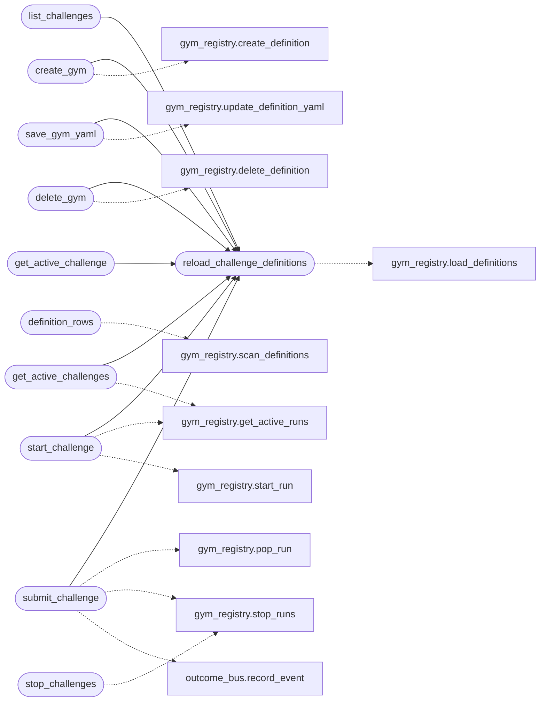

# `modules.redteam_gym`

> Source: [modules/redteam_gym.py:1](../../modules/redteam_gym.py#L1) | language `py` | coverage 100.0% | [API index](../index.md)

Red Team Gym — gamified pentest training mode.

Integrates with the existing ELO/karma system in
[`cli.engagement_hooks`](cli.engagement_hooks.py.md) and extends [`cli.commands.lab`](cli.commands.lab.py.md)
Docker scenarios with challenge objectives, scoring, and leaderboards.

Each challenge defines a specific objective, success criteria, a
time-based speed score, a stealth score (based on techniques that
avoid EDR triggers), and a technique-diversity bonus.

Completion awards bonus ELO that is added via the existing
`[`aumentar_elo`](lazyc2.py.md#aumentar_elo)` / ``_award_elo`` pipeline.

Definitions are YAML files under ``gyms/`` (see [`modules.gym_registry`](modules.gym_registry.py.md)).
Active runs are persisted in the world model, so status and stop work
across sessions and are addressable by stable run ids.

## Contents

- **Functions:** [`reload_challenge_definitions`](#reload_challenge_definitions), [`definition_rows`](#definition_rows), [`create_gym`](#create_gym), [`save_gym_yaml`](#save_gym_yaml), [`delete_gym`](#delete_gym), [`list_challenges`](#list_challenges), [`start_challenge`](#start_challenge), [`submit_challenge`](#submit_challenge), [`stop_challenges`](#stop_challenges), [`get_active_challenges`](#get_active_challenges), [`show_leaderboard`](#show_leaderboard), [`get_active_challenge`](#get_active_challenge), [`record_external_attempt`](#record_external_attempt)
- **Constants:** [`GYM_DEFAULT_DEFINITIONS`](#gym_default_definitions), [`GYM_CHALLENGE_DEFINITIONS`](#gym_challenge_definitions)

## Call Graph

Solid arrows stay in this module, dashed arrows leave it.



## Functions

<a id="reload_challenge_definitions"></a>

### `reload_challenge_definitions`

`function` | [modules/redteam_gym.py:299](../../modules/redteam_gym.py#L299)

```python
def reload_challenge_definitions(directory: Path | str | None = None) -> dict[str, dict[str, Any]]
```

Reload YAML definitions, falling back to the embedded catalogue.

**Parameters**

| Name | Type | Default | Description |
|---|---|---|---|
| `directory` | `Path \| str \| None` | `None` | Override for tests; defaults to ``gyms/``. |

**Returns:** `dict[str, dict[str, Any]]` - The active definition mapping.

*Calls:* [`load_definitions`](modules.gym_registry.py.md#load_definitions)

*Called by:* [`create_gym`](#create_gym), [`delete_gym`](#delete_gym), [`get_active_challenge`](#get_active_challenge), [`get_active_challenges`](#get_active_challenges), [`list_challenges`](#list_challenges), [`save_gym_yaml`](#save_gym_yaml), [`start_challenge`](#start_challenge), [`submit_challenge`](#submit_challenge)

---

<a id="definition_rows"></a>

### `definition_rows`

`function` | [modules/redteam_gym.py:393](../../modules/redteam_gym.py#L393)

```python
def definition_rows() -> list[dict[str, Any]]
```

Return one row per gym YAML file, including invalid files.

**Returns:** `list[dict[str, Any]]`

*Calls:* [`scan_definitions`](modules.gym_registry.py.md#scan_definitions)

---

<a id="create_gym"></a>

### `create_gym`

`function` | [modules/redteam_gym.py:398](../../modules/redteam_gym.py#L398)

```python
def create_gym(gym_id: str, *, name: str = '', scenario: str = 'metasploitable', objective: str = '', description: str = '', difficulty: str = 'easy', chain: str = '', phases: list[str] | None = None, hints: list[str] | None = None, max_points: int = 1000, elo_bonus: int = 100, overwrite: bool = False) -> dict[str, Any]
```

Create a gym definition YAML and reload the catalogue.

**Parameters**

| Name | Type | Default | Description |
|---|---|---|---|
| `gym_id` | `str` |  |  |
| `name` | `str` | `''` |  |
| `scenario` | `str` | `'metasploitable'` |  |
| `objective` | `str` | `''` |  |
| `description` | `str` | `''` |  |
| `difficulty` | `str` | `'easy'` |  |
| `chain` | `str` | `''` |  |
| `phases` | `list[str] \| None` | `None` |  |
| `hints` | `list[str] \| None` | `None` |  |
| `max_points` | `int` | `1000` |  |
| `elo_bonus` | `int` | `100` |  |
| `overwrite` | `bool` | `False` |  |

**Returns:** `dict[str, Any]`

*Calls:* [`create_definition`](modules.gym_registry.py.md#create_definition), [`reload_challenge_definitions`](#reload_challenge_definitions)

*Called by:* [`LazyOrchestratorApp.action_add_item`](cli.lazy_orchestrator.py.md#lazyorchestratorapp-action_add_item)

---

<a id="save_gym_yaml"></a>

### `save_gym_yaml`

`function` | [modules/redteam_gym.py:435](../../modules/redteam_gym.py#L435)

```python
def save_gym_yaml(gym_id: str, text: str) -> dict[str, Any]
```

Validate and persist raw YAML for one gym definition.

**Parameters**

| Name | Type | Default | Description |
|---|---|---|---|
| `gym_id` | `str` |  |  |
| `text` | `str` |  |  |

**Returns:** `dict[str, Any]`

*Calls:* [`update_definition_yaml`](modules.gym_registry.py.md#update_definition_yaml), [`reload_challenge_definitions`](#reload_challenge_definitions)

---

<a id="delete_gym"></a>

### `delete_gym`

`function` | [modules/redteam_gym.py:445](../../modules/redteam_gym.py#L445)

```python
def delete_gym(gym_id: str, *, allow_active: bool = False) -> dict[str, Any]
```

Delete one gym definition unless it has active runs.

**Parameters**

| Name | Type | Default | Description |
|---|---|---|---|
| `gym_id` | `str` |  |  |
| `allow_active` | `bool` | `False` |  |

**Returns:** `dict[str, Any]`

*Calls:* [`delete_definition`](modules.gym_registry.py.md#delete_definition), [`reload_challenge_definitions`](#reload_challenge_definitions)

*Called by:* [`LazyOrchestratorApp.action_delete_item`](cli.lazy_orchestrator.py.md#lazyorchestratorapp-action_delete_item)

---

<a id="list_challenges"></a>

### `list_challenges`

`function` | [modules/redteam_gym.py:453](../../modules/redteam_gym.py#L453)

```python
def list_challenges() -> dict[str, dict[str, Any]]
```

Return all defined gym challenges with metadata.

**Returns:** `dict[str, dict[str, Any]]` - Dict mapping challenge ID to definition.

*Calls:* [`reload_challenge_definitions`](#reload_challenge_definitions)

---

<a id="start_challenge"></a>

### `start_challenge`

`function` | [modules/redteam_gym.py:494](../../modules/redteam_gym.py#L494)

```python
def start_challenge(challenge_id: str, target: str = '', spin_lab: bool = True) -> dict[str, Any]
```

Begin a gym challenge and persist the run in the world model.

When ``spin_lab`` is set the challenge's scenario container is also
started through [`modules.lab_runtime`](modules.lab_runtime.py.md) (best effort: Docker
missing or an unknown scenario never fails the run registration;
the result then keeps the manual ``lab start`` hint).

**Parameters**

| Name | Type | Default | Description |
|---|---|---|---|
| `challenge_id` | `str` |  | ID from the YAML catalogue. |
| `target` | `str` | `''` | Optional engagement target stored with the run. |
| `spin_lab` | `bool` | `True` | Also spin up the scenario target container. |

**Returns:** `dict[str, Any]` - Dict with the run id, challenge info, lab info and next steps.

*Calls:* [`get_active_runs`](modules.gym_registry.py.md#get_active_runs), [`start_run`](modules.gym_registry.py.md#start_run), [`reload_challenge_definitions`](#reload_challenge_definitions)

*Called by:* [`OrchestratorAssetsMixin.start_gym`](cli.orchestrator_assets_tabs.py.md#orchestratorassetsmixin-start_gym)

---

<a id="submit_challenge"></a>

### `submit_challenge`

`function` | [modules/redteam_gym.py:637](../../modules/redteam_gym.py#L637)

```python
def submit_challenge(techniques_used: list[str] | None = None, success: bool = True, run_id: str = '') -> dict[str, Any]
```

Submit a completed challenge for scoring.

**Parameters**

| Name | Type | Default | Description |
|---|---|---|---|
| `techniques_used` | `list[str] \| None` | `None` | List of technique identifiers used. |
| `success` | `bool` | `True` | Whether the challenge was completed successfully. |
| `run_id` | `str` | `''` | Optional run id, challenge id or gym name. Required when more than one gym is active. |

**Returns:** `dict[str, Any]` - Dict with score breakdown and leaderboard position.

*Calls:* [`pop_run`](modules.gym_registry.py.md#pop_run), [`stop_runs`](modules.gym_registry.py.md#stop_runs), [`record_event`](modules.outcome_bus.py.md#record_event), [`reload_challenge_definitions`](#reload_challenge_definitions)

---

<a id="stop_challenges"></a>

### `stop_challenges`

`function` | [modules/redteam_gym.py:745](../../modules/redteam_gym.py#L745)

```python
def stop_challenges(selector: str = '') -> dict[str, Any]
```

Stop one gym by id/name/run id, or every gym when selector is empty.

After the runs are removed from the world model, each scenario
container without any remaining active run is stopped through
[`modules.lab_runtime`](modules.lab_runtime.py.md) so gym machines never outlive their runs.

**Parameters**

| Name | Type | Default | Description |
|---|---|---|---|
| `selector` | `str` | `''` | Optional run id, challenge id or gym name. Empty stops every active run. |

**Returns:** `dict[str, Any]` - The stop result with the stopped run rows and a ``labs`` key.

*Calls:* [`stop_runs`](modules.gym_registry.py.md#stop_runs)

*Called by:* [`OrchestratorAssetsMixin.stop_gym`](cli.orchestrator_assets_tabs.py.md#orchestratorassetsmixin-stop_gym)

---

<a id="get_active_challenges"></a>

### `get_active_challenges`

`function` | [modules/redteam_gym.py:887](../../modules/redteam_gym.py#L887)

```python
def get_active_challenges() -> list[dict[str, Any]]
```

Return every active gym run across operators.

**Returns:** `list[dict[str, Any]]`

*Calls:* [`get_active_runs`](modules.gym_registry.py.md#get_active_runs), [`reload_challenge_definitions`](#reload_challenge_definitions)

*Called by:* [`OrchestratorAssetsMixin.gym_rows`](cli.orchestrator_assets_tabs.py.md#orchestratorassetsmixin-gym_rows)

---

<a id="show_leaderboard"></a>

### `show_leaderboard`

`function` | [modules/redteam_gym.py:1046](../../modules/redteam_gym.py#L1046)

```python
def show_leaderboard(top_n: int = 15) -> list[dict[str, Any]]
```

Return the top N players from the leaderboard.

**Parameters**

| Name | Type | Default | Description |
|---|---|---|---|
| `top_n` | `int` | `15` | Maximum number of entries to return. |

**Returns:** `list[dict[str, Any]]` - List of leaderboard entries sorted by total_score descending.

---

<a id="get_active_challenge"></a>

### `get_active_challenge`

`function` | [modules/redteam_gym.py:1073](../../modules/redteam_gym.py#L1073)

```python
def get_active_challenge(run_id: str = '') -> dict[str, Any] | None
```

Return one active challenge, preferring the current operator.

**Parameters**

| Name | Type | Default | Description |
|---|---|---|---|
| `run_id` | `str` | `''` | Optional run id, challenge id or gym name. |

**Returns:** `dict[str, Any] | None` - Active challenge dict or None. When no selector is given and only
one gym is active globally, that run is returned even if the
operator label changed between sessions.

*Calls:* [`reload_challenge_definitions`](#reload_challenge_definitions)

---

<a id="record_external_attempt"></a>

### `record_external_attempt`

`function` | [modules/redteam_gym.py:1104](../../modules/redteam_gym.py#L1104)

```python
def record_external_attempt(challenge_id: str, success: bool, elo_bonus: int = 150, techniques: list[str] | None = None) -> dict[str, Any]
```

Record a scored attempt for a challenge not defined in the catalog.

Lets external modules (for example the ExploitGym integration) feed the
shared ELO/leaderboard pipeline without requiring a challenge
definition or an active in-flight challenge.

**Parameters**

| Name | Type | Default | Description |
|---|---|---|---|
| `challenge_id` | `str` |  | Identifier recorded on the leaderboard (e.g. ``exploitgym:<task_id>``). |
| `success` | `bool` |  | Whether the attempt succeeded. |
| `elo_bonus` | `int` | `150` | ELO delta to award on success (``0`` on failure). |
| `techniques` | `list[str] \| None` | `None` | Technique identifiers used. |

**Returns:** `dict[str, Any]` - Dict with ``success``, ``challenge``, ``completed``, ``elo_awarded``
and `[`rank`](modules.atomic_exploit_bridge.py.md#rank)`.

*Called by:* [`score_task`](modules.exploitgym_gym.py.md#score_task)

---

## Constants

<a id="gym_default_definitions"></a>

### `GYM_DEFAULT_DEFINITIONS`

`constant` | [modules/redteam_gym.py:46](../../modules/redteam_gym.py#L46)

```python
GYM_DEFAULT_DEFINITIONS: dict[str, dict[str, Any]]
```

---

<a id="gym_challenge_definitions"></a>

### `GYM_CHALLENGE_DEFINITIONS`

`constant` | [modules/redteam_gym.py:314](../../modules/redteam_gym.py#L314)

```python
GYM_CHALLENGE_DEFINITIONS = load_definitions() or GYM_DEFAULT_DEFINITIONS
```

---
