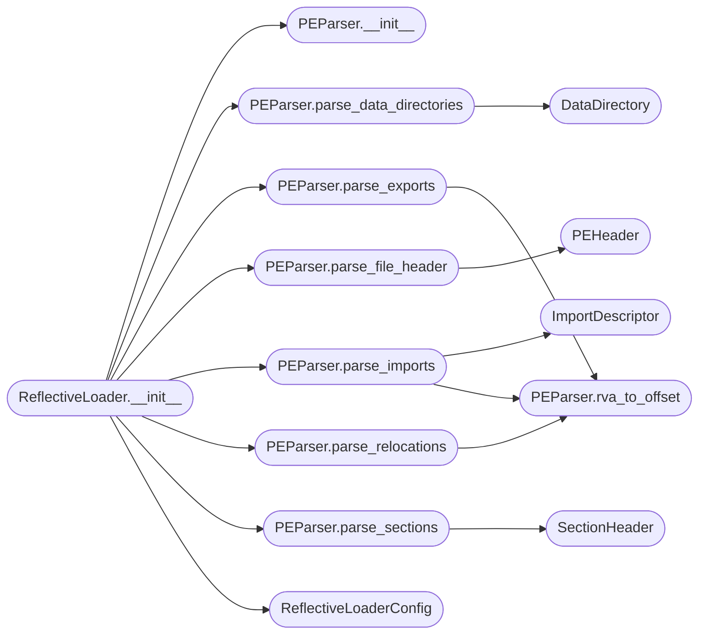

# `modules.reflective_dll`

> Source: [modules/reflective_dll.py:1](../../modules/reflective_dll.py#L1) | language `py` | coverage 84.6% | [API index](../index.md)

Reflective DLL loading — load PE from memory without touching disk.

Implements manual PE parsing, import resolution, relocations, and DllMain
invocation. Supports five injection techniques: CreateRemoteThread,
NtCreateThreadEx, QueueUserAPC, SetWindowsHookEx, and thread hijacking.

All operations use raw bytes — no LoadLibrary or GetProcAddress for
the target DLL. Designed for in-process or cross-process reflection.

## Contents

- **Classes:** [`PEHeader`](#peheader), [`DataDirectory`](#datadirectory), [`SectionHeader`](#sectionheader), [`ImportDescriptor`](#importdescriptor), [`ReflectiveLoaderConfig`](#reflectiveloaderconfig), [`PEParser`](#peparser), [`ReflectiveLoader`](#reflectiveloader)
- **Constants:** [`IMAGE_DOS_SIGNATURE`](#image_dos_signature), [`IMAGE_NT_SIGNATURE`](#image_nt_signature), [`IMAGE_FILE_MACHINE_AMD64`](#image_file_machine_amd64), [`IMAGE_FILE_MACHINE_I386`](#image_file_machine_i386), [`IMAGE_DIRECTORY_ENTRY_EXPORT`](#image_directory_entry_export), [`IMAGE_DIRECTORY_ENTRY_IMPORT`](#image_directory_entry_import), [`IMAGE_DIRECTORY_ENTRY_BASERELOC`](#image_directory_entry_basereloc), [`IMAGE_REL_BASED_ABSOLUTE`](#image_rel_based_absolute), [`IMAGE_REL_BASED_HIGHLOW`](#image_rel_based_highlow), [`IMAGE_REL_BASED_DIR64`](#image_rel_based_dir64), [`IMAGE_REL_BASED_HIGH`](#image_rel_based_high), [`IMAGE_REL_BASED_LOW`](#image_rel_based_low), [`IMAGE_SIZEOF_SHORT_NAME`](#image_sizeof_short_name)

## Type Diagram

```mermaid
classDiagram
    direction LR
    class PEHeader
    PEHeader : int machine
    PEHeader : int number_of_sections
    PEHeader : int size_of_optional_header
    PEHeader : int characteristics
    PEHeader : int entry_point_rva
    PEHeader : int image_base
    PEHeader : int section_alignment
    PEHeader : int file_alignment
    PEHeader : int size_of_image
    PEHeader : int size_of_headers
    PEHeader : int subsystem
    PEHeader : int dll_characteristics
    class DataDirectory
    DataDirectory : int virtual_address
    DataDirectory : int size
    class SectionHeader
    SectionHeader : str name
    SectionHeader : int virtual_address
    SectionHeader : int virtual_size
    SectionHeader : int raw_data_offset
    SectionHeader : int raw_data_size
    SectionHeader : int characteristics
    class ImportDescriptor
    ImportDescriptor : str dll_name
    ImportDescriptor : list[str] function_names
    ImportDescriptor : int original_first_thunk_rva
    ImportDescriptor : int first_thunk_rva
    class ReflectiveLoaderConfig
    ReflectiveLoaderConfig : int target_process_id
    ReflectiveLoaderConfig : str injection_technique
    ReflectiveLoaderConfig : str injection_entry
    ReflectiveLoaderConfig : bytes injection_args
    ReflectiveLoaderConfig : bool erase_headers
    ReflectiveLoaderConfig : bool unhook_ntdll
    class PEParser
    PEParser : __init__()
    PEParser : parse_file_header()
    PEParser : parse_sections()
    PEParser : parse_data_directories()
    PEParser : rva_to_offset()
    PEParser : parse_imports()
    PEParser : parse_relocations()
    PEParser : parse_exports()
    PEParser : is_64bit()
    PEParser : raw_data()
    class ReflectiveLoader
    ReflectiveLoader : __init__()
    ReflectiveLoader : sha256()
    ReflectiveLoader : architecture()
    ReflectiveLoader : required_imports()
    ReflectiveLoader : plan_injection()
    ReflectiveLoader : generate_c_stub()
    ReflectiveLoader : generate_powershell_stub()
    ReflectiveLoader : summarize()
```



## Call Graph

Solid arrows stay in this module, dashed arrows leave it.



## Classes

<a id="peheader"></a>

### `PEHeader`

`class` `dataclass` | [modules/reflective_dll.py:37](../../modules/reflective_dll.py#L37)

Decorators: `@dataclass`

```python
class PEHeader
```

Parsed portable executable header fields.

**Attributes**

| Name | Type | Default | Description |
|---|---|---|---|
| [`machine`](#peheader-machine) | `int` | `0` | Target CPU architecture. |
| [`number_of_sections`](#peheader-number_of_sections) | `int` | `0` | Count of section headers. |
| [`size_of_optional_header`](#peheader-size_of_optional_header) | `int` | `0` | Bytes of optional header. |
| [`characteristics`](#peheader-characteristics) | `int` | `0` | DLL/EXE flags. |
| [`entry_point_rva`](#peheader-entry_point_rva) | `int` | `0` | Relative virtual address of entry. |
| [`image_base`](#peheader-image_base) | `int` | `0` | Preferred load address. |
| [`section_alignment`](#peheader-section_alignment) | `int` | `0` | Memory section alignment. |
| [`file_alignment`](#peheader-file_alignment) | `int` | `0` | Disk section alignment. |
| [`size_of_image`](#peheader-size_of_image) | `int` | `0` | Total image size in memory. |
| [`size_of_headers`](#peheader-size_of_headers) | `int` | `0` | Combined header size. |
| [`subsystem`](#peheader-subsystem) | `int` | `0` | GUI/CUI/NATIVE subsystem. |
| [`dll_characteristics`](#peheader-dll_characteristics) | `int` | `0` | ASLR, DEP, etc. |

---

<a id="datadirectory"></a>

### `DataDirectory`

`class` `dataclass` | [modules/reflective_dll.py:70](../../modules/reflective_dll.py#L70)

Decorators: `@dataclass`

```python
class DataDirectory
```

PE data directory entry.

**Attributes**

| Name | Type | Default | Description |
|---|---|---|---|
| [`virtual_address`](#datadirectory-virtual_address) | `int` | `0` | RVA of the directory data. |
| [`size`](#datadirectory-size) | `int` | `0` | Size of the directory data in bytes. |

---

<a id="sectionheader"></a>

### `SectionHeader`

`class` `dataclass` | [modules/reflective_dll.py:83](../../modules/reflective_dll.py#L83)

Decorators: `@dataclass`

```python
class SectionHeader
```

Parsed PE section header.

**Attributes**

| Name | Type | Default | Description |
|---|---|---|---|
| [`name`](#sectionheader-name) | `str` | `''` | Section name (max 8 chars). |
| [`virtual_address`](#sectionheader-virtual_address) | `int` | `0` | RVA of section in memory. |
| [`virtual_size`](#sectionheader-virtual_size) | `int` | `0` | Size of section in memory. |
| [`raw_data_offset`](#sectionheader-raw_data_offset) | `int` | `0` | File offset of section data. |
| [`raw_data_size`](#sectionheader-raw_data_size) | `int` | `0` | Size of raw section data. |
| [`characteristics`](#sectionheader-characteristics) | `int` | `0` | Section flags (executable, writable, readable). |

---

<a id="importdescriptor"></a>

### `ImportDescriptor`

`class` `dataclass` | [modules/reflective_dll.py:104](../../modules/reflective_dll.py#L104)

Decorators: `@dataclass`

```python
class ImportDescriptor
```

Parsed import directory entry.

**Attributes**

| Name | Type | Default | Description |
|---|---|---|---|
| [`dll_name`](#importdescriptor-dll_name) | `str` | `''` | Name of the imported DLL. |
| [`function_names`](#importdescriptor-function_names) | `list[str]` | `field(default_factory=list)` | List of imported function names or ordinals. |
| [`original_first_thunk_rva`](#importdescriptor-original_first_thunk_rva) | `int` | `0` | RVA of the import lookup table. |
| [`first_thunk_rva`](#importdescriptor-first_thunk_rva) | `int` | `0` | RVA of the import address table. |

---

<a id="reflectiveloaderconfig"></a>

### `ReflectiveLoaderConfig`

`class` `dataclass` | [modules/reflective_dll.py:121](../../modules/reflective_dll.py#L121)

Decorators: `@dataclass`

```python
class ReflectiveLoaderConfig
```

Configuration for reflective DLL loading.

**Attributes**

| Name | Type | Default | Description |
|---|---|---|---|
| [`target_process_id`](#reflectiveloaderconfig-target_process_id) | `int` | `0` | PID to inject into (0 for self-injection). |
| [`injection_technique`](#reflectiveloaderconfig-injection_technique) | `str` | `'createremotethread'` | createremotethread, ntcreatethreadex, queueuserapc, setwindowshookex, threadhijack. |
| [`injection_entry`](#reflectiveloaderconfig-injection_entry) | `str` | `''` | Export name / ordinal to call after loading. |
| [`injection_args`](#reflectiveloaderconfig-injection_args) | `bytes` | `b''` | Argument bytes to pass to the entry point. |
| [`erase_headers`](#reflectiveloaderconfig-erase_headers) | `bool` | `False` | Zero out PE headers post-load for stealth. |
| [`unhook_ntdll`](#reflectiveloaderconfig-unhook_ntdll) | `bool` | `False` | Restore clean ntdll.dll from disk before loading. |

---

<a id="peparser"></a>

### `PEParser`

`class` | [modules/reflective_dll.py:142](../../modules/reflective_dll.py#L142)

```python
class PEParser
```

Parse a portable executable from raw bytes for manual loading.

Extracts DOS header, NT headers, section table, import table,
export table, and base relocations without using LoadLibrary.

**Members**

| Member | Kind | Summary |
|---|---|---|
| [`__init__`](#peparser-__init__) | constructor |  |
| [`parse_file_header`](#peparser-parse_file_header) | method | Extract the COFF file header. |
| [`parse_sections`](#peparser-parse_sections) | method | Parse all section headers from the PE. |
| [`parse_data_directories`](#peparser-parse_data_directories) | method | Parse the PE data directory entries. |
| [`rva_to_offset`](#peparser-rva_to_offset) | method | Convert a relative virtual address to a file offset. |
| [`parse_imports`](#peparser-parse_imports) | method | Parse the import directory to enumerate imported DLLs and functions. |
| [`parse_relocations`](#peparser-parse_relocations) | method | Parse base relocation entries. |
| [`parse_exports`](#peparser-parse_exports) | method | Parse the export directory. |
| [`is_64bit`](#peparser-is_64bit) | property |  |
| [`raw_data`](#peparser-raw_data) | property |  |

<a id="peparser-__init__"></a>

#### `PEParser.__init__`

`constructor` | [modules/reflective_dll.py:151](../../modules/reflective_dll.py#L151)

```python
def __init__(self, pe_data: bytes)
```

**Parameters**

| Name | Type | Default | Description |
|---|---|---|---|
| `pe_data` | `bytes` |  |  |

**Raises**

- `ValueError`: (raised in the body, not documented)

*Called by:* [`ReflectiveLoader.__init__`](#reflectiveloader-__init__)

<a id="peparser-parse_file_header"></a>

#### `PEParser.parse_file_header`

`method` | [modules/reflective_dll.py:166](../../modules/reflective_dll.py#L166)

```python
def parse_file_header(self) -> PEHeader
```

Extract the COFF file header.

**Returns:** `PEHeader` - PEHeader with machine, sections, and characteristics.

*Calls:* [`PEHeader`](#peheader)

*Called by:* [`ReflectiveLoader.__init__`](#reflectiveloader-__init__)

<a id="peparser-parse_sections"></a>

#### `PEParser.parse_sections`

`method` | [modules/reflective_dll.py:208](../../modules/reflective_dll.py#L208)

```python
def parse_sections(self, num_sections: int) -> list[SectionHeader]
```

Parse all section headers from the PE.

**Parameters**

| Name | Type | Default | Description |
|---|---|---|---|
| `num_sections` | `int` |  | Number of sections from the file header. |

**Returns:** `list[SectionHeader]` - List of SectionHeader objects.

*Calls:* [`SectionHeader`](#sectionheader)

*Called by:* [`ReflectiveLoader.__init__`](#reflectiveloader-__init__)

<a id="peparser-parse_data_directories"></a>

#### `PEParser.parse_data_directories`

`method` | [modules/reflective_dll.py:243](../../modules/reflective_dll.py#L243)

```python
def parse_data_directories(self, num_entries: int = 16) -> list[DataDirectory]
```

Parse the PE data directory entries.

**Parameters**

| Name | Type | Default | Description |
|---|---|---|---|
| `num_entries` | `int` | `16` | Number of directory entries (default 16). |

**Returns:** `list[DataDirectory]` - List of DataDirectory objects.

*Calls:* [`DataDirectory`](#datadirectory)

*Called by:* [`ReflectiveLoader.__init__`](#reflectiveloader-__init__)

<a id="peparser-rva_to_offset"></a>

#### `PEParser.rva_to_offset`

`method` | [modules/reflective_dll.py:265](../../modules/reflective_dll.py#L265)

```python
def rva_to_offset(self, rva: int, sections: list[SectionHeader]) -> int
```

Convert a relative virtual address to a file offset.

**Parameters**

| Name | Type | Default | Description |
|---|---|---|---|
| `rva` | `int` |  | Relative virtual address. |
| `sections` | `list[SectionHeader]` |  | Parsed section table. |

**Returns:** `int` - File offset or -1 if the RVA doesn't map.

*Called by:* [`PEParser.parse_exports`](#peparser-parse_exports), [`PEParser.parse_imports`](#peparser-parse_imports), [`PEParser.parse_relocations`](#peparser-parse_relocations)

<a id="peparser-parse_imports"></a>

#### `PEParser.parse_imports`

`method` | [modules/reflective_dll.py:280](../../modules/reflective_dll.py#L280)

```python
def parse_imports(self, import_dir: DataDirectory, sections: list[SectionHeader]) -> list[ImportDescriptor]
```

Parse the import directory to enumerate imported DLLs and functions.

**Parameters**

| Name | Type | Default | Description |
|---|---|---|---|
| `import_dir` | `DataDirectory` |  | IMAGE_DIRECTORY_ENTRY_IMPORT data directory. |
| `sections` | `list[SectionHeader]` |  | Parsed section table. |

**Returns:** `list[ImportDescriptor]` - List of ImportDescriptor objects.

*Calls:* [`ImportDescriptor`](#importdescriptor), [`PEParser.rva_to_offset`](#peparser-rva_to_offset)

*Called by:* [`ReflectiveLoader.__init__`](#reflectiveloader-__init__)

<a id="peparser-parse_relocations"></a>

#### `PEParser.parse_relocations`

`method` | [modules/reflective_dll.py:326](../../modules/reflective_dll.py#L326)

```python
def parse_relocations(self, reloc_dir: DataDirectory, sections: list[SectionHeader]) -> list[tuple[int, int]]
```

Parse base relocation entries.

**Parameters**

| Name | Type | Default | Description |
|---|---|---|---|
| `reloc_dir` | `DataDirectory` |  | IMAGE_DIRECTORY_ENTRY_BASERELOC data directory. |
| `sections` | `list[SectionHeader]` |  | Parsed section table. |

**Returns:** `list[tuple[int, int]]` - List of (offset, type) tuples for relocation fixups.

*Calls:* [`PEParser.rva_to_offset`](#peparser-rva_to_offset)

*Called by:* [`ReflectiveLoader.__init__`](#reflectiveloader-__init__)

<a id="peparser-parse_exports"></a>

#### `PEParser.parse_exports`

`method` | [modules/reflective_dll.py:374](../../modules/reflective_dll.py#L374)

```python
def parse_exports(self, export_dir: DataDirectory, sections: list[SectionHeader]) -> dict[str, int]
```

Parse the export directory.

**Parameters**

| Name | Type | Default | Description |
|---|---|---|---|
| `export_dir` | `DataDirectory` |  | IMAGE_DIRECTORY_ENTRY_EXPORT data directory. |
| `sections` | `list[SectionHeader]` |  | Parsed section table. |

**Returns:** `dict[str, int]` - Dict mapping export name to RVA.

*Calls:* [`PEParser.rva_to_offset`](#peparser-rva_to_offset)

*Called by:* [`ReflectiveLoader.__init__`](#reflectiveloader-__init__)

<a id="peparser-is_64bit"></a>

#### `PEParser.is_64bit`

`property` | [modules/reflective_dll.py:456](../../modules/reflective_dll.py#L456)

Decorators: `@property`

```python
def is_64bit(self) -> bool
```

**Returns:** `bool`

<a id="peparser-raw_data"></a>

#### `PEParser.raw_data`

`property` | [modules/reflective_dll.py:460](../../modules/reflective_dll.py#L460)

Decorators: `@property`

```python
def raw_data(self) -> bytes
```

**Returns:** `bytes`

---

<a id="reflectiveloader"></a>

### `ReflectiveLoader`

`class` | [modules/reflective_dll.py:464](../../modules/reflective_dll.py#L464)

```python
class ReflectiveLoader
```

Plan reflective DLL load strategy and generate shellcode wrappers.

Produces Python instructions, C stubs, or PowerShell scripts that
implement reflective loading for operator use. Does not perform the
actual load (that requires native execution on target).

**Members**

| Member | Kind | Summary |
|---|---|---|
| [`__init__`](#reflectiveloader-__init__) | constructor |  |
| [`sha256`](#reflectiveloader-sha256) | property | SHA-256 hash of the raw PE bytes. |
| [`architecture`](#reflectiveloader-architecture) | property | CPU architecture string ('x64' or 'x86'). |
| [`required_imports`](#reflectiveloader-required_imports) | property | DLL names needed for import resolution. |
| [`plan_injection`](#reflectiveloader-plan_injection) | method | Generate an injection plan based on the configured technique. |
| [`generate_c_stub`](#reflectiveloader-generate_c_stub) | method | Generate a C stub that implements reflective loading. |
| [`generate_powershell_stub`](#reflectiveloader-generate_powershell_stub) | method | Generate PowerShell reflective loader script. |
| [`summarize`](#reflectiveloader-summarize) | method | Human-readable summary of the parsed PE for operator review. |

<a id="reflectiveloader-__init__"></a>

#### `ReflectiveLoader.__init__`

`constructor` | [modules/reflective_dll.py:492](../../modules/reflective_dll.py#L492)

```python
def __init__(self, pe_data: bytes, config: ReflectiveLoaderConfig | None = None)
```

**Parameters**

| Name | Type | Default | Description |
|---|---|---|---|
| `pe_data` | `bytes` |  |  |
| `config` | `ReflectiveLoaderConfig \| None` | `None` |  |

*Calls:* [`PEParser.__init__`](#peparser-__init__), [`PEParser.parse_data_directories`](#peparser-parse_data_directories), [`PEParser.parse_exports`](#peparser-parse_exports), [`PEParser.parse_file_header`](#peparser-parse_file_header), [`PEParser.parse_imports`](#peparser-parse_imports), [`PEParser.parse_relocations`](#peparser-parse_relocations), [`PEParser.parse_sections`](#peparser-parse_sections), [`ReflectiveLoaderConfig`](#reflectiveloaderconfig)

<a id="reflectiveloader-sha256"></a>

#### `ReflectiveLoader.sha256`

`property` | [modules/reflective_dll.py:505](../../modules/reflective_dll.py#L505)

Decorators: `@property`

```python
def sha256(self) -> str
```

SHA-256 hash of the raw PE bytes.

**Returns:** `str`

<a id="reflectiveloader-architecture"></a>

#### `ReflectiveLoader.architecture`

`property` | [modules/reflective_dll.py:510](../../modules/reflective_dll.py#L510)

Decorators: `@property`

```python
def architecture(self) -> str
```

CPU architecture string ('x64' or 'x86').

**Returns:** `str`

<a id="reflectiveloader-required_imports"></a>

#### `ReflectiveLoader.required_imports`

`property` | [modules/reflective_dll.py:515](../../modules/reflective_dll.py#L515)

Decorators: `@property`

```python
def required_imports(self) -> list[str]
```

DLL names needed for import resolution.

**Returns:** `list[str]`

<a id="reflectiveloader-plan_injection"></a>

#### `ReflectiveLoader.plan_injection`

`method` | [modules/reflective_dll.py:526](../../modules/reflective_dll.py#L526)

```python
def plan_injection(self) -> dict[str, Any]
```

Generate an injection plan based on the configured technique.

**Returns:** `dict[str, Any]` - Dict with technique, process_id, entry_point, and required steps.

<a id="reflectiveloader-generate_c_stub"></a>

#### `ReflectiveLoader.generate_c_stub`

`method` | [modules/reflective_dll.py:588](../../modules/reflective_dll.py#L588)

```python
def generate_c_stub(self) -> str
```

Generate a C stub that implements reflective loading.

**Returns:** `str` - C source code string with reflective loader logic.

<a id="reflectiveloader-generate_powershell_stub"></a>

#### `ReflectiveLoader.generate_powershell_stub`

`method` | [modules/reflective_dll.py:666](../../modules/reflective_dll.py#L666)

```python
def generate_powershell_stub(self) -> str
```

Generate PowerShell reflective loader script.

**Returns:** `str` - PowerShell script for .NET Assembly.Load reflectively.

<a id="reflectiveloader-summarize"></a>

#### `ReflectiveLoader.summarize`

`method` | [modules/reflective_dll.py:685](../../modules/reflective_dll.py#L685)

```python
def summarize(self) -> dict[str, Any]
```

Human-readable summary of the parsed PE for operator review.

**Returns:** `dict[str, Any]` - Dict with architecture, imports, sections, exports, and hashes.

---

## Constants

<a id="image_dos_signature"></a>

### `IMAGE_DOS_SIGNATURE`

`constant` | [modules/reflective_dll.py:18](../../modules/reflective_dll.py#L18)

```python
IMAGE_DOS_SIGNATURE = 23117
```

---

<a id="image_nt_signature"></a>

### `IMAGE_NT_SIGNATURE`

`constant` | [modules/reflective_dll.py:19](../../modules/reflective_dll.py#L19)

```python
IMAGE_NT_SIGNATURE = 17744
```

---

<a id="image_file_machine_amd64"></a>

### `IMAGE_FILE_MACHINE_AMD64`

`constant` | [modules/reflective_dll.py:20](../../modules/reflective_dll.py#L20)

```python
IMAGE_FILE_MACHINE_AMD64 = 34404
```

---

<a id="image_file_machine_i386"></a>

### `IMAGE_FILE_MACHINE_I386`

`constant` | [modules/reflective_dll.py:21](../../modules/reflective_dll.py#L21)

```python
IMAGE_FILE_MACHINE_I386 = 332
```

---

<a id="image_directory_entry_export"></a>

### `IMAGE_DIRECTORY_ENTRY_EXPORT`

`constant` | [modules/reflective_dll.py:23](../../modules/reflective_dll.py#L23)

```python
IMAGE_DIRECTORY_ENTRY_EXPORT = 0
```

---

<a id="image_directory_entry_import"></a>

### `IMAGE_DIRECTORY_ENTRY_IMPORT`

`constant` | [modules/reflective_dll.py:24](../../modules/reflective_dll.py#L24)

```python
IMAGE_DIRECTORY_ENTRY_IMPORT = 1
```

---

<a id="image_directory_entry_basereloc"></a>

### `IMAGE_DIRECTORY_ENTRY_BASERELOC`

`constant` | [modules/reflective_dll.py:25](../../modules/reflective_dll.py#L25)

```python
IMAGE_DIRECTORY_ENTRY_BASERELOC = 5
```

---

<a id="image_rel_based_absolute"></a>

### `IMAGE_REL_BASED_ABSOLUTE`

`constant` | [modules/reflective_dll.py:27](../../modules/reflective_dll.py#L27)

```python
IMAGE_REL_BASED_ABSOLUTE = 0
```

---

<a id="image_rel_based_highlow"></a>

### `IMAGE_REL_BASED_HIGHLOW`

`constant` | [modules/reflective_dll.py:28](../../modules/reflective_dll.py#L28)

```python
IMAGE_REL_BASED_HIGHLOW = 3
```

---

<a id="image_rel_based_dir64"></a>

### `IMAGE_REL_BASED_DIR64`

`constant` | [modules/reflective_dll.py:29](../../modules/reflective_dll.py#L29)

```python
IMAGE_REL_BASED_DIR64 = 10
```

---

<a id="image_rel_based_high"></a>

### `IMAGE_REL_BASED_HIGH`

`constant` | [modules/reflective_dll.py:30](../../modules/reflective_dll.py#L30)

```python
IMAGE_REL_BASED_HIGH = 1
```

---

<a id="image_rel_based_low"></a>

### `IMAGE_REL_BASED_LOW`

`constant` | [modules/reflective_dll.py:31](../../modules/reflective_dll.py#L31)

```python
IMAGE_REL_BASED_LOW = 2
```

---

<a id="image_sizeof_short_name"></a>

### `IMAGE_SIZEOF_SHORT_NAME`

`constant` | [modules/reflective_dll.py:33](../../modules/reflective_dll.py#L33)

```python
IMAGE_SIZEOF_SHORT_NAME = 8
```

---
