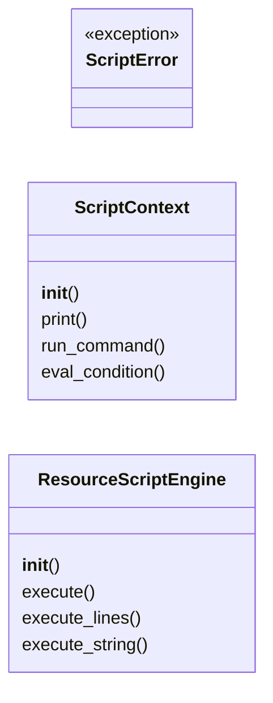
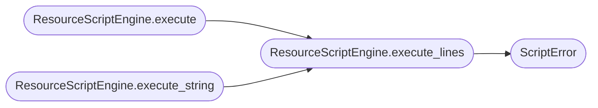

# `modules.resource_script`

> Source: [modules/resource_script.py:1](../../modules/resource_script.py#L1) | language `py` | coverage 75.0% | [API index](../index.md)

Enhanced resource script engine — variables, conditionals, loops, macros.

Extends LazyOwn's existing ``.ls`` script format with:

- ``set <var> <value>`` — set a local variable
- ``setg <var> <value>`` — set a global variable (persists in shell params)
- ``unset <var>`` — remove a variable
- ``if <condition>`` / ``else`` / ``endif`` — conditional execution
- ``while <condition>`` / ``endwhile`` — loop until condition is false
- ``for <var> in <items>`` / ``endfor`` — iterate over space-separated items
- ``break`` / ``continue`` — loop control inside while/for bodies
- ``macro <name> <args>`` / ``endmacro`` / ``call <name> <args>`` — reusable blocks
- ``spool <file>`` / ``spool off`` — log output to file
- ``sleep <seconds>`` — pause execution
- ``echo <message>`` — print a message
- ``comment <text>`` — inline comment (also ``#`` lines)
- Variable substitution: ``$var`` or ``${var}`` anywhere in command lines

Conditions (``if`` / ``while``) support real expressions:

- ``$a == $b`` / ``$a != $b`` — string equality after substitution
- ``$a =~ pattern`` / ``$a !~ pattern`` — regex search / negated
- ``$a > $b`` and friends (``>=``, ``<``, ``<=``) — numeric when both
  operands parse as numbers, string order otherwise
- ``$a contains text`` — substring test
- ``defined $var`` — true when the variable exists and is non-empty
- anything else falls back to truthiness: empty, ``false``, ``0``, ``no``
  and ``off`` are false; every other value is true

Built-in variables: ``$rhost``, ``$lhost``, ``$lport``, ``$domain``,
``$workspace``, ``$timestamp``.

Usage:
    resource path/to/script.ls

## Contents

- **Classes:** [`ScriptContext`](#scriptcontext), [`ResourceScriptEngine`](#resourcescriptengine)
- **Exceptions:** [`ScriptError`](#scripterror)

## Type Diagram



## Call Graph

Solid arrows stay in this module, dashed arrows leave it.



## Classes

<a id="scriptcontext"></a>

### `ScriptContext`

`class` | [modules/resource_script.py:82](../../modules/resource_script.py#L82)

```python
class ScriptContext
```

Runtime context for a single resource script execution.

Tracks local/global variables, macro definitions, nesting state,
and the spool file.

**Members**

| Member | Kind | Summary |
|---|---|---|
| [`__init__`](#scriptcontext-__init__) | constructor |  |
| [`print`](#scriptcontext-print) | method |  |
| [`run_command`](#scriptcontext-run_command) | method |  |
| [`eval_condition`](#scriptcontext-eval_condition) | method | Evaluate an ``if``/``while`` condition expression. |

<a id="scriptcontext-__init__"></a>

#### `ScriptContext.__init__`

`constructor` | [modules/resource_script.py:89](../../modules/resource_script.py#L89)

```python
def __init__(self, shell_params: dict[str, Any] | None = None, on_command: Callable[[str], None] | None = None, on_print: Callable[[str], None] | None = None) -> None
```

**Parameters**

| Name | Type | Default | Description |
|---|---|---|---|
| `shell_params` | `dict[str, Any] \| None` | `None` |  |
| `on_command` | `Callable[[str], None] \| None` | `None` |  |
| `on_print` | `Callable[[str], None] \| None` | `None` |  |

<a id="scriptcontext-print"></a>

#### `ScriptContext.print`

`method` | [modules/resource_script.py:138](../../modules/resource_script.py#L138)

```python
def print(self, msg: str = '') -> None
```

**Parameters**

| Name | Type | Default | Description |
|---|---|---|---|
| `msg` | `str` | `''` |  |

<a id="scriptcontext-run_command"></a>

#### `ScriptContext.run_command`

`method` | [modules/resource_script.py:147](../../modules/resource_script.py#L147)

```python
def run_command(self, cmd: str) -> None
```

**Parameters**

| Name | Type | Default | Description |
|---|---|---|---|
| `cmd` | `str` |  |  |

<a id="scriptcontext-eval_condition"></a>

#### `ScriptContext.eval_condition`

`method` | [modules/resource_script.py:191](../../modules/resource_script.py#L191)

```python
def eval_condition(self, raw_condition: str) -> bool
```

Evaluate an ``if``/``while`` condition expression.

Supports ``==``, ``!=``, ``=~``, ``!~``, ``>``, ``>=``, ``<``,
``<=``, ``contains`` and ``defined``; anything else falls back to
plain truthiness of the substituted text. Substitution happens per
operand so ``if $a == $b`` compares values instead of evaluating
the literal string ``"x == y"`` (which is always truthy).

**Parameters**

| Name | Type | Default | Description |
|---|---|---|---|
| `raw_condition` | `str` |  |  |

**Returns:** `bool`

---

<a id="resourcescriptengine"></a>

### `ResourceScriptEngine`

`class` | [modules/resource_script.py:268](../../modules/resource_script.py#L268)

```python
class ResourceScriptEngine
```

Parses and executes enhanced resource scripts.

**Parameters**

| Name | Type | Default | Description |
|---|---|---|---|
| `context` |  |  | A [`ScriptContext`](#scriptcontext) providing variable scope and command execution callbacks. |

**Members**

| Member | Kind | Summary |
|---|---|---|
| [`__init__`](#resourcescriptengine-__init__) | constructor |  |
| [`execute`](#resourcescriptengine-execute) | method | Load and run a script file. |
| [`execute_lines`](#resourcescriptengine-execute_lines) | method | Execute a list of script lines. |
| [`execute_string`](#resourcescriptengine-execute_string) | method | Execute a script string (split on newlines). |

<a id="resourcescriptengine-__init__"></a>

#### `ResourceScriptEngine.__init__`

`constructor` | [modules/resource_script.py:276](../../modules/resource_script.py#L276)

```python
def __init__(self, context: ScriptContext) -> None
```

**Parameters**

| Name | Type | Default | Description |
|---|---|---|---|
| `context` | `ScriptContext` |  | A [`ScriptContext`](#scriptcontext) providing variable scope and command execution callbacks. |

*Called by:* [`ResourceCommandSet.do_resource`](cli.commands.resource_scripting.py.md#resourcecommandset-do_resource)

<a id="resourcescriptengine-execute"></a>

#### `ResourceScriptEngine.execute`

`method` | [modules/resource_script.py:279](../../modules/resource_script.py#L279)

```python
def execute(self, script_path: str) -> None
```

Load and run a script file.

**Parameters**

| Name | Type | Default | Description |
|---|---|---|---|
| `script_path` | `str` |  | Path to the ``.ls`` or resource script file. |

**Raises**

- [`ScriptError`](#scripterror): On parse/execution errors.
- `FileNotFoundError`: When the script does not exist.

*Calls:* [`ResourceScriptEngine.execute_lines`](#resourcescriptengine-execute_lines)

*Called by:* [`ResourceCommandSet.do_resource`](cli.commands.resource_scripting.py.md#resourcecommandset-do_resource)

<a id="resourcescriptengine-execute_lines"></a>

#### `ResourceScriptEngine.execute_lines`

`method` | [modules/resource_script.py:293](../../modules/resource_script.py#L293)

```python
def execute_lines(self, lines: list[str], source: str = '<inline>') -> None
```

Execute a list of script lines.

**Parameters**

| Name | Type | Default | Description |
|---|---|---|---|
| `lines` | `list[str]` |  | Script lines (may include trailing newlines). |
| `source` | `str` | `'<inline>'` | Source name for error messages. |

**Raises**

- [`ScriptError`](#scripterror): On parse/execution errors.

*Calls:* [`ScriptError`](#scripterror)

*Called by:* [`ResourceScriptEngine.execute`](#resourcescriptengine-execute), [`ResourceScriptEngine.execute_string`](#resourcescriptengine-execute_string)

<a id="resourcescriptengine-execute_string"></a>

#### `ResourceScriptEngine.execute_string`

`method` | [modules/resource_script.py:327](../../modules/resource_script.py#L327)

```python
def execute_string(self, script: str) -> None
```

Execute a script string (split on newlines).

**Parameters**

| Name | Type | Default | Description |
|---|---|---|---|
| `script` | `str` |  |  |

*Calls:* [`ResourceScriptEngine.execute_lines`](#resourcescriptengine-execute_lines)

---

## Exceptions

<a id="scripterror"></a>

### `ScriptError`

`exception` | [modules/resource_script.py:76](../../modules/resource_script.py#L76)

```python
class ScriptError(RuntimeError)
```

Bases: `RuntimeError`

Raised when a resource script encounters a fatal error.

---
