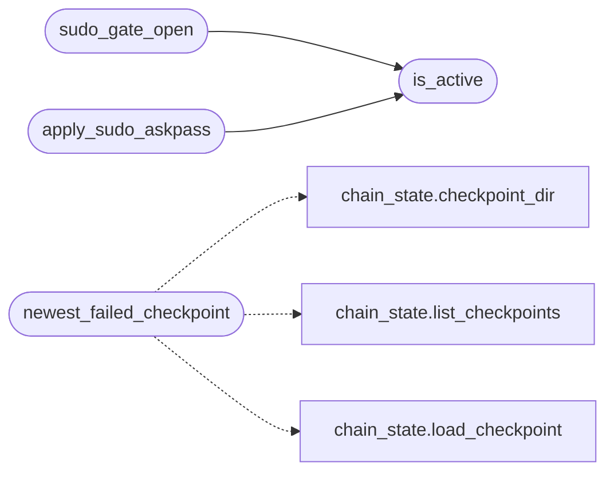

# `modules.retry_session`

> Source: [modules/retry_session.py:1](../../modules/retry_session.py#L1) | language `py` | coverage 100.0% | [API index](../index.md)

Retry sessions - safely relaunch a failed verb or a failed run.

A retry session bundles three things the operator needs after a failure:

- resurrection inputs: the newest failed chain checkpoint or the last
  loop task, so ``retry chain <name>`` / ``retry loop`` restart exactly
  where the previous attempt stopped;
- user-varied configuration: overrides applied on top of the recorded
  variables/flags before the relaunch (``--var key=value`` and the
  ordinary chain/loop flags);
- an optional elevated-operator mode: when the failure was caused by a
  missing sudo/session password, the operator may provide a secret for
  this process only. The secret never appears in argv, log or transcript:
  it lives in a 0600 file under ``sessions/retry/`` and is served through
  ``sudo -A`` (``SUDO_ASKPASS`` helper with 0700 permissions). Both files
  are removed by [`clear_sudo_secret`](#clear_sudo_secret), and an ``atexit`` hook removes
  them even on abnormal interpreter exit.

The elevated mode is opt-in per invocation (``--sudo`` plus an explicit
interactive confirmation), because enabling it means destructive steps
configured by the operator (chains, playbooks, gyms) may now actually
execute with root/elevated privileges. [`SUDO_WARNING`](#sudo_warning) is the exact
consent text printed to the operator; callers must resolve it to True
before calling [`set_sudo_secret`](#set_sudo_secret).

## Contents

- **Functions:** [`is_active`](#is_active), [`sudo_gate_open`](#sudo_gate_open), [`set_sudo_secret`](#set_sudo_secret), [`clear_sudo_secret`](#clear_sudo_secret), [`apply_sudo_askpass`](#apply_sudo_askpass), [`newest_failed_checkpoint`](#newest_failed_checkpoint), [`resolve_sudo_consent`](#resolve_sudo_consent)
- **Constants:** [`SUDO_WARNING`](#sudo_warning)

## Call Graph

Solid arrows stay in this module, dashed arrows leave it.



## Functions

<a id="is_active"></a>

### `is_active`

`function` | [modules/retry_session.py:56](../../modules/retry_session.py#L56)

```python
def is_active() -> bool
```

Return True when an elevated retry session is currently armed.

**Returns:** `bool`

*Called by:* [`apply_sudo_askpass`](#apply_sudo_askpass), [`sudo_gate_open`](#sudo_gate_open)

---

<a id="sudo_gate_open"></a>

### `sudo_gate_open`

`function` | [modules/retry_session.py:79](../../modules/retry_session.py#L79)

```python
def sudo_gate_open() -> bool
```

Return True when armed and the on-disk askpass pair is sound.

Components reading this (utils.needs_sudo callers, loop guards,
chain runners) use it instead of a passwordless probe while a retry
session is active. Soundness is re-checked on disk so a stale or
tampered environment cannot claim elevation.

**Returns:** `bool`

*Calls:* [`is_active`](#is_active)

*Called by:* [`consent_to_elevate`](cli.retry_support.py.md#consent_to_elevate), [`retry_chain`](cli.retry_support.py.md#retry_chain), [`status_snapshot`](cli.retry_support.py.md#status_snapshot)

---

<a id="set_sudo_secret"></a>

### `set_sudo_secret`

`function` | [modules/retry_session.py:94](../../modules/retry_session.py#L94)

```python
def set_sudo_secret(secret: str) -> Path
```

Arm the elevated retry session with one secret.

**Parameters**

| Name | Type | Default | Description |
|---|---|---|---|
| `secret` | `str` |  | The plain sudo password for this session. |

**Returns:** `Path` - The askpass helper path set on ``SUDO_ASKPASS``.

**Raises**

- `ValueError`: When the secret is empty or too long.
- `OSError`: When the session directory cannot be secured.

*Called by:* [`consent_to_elevate`](cli.retry_support.py.md#consent_to_elevate)

---

<a id="clear_sudo_secret"></a>

### `clear_sudo_secret`

`function` | [modules/retry_session.py:125](../../modules/retry_session.py#L125)

```python
def clear_sudo_secret() -> None
```

Disarm the elevated retry session and wipe the secret from disk.

---

<a id="apply_sudo_askpass"></a>

### `apply_sudo_askpass`

`function` | [modules/retry_session.py:137](../../modules/retry_session.py#L137)

```python
def apply_sudo_askpass(command: str) -> str
```

Rewrite bare ``sudo`` tokens to ``sudo -A`` for one command.

**Parameters**

| Name | Type | Default | Description |
|---|---|---|---|
| `command` | `str` |  | Raw shell command line about to execute. |

**Returns:** `str` - The command with the top-level sudo invocations switched to the
askpass path. Verbs whose internals invoke sudo are unaffected:
elevated retries for those need passwordless sudo or a changed
configuration.

*Calls:* [`is_active`](#is_active)

---

<a id="newest_failed_checkpoint"></a>

### `newest_failed_checkpoint`

`function` | [modules/retry_session.py:180](../../modules/retry_session.py#L180)

```python
def newest_failed_checkpoint(chain: str = '', run_id: str = '') -> dict | None
```

Return the freshest unfinished checkpoint of one chain.

**Parameters**

| Name | Type | Default | Description |
|---|---|---|---|
| `chain` | `str` | `''` | Chain name filter; empty accepts any chain. |
| `run_id` | `str` | `''` | Explicit run id; empty means "newest failed". |

**Returns:** `dict | None` - The loaded checkpoint mapping, or None when nothing matches.

*Calls:* [`checkpoint_dir`](modules.chain_state.py.md#checkpoint_dir), [`list_checkpoints`](modules.chain_state.py.md#list_checkpoints), [`load_checkpoint`](modules.chain_state.py.md#load_checkpoint)

*Called by:* [`retry_chain`](cli.retry_support.py.md#retry_chain)

---

<a id="resolve_sudo_consent"></a>

### `resolve_sudo_consent`

`function` | [modules/retry_session.py:204](../../modules/retry_session.py#L204)

```python
def resolve_sudo_consent(confirmer: Callable[[str], str] | None, want_sudo: bool) -> tuple[bool, str]
```

Gate the elevated mode behind an explicit, warned confirmation.

**Parameters**

| Name | Type | Default | Description |
|---|---|---|---|
| `confirmer` | `Callable[[str], str] \| None` |  | Prompt function returning the operator answer; when None the flag alone is refused (fail-closed). |
| `want_sudo` | `bool` |  | True when ``--sudo`` was requested. |

**Returns:** `tuple[bool, str]` - (armed, note) where armed means set_sudo_secret must be called
and note is the human reason when refused.

*Called by:* [`consent_to_elevate`](cli.retry_support.py.md#consent_to_elevate)

---

## Constants

<a id="sudo_warning"></a>

### `SUDO_WARNING`

`constant` | [modules/retry_session.py:41](../../modules/retry_session.py#L41)

```python
SUDO_WARNING
```

---
