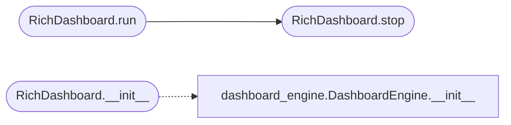

# `modules.rich_tui`

> Source: [modules/rich_tui.py:1](../../modules/rich_tui.py#L1) | language `py` | coverage 100.0% | [API index](../index.md)

Rich-based live TUI dashboard for LazyOwn campaign monitoring.

Provides an htop-style real-time dashboard that consumes data from
modules.dashboard_engine.DashboardEngine and renders a terminal UI
using the Python rich library.

## Contents

- **Classes:** [`RichDashboard`](#richdashboard)

## Call Graph

Solid arrows stay in this module, dashed arrows leave it.



## Classes

<a id="richdashboard"></a>

### `RichDashboard`

`class` | [modules/rich_tui.py:66](../../modules/rich_tui.py#L66)

```python
class RichDashboard
```

Rich-based live TUI dashboard for LazyOwn campaign monitoring.

**Members**

| Member | Kind | Summary |
|---|---|---|
| [`__init__`](#richdashboard-__init__) | constructor | Initialize the Rich dashboard. |
| [`run`](#richdashboard-run) | method | Run the dashboard. |
| [`stop`](#richdashboard-stop) | method | Gracefully shut down the dashboard and restore terminal state. |

<a id="richdashboard-__init__"></a>

#### `RichDashboard.__init__`

`constructor` | [modules/rich_tui.py:74](../../modules/rich_tui.py#L74)

```python
def __init__(self, dashboard_engine: DashboardEngine | None = None, refresh_interval: float = 3.0, live: bool = False) -> None
```

Initialize the Rich dashboard.

**Parameters**

| Name | Type | Default | Description |
|---|---|---|---|
| `dashboard_engine` | `DashboardEngine \| None` | `None` | DashboardEngine instance for data sourcing. |
| `refresh_interval` | `float` | `3.0` | Seconds between refreshes in blocking mode. |
| `live` | `bool` | `False` | Non-blocking mode when True. run() returns snapshot data without entering the interactive loop. |

*Calls:* [`DashboardEngine.__init__`](modules.dashboard_engine.py.md#dashboardengine-__init__)

*Called by:* [`PwnCommandSet.do_rich_tui`](cli.commands.pwn.py.md#pwncommandset-do_rich_tui)

<a id="richdashboard-run"></a>

#### `RichDashboard.run`

`method` | [modules/rich_tui.py:96](../../modules/rich_tui.py#L96)

```python
def run(self) -> dict[str, Any] | None
```

Run the dashboard.

**Returns:** `dict[str, Any] | None` - If live=True, returns the built snapshot dict.
Otherwise blocks until user quits (q key) and returns None.

*Calls:* [`RichDashboard.stop`](#richdashboard-stop)

*Called by:* [`PwnCommandSet.do_rich_tui`](cli.commands.pwn.py.md#pwncommandset-do_rich_tui)

<a id="richdashboard-stop"></a>

#### `RichDashboard.stop`

`method` | [modules/rich_tui.py:132](../../modules/rich_tui.py#L132)

```python
def stop(self) -> None
```

Gracefully shut down the dashboard and restore terminal state.

*Called by:* [`RichDashboard.run`](#richdashboard-run)

---
