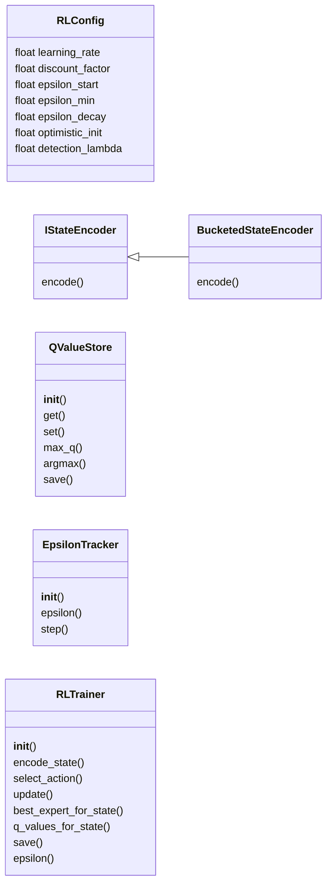
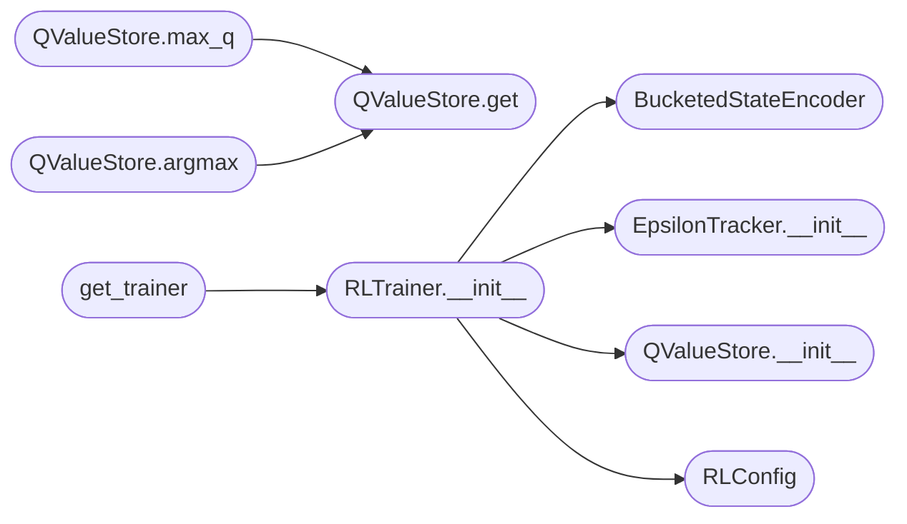

# `modules.rl_trainer`

> Source: [modules/rl_trainer.py:1](../../modules/rl_trainer.py#L1) | language `py` | coverage 70.4% | [API index](../index.md)

modules/rl_trainer.py ====================== Reinforcement Learning trainer for expert routing in LazyOwn's MoE system.

Implements tabular Q-learning to improve which expert model is selected for
each (task_type, engagement_phase) state.  Over time, the policy learns to
route high-risk tasks to reasoning models and quick tasks to fast models.

Theory
------
MDP formulation:
  State  S  =  (task_type, engagement_phase, recent_success_bucket)
  Action A  =  expert_id (which model to invoke)
  Reward R  =  policy_reward - detection_penalty
  Transition: S → S' after the expert completes the task

Q-learning update (off-policy, model-free):
  Q(s, a)  ←  Q(s, a)  +  α  *  [ r  +  γ * max_a' Q(s', a')  -  Q(s, a) ]

Exploration strategy: ε-greedy with decay
  ε_t = ε_0 * decay^t   (minimum ε_min = 0.05)

Design principles
-----------------
- Single Responsibility : RL update logic only; no model invocation
- Open/Closed           : state encoding extended via StateEncoder
- Dependency Inversion  : RLTrainer depends on IStateEncoder interface
- Thread-safe           : RLock guards all Q-value mutations

Usage
-----
    from modules.rl_trainer import get_trainer

    trainer = get_trainer()

    # Before executing: select expert
    expert_id = trainer.select_action(
        state=trainer.encode_state("exploit", "exploitation", 0.7),
        candidates=["groq_powerful", "groq_deepseek_r1", "ollama_reason"],
    )

    # After executing: update Q-values
    next_state = trainer.encode_state("privesc", "post_exploitation", 0.8)
    trainer.update(
        state=current_state,
        action=expert_id,
        reward=6.0,          # from policy engine
        next_state=next_state,
        detection_prob=0.82, # from detection oracle
    )

    # Persist
    trainer.save()

## Contents

- **Classes:** [`RLConfig`](#rlconfig), [`IStateEncoder`](#istateencoder), [`BucketedStateEncoder`](#bucketedstateencoder), [`QValueStore`](#qvaluestore), [`EpsilonTracker`](#epsilontracker), [`RLTrainer`](#rltrainer)
- **Functions:** [`get_trainer`](#get_trainer)

## Type Diagram



## Call Graph

Solid arrows stay in this module, dashed arrows leave it.



## Classes

<a id="rlconfig"></a>

### `RLConfig`

`class` `dataclass` | [modules/rl_trainer.py:84](../../modules/rl_trainer.py#L84)

Decorators: `@dataclass(frozen=True)`

```python
class RLConfig
```

All tunable RL hyperparameters in one place.

**Attributes**

| Name | Type | Default | Description |
|---|---|---|---|
| [`learning_rate`](#rlconfig-learning_rate) | `float` | `0.1` |  |
| [`discount_factor`](#rlconfig-discount_factor) | `float` | `0.9` |  |
| [`epsilon_start`](#rlconfig-epsilon_start) | `float` | `0.2` |  |
| [`epsilon_min`](#rlconfig-epsilon_min) | `float` | `0.05` |  |
| [`epsilon_decay`](#rlconfig-epsilon_decay) | `float` | `0.995` |  |
| [`optimistic_init`](#rlconfig-optimistic_init) | `float` | `1.0` |  |
| [`detection_lambda`](#rlconfig-detection_lambda) | `float` | `0.5` |  |

---

<a id="istateencoder"></a>

### `IStateEncoder`

`class` `abstract` | [modules/rl_trainer.py:101](../../modules/rl_trainer.py#L101)

```python
class IStateEncoder(ABC)
```

Bases: `ABC`

Subclasses: [`BucketedStateEncoder`](#bucketedstateencoder)

Contract for encoding environment state into a hashable string key.

**Members**

| Member | Kind | Summary |
|---|---|---|
| [`encode`](#istateencoder-encode) | method | Return a string key representing the current state. |

<a id="istateencoder-encode"></a>

#### `IStateEncoder.encode`

`method` `abstract` | [modules/rl_trainer.py:105](../../modules/rl_trainer.py#L105)

Decorators: `@abstractmethod`

```python
def encode(self, task_type: str, engagement_phase: str, recent_reward_ema: float) -> str
```

Return a string key representing the current state.

**Parameters**

| Name | Type | Default | Description |
|---|---|---|---|
| `task_type` | `str` |  |  |
| `engagement_phase` | `str` |  |  |
| `recent_reward_ema` | `float` |  |  |

**Returns:** `str`

---

<a id="bucketedstateencoder"></a>

### `BucketedStateEncoder`

`class` | [modules/rl_trainer.py:114](../../modules/rl_trainer.py#L114)

```python
class BucketedStateEncoder(IStateEncoder)
```

Bases: [`IStateEncoder`](#istateencoder)

Encodes (task_type, phase, recent_reward_ema) into a discrete state key.

Reward EMA is bucketed into 4 bins so that the Q-table stays finite:
    low       EMA <  0
    medium    0 <= EMA <  5
    high      5 <= EMA < 10
    excellent EMA >= 10

**Members**

| Member | Kind | Summary |
|---|---|---|
| [`encode`](#bucketedstateencoder-encode) | method | Return a string key representing the current state. |

<a id="bucketedstateencoder-encode"></a>

#### `BucketedStateEncoder.encode`

`method` | [modules/rl_trainer.py:131](../../modules/rl_trainer.py#L131)

```python
def encode(self, task_type: str, engagement_phase: str, recent_reward_ema: float) -> str
```

Return a string key representing the current state.

**Parameters**

| Name | Type | Default | Description |
|---|---|---|---|
| `task_type` | `str` |  |  |
| `engagement_phase` | `str` |  |  |
| `recent_reward_ema` | `float` |  |  |

**Returns:** `str`

> **Inherited:** Documentation from [`IStateEncoder.encode`](#istateencoder-encode) (modules/rl_trainer.py:105).

---

<a id="qvaluestore"></a>

### `QValueStore`

`class` | [modules/rl_trainer.py:150](../../modules/rl_trainer.py#L150)

```python
class QValueStore
```

Persists the Q-table to sessions/expert_qvalues.json.

Thread-safe via RLock.

**Members**

| Member | Kind | Summary |
|---|---|---|
| [`__init__`](#qvaluestore-__init__) | constructor |  |
| [`get`](#qvaluestore-get) | method |  |
| [`set`](#qvaluestore-set) | method |  |
| [`max_q`](#qvaluestore-max_q) | method | Return max Q(state, a) over the given candidate actions. |
| [`argmax`](#qvaluestore-argmax) | method | Return the action with highest Q(state, a). |
| [`save`](#qvaluestore-save) | method |  |

<a id="qvaluestore-__init__"></a>

#### `QValueStore.__init__`

`constructor` | [modules/rl_trainer.py:156](../../modules/rl_trainer.py#L156)

```python
def __init__(self, path: Path = _QVAL_FILE, optimistic_init: float = 1.0) -> None
```

**Parameters**

| Name | Type | Default | Description |
|---|---|---|---|
| `path` | `Path` | `_QVAL_FILE` |  |
| `optimistic_init` | `float` | `1.0` |  |

*Called by:* [`RLTrainer.__init__`](#rltrainer-__init__)

<a id="qvaluestore-get"></a>

#### `QValueStore.get`

`method` | [modules/rl_trainer.py:168](../../modules/rl_trainer.py#L168)

```python
def get(self, state: str, action: str) -> float
```

**Parameters**

| Name | Type | Default | Description |
|---|---|---|---|
| `state` | `str` |  |  |
| `action` | `str` |  |  |

**Returns:** `float`

*Called by:* [`QValueStore.argmax`](#qvaluestore-argmax), [`QValueStore.max_q`](#qvaluestore-max_q)

<a id="qvaluestore-set"></a>

#### `QValueStore.set`

`method` | [modules/rl_trainer.py:172](../../modules/rl_trainer.py#L172)

```python
def set(self, state: str, action: str, value: float) -> None
```

**Parameters**

| Name | Type | Default | Description |
|---|---|---|---|
| `state` | `str` |  |  |
| `action` | `str` |  |  |
| `value` | `float` |  |  |

<a id="qvaluestore-max_q"></a>

#### `QValueStore.max_q`

`method` | [modules/rl_trainer.py:176](../../modules/rl_trainer.py#L176)

```python
def max_q(self, state: str, candidates: Sequence[str]) -> float
```

Return max Q(state, a) over the given candidate actions.

**Parameters**

| Name | Type | Default | Description |
|---|---|---|---|
| `state` | `str` |  |  |
| `candidates` | `Sequence[str]` |  |  |

**Returns:** `float`

*Calls:* [`QValueStore.get`](#qvaluestore-get)

<a id="qvaluestore-argmax"></a>

#### `QValueStore.argmax`

`method` | [modules/rl_trainer.py:182](../../modules/rl_trainer.py#L182)

```python
def argmax(self, state: str, candidates: Sequence[str]) -> str
```

Return the action with highest Q(state, a).

**Parameters**

| Name | Type | Default | Description |
|---|---|---|---|
| `state` | `str` |  |  |
| `candidates` | `Sequence[str]` |  |  |

**Returns:** `str`

**Raises**

- `ValueError`: (raised in the body, not documented)

*Calls:* [`QValueStore.get`](#qvaluestore-get)

<a id="qvaluestore-save"></a>

#### `QValueStore.save`

`method` | [modules/rl_trainer.py:188](../../modules/rl_trainer.py#L188)

```python
def save(self) -> None
```

---

<a id="epsilontracker"></a>

### `EpsilonTracker`

`class` | [modules/rl_trainer.py:215](../../modules/rl_trainer.py#L215)

```python
class EpsilonTracker
```

Manages epsilon decay for epsilon-greedy exploration.

**Members**

| Member | Kind | Summary |
|---|---|---|
| [`__init__`](#epsilontracker-__init__) | constructor |  |
| [`epsilon`](#epsilontracker-epsilon) | property |  |
| [`step`](#epsilontracker-step) | method | Apply one decay step and persist. |

<a id="epsilontracker-__init__"></a>

#### `EpsilonTracker.__init__`

`constructor` | [modules/rl_trainer.py:218](../../modules/rl_trainer.py#L218)

```python
def __init__(self, start: float, minimum: float, decay: float, path: Path = _EPS_FILE) -> None
```

**Parameters**

| Name | Type | Default | Description |
|---|---|---|---|
| `start` | `float` |  |  |
| `minimum` | `float` |  |  |
| `decay` | `float` |  |  |
| `path` | `Path` | `_EPS_FILE` |  |

*Called by:* [`RLTrainer.__init__`](#rltrainer-__init__)

<a id="epsilontracker-epsilon"></a>

#### `EpsilonTracker.epsilon`

`property` | [modules/rl_trainer.py:233](../../modules/rl_trainer.py#L233)

Decorators: `@property`

```python
def epsilon(self) -> float
```

**Returns:** `float`

<a id="epsilontracker-step"></a>

#### `EpsilonTracker.step`

`method` | [modules/rl_trainer.py:236](../../modules/rl_trainer.py#L236)

```python
def step(self) -> None
```

Apply one decay step and persist.

---

<a id="rltrainer"></a>

### `RLTrainer`

`class` | [modules/rl_trainer.py:267](../../modules/rl_trainer.py#L267)

```python
class RLTrainer
```

Q-learning trainer for expert routing.

Provides:
  encode_state()    — convert environment observations to state key
  select_action()   — epsilon-greedy expert selection
  update()          — Q-learning update from observed reward
  save()            — persist Q-table and epsilon

Detection penalty
-----------------
High detection probability reduces the effective reward seen by the trainer,
encouraging selection of lower-noise experts over time:
    effective_reward = raw_reward - lambda * detection_prob * |raw_reward|

**Members**

| Member | Kind | Summary |
|---|---|---|
| [`__init__`](#rltrainer-__init__) | constructor |  |
| [`encode_state`](#rltrainer-encode_state) | method | Convert environment observations into a discrete state key. |
| [`select_action`](#rltrainer-select_action) | method | Epsilon-greedy expert selection. |
| [`update`](#rltrainer-update) | method | Apply one Q-learning update. |
| [`best_expert_for_state`](#rltrainer-best_expert_for_state) | method | Return the highest Q-value expert for the given state (greedy). |
| [`q_values_for_state`](#rltrainer-q_values_for_state) | method | Return {expert_id: q_value} for diagnostics. |
| [`save`](#rltrainer-save) | method | Persist Q-table to disk. |
| [`epsilon`](#rltrainer-epsilon) | property |  |

<a id="rltrainer-__init__"></a>

#### `RLTrainer.__init__`

`constructor` | [modules/rl_trainer.py:284](../../modules/rl_trainer.py#L284)

```python
def __init__(self, config: RLConfig | None = None, state_encoder: IStateEncoder | None = None, q_store: QValueStore | None = None, epsilon_tracker: EpsilonTracker | None = None) -> None
```

**Parameters**

| Name | Type | Default | Description |
|---|---|---|---|
| `config` | `RLConfig \| None` | `None` |  |
| `state_encoder` | `IStateEncoder \| None` | `None` |  |
| `q_store` | `QValueStore \| None` | `None` |  |
| `epsilon_tracker` | `EpsilonTracker \| None` | `None` |  |

*Calls:* [`BucketedStateEncoder`](#bucketedstateencoder), [`EpsilonTracker.__init__`](#epsilontracker-__init__), [`QValueStore.__init__`](#qvaluestore-__init__), [`RLConfig`](#rlconfig)

*Called by:* [`get_trainer`](#get_trainer)

<a id="rltrainer-encode_state"></a>

#### `RLTrainer.encode_state`

`method` | [modules/rl_trainer.py:304](../../modules/rl_trainer.py#L304)

```python
def encode_state(self, task_type: str, engagement_phase: str, recent_reward_ema: float = 0.0) -> str
```

Convert environment observations into a discrete state key.

**Parameters**

| Name | Type | Default | Description |
|---|---|---|---|
| `task_type` | `str` |  |  |
| `engagement_phase` | `str` |  |  |
| `recent_reward_ema` | `float` | `0.0` |  |

**Returns:** `str`

<a id="rltrainer-select_action"></a>

#### `RLTrainer.select_action`

`method` | [modules/rl_trainer.py:313](../../modules/rl_trainer.py#L313)

```python
def select_action(self, state: str, candidates: list[str], force_exploit: bool = False) -> str
```

Epsilon-greedy expert selection.

**Parameters**

| Name | Type | Default | Description |
|---|---|---|---|
| `state` | `str` |  |  |
| `candidates` | `list[str]` |  |  |
| `force_exploit` | `bool` | `False` |  |

**Returns:** `The selected expert_id.`

**Raises**

- `ValueError`: (raised in the body, not documented)

<a id="rltrainer-update"></a>

#### `RLTrainer.update`

`method` | [modules/rl_trainer.py:347](../../modules/rl_trainer.py#L347)

```python
def update(self, state: str, action: str, reward: float, next_state: str, candidates: list[str], detection_prob: float = 0.0) -> None
```

Apply one Q-learning update.

**Parameters**

| Name | Type | Default | Description |
|---|---|---|---|
| `state` | `str` |  |  |
| `action` | `str` |  |  |
| `reward` | `float` |  |  |
| `next_state` | `str` |  |  |
| `candidates` | `list[str]` |  |  |
| `detection_prob` | `float` | `0.0` |  |

<a id="rltrainer-best_expert_for_state"></a>

#### `RLTrainer.best_expert_for_state`

`method` | [modules/rl_trainer.py:389](../../modules/rl_trainer.py#L389)

```python
def best_expert_for_state(self, state: str, candidates: list[str]) -> str
```

Return the highest Q-value expert for the given state (greedy).

**Parameters**

| Name | Type | Default | Description |
|---|---|---|---|
| `state` | `str` |  |  |
| `candidates` | `list[str]` |  |  |

**Returns:** `str`

<a id="rltrainer-q_values_for_state"></a>

#### `RLTrainer.q_values_for_state`

`method` | [modules/rl_trainer.py:393](../../modules/rl_trainer.py#L393)

```python
def q_values_for_state(self, state: str, candidates: list[str]) -> dict[str, float]
```

Return {expert_id: q_value} for diagnostics.

**Parameters**

| Name | Type | Default | Description |
|---|---|---|---|
| `state` | `str` |  |  |
| `candidates` | `list[str]` |  |  |

**Returns:** `dict[str, float]`

<a id="rltrainer-save"></a>

#### `RLTrainer.save`

`method` | [modules/rl_trainer.py:397](../../modules/rl_trainer.py#L397)

```python
def save(self) -> None
```

Persist Q-table to disk.

<a id="rltrainer-epsilon"></a>

#### `RLTrainer.epsilon`

`property` | [modules/rl_trainer.py:402](../../modules/rl_trainer.py#L402)

Decorators: `@property`

```python
def epsilon(self) -> float
```

**Returns:** `float`

---

## Functions

<a id="get_trainer"></a>

### `get_trainer`

`function` | [modules/rl_trainer.py:425](../../modules/rl_trainer.py#L425)

```python
def get_trainer(config: RLConfig | None = None) -> RLTrainer
```

Return (or create) the module-level singleton RLTrainer.

**Parameters**

| Name | Type | Default | Description |
|---|---|---|---|
| `config` | `RLConfig \| None` | `None` |  |

**Returns:** `RLTrainer`

*Calls:* [`RLTrainer.__init__`](#rltrainer-__init__)

*Called by:* [`ai_snapshot`](modules.loop_ai_bridge.py.md#ai_snapshot), [`rl_save`](modules.loop_ai_bridge.py.md#rl_save), [`rl_select`](modules.loop_ai_bridge.py.md#rl_select), [`rl_update`](modules.loop_ai_bridge.py.md#rl_update), [`tool_class_yields`](modules.loop_ai_bridge.py.md#tool_class_yields)

---
