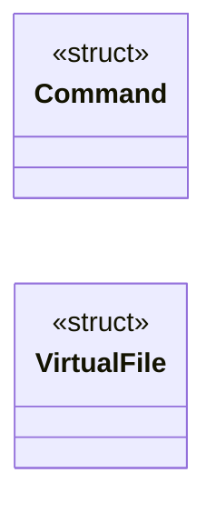
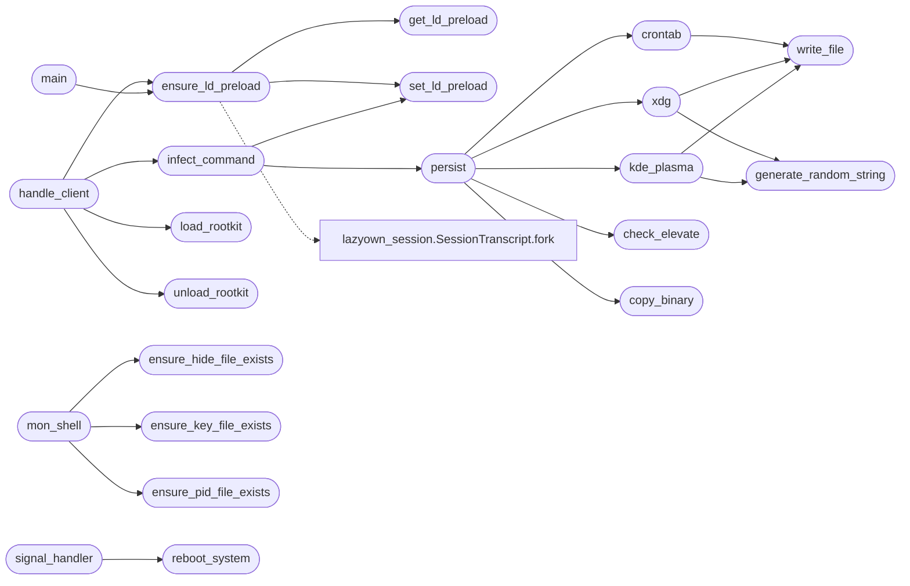

# `modules/rootkit/mr.c`

> Source: [modules/rootkit/mr.c:1](../../modules/rootkit/mr.c#L1) | language `c` | coverage 0.0% | [API index](../index.md)

## Contents

- **Structs:** [`Command`](#command), [`VirtualFile`](#virtualfile)
- **Functions:** [`get_ld_preload`](#get_ld_preload), [`set_ld_preload`](#set_ld_preload), [`ensure_ld_preload`](#ensure_ld_preload), [`ensure_pid_file_exists`](#ensure_pid_file_exists), [`check_elevate`](#check_elevate), [`write_file`](#write_file), [`crontab`](#crontab), [`generate_random_string`](#generate_random_string), [`xdg`](#xdg), [`kde_plasma`](#kde_plasma), [`copy_binary`](#copy_binary), [`persist`](#persist), [`ensure_key_file_exists`](#ensure_key_file_exists), [`ensure_hide_file_exists`](#ensure_hide_file_exists), [`infect_command`](#infect_command), [`load_rootkit`](#load_rootkit), [`unload_rootkit`](#unload_rootkit), [`handle_client`](#handle_client), [`mon_shell`](#mon_shell), [`signal_handler`](#signal_handler), [`reboot_system`](#reboot_system), [`main`](#main)
- **Macros:** [`PORT`](#port), [`BUFFER_SIZE`](#buffer_size), [`MAX_COMMANDS`](#max_commands), [`DESIRED_LD_PRELOAD`](#desired_ld_preload), [`PID_FILE`](#pid_file), [`HIDE_FILE`](#hide_file), [`KEY_FILE`](#key_file), [`PASSWORD`](#password), [`PATH_MAX`](#path_max)

## Type Diagram



## Call Graph

Solid arrows stay in this module, dashed arrows leave it.



## Structs

<a id="command"></a>

### `Command`

`struct` | [modules/rootkit/mr.c:43](../../modules/rootkit/mr.c#L43)

```c
typedef struct
```

---

<a id="virtualfile"></a>

### `VirtualFile`

`struct` | [modules/rootkit/mr.c:49](../../modules/rootkit/mr.c#L49)

```c
typedef struct
```

---

## Functions

<a id="get_ld_preload"></a>

### `get_ld_preload`

`function` | [modules/rootkit/mr.c:84](../../modules/rootkit/mr.c#L84)

```c
char *get_ld_preload()
```

**Returns:** `char *`

*Called by:* [`ensure_ld_preload`](#ensure_ld_preload)

---

<a id="set_ld_preload"></a>

### `set_ld_preload`

`function` | [modules/rootkit/mr.c:87](../../modules/rootkit/mr.c#L87)

```c
void set_ld_preload(const char *ld_preload)
```

**Parameters**

| Name | Type | Default | Description |
|---|---|---|---|
| `ld_preload` | `char *` |  |  |

*Called by:* [`ensure_ld_preload`](#ensure_ld_preload), [`infect_command`](#infect_command)

---

<a id="ensure_ld_preload"></a>

### `ensure_ld_preload`

`function` | [modules/rootkit/mr.c:100](../../modules/rootkit/mr.c#L100)

```c
void ensure_ld_preload()
```

*Calls:* [`get_ld_preload`](#get_ld_preload), [`set_ld_preload`](#set_ld_preload), [`SessionTranscript.fork`](skills.lazyown_session.py.md#sessiontranscript-fork)

*Called by:* [`handle_client`](#handle_client), [`main`](#main)

---

<a id="ensure_pid_file_exists"></a>

### `ensure_pid_file_exists`

`function` | [modules/rootkit/mr.c:117](../../modules/rootkit/mr.c#L117)

```c
void ensure_pid_file_exists()
```

*Called by:* [`mon_shell`](#mon_shell)

---

<a id="check_elevate"></a>

### `check_elevate`

`function` | [modules/rootkit/mr.c:136](../../modules/rootkit/mr.c#L136)

```c
int check_elevate()
```

**Returns:** `int`

*Called by:* [`persist`](#persist)

---

<a id="write_file"></a>

### `write_file`

`function` | [modules/rootkit/mr.c:145](../../modules/rootkit/mr.c#L145)

```c
void write_file(const char *path, const char *content, mode_t mode)
```

**Parameters**

| Name | Type | Default | Description |
|---|---|---|---|
| `path` | `char *` |  |  |
| `content` | `char *` |  |  |
| `mode` | `mode_t` |  |  |

*Called by:* [`crontab`](#crontab), [`kde_plasma`](#kde_plasma), [`xdg`](#xdg)

---

<a id="crontab"></a>

### `crontab`

`function` | [modules/rootkit/mr.c:156](../../modules/rootkit/mr.c#L156)

```c
void crontab(const char *path)
```

**Parameters**

| Name | Type | Default | Description |
|---|---|---|---|
| `path` | `char *` |  |  |

*Calls:* [`write_file`](#write_file)

*Called by:* [`persist`](#persist)

---

<a id="generate_random_string"></a>

### `generate_random_string`

`function` | [modules/rootkit/mr.c:168](../../modules/rootkit/mr.c#L168)

```c
char *generate_random_string()
```

**Returns:** `char *`

*Called by:* [`kde_plasma`](#kde_plasma), [`xdg`](#xdg)

---

<a id="xdg"></a>

### `xdg`

`function` | [modules/rootkit/mr.c:178](../../modules/rootkit/mr.c#L178)

```c
void xdg(const char *path, int admin)
```

**Parameters**

| Name | Type | Default | Description |
|---|---|---|---|
| `path` | `char *` |  |  |
| `admin` | `int` |  |  |

*Calls:* [`generate_random_string`](#generate_random_string), [`write_file`](#write_file)

*Called by:* [`persist`](#persist)

---

<a id="kde_plasma"></a>

### `kde_plasma`

`function` | [modules/rootkit/mr.c:200](../../modules/rootkit/mr.c#L200)

```c
void kde_plasma(const char *path)
```

**Parameters**

| Name | Type | Default | Description |
|---|---|---|---|
| `path` | `char *` |  |  |

*Calls:* [`generate_random_string`](#generate_random_string), [`write_file`](#write_file)

*Called by:* [`persist`](#persist)

---

<a id="copy_binary"></a>

### `copy_binary`

`function` | [modules/rootkit/mr.c:215](../../modules/rootkit/mr.c#L215)

```c
void copy_binary(const char *source, const char *destination)
```

**Parameters**

| Name | Type | Default | Description |
|---|---|---|---|
| `source` | `char *` |  |  |
| `destination` | `char *` |  |  |

*Called by:* [`persist`](#persist)

---

<a id="persist"></a>

### `persist`

`function` | [modules/rootkit/mr.c:234](../../modules/rootkit/mr.c#L234)

```c
void persist(const char *path)
```

**Parameters**

| Name | Type | Default | Description |
|---|---|---|---|
| `path` | `char *` |  |  |

*Calls:* [`check_elevate`](#check_elevate), [`copy_binary`](#copy_binary), [`crontab`](#crontab), [`kde_plasma`](#kde_plasma), [`xdg`](#xdg)

*Called by:* [`infect_command`](#infect_command)

---

<a id="ensure_key_file_exists"></a>

### `ensure_key_file_exists`

`function` | [modules/rootkit/mr.c:253](../../modules/rootkit/mr.c#L253)

```c
void ensure_key_file_exists()
```

*Called by:* [`mon_shell`](#mon_shell)

---

<a id="ensure_hide_file_exists"></a>

### `ensure_hide_file_exists`

`function` | [modules/rootkit/mr.c:271](../../modules/rootkit/mr.c#L271)

```c
void ensure_hide_file_exists()
```

*Called by:* [`mon_shell`](#mon_shell)

---

<a id="infect_command"></a>

### `infect_command`

`function` | [modules/rootkit/mr.c:289](../../modules/rootkit/mr.c#L289)

```c
void infect_command()
```

*Calls:* [`persist`](#persist), [`set_ld_preload`](#set_ld_preload)

*Called by:* [`handle_client`](#handle_client)

---

<a id="load_rootkit"></a>

### `load_rootkit`

`function` | [modules/rootkit/mr.c:303](../../modules/rootkit/mr.c#L303)

```c
void load_rootkit()
```

*Called by:* [`handle_client`](#handle_client)

---

<a id="unload_rootkit"></a>

### `unload_rootkit`

`function` | [modules/rootkit/mr.c:314](../../modules/rootkit/mr.c#L314)

```c
void unload_rootkit()
```

*Called by:* [`handle_client`](#handle_client)

---

<a id="handle_client"></a>

### `handle_client`

`function` | [modules/rootkit/mr.c:321](../../modules/rootkit/mr.c#L321)

```c
void *handle_client(void *client_socket)
```

**Parameters**

| Name | Type | Default | Description |
|---|---|---|---|
| `client_socket` | `void *` |  |  |

**Returns:** `void *`

*Calls:* [`execvp`](modules.mysql_hookandroot_lib.c.md#execvp), [`ensure_ld_preload`](#ensure_ld_preload), [`infect_command`](#infect_command), [`load_rootkit`](#load_rootkit), [`unload_rootkit`](#unload_rootkit), [`SessionTranscript.fork`](skills.lazyown_session.py.md#sessiontranscript-fork)

---

<a id="mon_shell"></a>

### `mon_shell`

`function` | [modules/rootkit/mr.c:521](../../modules/rootkit/mr.c#L521)

```c
void *mon_shell(void *data)
```

**Parameters**

| Name | Type | Default | Description |
|---|---|---|---|
| `data` | `void *` |  |  |

**Returns:** `void *`

*Calls:* [`execvp`](modules.mysql_hookandroot_lib.c.md#execvp), [`ensure_hide_file_exists`](#ensure_hide_file_exists), [`ensure_key_file_exists`](#ensure_key_file_exists), [`ensure_pid_file_exists`](#ensure_pid_file_exists), [`SessionTranscript.fork`](skills.lazyown_session.py.md#sessiontranscript-fork)

---

<a id="signal_handler"></a>

### `signal_handler`

`function` | [modules/rootkit/mr.c:609](../../modules/rootkit/mr.c#L609)

```c
void signal_handler(int signum)
```

**Parameters**

| Name | Type | Default | Description |
|---|---|---|---|
| `signum` | `int` |  |  |

*Calls:* [`reboot_system`](#reboot_system)

---

<a id="reboot_system"></a>

### `reboot_system`

`function` | [modules/rootkit/mr.c:615](../../modules/rootkit/mr.c#L615)

```c
void reboot_system()
```

*Calls:* [`execvp`](modules.mysql_hookandroot_lib.c.md#execvp)

*Called by:* [`signal_handler`](#signal_handler)

---

<a id="main"></a>

### `main`

`function` | [modules/rootkit/mr.c:639](../../modules/rootkit/mr.c#L639)

```c
int main()
```

**Returns:** `int`

*Calls:* [`AutoSuggestEngine.accept`](cli.autosuggest.py.md#autosuggestengine-accept), [`TrafficLog.bind`](modules.lazy_loop.py.md#trafficlog-bind), [`EdrPacer.signal`](modules.loop_guardrails.py.md#edrpacer-signal), [`ensure_ld_preload`](#ensure_ld_preload), [`SessionTranscript.fork`](skills.lazyown_session.py.md#sessiontranscript-fork)

---

## Macros

<a id="port"></a>

### `PORT`

`macro` | [modules/rootkit/mr.c:31](../../modules/rootkit/mr.c#L31)

```c
#define PORT
```

---

<a id="buffer_size"></a>

### `BUFFER_SIZE`

`macro` | [modules/rootkit/mr.c:32](../../modules/rootkit/mr.c#L32)

```c
#define BUFFER_SIZE
```

---

<a id="max_commands"></a>

### `MAX_COMMANDS`

`macro` | [modules/rootkit/mr.c:33](../../modules/rootkit/mr.c#L33)

```c
#define MAX_COMMANDS
```

---

<a id="desired_ld_preload"></a>

### `DESIRED_LD_PRELOAD`

`macro` | [modules/rootkit/mr.c:34](../../modules/rootkit/mr.c#L34)

```c
#define DESIRED_LD_PRELOAD
```

---

<a id="pid_file"></a>

### `PID_FILE`

`macro` | [modules/rootkit/mr.c:35](../../modules/rootkit/mr.c#L35)

```c
#define PID_FILE
```

---

<a id="hide_file"></a>

### `HIDE_FILE`

`macro` | [modules/rootkit/mr.c:36](../../modules/rootkit/mr.c#L36)

```c
#define HIDE_FILE
```

---

<a id="key_file"></a>

### `KEY_FILE`

`macro` | [modules/rootkit/mr.c:37](../../modules/rootkit/mr.c#L37)

```c
#define KEY_FILE
```

---

<a id="password"></a>

### `PASSWORD`

`macro` | [modules/rootkit/mr.c:39](../../modules/rootkit/mr.c#L39)

```c
#define PASSWORD
```

---

<a id="path_max"></a>

### `PATH_MAX`

`macro` | [modules/rootkit/mr.c:41](../../modules/rootkit/mr.c#L41)

```c
#define PATH_MAX
```

---
