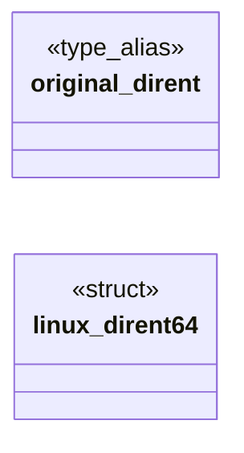
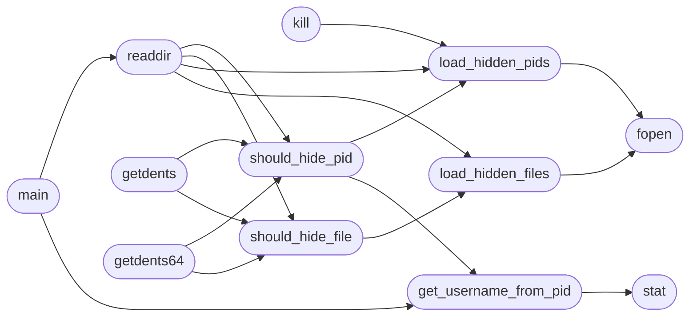

# `modules/rootkit/mrhyde.c`

> Source: [modules/rootkit/mrhyde.c:1](../../modules/rootkit/mrhyde.c#L1) | language `c` | coverage 2.6% | [API index](../index.md)

## Contents

- **Structs:** [`linux_dirent64`](#linux_dirent64)
- **Type Aliases:** [`original_dirent`](#original_dirent)
- **Functions:** [`load_hidden_pids`](#load_hidden_pids), [`load_hidden_files`](#load_hidden_files), [`unlink`](#unlink), [`kill`](#kill), [`remove`](#remove), [`unlinkat`](#unlinkat), [`get_username_from_pid`](#get_username_from_pid), [`should_hide_pid`](#should_hide_pid), [`should_hide_file`](#should_hide_file), [`readdir`](#readdir), [`fopen`](#fopen), [`my_open`](#my_open), [`my_openat`](#my_openat), [`stat`](#stat), [`lstat`](#lstat), [`fstat`](#fstat), [`getdents`](#getdents), [`getdents64`](#getdents64), [`main`](#main)
- **Macros:** [`HIDDEN_DIR`](#hidden_dir), [`HIDDEN_FILE`](#hidden_file), [`HIDDEN_FILE1`](#hidden_file1), [`HIDDEN_FILE2`](#hidden_file2), [`HIDDEN_FILE3`](#hidden_file3), [`HIDDEN_FILE4`](#hidden_file4), [`HIDDEN_FILE5`](#hidden_file5), [`HIDDEN_FILE6`](#hidden_file6), [`HIDDEN_FILE7`](#hidden_file7), [`HIDDEN_FILE8`](#hidden_file8), [`HIDDEN_FILE9`](#hidden_file9), [`PATHMRHYDE`](#pathmrhyde), [`HIDE_DIR`](#hide_dir), [`HIDE_USER`](#hide_user), [`MAX_HIDE_PIDS`](#max_hide_pids), [`PID_FILE_PATH`](#pid_file_path), [`FILE_HIDE_PATH`](#file_hide_path)

## Type Diagram



## Call Graph

Solid arrows stay in this module, dashed arrows leave it.



## Structs

<a id="linux_dirent64"></a>

### `linux_dirent64`

`struct` | [modules/rootkit/mrhyde.c:552](../../modules/rootkit/mrhyde.c#L552)

```c
struct linux_dirent64
```

---

## Type Aliases

<a id="original_dirent"></a>

### `original_dirent`

`type_alias` | [modules/rootkit/mrhyde.c:55](../../modules/rootkit/mrhyde.c#L55)

```c
typedef struct dirent original_dirent;
```

ifndef HIDE_DIR define HIDE_DIR ".rootkit_dir" endif ifndef HIDE_USER define HIDE_USER "rootkit_user" endif define MAX_HIDE_PIDS 140 define PID_FILE_PATH "/dev/shm/pid" define FILE_HIDE_PATH "/dev/shm/file"

---

## Functions

<a id="load_hidden_pids"></a>

### `load_hidden_pids`

`function` | [modules/rootkit/mrhyde.c:77](../../modules/rootkit/mrhyde.c#L77)

```c
void load_hidden_pids()
```

*Calls:* [`fopen`](#fopen)

*Called by:* [`kill`](#kill), [`readdir`](#readdir), [`should_hide_pid`](#should_hide_pid)

---

<a id="load_hidden_files"></a>

### `load_hidden_files`

`function` | [modules/rootkit/mrhyde.c:97](../../modules/rootkit/mrhyde.c#L97)

```c
void load_hidden_files()
```

*Calls:* [`fopen`](#fopen)

*Called by:* [`readdir`](#readdir), [`should_hide_file`](#should_hide_file)

---

<a id="unlink"></a>

### `unlink`

`function` | [modules/rootkit/mrhyde.c:117](../../modules/rootkit/mrhyde.c#L117)

```c
int unlink(const char *pathname)
```

**Parameters**

| Name | Type | Default | Description |
|---|---|---|---|
| `pathname` | `char *` |  |  |

**Returns:** `int`

---

<a id="kill"></a>

### `kill`

`function` | [modules/rootkit/mrhyde.c:129](../../modules/rootkit/mrhyde.c#L129)

```c
int kill(pid_t pid, int sig)
```

**Parameters**

| Name | Type | Default | Description |
|---|---|---|---|
| `pid` | `pid_t` |  |  |
| `sig` | `int` |  |  |

**Returns:** `int`

*Calls:* [`load_hidden_pids`](#load_hidden_pids)

---

<a id="remove"></a>

### `remove`

`function` | [modules/rootkit/mrhyde.c:149](../../modules/rootkit/mrhyde.c#L149)

```c
int remove(const char *pathname)
```

**Parameters**

| Name | Type | Default | Description |
|---|---|---|---|
| `pathname` | `char *` |  |  |

**Returns:** `int`

---

<a id="unlinkat"></a>

### `unlinkat`

`function` | [modules/rootkit/mrhyde.c:161](../../modules/rootkit/mrhyde.c#L161)

```c
int unlinkat(int dirfd, const char *pathname, int flags)
```

**Parameters**

| Name | Type | Default | Description |
|---|---|---|---|
| `dirfd` | `int` |  |  |
| `pathname` | `char *` |  |  |
| `flags` | `int` |  |  |

**Returns:** `int`

---

<a id="get_username_from_pid"></a>

### `get_username_from_pid`

`function` | [modules/rootkit/mrhyde.c:182](../../modules/rootkit/mrhyde.c#L182)

```c
char* get_username_from_pid(pid_t pid)
```

**Parameters**

| Name | Type | Default | Description |
|---|---|---|---|
| `pid` | `pid_t` |  |  |

**Returns:** `char*`

*Calls:* [`stat`](#stat)

*Called by:* [`main`](#main), [`should_hide_pid`](#should_hide_pid)

---

<a id="should_hide_pid"></a>

### `should_hide_pid`

`function` | [modules/rootkit/mrhyde.c:201](../../modules/rootkit/mrhyde.c#L201)

```c
int should_hide_pid(const char* pid)
```

**Parameters**

| Name | Type | Default | Description |
|---|---|---|---|
| `pid` | `char*` |  |  |

**Returns:** `int`

*Calls:* [`get_username_from_pid`](#get_username_from_pid), [`load_hidden_pids`](#load_hidden_pids)

*Called by:* [`getdents`](#getdents), [`getdents64`](#getdents64), [`readdir`](#readdir)

---

<a id="should_hide_file"></a>

### `should_hide_file`

`function` | [modules/rootkit/mrhyde.c:216](../../modules/rootkit/mrhyde.c#L216)

```c
int should_hide_file(const char* filename)
```

**Parameters**

| Name | Type | Default | Description |
|---|---|---|---|
| `filename` | `char*` |  |  |

**Returns:** `int`

*Calls:* [`load_hidden_files`](#load_hidden_files)

*Called by:* [`getdents`](#getdents), [`getdents64`](#getdents64), [`readdir`](#readdir)

---

<a id="readdir"></a>

### `readdir`

`function` | [modules/rootkit/mrhyde.c:226](../../modules/rootkit/mrhyde.c#L226)

```c
struct dirent* readdir(DIR* dirp)
```

**Parameters**

| Name | Type | Default | Description |
|---|---|---|---|
| `dirp` | `DIR*` |  |  |

**Returns:** `dirent*`

*Calls:* [`load_hidden_files`](#load_hidden_files), [`load_hidden_pids`](#load_hidden_pids), [`should_hide_file`](#should_hide_file), [`should_hide_pid`](#should_hide_pid)

*Called by:* [`main`](#main)

---

<a id="fopen"></a>

### `fopen`

`function` | [modules/rootkit/mrhyde.c:287](../../modules/rootkit/mrhyde.c#L287)

```c
FILE *fopen(const char *pathname, const char *mode)
```

**Parameters**

| Name | Type | Default | Description |
|---|---|---|---|
| `pathname` | `char *` |  |  |
| `mode` | `char *` |  |  |

**Returns:** `FILE *`

*Called by:* [`load_hidden_files`](#load_hidden_files), [`load_hidden_pids`](#load_hidden_pids)

---

<a id="my_open"></a>

### `my_open`

`function` | [modules/rootkit/mrhyde.c:331](../../modules/rootkit/mrhyde.c#L331)

```c
int my_open(const char *pathname, int flags, mode_t mode)
```

**Parameters**

| Name | Type | Default | Description |
|---|---|---|---|
| `pathname` | `char *` |  |  |
| `flags` | `int` |  |  |
| `mode` | `mode_t` |  |  |

**Returns:** `int`

---

<a id="my_openat"></a>

### `my_openat`

`function` | [modules/rootkit/mrhyde.c:375](../../modules/rootkit/mrhyde.c#L375)

```c
int my_openat(int dirfd, const char *pathname, int flags, mode_t mode)
```

**Parameters**

| Name | Type | Default | Description |
|---|---|---|---|
| `dirfd` | `int` |  |  |
| `pathname` | `char *` |  |  |
| `flags` | `int` |  |  |
| `mode` | `mode_t` |  |  |

**Returns:** `int`

---

<a id="stat"></a>

### `stat`

`function` | [modules/rootkit/mrhyde.c:419](../../modules/rootkit/mrhyde.c#L419)

```c
int stat(const char *pathname, struct stat *statbuf)
```

**Parameters**

| Name | Type | Default | Description |
|---|---|---|---|
| `pathname` | `char *` |  |  |
| `statbuf` | `struct stat *` |  |  |

**Returns:** `int`

*Called by:* [`get_username_from_pid`](#get_username_from_pid)

---

<a id="lstat"></a>

### `lstat`

`function` | [modules/rootkit/mrhyde.c:463](../../modules/rootkit/mrhyde.c#L463)

```c
int lstat(const char *pathname, struct stat *statbuf)
```

**Parameters**

| Name | Type | Default | Description |
|---|---|---|---|
| `pathname` | `char *` |  |  |
| `statbuf` | `struct stat *` |  |  |

**Returns:** `int`

---

<a id="fstat"></a>

### `fstat`

`function` | [modules/rootkit/mrhyde.c:507](../../modules/rootkit/mrhyde.c#L507)

```c
int fstat(int fd, struct stat *statbuf)
```

**Parameters**

| Name | Type | Default | Description |
|---|---|---|---|
| `fd` | `int` |  |  |
| `statbuf` | `struct stat *` |  |  |

**Returns:** `int`

---

<a id="getdents"></a>

### `getdents`

`function` | [modules/rootkit/mrhyde.c:561](../../modules/rootkit/mrhyde.c#L561)

```c
int getdents(unsigned int fd, struct linux_dirent64 *dirp, unsigned int count)
```

**Parameters**

| Name | Type | Default | Description |
|---|---|---|---|
| `fd` | `unsigned int` |  |  |
| `dirp` | `struct linux_dirent64 *` |  |  |
| `count` | `unsigned int` |  |  |

**Returns:** `int`

*Calls:* [`should_hide_file`](#should_hide_file), [`should_hide_pid`](#should_hide_pid)

---

<a id="getdents64"></a>

### `getdents64`

`function` | [modules/rootkit/mrhyde.c:622](../../modules/rootkit/mrhyde.c#L622)

```c
int getdents64(unsigned int fd, struct linux_dirent64 *dirp, unsigned int count)
```

**Parameters**

| Name | Type | Default | Description |
|---|---|---|---|
| `fd` | `unsigned int` |  |  |
| `dirp` | `struct linux_dirent64 *` |  |  |
| `count` | `unsigned int` |  |  |

**Returns:** `int`

*Calls:* [`should_hide_file`](#should_hide_file), [`should_hide_pid`](#should_hide_pid)

---

<a id="main"></a>

### `main`

`function` | [modules/rootkit/mrhyde.c:682](../../modules/rootkit/mrhyde.c#L682)

```c
int main()
```

**Returns:** `int`

*Calls:* [`get_username_from_pid`](#get_username_from_pid), [`readdir`](#readdir)

---

## Macros

<a id="hidden_dir"></a>

### `HIDDEN_DIR`

`macro` | [modules/rootkit/mrhyde.c:33](../../modules/rootkit/mrhyde.c#L33)

```c
#define HIDDEN_DIR
```

---

<a id="hidden_file"></a>

### `HIDDEN_FILE`

`macro` | [modules/rootkit/mrhyde.c:34](../../modules/rootkit/mrhyde.c#L34)

```c
#define HIDDEN_FILE
```

---

<a id="hidden_file1"></a>

### `HIDDEN_FILE1`

`macro` | [modules/rootkit/mrhyde.c:35](../../modules/rootkit/mrhyde.c#L35)

```c
#define HIDDEN_FILE1
```

---

<a id="hidden_file2"></a>

### `HIDDEN_FILE2`

`macro` | [modules/rootkit/mrhyde.c:36](../../modules/rootkit/mrhyde.c#L36)

```c
#define HIDDEN_FILE2
```

---

<a id="hidden_file3"></a>

### `HIDDEN_FILE3`

`macro` | [modules/rootkit/mrhyde.c:37](../../modules/rootkit/mrhyde.c#L37)

```c
#define HIDDEN_FILE3
```

---

<a id="hidden_file4"></a>

### `HIDDEN_FILE4`

`macro` | [modules/rootkit/mrhyde.c:38](../../modules/rootkit/mrhyde.c#L38)

```c
#define HIDDEN_FILE4
```

---

<a id="hidden_file5"></a>

### `HIDDEN_FILE5`

`macro` | [modules/rootkit/mrhyde.c:39](../../modules/rootkit/mrhyde.c#L39)

```c
#define HIDDEN_FILE5
```

---

<a id="hidden_file6"></a>

### `HIDDEN_FILE6`

`macro` | [modules/rootkit/mrhyde.c:40](../../modules/rootkit/mrhyde.c#L40)

```c
#define HIDDEN_FILE6
```

---

<a id="hidden_file7"></a>

### `HIDDEN_FILE7`

`macro` | [modules/rootkit/mrhyde.c:41](../../modules/rootkit/mrhyde.c#L41)

```c
#define HIDDEN_FILE7
```

---

<a id="hidden_file8"></a>

### `HIDDEN_FILE8`

`macro` | [modules/rootkit/mrhyde.c:42](../../modules/rootkit/mrhyde.c#L42)

```c
#define HIDDEN_FILE8
```

---

<a id="hidden_file9"></a>

### `HIDDEN_FILE9`

`macro` | [modules/rootkit/mrhyde.c:43](../../modules/rootkit/mrhyde.c#L43)

```c
#define HIDDEN_FILE9
```

---

<a id="pathmrhyde"></a>

### `PATHMRHYDE`

`macro` | [modules/rootkit/mrhyde.c:44](../../modules/rootkit/mrhyde.c#L44)

```c
#define PATHMRHYDE
```

---

<a id="hide_dir"></a>

### `HIDE_DIR`

`macro` | [modules/rootkit/mrhyde.c:47](../../modules/rootkit/mrhyde.c#L47)

```c
#define HIDE_DIR
```

---

<a id="hide_user"></a>

### `HIDE_USER`

`macro` | [modules/rootkit/mrhyde.c:50](../../modules/rootkit/mrhyde.c#L50)

```c
#define HIDE_USER
```

---

<a id="max_hide_pids"></a>

### `MAX_HIDE_PIDS`

`macro` | [modules/rootkit/mrhyde.c:52](../../modules/rootkit/mrhyde.c#L52)

```c
#define MAX_HIDE_PIDS
```

---

<a id="pid_file_path"></a>

### `PID_FILE_PATH`

`macro` | [modules/rootkit/mrhyde.c:53](../../modules/rootkit/mrhyde.c#L53)

```c
#define PID_FILE_PATH
```

---

<a id="file_hide_path"></a>

### `FILE_HIDE_PATH`

`macro` | [modules/rootkit/mrhyde.c:54](../../modules/rootkit/mrhyde.c#L54)

```c
#define FILE_HIDE_PATH
```

---
