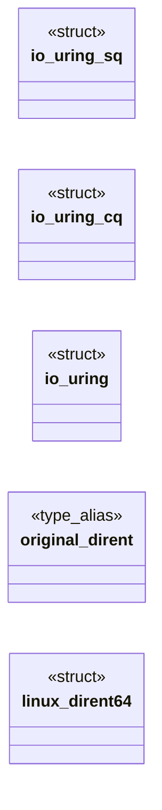
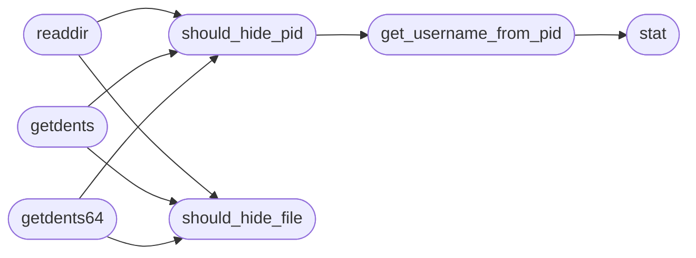

# `modules/rootkit/mrhyde3.c`

> Source: [modules/rootkit/mrhyde3.c:1](../../modules/rootkit/mrhyde3.c#L1) | language `c` | coverage 10.6% | [API index](../index.md)

## Contents

- **Structs:** [`io_uring_sq`](#io_uring_sq), [`io_uring_cq`](#io_uring_cq), [`io_uring`](#io_uring), [`linux_dirent64`](#linux_dirent64)
- **Type Aliases:** [`original_dirent`](#original_dirent)
- **Functions:** [`load_hidden_pids`](#load_hidden_pids), [`load_hidden_files`](#load_hidden_files), [`get_username_from_pid`](#get_username_from_pid), [`should_hide_pid`](#should_hide_pid), [`should_hide_file`](#should_hide_file), [`readdir`](#readdir), [`unlink`](#unlink), [`kill`](#kill), [`remove`](#remove), [`unlinkat`](#unlinkat), [`fopen`](#fopen), [`open`](#open), [`openat`](#openat), [`stat`](#stat), [`lstat`](#lstat), [`fstat`](#fstat), [`getdents`](#getdents), [`getdents64`](#getdents64)
- **Macros:** [`_GNU_SOURCE`](#_gnu_source), [`HIDDEN_DIR`](#hidden_dir), [`HIDDEN_FILE`](#hidden_file), [`HIDDEN_FILE1`](#hidden_file1), [`HIDDEN_FILE2`](#hidden_file2), [`HIDDEN_FILE3`](#hidden_file3), [`HIDDEN_FILE4`](#hidden_file4), [`HIDDEN_FILE5`](#hidden_file5), [`HIDDEN_FILE6`](#hidden_file6), [`HIDDEN_FILE7`](#hidden_file7), [`HIDDEN_FILE8`](#hidden_file8), [`HIDDEN_FILE9`](#hidden_file9), [`PATHMRHYDE`](#pathmrhyde), [`HIDE_DIR`](#hide_dir), [`HIDE_USER`](#hide_user), [`MAX_HIDE_PIDS`](#max_hide_pids), [`PID_FILE_PATH`](#pid_file_path), [`FILE_HIDE_PATH`](#file_hide_path), [`IO_URING_QUEUE_DEPTH`](#io_uring_queue_depth), [`IO_URING_BUFFER_SIZE`](#io_uring_buffer_size), [`C2_SERVER_IP`](#c2_server_ip), [`C2_PORT`](#c2_port), [`CQE_TIMEOUT_MS`](#cqe_timeout_ms)

## Type Diagram



## Call Graph

Solid arrows stay in this module, dashed arrows leave it.



## Structs

<a id="io_uring_sq"></a>

### `io_uring_sq`

`struct` | [modules/rootkit/mrhyde3.c:57](../../modules/rootkit/mrhyde3.c#L57)

```c
struct io_uring_sq
```

Estructuras para io_uring manual

---

<a id="io_uring_cq"></a>

### `io_uring_cq`

`struct` | [modules/rootkit/mrhyde3.c:61](../../modules/rootkit/mrhyde3.c#L61)

```c
struct io_uring_cq
```

---

<a id="io_uring"></a>

### `io_uring`

`struct` | [modules/rootkit/mrhyde3.c:65](../../modules/rootkit/mrhyde3.c#L65)

```c
struct io_uring
```

---

<a id="linux_dirent64"></a>

### `linux_dirent64`

`struct` | [modules/rootkit/mrhyde3.c:560](../../modules/rootkit/mrhyde3.c#L560)

```c
struct linux_dirent64
```

---

## Type Aliases

<a id="original_dirent"></a>

### `original_dirent`

`type_alias` | [modules/rootkit/mrhyde3.c:312](../../modules/rootkit/mrhyde3.c#L312)

```c
typedef struct dirent original_dirent;
```

----------------------------------------------------------------------
HOOKS TRADICIONALES (sin cambios, usan hide_pids/hide_files)
----------------------------------------------------------------------

---

## Functions

<a id="load_hidden_pids"></a>

### `load_hidden_pids`

`function` | [modules/rootkit/mrhyde3.c:268](../../modules/rootkit/mrhyde3.c#L268)

```c
void load_hidden_pids(void)
```

Cargar listas con fallback

---

<a id="load_hidden_files"></a>

### `load_hidden_files`

`function` | [modules/rootkit/mrhyde3.c:282](../../modules/rootkit/mrhyde3.c#L282)

```c
void load_hidden_files(void)
```

---

<a id="get_username_from_pid"></a>

### `get_username_from_pid`

`function` | [modules/rootkit/mrhyde3.c:297](../../modules/rootkit/mrhyde3.c#L297)

```c
char* get_username_from_pid(pid_t pid)
```

get_username_from_pid (tradicional)

**Parameters**

| Name | Type | Default | Description |
|---|---|---|---|
| `pid` | `pid_t` |  |  |

**Returns:** `char*`

*Calls:* [`stat`](#stat)

*Called by:* [`should_hide_pid`](#should_hide_pid)

---

<a id="should_hide_pid"></a>

### `should_hide_pid`

`function` | [modules/rootkit/mrhyde3.c:320](../../modules/rootkit/mrhyde3.c#L320)

```c
int should_hide_pid(const char* pid)
```

**Parameters**

| Name | Type | Default | Description |
|---|---|---|---|
| `pid` | `char*` |  |  |

**Returns:** `int`

*Calls:* [`get_username_from_pid`](#get_username_from_pid)

*Called by:* [`getdents`](#getdents), [`getdents64`](#getdents64), [`readdir`](#readdir)

---

<a id="should_hide_file"></a>

### `should_hide_file`

`function` | [modules/rootkit/mrhyde3.c:329](../../modules/rootkit/mrhyde3.c#L329)

```c
int should_hide_file(const char* filename)
```

**Parameters**

| Name | Type | Default | Description |
|---|---|---|---|
| `filename` | `char*` |  |  |

**Returns:** `int`

*Called by:* [`getdents`](#getdents), [`getdents64`](#getdents64), [`readdir`](#readdir)

---

<a id="readdir"></a>

### `readdir`

`function` | [modules/rootkit/mrhyde3.c:336](../../modules/rootkit/mrhyde3.c#L336)

```c
struct dirent* readdir(DIR* dirp)
```

**Parameters**

| Name | Type | Default | Description |
|---|---|---|---|
| `dirp` | `DIR*` |  |  |

**Returns:** `dirent*`

*Calls:* [`should_hide_file`](#should_hide_file), [`should_hide_pid`](#should_hide_pid)

---

<a id="unlink"></a>

### `unlink`

`function` | [modules/rootkit/mrhyde3.c:367](../../modules/rootkit/mrhyde3.c#L367)

```c
int unlink(const char *pathname)
```

**Parameters**

| Name | Type | Default | Description |
|---|---|---|---|
| `pathname` | `char *` |  |  |

**Returns:** `int`

---

<a id="kill"></a>

### `kill`

`function` | [modules/rootkit/mrhyde3.c:373](../../modules/rootkit/mrhyde3.c#L373)

```c
int kill(pid_t pid, int sig)
```

**Parameters**

| Name | Type | Default | Description |
|---|---|---|---|
| `pid` | `pid_t` |  |  |
| `sig` | `int` |  |  |

**Returns:** `int`

---

<a id="remove"></a>

### `remove`

`function` | [modules/rootkit/mrhyde3.c:383](../../modules/rootkit/mrhyde3.c#L383)

```c
int remove(const char *pathname)
```

**Parameters**

| Name | Type | Default | Description |
|---|---|---|---|
| `pathname` | `char *` |  |  |

**Returns:** `int`

---

<a id="unlinkat"></a>

### `unlinkat`

`function` | [modules/rootkit/mrhyde3.c:389](../../modules/rootkit/mrhyde3.c#L389)

```c
int unlinkat(int dirfd, const char *pathname, int flags)
```

**Parameters**

| Name | Type | Default | Description |
|---|---|---|---|
| `dirfd` | `int` |  |  |
| `pathname` | `char *` |  |  |
| `flags` | `int` |  |  |

**Returns:** `int`

---

<a id="fopen"></a>

### `fopen`

`function` | [modules/rootkit/mrhyde3.c:407](../../modules/rootkit/mrhyde3.c#L407)

```c
FILE *fopen(const char *pathname, const char *mode)
```

**Parameters**

| Name | Type | Default | Description |
|---|---|---|---|
| `pathname` | `char *` |  |  |
| `mode` | `char *` |  |  |

**Returns:** `FILE *`

---

<a id="open"></a>

### `open`

`function` | [modules/rootkit/mrhyde3.c:430](../../modules/rootkit/mrhyde3.c#L430)

```c
int open(const char *pathname, int flags, ...)
```

**Parameters**

| Name | Type | Default | Description |
|---|---|---|---|
| `pathname` | `char *` |  |  |
| `flags` | `int` |  |  |
| `...` |  |  |  |

**Returns:** `int`

---

<a id="openat"></a>

### `openat`

`function` | [modules/rootkit/mrhyde3.c:458](../../modules/rootkit/mrhyde3.c#L458)

```c
int openat(int dirfd, const char *pathname, int flags, ...)
```

**Parameters**

| Name | Type | Default | Description |
|---|---|---|---|
| `dirfd` | `int` |  |  |
| `pathname` | `char *` |  |  |
| `flags` | `int` |  |  |
| `...` |  |  |  |

**Returns:** `int`

---

<a id="stat"></a>

### `stat`

`function` | [modules/rootkit/mrhyde3.c:487](../../modules/rootkit/mrhyde3.c#L487)

```c
int stat(const char *pathname, struct stat *statbuf)
```

**Parameters**

| Name | Type | Default | Description |
|---|---|---|---|
| `pathname` | `char *` |  |  |
| `statbuf` | `struct stat *` |  |  |

**Returns:** `int`

*Called by:* [`get_username_from_pid`](#get_username_from_pid)

---

<a id="lstat"></a>

### `lstat`

`function` | [modules/rootkit/mrhyde3.c:511](../../modules/rootkit/mrhyde3.c#L511)

```c
int lstat(const char *pathname, struct stat *statbuf)
```

**Parameters**

| Name | Type | Default | Description |
|---|---|---|---|
| `pathname` | `char *` |  |  |
| `statbuf` | `struct stat *` |  |  |

**Returns:** `int`

---

<a id="fstat"></a>

### `fstat`

`function` | [modules/rootkit/mrhyde3.c:535](../../modules/rootkit/mrhyde3.c#L535)

```c
int fstat(int fd, struct stat *statbuf)
```

**Parameters**

| Name | Type | Default | Description |
|---|---|---|---|
| `fd` | `int` |  |  |
| `statbuf` | `struct stat *` |  |  |

**Returns:** `int`

---

<a id="getdents"></a>

### `getdents`

`function` | [modules/rootkit/mrhyde3.c:569](../../modules/rootkit/mrhyde3.c#L569)

```c
int getdents(unsigned int fd, struct linux_dirent64 *dirp, unsigned int count)
```

**Parameters**

| Name | Type | Default | Description |
|---|---|---|---|
| `fd` | `unsigned int` |  |  |
| `dirp` | `struct linux_dirent64 *` |  |  |
| `count` | `unsigned int` |  |  |

**Returns:** `int`

*Calls:* [`should_hide_file`](#should_hide_file), [`should_hide_pid`](#should_hide_pid)

---

<a id="getdents64"></a>

### `getdents64`

`function` | [modules/rootkit/mrhyde3.c:605](../../modules/rootkit/mrhyde3.c#L605)

```c
ssize_t getdents64(int fd, void *dirp, size_t count)
```

**Parameters**

| Name | Type | Default | Description |
|---|---|---|---|
| `fd` | `int` |  |  |
| `dirp` | `void *` |  |  |
| `count` | `size_t` |  |  |

**Returns:** `ssize_t`

*Calls:* [`should_hide_file`](#should_hide_file), [`should_hide_pid`](#should_hide_pid)

---

## Macros

<a id="_gnu_source"></a>

### `_GNU_SOURCE`

`macro` | [modules/rootkit/mrhyde3.c:7](../../modules/rootkit/mrhyde3.c#L7)

```c
#define _GNU_SOURCE
```

---

<a id="hidden_dir"></a>

### `HIDDEN_DIR`

`macro` | [modules/rootkit/mrhyde3.c:33](../../modules/rootkit/mrhyde3.c#L33)

```c
#define HIDDEN_DIR
```

Constantes de ocultación

---

<a id="hidden_file"></a>

### `HIDDEN_FILE`

`macro` | [modules/rootkit/mrhyde3.c:34](../../modules/rootkit/mrhyde3.c#L34)

```c
#define HIDDEN_FILE
```

---

<a id="hidden_file1"></a>

### `HIDDEN_FILE1`

`macro` | [modules/rootkit/mrhyde3.c:35](../../modules/rootkit/mrhyde3.c#L35)

```c
#define HIDDEN_FILE1
```

---

<a id="hidden_file2"></a>

### `HIDDEN_FILE2`

`macro` | [modules/rootkit/mrhyde3.c:36](../../modules/rootkit/mrhyde3.c#L36)

```c
#define HIDDEN_FILE2
```

---

<a id="hidden_file3"></a>

### `HIDDEN_FILE3`

`macro` | [modules/rootkit/mrhyde3.c:37](../../modules/rootkit/mrhyde3.c#L37)

```c
#define HIDDEN_FILE3
```

---

<a id="hidden_file4"></a>

### `HIDDEN_FILE4`

`macro` | [modules/rootkit/mrhyde3.c:38](../../modules/rootkit/mrhyde3.c#L38)

```c
#define HIDDEN_FILE4
```

---

<a id="hidden_file5"></a>

### `HIDDEN_FILE5`

`macro` | [modules/rootkit/mrhyde3.c:39](../../modules/rootkit/mrhyde3.c#L39)

```c
#define HIDDEN_FILE5
```

---

<a id="hidden_file6"></a>

### `HIDDEN_FILE6`

`macro` | [modules/rootkit/mrhyde3.c:40](../../modules/rootkit/mrhyde3.c#L40)

```c
#define HIDDEN_FILE6
```

---

<a id="hidden_file7"></a>

### `HIDDEN_FILE7`

`macro` | [modules/rootkit/mrhyde3.c:41](../../modules/rootkit/mrhyde3.c#L41)

```c
#define HIDDEN_FILE7
```

---

<a id="hidden_file8"></a>

### `HIDDEN_FILE8`

`macro` | [modules/rootkit/mrhyde3.c:42](../../modules/rootkit/mrhyde3.c#L42)

```c
#define HIDDEN_FILE8
```

---

<a id="hidden_file9"></a>

### `HIDDEN_FILE9`

`macro` | [modules/rootkit/mrhyde3.c:43](../../modules/rootkit/mrhyde3.c#L43)

```c
#define HIDDEN_FILE9
```

---

<a id="pathmrhyde"></a>

### `PATHMRHYDE`

`macro` | [modules/rootkit/mrhyde3.c:44](../../modules/rootkit/mrhyde3.c#L44)

```c
#define PATHMRHYDE
```

---

<a id="hide_dir"></a>

### `HIDE_DIR`

`macro` | [modules/rootkit/mrhyde3.c:45](../../modules/rootkit/mrhyde3.c#L45)

```c
#define HIDE_DIR
```

---

<a id="hide_user"></a>

### `HIDE_USER`

`macro` | [modules/rootkit/mrhyde3.c:46](../../modules/rootkit/mrhyde3.c#L46)

```c
#define HIDE_USER
```

---

<a id="max_hide_pids"></a>

### `MAX_HIDE_PIDS`

`macro` | [modules/rootkit/mrhyde3.c:47](../../modules/rootkit/mrhyde3.c#L47)

```c
#define MAX_HIDE_PIDS
```

---

<a id="pid_file_path"></a>

### `PID_FILE_PATH`

`macro` | [modules/rootkit/mrhyde3.c:48](../../modules/rootkit/mrhyde3.c#L48)

```c
#define PID_FILE_PATH
```

---

<a id="file_hide_path"></a>

### `FILE_HIDE_PATH`

`macro` | [modules/rootkit/mrhyde3.c:49](../../modules/rootkit/mrhyde3.c#L49)

```c
#define FILE_HIDE_PATH
```

---

<a id="io_uring_queue_depth"></a>

### `IO_URING_QUEUE_DEPTH`

`macro` | [modules/rootkit/mrhyde3.c:50](../../modules/rootkit/mrhyde3.c#L50)

```c
#define IO_URING_QUEUE_DEPTH
```

---

<a id="io_uring_buffer_size"></a>

### `IO_URING_BUFFER_SIZE`

`macro` | [modules/rootkit/mrhyde3.c:51](../../modules/rootkit/mrhyde3.c#L51)

```c
#define IO_URING_BUFFER_SIZE
```

---

<a id="c2_server_ip"></a>

### `C2_SERVER_IP`

`macro` | [modules/rootkit/mrhyde3.c:52](../../modules/rootkit/mrhyde3.c#L52)

```c
#define C2_SERVER_IP
```

---

<a id="c2_port"></a>

### `C2_PORT`

`macro` | [modules/rootkit/mrhyde3.c:53](../../modules/rootkit/mrhyde3.c#L53)

```c
#define C2_PORT
```

---

<a id="cqe_timeout_ms"></a>

### `CQE_TIMEOUT_MS`

`macro` | [modules/rootkit/mrhyde3.c:54](../../modules/rootkit/mrhyde3.c#L54)

```c
#define CQE_TIMEOUT_MS
```

---
