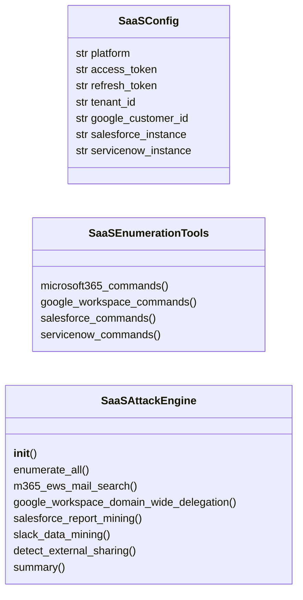
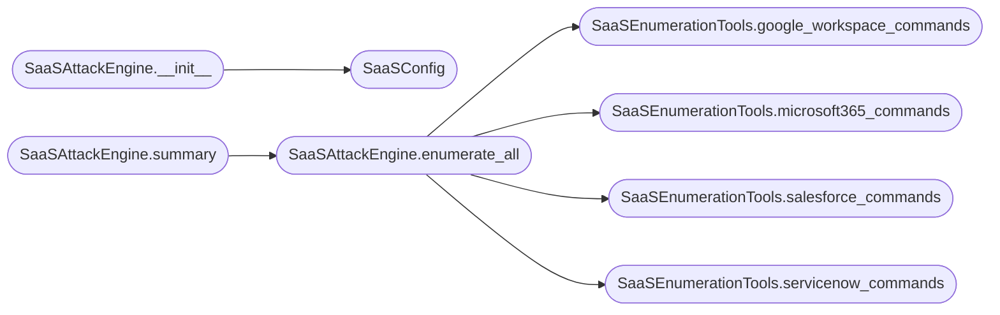

# `modules.saas_attacks`

> Source: [modules/saas_attacks.py:1](../../modules/saas_attacks.py#L1) | language `py` | coverage 62.5% | [API index](../index.md)

SaaS attacks — Microsoft 365, Google Workspace, Salesforce, ServiceNow exploitation.

Provides attack primitives against major SaaS platforms: Microsoft 365
(EWS abuse, eDiscovery exports, Teams phishing), Google Workspace (Gmail
API, Drive enumeration, Admin SDK), Salesforce (API access, report exports),
and ServiceNow (knowledge base, ticket mining).

All techniques operate through the platform's official APIs with stolen
tokens or credentials — no vulnerability exploitation required.

## Contents

- **Classes:** [`SaaSConfig`](#saasconfig), [`SaaSEnumerationTools`](#saasenumerationtools), [`SaaSAttackEngine`](#saasattackengine)
- **Constants:** [`SAAS_PLATFORMS`](#saas_platforms), [`M365_EWS_URL`](#m365_ews_url), [`M365_GRAPH_URL`](#m365_graph_url), [`GOOGLE_ADMIN_SDK`](#google_admin_sdk), [`GOOGLE_GMAIL_API`](#google_gmail_api), [`SALESFORCE_API_VERSION`](#salesforce_api_version), [`SERVICENOW_API`](#servicenow_api)

## Type Diagram



## Call Graph

Solid arrows stay in this module, dashed arrows leave it.



## Classes

<a id="saasconfig"></a>

### `SaaSConfig`

`class` `dataclass` | [modules/saas_attacks.py:49](../../modules/saas_attacks.py#L49)

Decorators: `@dataclass`

```python
class SaaSConfig
```

Configuration for SaaS attack operations.

**Attributes**

| Name | Type | Default | Description |
|---|---|---|---|
| [`platform`](#saasconfig-platform) | `str` | `''` | Target SaaS platform. |
| [`access_token`](#saasconfig-access_token) | `str` | `''` | OAuth2 access token. |
| [`refresh_token`](#saasconfig-refresh_token) | `str` | `''` | OAuth2 refresh token. |
| [`tenant_id`](#saasconfig-tenant_id) | `str` | `''` | Microsoft tenant ID. |
| [`google_customer_id`](#saasconfig-google_customer_id) | `str` | `''` | Google Workspace customer ID. |
| [`salesforce_instance`](#saasconfig-salesforce_instance) | `str` | `''` | Salesforce instance URL. |
| [`servicenow_instance`](#saasconfig-servicenow_instance) | `str` | `''` | ServiceNow instance URL. |

---

<a id="saasenumerationtools"></a>

### `SaaSEnumerationTools`

`class` | [modules/saas_attacks.py:71](../../modules/saas_attacks.py#L71)

```python
class SaaSEnumerationTools
```

Enumerate SaaS tenant resources for data mining and lateral movement.

**Members**

| Member | Kind | Summary |
|---|---|---|
| [`microsoft365_commands`](#saasenumerationtools-microsoft365_commands) | staticmethod |  |
| [`google_workspace_commands`](#saasenumerationtools-google_workspace_commands) | staticmethod |  |
| [`salesforce_commands`](#saasenumerationtools-salesforce_commands) | staticmethod |  |
| [`servicenow_commands`](#saasenumerationtools-servicenow_commands) | staticmethod |  |

<a id="saasenumerationtools-microsoft365_commands"></a>

#### `SaaSEnumerationTools.microsoft365_commands`

`staticmethod` | [modules/saas_attacks.py:75](../../modules/saas_attacks.py#L75)

Decorators: `@staticmethod`

```python
def microsoft365_commands() -> dict[str, Any]
```

**Returns:** `dict[str, Any]`

*Called by:* [`CloudAttackCommandSet.do_saas_enum`](cli.commands.cloud_attacks.py.md#cloudattackcommandset-do_saas_enum), [`SaaSAttackEngine.enumerate_all`](#saasattackengine-enumerate_all)

<a id="saasenumerationtools-google_workspace_commands"></a>

#### `SaaSEnumerationTools.google_workspace_commands`

`staticmethod` | [modules/saas_attacks.py:100](../../modules/saas_attacks.py#L100)

Decorators: `@staticmethod`

```python
def google_workspace_commands() -> dict[str, Any]
```

**Returns:** `dict[str, Any]`

*Called by:* [`CloudAttackCommandSet.do_saas_enum`](cli.commands.cloud_attacks.py.md#cloudattackcommandset-do_saas_enum), [`SaaSAttackEngine.enumerate_all`](#saasattackengine-enumerate_all)

<a id="saasenumerationtools-salesforce_commands"></a>

#### `SaaSEnumerationTools.salesforce_commands`

`staticmethod` | [modules/saas_attacks.py:118](../../modules/saas_attacks.py#L118)

Decorators: `@staticmethod`

```python
def salesforce_commands() -> dict[str, Any]
```

**Returns:** `dict[str, Any]`

*Called by:* [`CloudAttackCommandSet.do_saas_enum`](cli.commands.cloud_attacks.py.md#cloudattackcommandset-do_saas_enum), [`SaaSAttackEngine.enumerate_all`](#saasattackengine-enumerate_all)

<a id="saasenumerationtools-servicenow_commands"></a>

#### `SaaSEnumerationTools.servicenow_commands`

`staticmethod` | [modules/saas_attacks.py:135](../../modules/saas_attacks.py#L135)

Decorators: `@staticmethod`

```python
def servicenow_commands() -> dict[str, Any]
```

**Returns:** `dict[str, Any]`

*Called by:* [`CloudAttackCommandSet.do_saas_enum`](cli.commands.cloud_attacks.py.md#cloudattackcommandset-do_saas_enum), [`SaaSAttackEngine.enumerate_all`](#saasattackengine-enumerate_all)

---

<a id="saasattackengine"></a>

### `SaaSAttackEngine`

`class` | [modules/saas_attacks.py:152](../../modules/saas_attacks.py#L152)

```python
class SaaSAttackEngine
```

Execute SaaS platform enumeration and data exfiltration attacks.

Provides structured commands and GraphQL/REST API queries for each
supported SaaS platform. All techniques use the platform's official
APIs with stolen OAuth tokens or service account credentials.

**Members**

| Member | Kind | Summary |
|---|---|---|
| [`__init__`](#saasattackengine-__init__) | constructor |  |
| [`enumerate_all`](#saasattackengine-enumerate_all) | method | Generate enumeration commands for all supported SaaS platforms. |
| [`m365_ews_mail_search`](#saasattackengine-m365_ews_mail_search) | method | Search mailboxes via Exchange Web Services (EWS). |
| [`google_workspace_domain_wide_delegation`](#saasattackengine-google_workspace_domain_wide_delegation) | method | Abuse Google Workspace Domain-Wide Delegation (DWD). |
| [`salesforce_report_mining`](#saasattackengine-salesforce_report_mining) | method | Mine Salesforce reports and dashboards for sensitive data. |
| [`slack_data_mining`](#saasattackengine-slack_data_mining) | method | Mine Slack Enterprise for sensitive conversations and files. |
| [`detect_external_sharing`](#saasattackengine-detect_external_sharing) | method | Detect external sharing configurations across SaaS platforms. |
| [`summary`](#saasattackengine-summary) | method |  |

<a id="saasattackengine-__init__"></a>

#### `SaaSAttackEngine.__init__`

`constructor` | [modules/saas_attacks.py:163](../../modules/saas_attacks.py#L163)

```python
def __init__(self, config: SaaSConfig | None = None)
```

**Parameters**

| Name | Type | Default | Description |
|---|---|---|---|
| `config` | `SaaSConfig \| None` | `None` |  |

*Calls:* [`SaaSConfig`](#saasconfig)

*Called by:* [`CloudAttackCommandSet.do_saas_enum`](cli.commands.cloud_attacks.py.md#cloudattackcommandset-do_saas_enum)

<a id="saasattackengine-enumerate_all"></a>

#### `SaaSAttackEngine.enumerate_all`

`method` | [modules/saas_attacks.py:166](../../modules/saas_attacks.py#L166)

```python
def enumerate_all(self) -> dict[str, Any]
```

Generate enumeration commands for all supported SaaS platforms.

**Returns:** `dict[str, Any]` - Dict with platform-specific enumeration commands.

*Calls:* [`SaaSEnumerationTools.google_workspace_commands`](#saasenumerationtools-google_workspace_commands), [`SaaSEnumerationTools.microsoft365_commands`](#saasenumerationtools-microsoft365_commands), [`SaaSEnumerationTools.salesforce_commands`](#saasenumerationtools-salesforce_commands), [`SaaSEnumerationTools.servicenow_commands`](#saasenumerationtools-servicenow_commands)

*Called by:* [`CloudAttackCommandSet.do_saas_enum`](cli.commands.cloud_attacks.py.md#cloudattackcommandset-do_saas_enum), [`SaaSAttackEngine.summary`](#saasattackengine-summary)

<a id="saasattackengine-m365_ews_mail_search"></a>

#### `SaaSAttackEngine.m365_ews_mail_search`

`method` | [modules/saas_attacks.py:179](../../modules/saas_attacks.py#L179)

```python
def m365_ews_mail_search(self, search_term: str = 'password') -> dict[str, Any]
```

Search mailboxes via Exchange Web Services (EWS).

EWS provides SOAP-based mail access and often uses different
authentication than Graph API, providing an alternative path
if Graph access is restricted.

**Parameters**

| Name | Type | Default | Description |
|---|---|---|---|
| `search_term` | `str` | `'password'` | Query term for mail search. |

**Returns:** `dict[str, Any]` - Dict with EWS SOAP payload and search configuration.

<a id="saasattackengine-google_workspace_domain_wide_delegation"></a>

#### `SaaSAttackEngine.google_workspace_domain_wide_delegation`

`method` | [modules/saas_attacks.py:228](../../modules/saas_attacks.py#L228)

```python
def google_workspace_domain_wide_delegation(self) -> dict[str, Any]
```

Abuse Google Workspace Domain-Wide Delegation (DWD).

Service accounts with DWD can impersonate any user in the domain
without their credentials. This is a powerful persistence technique.

**Returns:** `dict[str, Any]` - Dict with DWD abuse instructions.

<a id="saasattackengine-salesforce_report_mining"></a>

#### `SaaSAttackEngine.salesforce_report_mining`

`method` | [modules/saas_attacks.py:257](../../modules/saas_attacks.py#L257)

```python
def salesforce_report_mining(self) -> dict[str, Any]
```

Mine Salesforce reports and dashboards for sensitive data.

Salesforce reports often contain aggregated financial data,
customer lists, and pipeline information valuable for
business intelligence gathering.

**Returns:** `dict[str, Any]` - Dict with SOQL queries and report endpoints.

<a id="saasattackengine-slack_data_mining"></a>

#### `SaaSAttackEngine.slack_data_mining`

`method` | [modules/saas_attacks.py:286](../../modules/saas_attacks.py#L286)

```python
def slack_data_mining(self) -> dict[str, Any]
```

Mine Slack Enterprise for sensitive conversations and files.

Slack contains credentials in conversations, SSH keys in code
snippets, and cloud provider tokens in integrations.

**Returns:** `dict[str, Any]` - Dict with Slack API search and data mining techniques.

*Called by:* [`CloudAttackCommandSet.do_saas_enum`](cli.commands.cloud_attacks.py.md#cloudattackcommandset-do_saas_enum)

<a id="saasattackengine-detect_external_sharing"></a>

#### `SaaSAttackEngine.detect_external_sharing`

`method` | [modules/saas_attacks.py:327](../../modules/saas_attacks.py#L327)

```python
def detect_external_sharing(self) -> dict[str, Any]
```

Detect external sharing configurations across SaaS platforms.

External sharing to personal email accounts or partner domains
is a data exfiltration risk and potential pivot point.

**Returns:** `dict[str, Any]` - Dict with external sharing detection commands.

<a id="saasattackengine-summary"></a>

#### `SaaSAttackEngine.summary`

`method` | [modules/saas_attacks.py:352](../../modules/saas_attacks.py#L352)

```python
def summary(self) -> dict[str, Any]
```

**Returns:** `dict[str, Any]`

*Calls:* [`SaaSAttackEngine.enumerate_all`](#saasattackengine-enumerate_all)

---

## Constants

<a id="saas_platforms"></a>

### `SAAS_PLATFORMS`

`constant` | [modules/saas_attacks.py:24](../../modules/saas_attacks.py#L24)

```python
SAAS_PLATFORMS
```

---

<a id="m365_ews_url"></a>

### `M365_EWS_URL`

`constant` | [modules/saas_attacks.py:40](../../modules/saas_attacks.py#L40)

```python
M365_EWS_URL = 'https://outlook.office365.com/EWS/Exchange.asmx'
```

---

<a id="m365_graph_url"></a>

### `M365_GRAPH_URL`

`constant` | [modules/saas_attacks.py:41](../../modules/saas_attacks.py#L41)

```python
M365_GRAPH_URL = 'https://graph.microsoft.com/v1.0'
```

---

<a id="google_admin_sdk"></a>

### `GOOGLE_ADMIN_SDK`

`constant` | [modules/saas_attacks.py:42](../../modules/saas_attacks.py#L42)

```python
GOOGLE_ADMIN_SDK = 'https://admin.googleapis.com/admin/directory/v1'
```

---

<a id="google_gmail_api"></a>

### `GOOGLE_GMAIL_API`

`constant` | [modules/saas_attacks.py:43](../../modules/saas_attacks.py#L43)

```python
GOOGLE_GMAIL_API = 'https://gmail.googleapis.com/gmail/v1/users/me'
```

---

<a id="salesforce_api_version"></a>

### `SALESFORCE_API_VERSION`

`constant` | [modules/saas_attacks.py:44](../../modules/saas_attacks.py#L44)

```python
SALESFORCE_API_VERSION = 'v58.0'
```

---

<a id="servicenow_api"></a>

### `SERVICENOW_API`

`constant` | [modules/saas_attacks.py:45](../../modules/saas_attacks.py#L45)

```python
SERVICENOW_API = '/api/now'
```

---
