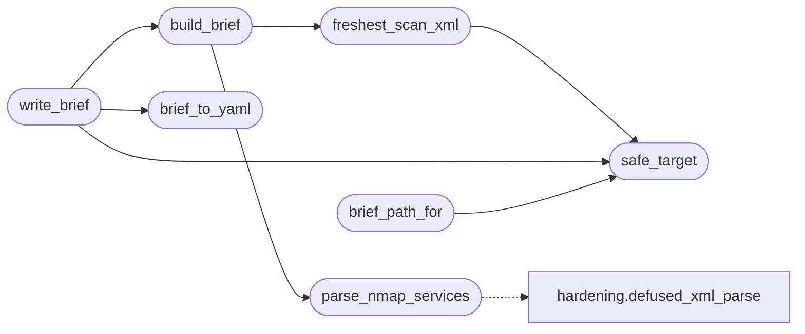

# `modules.scan_brief`

> Source: [modules/scan_brief.py:1](../../modules/scan_brief.py#L1) | language `py` | coverage 100.0% | [API index](../index.md)

Scan brief: sharpen loop probes against services an nmap scan already found.

Every ``lazynmap`` run persists ``sessions/scan_<target>.nmap.xml``; the
brief turns that XML into a small per-target YAML with the discovered
ports, services and versions so the orchestrator TUI, the operator and
the autonomous planner all read the same focused surface instead of
re-deriving it from raw XML. The planner converts each brief service
into a one-shot sharpening intent anchored to the scanned asset, so a
stealth profile can aim existing evidence at the right ports without a
second scan.

The module never raises: unreadable XML, missing dependencies or a bad
brief file all degrade to empty results.

## Contents

- **Functions:** [`safe_target`](#safe_target), [`freshest_scan_xml`](#freshest_scan_xml), [`parse_nmap_services`](#parse_nmap_services), [`build_brief`](#build_brief), [`brief_to_yaml`](#brief_to_yaml), [`write_brief`](#write_brief), [`load_brief`](#load_brief), [`brief_path_for`](#brief_path_for), [`focus_summary`](#focus_summary), [`intents_from_brief`](#intents_from_brief)
- **Constants:** [`BRIEF_VERSION`](#brief_version)

## Call Graph

Solid arrows stay in this module, dashed arrows leave it.



## Functions

<a id="safe_target"></a>

### `safe_target`

`function` | [modules/scan_brief.py:38](../../modules/scan_brief.py#L38)

```python
def safe_target(target: str) -> str
```

Return the filesystem-safe scan name fragment for a target.

**Parameters**

| Name | Type | Default | Description |
|---|---|---|---|
| `target` | `str` |  | Host or IP the scan covered. |

**Returns:** `str` - Sanitized fragment safe for glob composition, empty when invalid.

*Called by:* [`brief_path_for`](#brief_path_for), [`freshest_scan_xml`](#freshest_scan_xml), [`write_brief`](#write_brief)

---

<a id="freshest_scan_xml"></a>

### `freshest_scan_xml`

`function` | [modules/scan_brief.py:53](../../modules/scan_brief.py#L53)

```python
def freshest_scan_xml(target: str, sessions_dir: Path | None = None) -> Path
```

Return the newest scan XML for a target, or an empty path.

**Parameters**

| Name | Type | Default | Description |
|---|---|---|---|
| `target` | `str` |  | Host the scan covers. |
| `sessions_dir` | `Path \| None` | `None` | Sessions directory override (tests). |

**Returns:** `Path` - Path of ``scan_<target>*.nmap.xml`` with the newest mtime, or
an empty ``Path()`` when none exists.

*Calls:* [`safe_target`](#safe_target)

*Called by:* [`build_brief`](#build_brief)

---

<a id="parse_nmap_services"></a>

### `parse_nmap_services`

`function` | [modules/scan_brief.py:79](../../modules/scan_brief.py#L79)

```python
def parse_nmap_services(path: Path | str) -> list[dict[str, Any]]
```

Extract ``(port, protocol, service, version, product)`` rows from nmap XML.

**Parameters**

| Name | Type | Default | Description |
|---|---|---|---|
| `path` | `Path \| str` |  | Path of the nmap XML file. |

**Returns:** `list[dict[str, Any]]` - Up to ``MAX_BRIEF_SERVICES`` service mappings, empty on failure.

*Calls:* [`defused_xml_parse`](core.hardening.py.md#defused_xml_parse)

*Called by:* [`build_brief`](#build_brief)

---

<a id="build_brief"></a>

### `build_brief`

`function` | [modules/scan_brief.py:121](../../modules/scan_brief.py#L121)

```python
def build_brief(target: str, sessions_dir: Path | None = None) -> dict[str, Any] | None
```

Build the brief mapping for a target from its freshest scan XML.

**Parameters**

| Name | Type | Default | Description |
|---|---|---|---|
| `target` | `str` |  | Host the scan covered. |
| `sessions_dir` | `Path \| None` | `None` | Sessions directory override (tests). |

**Returns:** `dict[str, Any] | None` - Brief mapping (version, target, source_scan, services) or None
when no scan XML exists or it carries no services.

*Calls:* [`freshest_scan_xml`](#freshest_scan_xml), [`parse_nmap_services`](#parse_nmap_services)

*Called by:* [`write_brief`](#write_brief)

---

<a id="brief_to_yaml"></a>

### `brief_to_yaml`

`function` | [modules/scan_brief.py:148](../../modules/scan_brief.py#L148)

```python
def brief_to_yaml(brief: dict[str, Any]) -> str
```

Render one brief mapping as YAML text.

**Parameters**

| Name | Type | Default | Description |
|---|---|---|---|
| `brief` | `dict[str, Any]` |  | Mapping from [`build_brief`](#build_brief). |

**Returns:** `str` - YAML string (empty when PyYAML is unavailable).

*Called by:* [`write_brief`](#write_brief)

---

<a id="write_brief"></a>

### `write_brief`

`function` | [modules/scan_brief.py:165](../../modules/scan_brief.py#L165)

```python
def write_brief(target: str, sessions_dir: Path | None = None) -> str
```

Generate and persist ``sessions/loop_brief_<target>.yaml``.

**Parameters**

| Name | Type | Default | Description |
|---|---|---|---|
| `target` | `str` |  | Host the scan covered. |
| `sessions_dir` | `Path \| None` | `None` | Sessions directory override (tests). |

**Returns:** `str` - Path of the written brief file, empty when there was nothing to
write (no scan, no services, no PyYAML).

*Calls:* [`brief_to_yaml`](#brief_to_yaml), [`build_brief`](#build_brief), [`safe_target`](#safe_target)

---

<a id="load_brief"></a>

### `load_brief`

`function` | [modules/scan_brief.py:193](../../modules/scan_brief.py#L193)

```python
def load_brief(path: Path | str) -> dict[str, Any] | None
```

Load one brief YAML from disk.

**Parameters**

| Name | Type | Default | Description |
|---|---|---|---|
| `path` | `Path \| str` |  | Brief file path. |

**Returns:** `dict[str, Any] | None` - The parsed mapping, or None when missing, invalid or not a mapping.

---

<a id="brief_path_for"></a>

### `brief_path_for`

`function` | [modules/scan_brief.py:213](../../modules/scan_brief.py#L213)

```python
def brief_path_for(target: str, sessions_dir: Path | None = None) -> Path
```

Return the brief file path for a target.

**Parameters**

| Name | Type | Default | Description |
|---|---|---|---|
| `target` | `str` |  | Host the brief covers. |
| `sessions_dir` | `Path \| None` | `None` | Sessions directory override (tests). |

**Returns:** `Path` - Expected brief path (may not exist).

*Calls:* [`safe_target`](#safe_target)

---

<a id="focus_summary"></a>

### `focus_summary`

`function` | [modules/scan_brief.py:227](../../modules/scan_brief.py#L227)

```python
def focus_summary(brief: dict[str, Any] | None, limit: int = 6) -> str
```

Return one compact English line describing the focused surface.

**Parameters**

| Name | Type | Default | Description |
|---|---|---|---|
| `brief` | `dict[str, Any] \| None` |  | Brief mapping or None. |
| `limit` | `int` | `6` | Maximum services named. |

**Returns:** `str` - Like ``"4445/krb524, 5555/agent"``; empty when unusable.

---

<a id="intents_from_brief"></a>

### `intents_from_brief`

`function` | [modules/scan_brief.py:247](../../modules/scan_brief.py#L247)

```python
def intents_from_brief(brief: dict[str, Any] | None, limit: int = 6) -> list[str]
```

Return one sharpening intent text per brief service.

**Parameters**

| Name | Type | Default | Description |
|---|---|---|---|
| `brief` | `dict[str, Any] \| None` |  | Brief mapping or None. |
| `limit` | `int` | `6` | Maximum intents. |

**Returns:** `list[str]` - Intent summaries like ``brief service: http on 10.0.0.5:80 (from scan brief)``
referencing the target, anchored intent text the planner can route.

---

## Constants

<a id="brief_version"></a>

### `BRIEF_VERSION`

`constant` | [modules/scan_brief.py:32](../../modules/scan_brief.py#L32)

```python
BRIEF_VERSION = 1
```

---
