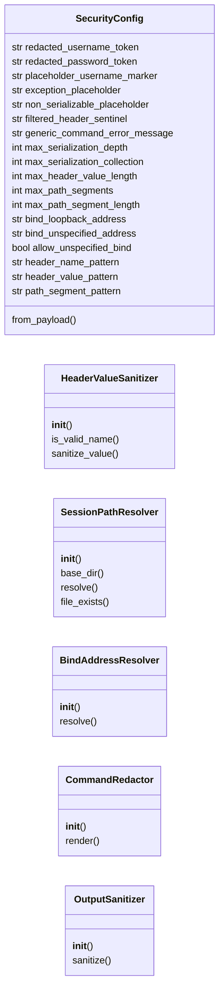
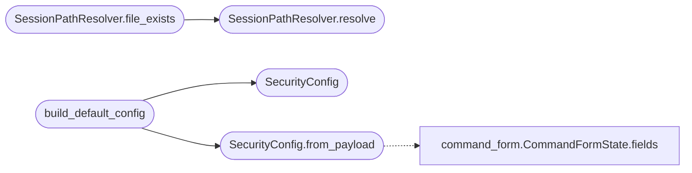

# `modules.security_sanitizers`

> Source: [modules/security_sanitizers.py:1](../../modules/security_sanitizers.py#L1) | language `py` | coverage 100.0% | [API index](../index.md)

Security sanitizers shared across the LazyOwn framework.

This module centralises the defensive code paths the framework
relies on so each concern is implemented once, with strict input
validation, and consumed from every caller that previously rolled
its own logic. The classes here are the single source of truth for:

* Validating untrusted bind addresses before opening a server socket.
* Resolving operator-supplied filenames against the sessions
  directory without enabling traversal.
* Sanitising HTTP header values to prevent response-splitting.
* Redacting credentials when shell commands are rendered for
  display or logging.
* Converting arbitrary Python values into a JSON-safe shape that
  can never leak exception details or traceback information.

Each sanitizer is its own small class so the Single Responsibility
Principle is satisfied; callers depend on the public method names
rather than the internal implementations (Dependency Inversion);
new sanitizers can be added without modifying existing ones (Open /
Closed); and every tunable is exposed on [`SecurityConfig`](#securityconfig) so
the framework keeps the ``payload.json`` single-source-of-truth
contract documented in ``CLAUDE.md``.

## Contents

- **Classes:** [`SecurityConfig`](#securityconfig), [`HeaderValueSanitizer`](#headervaluesanitizer), [`SessionPathResolver`](#sessionpathresolver), [`BindAddressResolver`](#bindaddressresolver), [`CommandRedactor`](#commandredactor), [`OutputSanitizer`](#outputsanitizer)
- **Functions:** [`build_default_config`](#build_default_config)

## Type Diagram



## Call Graph

Solid arrows stay in this module, dashed arrows leave it.



## Classes

<a id="securityconfig"></a>

### `SecurityConfig`

`class` `dataclass` | [modules/security_sanitizers.py:37](../../modules/security_sanitizers.py#L37)

Decorators: `@dataclass(frozen=True)`

```python
class SecurityConfig
```

Immutable tunables consumed by every sanitizer in this module.

Defaults are conservative; the operator can override any value
by adding the matching key to ``payload.json``. The dataclass
is frozen so a sanitizer instance can be shared across threads
without locking. Tightening a value never breaks an existing
caller because every helper exposes the resulting behaviour as
a sentinel rather than as an exception.

**Attributes**

| Name | Type | Default | Description |
|---|---|---|---|
| [`redacted_username_token`](#securityconfig-redacted_username_token) | `str` | `'[REDACTED-USERNAME]'` |  |
| [`redacted_password_token`](#securityconfig-redacted_password_token) | `str` | `'[REDACTED-PASSWORD]'` |  |
| [`placeholder_username_marker`](#securityconfig-placeholder_username_marker) | `str` | `'deefbeef'` |  |
| [`exception_placeholder`](#securityconfig-exception_placeholder) | `str` | `'<exception_omitted>'` |  |
| [`non_serializable_placeholder`](#securityconfig-non_serializable_placeholder) | `str` | `'<unserializable>'` |  |
| [`filtered_header_sentinel`](#securityconfig-filtered_header_sentinel) | `str` | `'[FILTERED]'` |  |
| [`generic_command_error_message`](#securityconfig-generic_command_error_message) | `str` | `'Command execution error'` |  |
| [`max_serialization_depth`](#securityconfig-max_serialization_depth) | `int` | `8` |  |
| [`max_serialization_collection`](#securityconfig-max_serialization_collection) | `int` | `1024` |  |
| [`max_header_value_length`](#securityconfig-max_header_value_length) | `int` | `4096` |  |
| [`max_path_segments`](#securityconfig-max_path_segments) | `int` | `32` |  |
| [`max_path_segment_length`](#securityconfig-max_path_segment_length) | `int` | `255` |  |
| [`bind_loopback_address`](#securityconfig-bind_loopback_address) | `str` | `'127.0.0.1'` |  |
| [`bind_unspecified_address`](#securityconfig-bind_unspecified_address) | `str` | `'0.0.0.0'` |  |
| [`allow_unspecified_bind`](#securityconfig-allow_unspecified_bind) | `bool` | `False` |  |
| [`header_name_pattern`](#securityconfig-header_name_pattern) | `str` | `` "^[A-Za-z0-9!#$%&'*+\\-.^_`\|~]+$" `` |  |
| [`header_value_pattern`](#securityconfig-header_value_pattern) | `str` | `'^[\\x20-\\x7E\\t]+$'` |  |
| [`path_segment_pattern`](#securityconfig-path_segment_pattern) | `str` | `'^[A-Za-z0-9._-]+$'` |  |

**Members**

| Member | Kind | Summary |
|---|---|---|
| [`from_payload`](#securityconfig-from_payload) | classmethod | Build a configuration object from a ``payload.json`` mapping. |

<a id="securityconfig-from_payload"></a>

#### `SecurityConfig.from_payload`

`classmethod` | [modules/security_sanitizers.py:68](../../modules/security_sanitizers.py#L68)

Decorators: `@classmethod`

```python
def from_payload(cls, payload: Mapping[str, Any]) -> SecurityConfig
```

Build a configuration object from a ``payload.json`` mapping.

Unknown keys are ignored so adding a new tunable in code
does not require an immediate ``payload.json`` migration.
Type-mismatched values are dropped silently because the
payload file is hand-edited by operators and the framework
must remain operational even with a partially valid file.

**Parameters**

| Name | Type | Default | Description |
|---|---|---|---|
| `payload` | `Mapping[str, Any]` |  | A mapping produced by ``json.load`` over ``payload.json`` (or any equivalent dictionary). |

**Returns:** `SecurityConfig` - A new, frozen [`SecurityConfig`](#securityconfig) populated from
the supplied mapping.

*Calls:* [`CommandFormState.fields`](cli.command_form.py.md#commandformstate-fields)

*Called by:* [`build_default_config`](#build_default_config)

---

<a id="headervaluesanitizer"></a>

### `HeaderValueSanitizer`

`class` | [modules/security_sanitizers.py:101](../../modules/security_sanitizers.py#L101)

```python
class HeaderValueSanitizer
```

Validate HTTP header names and values before transmission.

Headers crossing a proxy boundary may carry CR, LF or NUL
bytes that, if forwarded verbatim, allow an upstream to inject
extra headers or a response body. The sanitizer strips those
bytes and then enforces an allowlist regex; values failing
the allowlist are replaced by an opaque sentinel rather than
silently coerced to the empty string so the operator can spot
abnormal upstream behaviour in proxy logs.

**Members**

| Member | Kind | Summary |
|---|---|---|
| [`__init__`](#headervaluesanitizer-__init__) | constructor | Bind the sanitizer to a configuration instance. |
| [`is_valid_name`](#headervaluesanitizer-is_valid_name) | method | Return True iff ``name`` is a syntactically valid header token. |
| [`sanitize_value`](#headervaluesanitizer-sanitize_value) | method | Return a header value that cannot smuggle a response split. |

<a id="headervaluesanitizer-__init__"></a>

#### `HeaderValueSanitizer.__init__`

`constructor` | [modules/security_sanitizers.py:115](../../modules/security_sanitizers.py#L115)

```python
def __init__(self, config: SecurityConfig)
```

Bind the sanitizer to a configuration instance.

**Parameters**

| Name | Type | Default | Description |
|---|---|---|---|
| `config` | `SecurityConfig` |  | The [`SecurityConfig`](#securityconfig) from which the regex patterns, length limit and sentinel string are read at validation time. |

**Raises**

- `TypeError`: (raised in the body, not documented)

<a id="headervaluesanitizer-is_valid_name"></a>

#### `HeaderValueSanitizer.is_valid_name`

`method` | [modules/security_sanitizers.py:129](../../modules/security_sanitizers.py#L129)

```python
def is_valid_name(self, name: Any) -> bool
```

Return True iff ``name`` is a syntactically valid header token.

The check follows RFC 7230 ``token`` grammar via the
allowlist regex in [`SecurityConfig`](#securityconfig).

**Parameters**

| Name | Type | Default | Description |
|---|---|---|---|
| `name` | `Any` |  |  |

**Returns:** `bool`

<a id="headervaluesanitizer-sanitize_value"></a>

#### `HeaderValueSanitizer.sanitize_value`

`method` | [modules/security_sanitizers.py:139](../../modules/security_sanitizers.py#L139)

```python
def sanitize_value(self, value: Any) -> str
```

Return a header value that cannot smuggle a response split.

The output is guaranteed to consist solely of printable
ASCII plus the horizontal-tab character, with no CR, LF
or NUL bytes, and to be no longer than the configured
`[`max_header_value_length`](#securityconfig-max_header_value_length)`. Inputs that are not strings,
that become empty after stripping forbidden bytes, or that
fail the allowlist are replaced by the configured sentinel.

**Parameters**

| Name | Type | Default | Description |
|---|---|---|---|
| `value` | `Any` |  |  |

**Returns:** `str`

---

<a id="sessionpathresolver"></a>

### `SessionPathResolver`

`class` | [modules/security_sanitizers.py:162](../../modules/security_sanitizers.py#L162)

```python
class SessionPathResolver
```

Resolve untrusted filenames against a fixed base directory.

Every resolver is bound to one base directory whose realpath
is computed at construction; subsequent ``resolve`` calls join
the validated relative path with that base and reject anything
that would escape it after symlink resolution. Because the
validation logic is centralised here, CodeQL data-flow analysis
consistently recognises the sanitisation and the same guarantees
apply to every caller that routes through this class.

**Members**

| Member | Kind | Summary |
|---|---|---|
| [`__init__`](#sessionpathresolver-__init__) | constructor | Bind the resolver to an absolute, real base directory. |
| [`base_dir`](#sessionpathresolver-base_dir) | property | The resolved, absolute base directory. |
| [`resolve`](#sessionpathresolver-resolve) | method | Return ``(absolute, relative)`` for a safe filename. |
| [`file_exists`](#sessionpathresolver-file_exists) | method | Return True iff ``untrusted_name`` resolves to an existing file. |

<a id="sessionpathresolver-__init__"></a>

#### `SessionPathResolver.__init__`

`constructor` | [modules/security_sanitizers.py:174](../../modules/security_sanitizers.py#L174)

```python
def __init__(self, base_dir: str, config: SecurityConfig)
```

Bind the resolver to an absolute, real base directory.

**Parameters**

| Name | Type | Default | Description |
|---|---|---|---|
| `base_dir` | `str` |  | The directory that all resolved paths must stay within after symlink resolution. |
| `config` | `SecurityConfig` |  | The [`SecurityConfig`](#securityconfig) providing the allowlist regex and depth limits. |

**Raises**

- `TypeError`: (raised in the body, not documented)
- `ValueError`: (raised in the body, not documented)

*Called by:* [`webserver_report`](lazyc2.py.md#webserver_report), [`webserver_report`](lazyc2.blueprints.phishing.py.md#webserver_report)

<a id="sessionpathresolver-base_dir"></a>

#### `SessionPathResolver.base_dir`

`property` | [modules/security_sanitizers.py:192](../../modules/security_sanitizers.py#L192)

Decorators: `@property`

```python
def base_dir(self) -> str
```

The resolved, absolute base directory.

**Returns:** `str`

<a id="sessionpathresolver-resolve"></a>

#### `SessionPathResolver.resolve`

`method` | [modules/security_sanitizers.py:196](../../modules/security_sanitizers.py#L196)

```python
def resolve(self, untrusted_name: Any) -> tuple[str, str] | None
```

Return ``(absolute, relative)`` for a safe filename.

``relative`` is suitable for ``send_from_directory`` while
``absolute`` is the realpath after joining and may be used
for ``os.path.isfile`` style checks. Returns ``None`` when
any structural, textual or filesystem check fails so the
caller has a single branch to handle every error.

**Parameters**

| Name | Type | Default | Description |
|---|---|---|---|
| `untrusted_name` | `Any` |  |  |

**Returns:** `tuple[str, str] | None`

*Called by:* [`webserver_report`](lazyc2.py.md#webserver_report), [`webserver_report`](lazyc2.blueprints.phishing.py.md#webserver_report), [`SessionPathResolver.file_exists`](#sessionpathresolver-file_exists)

<a id="sessionpathresolver-file_exists"></a>

#### `SessionPathResolver.file_exists`

`method` | [modules/security_sanitizers.py:238](../../modules/security_sanitizers.py#L238)

```python
def file_exists(self, untrusted_name: Any) -> bool
```

Return True iff ``untrusted_name`` resolves to an existing file.

The method swallows `OSError` so the caller never
observes filesystem-level errors during an availability
probe; missing, denied or unreadable entries all surface
as ``False``.

**Parameters**

| Name | Type | Default | Description |
|---|---|---|---|
| `untrusted_name` | `Any` |  |  |

**Returns:** `bool`

*Calls:* [`SessionPathResolver.resolve`](#sessionpathresolver-resolve)

---

<a id="bindaddressresolver"></a>

### `BindAddressResolver`

`class` | [modules/security_sanitizers.py:256](../../modules/security_sanitizers.py#L256)

```python
class BindAddressResolver
```

Pick the address a server socket should bind to.

The resolver fails closed: when the operator has not chosen an
address, it falls back to the configured loopback rather than
the unspecified ``0.0.0.0`` address. The unspecified address is
returned only when `[`allow_unspecified_bind`](#securityconfig-allow_unspecified_bind)` is ``True`` in
[`SecurityConfig`](#securityconfig), which gives the operator an explicit,
auditable opt-in for exposing the C2 on every interface.

**Members**

| Member | Kind | Summary |
|---|---|---|
| [`__init__`](#bindaddressresolver-__init__) | constructor | Build a resolver with a prioritised list of candidate addresses. |
| [`resolve`](#bindaddressresolver-resolve) | method | Return the address sockets should bind to. |

<a id="bindaddressresolver-__init__"></a>

#### `BindAddressResolver.__init__`

`constructor` | [modules/security_sanitizers.py:269](../../modules/security_sanitizers.py#L269)

```python
def __init__(self, config: SecurityConfig, preferred_addresses: Sequence[Any] = ())
```

Build a resolver with a prioritised list of candidate addresses.

**Parameters**

| Name | Type | Default | Description |
|---|---|---|---|
| `config` | `SecurityConfig` |  | The [`SecurityConfig`](#securityconfig) providing the loopback fallback, the unspecified address literal and the opt-in flag. |
| `preferred_addresses` | `Sequence[Any]` | `()` | Operator-controlled address candidates evaluated in order. The first value that parses as a valid IPv4 or IPv6 literal wins. |

**Raises**

- `TypeError`: (raised in the body, not documented)

<a id="bindaddressresolver-resolve"></a>

#### `BindAddressResolver.resolve`

`method` | [modules/security_sanitizers.py:298](../../modules/security_sanitizers.py#L298)

```python
def resolve(self) -> str
```

Return the address sockets should bind to.

Resolution order:

1. The first operator-preferred address that parses.
2. The unspecified address when `[`allow_unspecified_bind`](#securityconfig-allow_unspecified_bind)`
   is explicitly enabled by the operator.
3. The loopback fallback from [`SecurityConfig`](#securityconfig).

**Returns:** `str`

---

<a id="commandredactor"></a>

### `CommandRedactor`

`class` | [modules/security_sanitizers.py:318](../../modules/security_sanitizers.py#L318)

```python
class CommandRedactor
```

Render shell commands without leaking the supplied credentials.

The redactor produces two strings from a single template: an
executable form, where the real credentials are substituted in
place, and a display form, where every credential placeholder
and every byte-for-byte occurrence of the credentials is
replaced by an opaque sentinel. Callers must use the executable
form for ``subprocess`` calls and the display form for printing
or logging.

**Members**

| Member | Kind | Summary |
|---|---|---|
| [`__init__`](#commandredactor-__init__) | constructor | Bind the redactor to a configuration instance. |
| [`render`](#commandredactor-render) | method | Return ``(executable, display)`` for a templated command. |

<a id="commandredactor-__init__"></a>

#### `CommandRedactor.__init__`

`constructor` | [modules/security_sanitizers.py:333](../../modules/security_sanitizers.py#L333)

```python
def __init__(self, config: SecurityConfig)
```

Bind the redactor to a configuration instance.

**Parameters**

| Name | Type | Default | Description |
|---|---|---|---|
| `config` | `SecurityConfig` |  | The [`SecurityConfig`](#securityconfig) providing the redaction sentinels and the placeholder-username marker. |

**Raises**

- `TypeError`: (raised in the body, not documented)

<a id="commandredactor-render"></a>

#### `CommandRedactor.render`

`method` | [modules/security_sanitizers.py:359](../../modules/security_sanitizers.py#L359)

```python
def render(self, template: str, substitutions: Mapping[str, str], username: str, password: str) -> tuple[str, str]
```

Return ``(executable, display)`` for a templated command.

``substitutions`` provides the non-credential replacements
(host, port, output directory and so on). The method
guarantees that ``display`` never contains the supplied
``username`` or ``password`` byte-for-byte unless
``username`` matches the placeholder marker. The dual
return value avoids any chance of the caller printing the
executable form by accident.

**Parameters**

| Name | Type | Default | Description |
|---|---|---|---|
| `template` | `str` |  |  |
| `substitutions` | `Mapping[str, str]` |  |  |
| `username` | `str` |  |  |
| `password` | `str` |  |  |

**Returns:** `tuple[str, str]`

**Raises**

- `TypeError`: (raised in the body, not documented)

---

<a id="outputsanitizer"></a>

### `OutputSanitizer`

`class` | [modules/security_sanitizers.py:406](../../modules/security_sanitizers.py#L406)

```python
class OutputSanitizer
```

Project arbitrary Python values into a JSON-safe shape.

Exceptions, traceback objects and any value that fails JSON
serialisation are replaced by opaque sentinels rather than
their ``str`` representation, which prevents stack traces,
internal file paths and instance attributes from reaching the
HTTP client. Recursion is bounded by the configured maximum
depth and the breadth of every collection is capped so a
hostile callee cannot exhaust the responder's stack or memory.

**Members**

| Member | Kind | Summary |
|---|---|---|
| [`__init__`](#outputsanitizer-__init__) | constructor | Bind the sanitizer to a configuration instance. |
| [`sanitize`](#outputsanitizer-sanitize) | method | Return ``value`` projected into a JSON-serialisable form. |

<a id="outputsanitizer-__init__"></a>

#### `OutputSanitizer.__init__`

`constructor` | [modules/security_sanitizers.py:418](../../modules/security_sanitizers.py#L418)

```python
def __init__(self, config: SecurityConfig)
```

Bind the sanitizer to a configuration instance.

**Parameters**

| Name | Type | Default | Description |
|---|---|---|---|
| `config` | `SecurityConfig` |  | The [`SecurityConfig`](#securityconfig) providing the placeholders, depth limit and collection cap. |

**Raises**

- `TypeError`: (raised in the body, not documented)

<a id="outputsanitizer-sanitize"></a>

#### `OutputSanitizer.sanitize`

`method` | [modules/security_sanitizers.py:429](../../modules/security_sanitizers.py#L429)

```python
def sanitize(self, value: Any) -> Any
```

Return ``value`` projected into a JSON-serialisable form.

**Parameters**

| Name | Type | Default | Description |
|---|---|---|---|
| `value` | `Any` |  |  |

**Returns:** `Any`

---

## Functions

<a id="build_default_config"></a>

### `build_default_config`

`function` | [modules/security_sanitizers.py:477](../../modules/security_sanitizers.py#L477)

```python
def build_default_config(payload: Mapping[str, Any] | None = None) -> SecurityConfig
```

Return a [`SecurityConfig`](#securityconfig) populated from ``payload``.

Convenience entry point so callers do not need to import the
dataclass directly. ``payload`` is typically the result of
``utils.load_payload``; when ``None``, the conservative
defaults are returned.

**Parameters**

| Name | Type | Default | Description |
|---|---|---|---|
| `payload` | `Mapping[str, Any] \| None` | `None` |  |

**Returns:** `SecurityConfig`

*Calls:* [`SecurityConfig`](#securityconfig), [`SecurityConfig.from_payload`](#securityconfig-from_payload)

---
