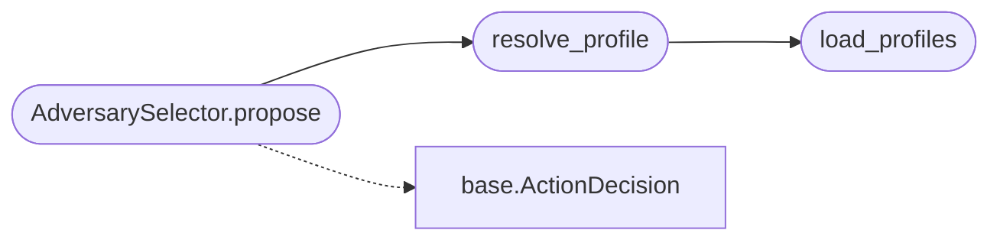

# `modules.selection.adversary`

> Source: [modules/selection/adversary.py:1](../../modules/selection/adversary.py#L1) | language `py` | coverage 100.0% | [API index](../index.md)

Adversary selector: run a custom adversary emulation named by the objective.

Single contract: when the task goal names a custom adversary profile from
``lazyadversaries/*.yaml`` (by file slug, entry name or goal words), resolve
it to the concrete emulation id the ``adversary_yaml`` verb expects and
propose executing it locally: ``adversary_yaml <id> l``. Conservative:
abstains unless the goal names a known profile, so it never emulates an
adversary the operator did not ask for.

## Contents

- **Classes:** [`AdversarySelector`](#adversaryselector)
- **Functions:** [`load_profiles`](#load_profiles), [`resolve_profile`](#resolve_profile)
- **Constants:** [`DEFAULT_ADVERSARIES_DIR`](#default_adversaries_dir)

## Call Graph

Solid arrows stay in this module, dashed arrows leave it.



## Classes

<a id="adversaryselector"></a>

### `AdversarySelector`

`class` | [modules/selection/adversary.py:118](../../modules/selection/adversary.py#L118)

```python
class AdversarySelector
```

Propose ``adversary_yaml <id> l`` when the goal names a profile.

**Attributes**

| Name | Type | Default | Description |
|---|---|---|---|
| [`name`](#adversaryselector-name) |  | `'adversary'` |  |

**Members**

| Member | Kind | Summary |
|---|---|---|
| [`__init__`](#adversaryselector-__init__) | constructor | Bind the profile directory and the execution confirmation word. |
| [`propose`](#adversaryselector-propose) | method | Return the emulation action when the goal names a profile. |

<a id="adversaryselector-__init__"></a>

#### `AdversarySelector.__init__`

`constructor` | [modules/selection/adversary.py:123](../../modules/selection/adversary.py#L123)

```python
def __init__(self, adversaries_dir: str | Path | None = None, confirm: str = 'l') -> None
```

Bind the profile directory and the execution confirmation word.

**Parameters**

| Name | Type | Default | Description |
|---|---|---|---|
| `adversaries_dir` | `str \| Path \| None` | `None` | Optional directory override; repo root is the default anchor. |
| `confirm` | `str` | `'l'` | Verb execution confirmation (``l`` local, ``r`` remote C2, ``n`` none). The loop proposes ``l`` by default because the goal explicitly named the profile. |

<a id="adversaryselector-propose"></a>

#### `AdversarySelector.propose`

`method` | [modules/selection/adversary.py:136](../../modules/selection/adversary.py#L136)

```python
def propose(self, ctx: SelectionContext) -> ActionDecision | None
```

Return the emulation action when the goal names a profile.

**Parameters**

| Name | Type | Default | Description |
|---|---|---|---|
| `ctx` | `SelectionContext` |  |  |

**Returns:** `ActionDecision | None`

*Calls:* [`resolve_profile`](#resolve_profile), [`ActionDecision`](modules.selection.base.py.md#actiondecision)

---

## Functions

<a id="load_profiles"></a>

### `load_profiles`

`function` | [modules/selection/adversary.py:26](../../modules/selection/adversary.py#L26)

```python
def load_profiles(adversaries_dir: str | Path | None = None) -> list[dict]
```

Load every adversary profile dictionary shipped in the repo.

Reads each ``lazyadversaries/*.yaml`` the same way the legacy shell
loader does (lists extend, dicts stand alone) and projects every
usable row onto ``{"id", "file", "slug", "name"}``.

**Parameters**

| Name | Type | Default | Description |
|---|---|---|---|
| `adversaries_dir` | `str \| Path \| None` | `None` | Optional directory override; the repo default is anchored to the project root so the loader works from any working directory. |

**Returns:** `list[dict]` - A list of profile dicts; never raises.

*Called by:* [`resolve_profile`](#resolve_profile)

---

<a id="resolve_profile"></a>

### `resolve_profile`

`function` | [modules/selection/adversary.py:80](../../modules/selection/adversary.py#L80)

```python
def resolve_profile(goal: str, adversaries_dir: str | Path | None = None) -> dict | None
```

Resolve the adversary profile the goal names, if any.

A profile matches when a goal token equals or prefixes its slug,
its artifacts name or its file slug (so ``malleable beacon`` and
``malleable_beacon`` both resolve; whole-word prefix keeps ``amsi``
and short real names reachable without matching random stop-words).
When several profiles match, the one with the most matched words
wins, so ``malleable beacon implant`` picks ``malleable_beacon``
over any profile that merely shares the word ``implant``.

**Parameters**

| Name | Type | Default | Description |
|---|---|---|---|
| `goal` | `str` |  | Task goal text. |
| `adversaries_dir` | `str \| Path \| None` | `None` | Optional directory override. |

**Returns:** `dict | None` - The matched profile dict from [`load_profiles`](#load_profiles), or None.

*Calls:* [`load_profiles`](#load_profiles)

*Called by:* [`AdversarySelector.propose`](#adversaryselector-propose)

---

## Constants

<a id="default_adversaries_dir"></a>

### `DEFAULT_ADVERSARIES_DIR`

`constant` | [modules/selection/adversary.py:20](../../modules/selection/adversary.py#L20)

```python
DEFAULT_ADVERSARIES_DIR = BASE_DIR / 'lazyadversaries'
```

---
