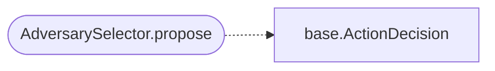

# `modules.selection.adversary`

> Source: [modules/selection/adversary.py:1](../../modules/selection/adversary.py#L1) | language `py` | coverage 100.0% | [API index](../index.md)

Adversary selector: run a custom adversary emulation named by the objective.

Single contract: when the task goal names a custom adversary profile from
``lazyadversaries/*.yaml``, propose executing it via the ``adversary_yaml``
verb. Conservative: abstains unless the goal names a known profile.

## Contents

- **Classes:** [`AdversarySelector`](#adversaryselector)

## Call Graph

Solid arrows stay in this module, dashed arrows leave it.



## Classes

<a id="adversaryselector"></a>

### `AdversarySelector`

`class` | [modules/selection/adversary.py:19](../../modules/selection/adversary.py#L19)

```python
class AdversarySelector
```

Propose ``adversary_yaml <name>`` when the goal names a profile.

**Attributes**

| Name | Type | Default | Description |
|---|---|---|---|
| [`name`](#adversaryselector-name) |  | `'adversary'` |  |

**Members**

| Member | Kind | Summary |
|---|---|---|
| [`__init__`](#adversaryselector-__init__) | constructor | Bind the directory holding adversary YAML profiles. |
| [`propose`](#adversaryselector-propose) | method | Return an adversary-emulation action when the goal names one. |

<a id="adversaryselector-__init__"></a>

#### `AdversarySelector.__init__`

`constructor` | [modules/selection/adversary.py:24](../../modules/selection/adversary.py#L24)

```python
def __init__(self, adversaries_dir: str = 'lazyadversaries') -> None
```

Bind the directory holding adversary YAML profiles.

**Parameters**

| Name | Type | Default | Description |
|---|---|---|---|
| `adversaries_dir` | `str` | `'lazyadversaries'` |  |

<a id="adversaryselector-propose"></a>

#### `AdversarySelector.propose`

`method` | [modules/selection/adversary.py:28](../../modules/selection/adversary.py#L28)

```python
def propose(self, ctx: SelectionContext) -> ActionDecision | None
```

Return an adversary-emulation action when the goal names one.

**Parameters**

| Name | Type | Default | Description |
|---|---|---|---|
| `ctx` | `SelectionContext` |  |  |

**Returns:** `ActionDecision | None`

*Calls:* [`ActionDecision`](modules.selection.base.py.md#actiondecision)

---
