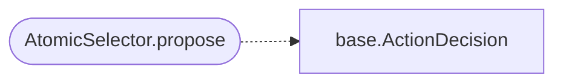

# `modules.selection.atomic`

> Source: [modules/selection/atomic.py:1](../../modules/selection/atomic.py#L1) | language `py` | coverage 100.0% | [API index](../index.md)

Atomic selector: emulate named MITRE ATT&CK techniques with atomic tests.

Single contract covering both MITRE ATT&CK techniques and the Atomic Red Team
library, which share one execution path: ``atomic_emulate --techniques``. When
the objective names ATT&CK technique ids (``T1059``, ``T1059.001``), propose
emulating them against the target. Gated to post-foothold phases because
atomic emulation runs through a working shell; abstains otherwise.

## Contents

- **Classes:** [`AtomicSelector`](#atomicselector)

## Call Graph

Solid arrows stay in this module, dashed arrows leave it.



## Classes

<a id="atomicselector"></a>

### `AtomicSelector`

`class` | [modules/selection/atomic.py:20](../../modules/selection/atomic.py#L20)

```python
class AtomicSelector
```

Propose ``atomic_emulate --target <t> --techniques <ids>`` for named TTPs.

**Attributes**

| Name | Type | Default | Description |
|---|---|---|---|
| [`name`](#atomicselector-name) |  | `'atomic'` |  |

**Members**

| Member | Kind | Summary |
|---|---|---|
| [`propose`](#atomicselector-propose) | method | Return an atomic-emulation action when technique ids are named. |

<a id="atomicselector-propose"></a>

#### `AtomicSelector.propose`

`method` | [modules/selection/atomic.py:25](../../modules/selection/atomic.py#L25)

```python
def propose(self, ctx: SelectionContext) -> ActionDecision | None
```

Return an atomic-emulation action when technique ids are named.

**Parameters**

| Name | Type | Default | Description |
|---|---|---|---|
| `ctx` | `SelectionContext` |  |  |

**Returns:** `ActionDecision | None`

*Calls:* [`ActionDecision`](modules.selection.base.py.md#actiondecision)

---
