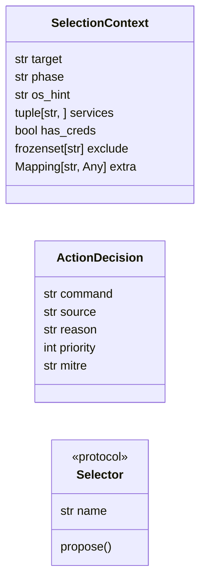

# `modules.selection.base`

> Source: [modules/selection/base.py:1](../../modules/selection/base.py#L1) | language `py` | coverage 100.0% | [API index](../index.md)

The one shared contract for autonomous action selection.

Both autonomous runtimes (the LazyLoopEngine planner and the autonomous
daemon) used to pick the next action with their own private logic. This
module defines the single vocabulary they now share: a [`SelectionContext`](#selectioncontext)
describing the live engagement state, an [`ActionDecision`](#actiondecision) naming the
command to run next, and the [`Selector`](#selector) protocol every strategy
implements. One selector lives per file under ``modules/selection/`` so each
strategy is a single contract; the runtimes only know this protocol.

## Contents

- **Classes:** [`SelectionContext`](#selectioncontext), [`ActionDecision`](#actiondecision)
- **Protocols:** [`Selector`](#selector)

## Type Diagram



## Classes

<a id="selectioncontext"></a>

### `SelectionContext`

`class` `dataclass` | [modules/selection/base.py:20](../../modules/selection/base.py#L20)

Decorators: `@dataclass(frozen=True)`

```python
class SelectionContext
```

Immutable snapshot of what the loop knows when it picks the next action.

**Attributes**

| Name | Type | Default | Description |
|---|---|---|---|
| [`target`](#selectioncontext-target) | `str` |  | Host currently under test. |
| [`phase`](#selectioncontext-phase) | `str` | `''` | Canonical kill-chain phase (``recon``, ``exploit``, ...). |
| [`os_hint`](#selectioncontext-os_hint) | `str` | `''` | Target platform hint (``linux``/``windows``), blank if unknown. |
| [`services`](#selectioncontext-services) | `tuple[str, ...]` | `()` | Discovered service names for the target. |
| [`has_creds`](#selectioncontext-has_creds) | `bool` | `False` | Whether usable credentials are known. |
| [`exclude`](#selectioncontext-exclude) | `frozenset[str]` | `frozenset()` | Action identifiers already taken, to avoid repeats. |
| [`extra`](#selectioncontext-extra) | `Mapping[str, Any]` | `field(default_factory=dict)` | Open map for strategy-specific inputs without widening the shared contract. |

---

<a id="actiondecision"></a>

### `ActionDecision`

`class` `dataclass` | [modules/selection/base.py:44](../../modules/selection/base.py#L44)

Decorators: `@dataclass(frozen=True)`

```python
class ActionDecision
```

One proposed next action, runtime-agnostic.

**Attributes**

| Name | Type | Default | Description |
|---|---|---|---|
| [`command`](#actiondecision-command) | `str` |  | The shell/verb command line to execute. |
| [`source`](#actiondecision-source) | `str` | `'selector'` | Selector identity that produced it. |
| [`reason`](#actiondecision-reason) | `str` | `''` | Short human rationale for the trace. |
| [`priority`](#actiondecision-priority) | `int` | `5` | Lower is more urgent; runtimes may use it to rank. |
| [`mitre`](#actiondecision-mitre) | `str` | `''` | Optional ATT&CK technique id when the action maps to one. |

---

## Protocols

<a id="selector"></a>

### `Selector`

`protocol` | [modules/selection/base.py:63](../../modules/selection/base.py#L63)

Decorators: `@runtime_checkable`

```python
class Selector(Protocol)
```

Bases: `Protocol`

Contract for one action-selection strategy.

Implementations are single-responsibility and side-effect free beyond
their own bookkeeping; they return ``None`` when they have no suggestion
so the cascade falls through to the next selector.

**Attributes**

| Name | Type | Default | Description |
|---|---|---|---|
| [`name`](#selector-name) | `str` |  |  |

**Members**

| Member | Kind | Summary |
|---|---|---|
| [`propose`](#selector-propose) | method | Return the next action for this strategy, or None to abstain. |

<a id="selector-propose"></a>

#### `Selector.propose`

`method` | [modules/selection/base.py:73](../../modules/selection/base.py#L73)

```python
def propose(self, ctx: SelectionContext) -> ActionDecision | None
```

Return the next action for this strategy, or None to abstain.

**Parameters**

| Name | Type | Default | Description |
|---|---|---|---|
| `ctx` | `SelectionContext` |  |  |

**Returns:** `ActionDecision | None`

---
