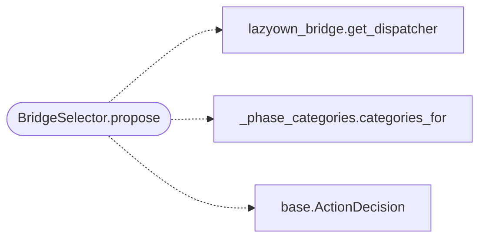

# `modules.selection.bridge`

> Source: [modules/selection/bridge.py:1](../../modules/selection/bridge.py#L1) | language `py` | coverage 100.0% | [API index](../index.md)

Bridge selector: propose a phase/service-appropriate catalogued command.

Single contract: adapt the LazyOwn bridge catalogue
([`modules.lazyown_bridge.get_dispatcher`](modules.lazyown_bridge.py.md#get_dispatcher)) into the
[`modules.selection.base.Selector`](modules.selection.base.py.md#selector) protocol. The dispatcher owns the
MITRE-mapped, OS-filtered 363-command catalogue and all scoring; this file only
tries each phase category as a tag hint, shapes the winning entry into an
[`ActionDecision`](modules.selection.base.py.md#actiondecision), and drops commands whose verb is burned or already
taken. It is a fallback tier: it fires only when the evidence-based and named
selectors ahead of it in the cascade abstain.

## Contents

- **Classes:** [`BridgeSelector`](#bridgeselector)

## Call Graph

Solid arrows stay in this module, dashed arrows leave it.



## Classes

<a id="bridgeselector"></a>

### `BridgeSelector`

`class` | [modules/selection/bridge.py:21](../../modules/selection/bridge.py#L21)

```python
class BridgeSelector
```

Propose one bridge-catalogue command for the phase, or None.

**Attributes**

| Name | Type | Default | Description |
|---|---|---|---|
| [`name`](#bridgeselector-name) |  | `'bridge'` |  |

**Members**

| Member | Kind | Summary |
|---|---|---|
| [`propose`](#bridgeselector-propose) | method | Return a catalogue suggestion for the context, or None. |

<a id="bridgeselector-propose"></a>

#### `BridgeSelector.propose`

`method` | [modules/selection/bridge.py:26](../../modules/selection/bridge.py#L26)

```python
def propose(self, ctx: SelectionContext) -> ActionDecision | None
```

Return a catalogue suggestion for the context, or None.

Each category mapped to the current phase is tried as a tag hint until
the dispatcher returns a command. Burned verbs and verbs already taken
this round are passed as the dispatcher's exclusion set and re-checked
on the returned command, so a dead verb is never proposed.

**Parameters**

| Name | Type | Default | Description |
|---|---|---|---|
| `ctx` | `SelectionContext` |  |  |

**Returns:** `ActionDecision | None`

*Calls:* [`get_dispatcher`](modules.lazyown_bridge.py.md#get_dispatcher), [`categories_for`](modules.selection._phase_categories.py.md#categories_for), [`ActionDecision`](modules.selection.base.py.md#actiondecision)

---
