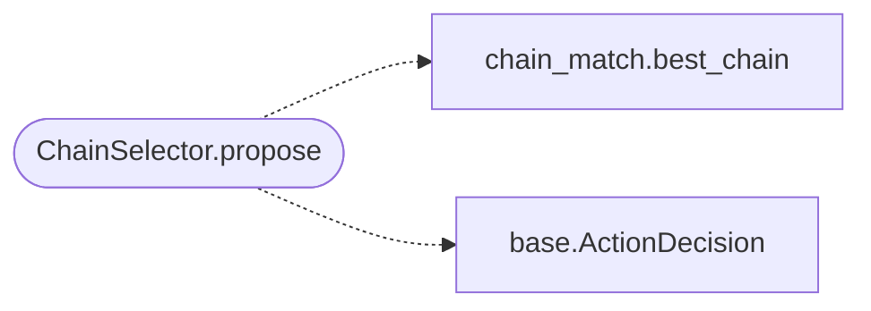

# `modules.selection.chain`

> Source: [modules/selection/chain.py:1](../../modules/selection/chain.py#L1) | language `py` | coverage 100.0% | [API index](../index.md)

Chain selector: propose a vetted ``apt_chain`` when one fits the state.

Single contract: adapt the shared chain matcher (`[`modules.chain_match`](modules.chain_match.py.md)`) into
the [`modules.selection.base.Selector`](modules.selection.base.py.md#selector) protocol. The scoring rules live
in ``chain_match``; this file only shapes the decision and dedupes per target.

## Contents

- **Classes:** [`ChainSelector`](#chainselector)

## Call Graph

Solid arrows stay in this module, dashed arrows leave it.



## Classes

<a id="chainselector"></a>

### `ChainSelector`

`class` | [modules/selection/chain.py:13](../../modules/selection/chain.py#L13)

```python
class ChainSelector
```

Propose ``apt_chain <name> <target>`` for the best-matching chain.

**Attributes**

| Name | Type | Default | Description |
|---|---|---|---|
| [`name`](#chainselector-name) |  | `'chain'` |  |

**Members**

| Member | Kind | Summary |
|---|---|---|
| [`__init__`](#chainselector-__init__) | constructor | Bind the lab-inclusion policy for the matcher. |
| [`propose`](#chainselector-propose) | method | Return a chain action for the context, or None when nothing fits. |

<a id="chainselector-__init__"></a>

#### `ChainSelector.__init__`

`constructor` | [modules/selection/chain.py:18](../../modules/selection/chain.py#L18)

```python
def __init__(self, allow_lab: bool = True) -> None
```

Bind the lab-inclusion policy for the matcher.

**Parameters**

| Name | Type | Default | Description |
|---|---|---|---|
| `allow_lab` | `bool` | `True` | Include lab/gym chains (default True; real engagements pass False). |

<a id="chainselector-propose"></a>

#### `ChainSelector.propose`

`method` | [modules/selection/chain.py:27](../../modules/selection/chain.py#L27)

```python
def propose(self, ctx: SelectionContext) -> ActionDecision | None
```

Return a chain action for the context, or None when nothing fits.

**Parameters**

| Name | Type | Default | Description |
|---|---|---|---|
| `ctx` | `SelectionContext` |  |  |

**Returns:** `ActionDecision | None`

*Calls:* [`best_chain`](modules.chain_match.py.md#best_chain), [`ActionDecision`](modules.selection.base.py.md#actiondecision)

---
