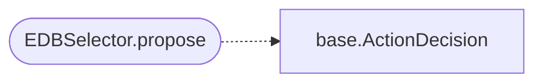

# `modules.selection.edb`

> Source: [modules/selection/edb.py:1](../../modules/selection/edb.py#L1) | language `py` | coverage 33.3% | [API index](../index.md)

## Contents

- **Classes:** [`EDBSelector`](#edbselector)

## Call Graph

Solid arrows stay in this module, dashed arrows leave it.



## Classes

<a id="edbselector"></a>

### `EDBSelector`

`class` | [modules/selection/edb.py:6](../../modules/selection/edb.py#L6)

```python
class EDBSelector
```

Propose ExploitDB (atomic_exploit) when services/cves fit.

**Attributes**

| Name | Type | Default | Description |
|---|---|---|---|
| [`name`](#edbselector-name) |  | `'edb'` |  |

**Members**

| Member | Kind | Summary |
|---|---|---|
| [`propose`](#edbselector-propose) | method |  |

<a id="edbselector-propose"></a>

#### `EDBSelector.propose`

`method` | [modules/selection/edb.py:11](../../modules/selection/edb.py#L11)

```python
def propose(self, ctx: SelectionContext) -> ActionDecision | None
```

**Parameters**

| Name | Type | Default | Description |
|---|---|---|---|
| `ctx` | `SelectionContext` |  |  |

**Returns:** `ActionDecision | None`

*Calls:* [`ActionDecision`](modules.selection.base.py.md#actiondecision)

---
