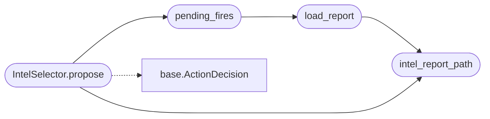

# `modules.selection.intel`

> Source: [modules/selection/intel.py:1](../../modules/selection/intel.py#L1) | language `py` | coverage 100.0% | [API index](../index.md)

Intel selector: feed exploitation intelligence into the autonomous loop.

Shared selector contract: when the exposure pipeline already graded a
target as `[`fire`](modules.conditional_hooks.py.md#hookengine-fire)` with bounded evidence and no confirmation chain covers
it yet, the loop acts before any generic proposal and fires the
autofire confirmation chain. When no report exists but a local exploit
feed is staged, the loop refreshes the exposure report first. Both are
read-only steps; operator-owned arming stays inside
`[`modules.lazy_autofire`](modules.lazy_autofire.py.md)`.

## Contents

- **Classes:** [`IntelSelector`](#intelselector)
- **Functions:** [`intel_report_path`](#intel_report_path), [`load_report`](#load_report), [`pending_fires`](#pending_fires)

## Call Graph

Solid arrows stay in this module, dashed arrows leave it.



## Classes

<a id="intelselector"></a>

### `IntelSelector`

`class` | [modules/selection/intel.py:112](../../modules/selection/intel.py#L112)

```python
class IntelSelector
```

Propose the next intelligence-driven read-only confirmation step.

**Attributes**

| Name | Type | Default | Description |
|---|---|---|---|
| [`name`](#intelselector-name) |  | `'intel'` |  |

**Members**

| Member | Kind | Summary |
|---|---|---|
| [`propose`](#intelselector-propose) | method | Return the next intelligence action, or None when none applies. |

<a id="intelselector-propose"></a>

#### `IntelSelector.propose`

`method` | [modules/selection/intel.py:117](../../modules/selection/intel.py#L117)

```python
def propose(self, ctx: SelectionContext) -> ActionDecision | None
```

Return the next intelligence action, or None when none applies.

**Parameters**

| Name | Type | Default | Description |
|---|---|---|---|
| `ctx` | `SelectionContext` |  | Live engagement snapshot from the runtime. |

**Returns:** `ActionDecision | None` - A pending ``lazyautofire fire <target>`` when fire intel is
uncovered, a ``lazyintel <target>`` refresh when no report
exists but a feed is staged, else None.

*Calls:* [`ActionDecision`](modules.selection.base.py.md#actiondecision), [`intel_report_path`](#intel_report_path), [`pending_fires`](#pending_fires)

---

## Functions

<a id="intel_report_path"></a>

### `intel_report_path`

`function` | [modules/selection/intel.py:32](../../modules/selection/intel.py#L32)

```python
def intel_report_path(target: str) -> Path
```

Return the saved exposure report path for one target.

**Parameters**

| Name | Type | Default | Description |
|---|---|---|---|
| `target` | `str` |  | Host address the report was generated for. |

**Returns:** `Path` - The report file path (may not exist).

*Called by:* [`IntelSelector.propose`](#intelselector-propose), [`load_report`](#load_report)

---

<a id="load_report"></a>

### `load_report`

`function` | [modules/selection/intel.py:44](../../modules/selection/intel.py#L44)

```python
def load_report(target: str) -> dict | None
```

Read the saved exposure report of one target.

**Parameters**

| Name | Type | Default | Description |
|---|---|---|---|
| `target` | `str` |  | Host address. |

**Returns:** `dict | None` - The report dict, or None when absent or unreadable.

*Calls:* [`intel_report_path`](#intel_report_path)

*Called by:* [`pending_fires`](#pending_fires)

---

<a id="pending_fires"></a>

### `pending_fires`

`function` | [modules/selection/intel.py:60](../../modules/selection/intel.py#L60)

```python
def pending_fires(target: str) -> list[dict]
```

Fire-tier bounded matches of a target not covered by a chain yet.

**Parameters**

| Name | Type | Default | Description |
|---|---|---|---|
| `target` | `str` |  | Host address. |

**Returns:** `list[dict]` - Match rows (tier fire, evidence in_range) with a live chain file
subtracted by CVE id.

*Calls:* [`load_report`](#load_report)

*Called by:* [`IntelSelector.propose`](#intelselector-propose)

---
