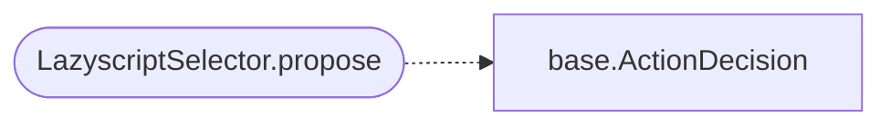

# `modules.selection.lazyscript`

> Source: [modules/selection/lazyscript.py:1](../../modules/selection/lazyscript.py#L1) | language `py` | coverage 100.0% | [API index](../index.md)

Lazyscript selector: propose an operator-authored .ls recipe when it fits.

Single contract. Lazyscripts (``lazyscripts/*.ls``) are ordered lists of
LazyOwn verbs an operator curated for a task (SMB sweep, AD enumeration, an
atomic-agent run). They are a safe, explicit chaining surface no selector
reached before. This strategy token-matches the goal and discovered services
against each script name and proposes ``lazyscript <name>.ls`` for the best
fit, so the autonomous loop can run a curated recipe instead of rebuilding it
one verb at a time. Matching mirrors the conservative whole-token rule the
module registry uses, so a plain substring never fires a script.

## Contents

- **Classes:** [`LazyscriptSelector`](#lazyscriptselector)

## Call Graph

Solid arrows stay in this module, dashed arrows leave it.



## Classes

<a id="lazyscriptselector"></a>

### `LazyscriptSelector`

`class` | [modules/selection/lazyscript.py:36](../../modules/selection/lazyscript.py#L36)

```python
class LazyscriptSelector
```

Propose ``lazyscript <name>.ls`` when a curated recipe matches the state.

**Attributes**

| Name | Type | Default | Description |
|---|---|---|---|
| [`name`](#lazyscriptselector-name) |  | `'lazyscript'` |  |

**Members**

| Member | Kind | Summary |
|---|---|---|
| [`__init__`](#lazyscriptselector-__init__) | constructor | Bind the lazyscripts directory (overridable for tests). |
| [`propose`](#lazyscriptselector-propose) | method | Return a lazyscript action for the context, or None when none fit. |

<a id="lazyscriptselector-__init__"></a>

#### `LazyscriptSelector.__init__`

`constructor` | [modules/selection/lazyscript.py:41](../../modules/selection/lazyscript.py#L41)

```python
def __init__(self, scripts_dir: Path | None = None) -> None
```

Bind the lazyscripts directory (overridable for tests).

**Parameters**

| Name | Type | Default | Description |
|---|---|---|---|
| `scripts_dir` | `Path \| None` | `None` |  |

<a id="lazyscriptselector-propose"></a>

#### `LazyscriptSelector.propose`

`method` | [modules/selection/lazyscript.py:56](../../modules/selection/lazyscript.py#L56)

```python
def propose(self, ctx: SelectionContext) -> ActionDecision | None
```

Return a lazyscript action for the context, or None when none fit.

**Parameters**

| Name | Type | Default | Description |
|---|---|---|---|
| `ctx` | `SelectionContext` |  |  |

**Returns:** `ActionDecision | None`

*Calls:* [`ActionDecision`](modules.selection.base.py.md#actiondecision)

---
