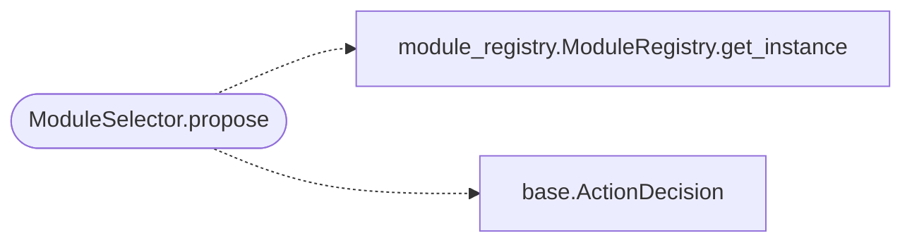

# `modules.selection.module`

> Source: [modules/selection/module.py:1](../../modules/selection/module.py#L1) | language `py` | coverage 100.0% | [API index](../index.md)

Module selector: map goal/service mentions onto runnable registry modules.

Single contract: adapt `[`ModuleRegistry.proposal_intents`](modules.module_registry.py.md#moduleregistry-proposal_intents)` (conservative
token matching over lazyaddons and APT playbooks) into the
[`modules.selection.base.Selector`](modules.selection.base.py.md#selector) protocol.

## Contents

- **Classes:** [`ModuleSelector`](#moduleselector)

## Call Graph

Solid arrows stay in this module, dashed arrows leave it.



## Classes

<a id="moduleselector"></a>

### `ModuleSelector`

`class` | [modules/selection/module.py:16](../../modules/selection/module.py#L16)

```python
class ModuleSelector
```

Propose ``lazy addon``/``apt_playbook run`` lines from the registry.

**Attributes**

| Name | Type | Default | Description |
|---|---|---|---|
| [`name`](#moduleselector-name) |  | `'module'` |  |

**Members**

| Member | Kind | Summary |
|---|---|---|
| [`propose`](#moduleselector-propose) | method | Return the first unproposed registry intent, or None. |

<a id="moduleselector-propose"></a>

#### `ModuleSelector.propose`

`method` | [modules/selection/module.py:21](../../modules/selection/module.py#L21)

```python
def propose(self, ctx: SelectionContext) -> ActionDecision | None
```

Return the first unproposed registry intent, or None.

**Parameters**

| Name | Type | Default | Description |
|---|---|---|---|
| `ctx` | `SelectionContext` |  |  |

**Returns:** `ActionDecision | None`

*Calls:* [`ModuleRegistry.get_instance`](modules.module_registry.py.md#moduleregistry-get_instance), [`ActionDecision`](modules.selection.base.py.md#actiondecision)

---
