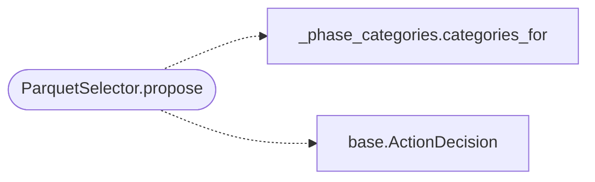

# `modules.selection.parquet`

> Source: [modules/selection/parquet.py:1](../../modules/selection/parquet.py#L1) | language `py` | coverage 100.0% | [API index](../index.md)

Parquet selector: propose the command that most often succeeded before.

Single contract: adapt the columnar session knowledge base
(``lazyown_parquet_db.get_pdb``) into the shared
[`modules.selection.base.Selector`](modules.selection.base.py.md#selector) protocol. For each lookup category
mapped to the current phase it mines the most-frequent successfully-executed
command head, skipping verbs that are burned, campaign-blacklisted, or already
taken. It is a history fallback: it fires only when the evidence-based and
named selectors ahead of it in the cascade abstain, and sits just before the
bridge catalogue so a proven command wins over a generic catalogue suggestion.

## Contents

- **Classes:** [`ParquetSelector`](#parquetselector)

## Call Graph

Solid arrows stay in this module, dashed arrows leave it.



## Classes

<a id="parquetselector"></a>

### `ParquetSelector`

`class` | [modules/selection/parquet.py:46](../../modules/selection/parquet.py#L46)

```python
class ParquetSelector
```

Propose the most-frequent past-successful command for the phase, or None.

**Attributes**

| Name | Type | Default | Description |
|---|---|---|---|
| [`name`](#parquetselector-name) |  | `'parquet'` |  |

**Members**

| Member | Kind | Summary |
|---|---|---|
| [`propose`](#parquetselector-propose) | method | Return a history-backed command head for the context, or None. |

<a id="parquetselector-propose"></a>

#### `ParquetSelector.propose`

`method` | [modules/selection/parquet.py:51](../../modules/selection/parquet.py#L51)

```python
def propose(self, ctx: SelectionContext) -> ActionDecision | None
```

Return a history-backed command head for the context, or None.

**Parameters**

| Name | Type | Default | Description |
|---|---|---|---|
| `ctx` | `SelectionContext` |  |  |

**Returns:** `ActionDecision | None`

*Calls:* [`categories_for`](modules.selection._phase_categories.py.md#categories_for), [`ActionDecision`](modules.selection.base.py.md#actiondecision)

---
