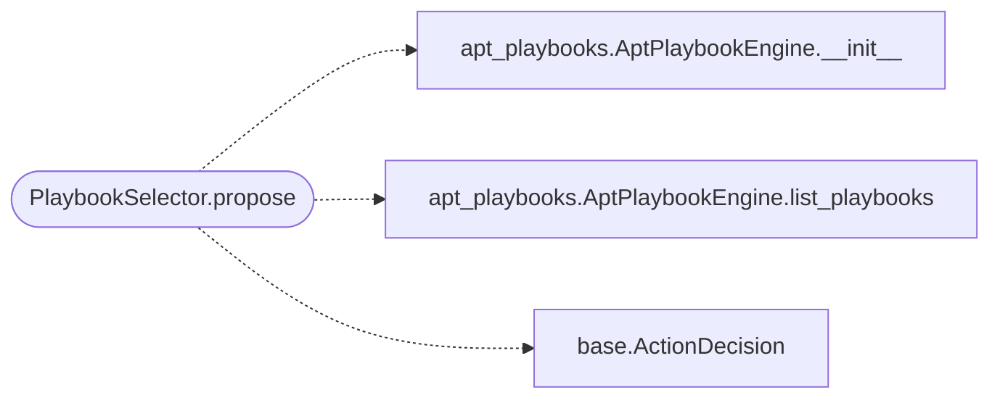

# `modules.selection.playbook`

> Source: [modules/selection/playbook.py:1](../../modules/selection/playbook.py#L1) | language `py` | coverage 100.0% | [API index](../index.md)

Playbook selector: run an APT actor emulation named by the objective.

Single contract: when the task goal names a known APT actor (from the
``playbooks/`` library) and a matching ``apt_<actor>`` chain exists, propose
running it end to end via ``apt_chain``. Conservative: abstains unless the goal
clearly names an actor, so it never emulates an actor the operator did not ask
for.

## Contents

- **Classes:** [`PlaybookSelector`](#playbookselector)

## Call Graph

Solid arrows stay in this module, dashed arrows leave it.



## Classes

<a id="playbookselector"></a>

### `PlaybookSelector`

`class` | [modules/selection/playbook.py:19](../../modules/selection/playbook.py#L19)

```python
class PlaybookSelector
```

Propose ``apt_chain apt_<actor> <target>`` when the goal names an actor.

**Attributes**

| Name | Type | Default | Description |
|---|---|---|---|
| [`name`](#playbookselector-name) |  | `'playbook'` |  |

**Members**

| Member | Kind | Summary |
|---|---|---|
| [`__init__`](#playbookselector-__init__) | constructor | Bind the playbook directory to scan for known actors. |
| [`propose`](#playbookselector-propose) | method | Return an actor-emulation action when the goal names one, else None. |

<a id="playbookselector-__init__"></a>

#### `PlaybookSelector.__init__`

`constructor` | [modules/selection/playbook.py:24](../../modules/selection/playbook.py#L24)

```python
def __init__(self, playbook_dir: str = 'playbooks') -> None
```

Bind the playbook directory to scan for known actors.

**Parameters**

| Name | Type | Default | Description |
|---|---|---|---|
| `playbook_dir` | `str` | `'playbooks'` |  |

<a id="playbookselector-propose"></a>

#### `PlaybookSelector.propose`

`method` | [modules/selection/playbook.py:28](../../modules/selection/playbook.py#L28)

```python
def propose(self, ctx: SelectionContext) -> ActionDecision | None
```

Return an actor-emulation action when the goal names one, else None.

**Parameters**

| Name | Type | Default | Description |
|---|---|---|---|
| `ctx` | `SelectionContext` |  |  |

**Returns:** `ActionDecision | None`

*Calls:* [`AptPlaybookEngine.__init__`](modules.apt_playbooks.py.md#aptplaybookengine-__init__), [`AptPlaybookEngine.list_playbooks`](modules.apt_playbooks.py.md#aptplaybookengine-list_playbooks), [`ActionDecision`](modules.selection.base.py.md#actiondecision)

---
