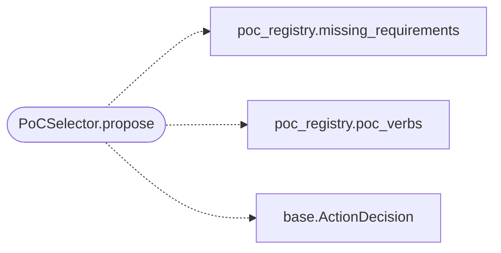

# `modules.selection.poc`

> Source: [modules/selection/poc.py:1](../../modules/selection/poc.py#L1) | language `py` | coverage 100.0% | [API index](../index.md)

PoC selector: propose catalogued PoC verbs when services match.

Single contract: adapt `[`modules.poc_registry`](modules.poc_registry.py.md)` trigger matching into the
shared [`modules.selection.base.Selector`](modules.selection.base.py.md#selector) protocol. Every enabled
PoC verb whose trigger token appears in the discovered service names for
the target becomes a ``lazy_poc run <name> <target>`` decision with the
catalog's per-verb proposal overrides embedded (e.g. ``rport=9000`` for
MinIO), so the planner and the daemon queue the exact runnable line.
Guidance-only when the PoC's requirements are missing: the decision is
skipped rather than proposing a command that cannot start.

## Contents

- **Classes:** [`PoCSelector`](#pocselector)

## Call Graph

Solid arrows stay in this module, dashed arrows leave it.



## Classes

<a id="pocselector"></a>

### `PoCSelector`

`class` | [modules/selection/poc.py:20](../../modules/selection/poc.py#L20)

```python
class PoCSelector
```

Propose ``lazy_poc run`` for the best-matching catalogued PoC.

**Attributes**

| Name | Type | Default | Description |
|---|---|---|---|
| [`name`](#pocselector-name) |  | `'poc'` |  |

**Members**

| Member | Kind | Summary |
|---|---|---|
| [`propose`](#pocselector-propose) | method | Return a PoC action for the context, or None when nothing fits. |

<a id="pocselector-propose"></a>

#### `PoCSelector.propose`

`method` | [modules/selection/poc.py:25](../../modules/selection/poc.py#L25)

```python
def propose(self, ctx: SelectionContext) -> ActionDecision | None
```

Return a PoC action for the context, or None when nothing fits.

**Parameters**

| Name | Type | Default | Description |
|---|---|---|---|
| `ctx` | `SelectionContext` |  | Live engagement snapshot with the target's services. |

**Returns:** `ActionDecision | None` - A ``lazy_poc run <name> <target>`` decision when one enabled
PoC matches a service token and its requirements are met,
else None.

*Calls:* [`missing_requirements`](modules.poc_registry.py.md#missing_requirements), [`poc_verbs`](modules.poc_registry.py.md#poc_verbs), [`ActionDecision`](modules.selection.base.py.md#actiondecision)

---
