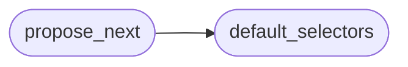

# `modules.selection.registry`

> Source: [modules/selection/registry.py:1](../../modules/selection/registry.py#L1) | language `py` | coverage 100.0% | [API index](../index.md)

Assemble and run the shared selector cascade.

The cascade is the single ordered list of strategies the unified autonomous
loop consults. [`propose_next`](#propose_next) tries each selector in order and returns
the first concrete decision, so adding a capability is adding one file and one
registry entry (Open/Closed). Both runtimes build their context and call here
instead of carrying private selection logic.

## Contents

- **Functions:** [`default_selectors`](#default_selectors), [`propose_next`](#propose_next)

## Call Graph

Solid arrows stay in this module, dashed arrows leave it.



## Functions

<a id="default_selectors"></a>

### `default_selectors`

`function` | [modules/selection/registry.py:40](../../modules/selection/registry.py#L40)

```python
def default_selectors() -> list[Selector]
```

Return the cascade after applying the orchestrator's enable toggles.

The orchestrator is the single admin surface: a selector disabled via
``orchestrator.selectors.<name> = false`` is dropped here, so both
runtimes honour one administration point without their own switches.

**Returns:** `list[Selector]`

*Called by:* [`propose_next`](#propose_next)

---

<a id="propose_next"></a>

### `propose_next`

`function` | [modules/selection/registry.py:55](../../modules/selection/registry.py#L55)

```python
def propose_next(ctx: SelectionContext, selectors: Iterable[Selector] | None = None) -> ActionDecision | None
```

Return the first concrete decision from the cascade, or None.

**Parameters**

| Name | Type | Default | Description |
|---|---|---|---|
| `ctx` | `SelectionContext` |  | Live engagement snapshot. |
| `selectors` | `Iterable[Selector] \| None` | `None` | Optional explicit cascade; defaults to [`default_selectors`](#default_selectors). |

**Returns:** `ActionDecision | None` - The first non-None [`ActionDecision`](modules.selection.base.py.md#actiondecision), or None when every
selector abstains.

*Calls:* [`default_selectors`](#default_selectors)

*Called by:* [`UnifiedBrainSelector.select`](skills.autonomous_daemon.py.md#unifiedbrainselector-select)

---
