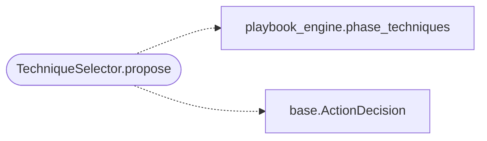

# `modules.selection.technique`

> Source: [modules/selection/technique.py:1](../../modules/selection/technique.py#L1) | language `py` | coverage 100.0% | [API index](../index.md)

Technique selector: propose MITRE technique emulation for the phase.

Single contract: adapt [`modules.playbook_engine.phase_techniques`](modules.playbook_engine.py.md#phase_techniques)
(STIX-first with local atomic-index fallback) into the
[`modules.selection.base.Selector`](modules.selection.base.py.md#selector) protocol. Post-foothold phases
only — technique emulation assumes an existing execution surface.

## Contents

- **Classes:** [`TechniqueSelector`](#techniqueselector)

## Call Graph

Solid arrows stay in this module, dashed arrows leave it.



## Classes

<a id="techniqueselector"></a>

### `TechniqueSelector`

`class` | [modules/selection/technique.py:18](../../modules/selection/technique.py#L18)

```python
class TechniqueSelector
```

Propose ``atomic_tests <TID> --non-interactive`` for the phase.

**Attributes**

| Name | Type | Default | Description |
|---|---|---|---|
| [`name`](#techniqueselector-name) |  | `'technique'` |  |

**Members**

| Member | Kind | Summary |
|---|---|---|
| [`propose`](#techniqueselector-propose) | method | Return a technique emulation action, or None when not applicable. |

<a id="techniqueselector-propose"></a>

#### `TechniqueSelector.propose`

`method` | [modules/selection/technique.py:23](../../modules/selection/technique.py#L23)

```python
def propose(self, ctx: SelectionContext) -> ActionDecision | None
```

Return a technique emulation action, or None when not applicable.

**Parameters**

| Name | Type | Default | Description |
|---|---|---|---|
| `ctx` | `SelectionContext` |  |  |

**Returns:** `ActionDecision | None`

*Calls:* [`phase_techniques`](modules.playbook_engine.py.md#phase_techniques), [`ActionDecision`](modules.selection.base.py.md#actiondecision)

---
