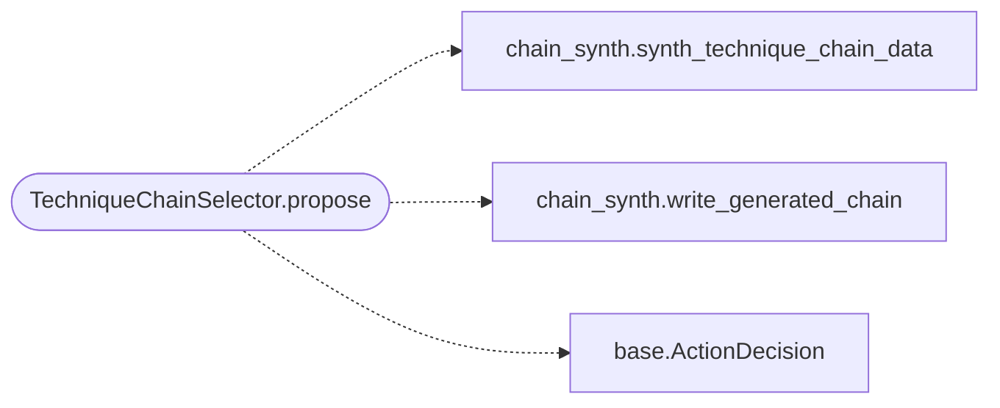

# `modules.selection.technique_chain`

> Source: [modules/selection/technique_chain.py:1](../../modules/selection/technique_chain.py#L1) | language `py` | coverage 100.0% | [API index](../index.md)

Technique-chain selector: compile the phase's techniques into one paced chain.

Single contract. Where [`modules.selection.technique.TechniqueSelector`](modules.selection.technique.py.md#techniqueselector)
emits one ``atomic_tests`` per round and
[`modules.selection.atomic.AtomicSelector`](modules.selection.atomic.py.md#atomicselector) emits a goal-named set, this
strategy compiles the ranked MITRE/Atomic techniques for the current phase (or
a goal that names several) into one ordered chain and runs it through
``apt_chain``. The ChainRunner's shared EdrPacer then applies the configured
jitter and sleeper windows between techniques, so chaining honours the
operator's pacing. Post-foothold phases only, because atomic emulation assumes
an existing execution surface; abstains otherwise.

## Contents

- **Classes:** [`TechniqueChainSelector`](#techniquechainselector)

## Call Graph

Solid arrows stay in this module, dashed arrows leave it.



## Classes

<a id="techniquechainselector"></a>

### `TechniqueChainSelector`

`class` | [modules/selection/technique_chain.py:24](../../modules/selection/technique_chain.py#L24)

```python
class TechniqueChainSelector
```

Propose ``apt_chain <synth> <target>`` for an ordered technique chain.

**Attributes**

| Name | Type | Default | Description |
|---|---|---|---|
| [`name`](#techniquechainselector-name) |  | `'technique_chain'` |  |

**Members**

| Member | Kind | Summary |
|---|---|---|
| [`propose`](#techniquechainselector-propose) | method | Return a technique-chain action, or None when fewer than two fit. |

<a id="techniquechainselector-propose"></a>

#### `TechniqueChainSelector.propose`

`method` | [modules/selection/technique_chain.py:53](../../modules/selection/technique_chain.py#L53)

```python
def propose(self, ctx: SelectionContext) -> ActionDecision | None
```

Return a technique-chain action, or None when fewer than two fit.

**Parameters**

| Name | Type | Default | Description |
|---|---|---|---|
| `ctx` | `SelectionContext` |  |  |

**Returns:** `ActionDecision | None`

*Calls:* [`synth_technique_chain_data`](modules.chain_synth.py.md#synth_technique_chain_data), [`write_generated_chain`](modules.chain_synth.py.md#write_generated_chain), [`ActionDecision`](modules.selection.base.py.md#actiondecision)

---
