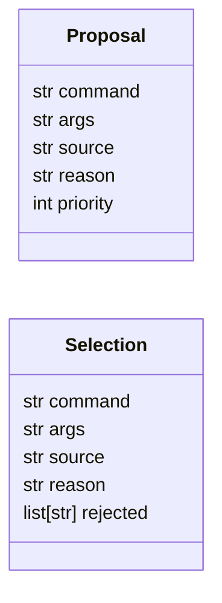
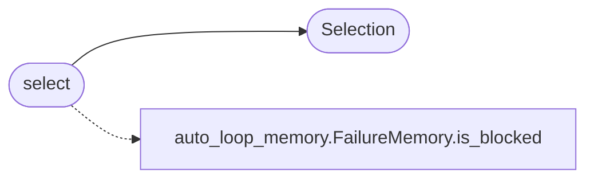

# `modules.selector_manager`

> Source: [modules/selector_manager.py:1](../../modules/selector_manager.py#L1) | language `py` | coverage 100.0% | [API index](../index.md)

Selector manager: deterministic priority cascade with provenance.

Every source in the auto-loop command cascade produces a `[`Proposal`](#proposal)`.
`[`select`](#select)` walks the ordered list, skips proposals whose base command is
blocked or malformed, and returns the winner together with the full
rejection trace so operators (and the digest) can see why a given source
lost. Deterministic: proposals are sorted by ``(priority, input order)``
and duplicate command strings collapse onto the best-priority instance.

## Contents

- **Classes:** [`Proposal`](#proposal), [`Selection`](#selection)
- **Functions:** [`select`](#select)

## Type Diagram



## Call Graph

Solid arrows stay in this module, dashed arrows leave it.



## Classes

<a id="proposal"></a>

### `Proposal`

`class` `dataclass` | [modules/selector_manager.py:21](../../modules/selector_manager.py#L21)

Decorators: `@dataclass`

```python
class Proposal
```

One candidate command offered by a selection source.

**Attributes**

| Name | Type | Default | Description |
|---|---|---|---|
| [`command`](#proposal-command) | `str` |  |  |
| [`args`](#proposal-args) | `str` | `''` |  |
| [`source`](#proposal-source) | `str` | `_UNKNOWN_SOURCE` |  |
| [`reason`](#proposal-reason) | `str` | `''` |  |
| [`priority`](#proposal-priority) | `int` | `100` |  |

---

<a id="selection"></a>

### `Selection`

`class` `dataclass` | [modules/selector_manager.py:32](../../modules/selector_manager.py#L32)

Decorators: `@dataclass`

```python
class Selection
```

The chosen proposal plus the reasons every other one lost.

**Attributes**

| Name | Type | Default | Description |
|---|---|---|---|
| [`command`](#selection-command) | `str` |  |  |
| [`args`](#selection-args) | `str` |  |  |
| [`source`](#selection-source) | `str` |  |  |
| [`reason`](#selection-reason) | `str` |  |  |
| [`rejected`](#selection-rejected) | `list[str]` | `field(default_factory=list)` |  |

---

## Functions

<a id="select"></a>

### `select`

`function` | [modules/selector_manager.py:42](../../modules/selector_manager.py#L42)

```python
def select(proposals: list[Proposal], is_blocked: Callable[[str], bool] | None = None) -> Selection | None
```

Pick the first valid proposal; None when everything is filtered.

**Parameters**

| Name | Type | Default | Description |
|---|---|---|---|
| `proposals` | `list[Proposal]` |  | Candidates in any order; sorted by priority ascending. |
| `is_blocked` | `Callable[[str], bool] \| None` | `None` | Optional veto predicate on the base command. |

**Returns:** `Selection | None` - Selection with command/args/source/reason and the rejection
trace, or None when no proposal survived.

*Calls:* [`FailureMemory.is_blocked`](modules.auto_loop_memory.py.md#failurememory-is_blocked), [`Selection`](#selection)

---
