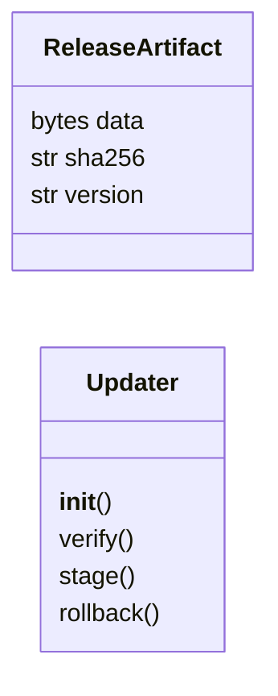
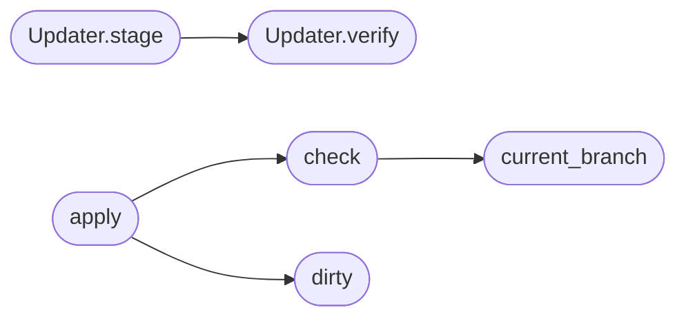

# `modules.selfupdate`

> Source: [modules/selfupdate.py:1](../../modules/selfupdate.py#L1) | language `py` | coverage 100.0% | [API index](../index.md)

Guarded self-update for the LazyOwn working tree.

`[`check`](#check)` fetches the configured branch and reports how far behind the
tree is; `[`apply`](#apply)` only fast-forwards when the tree is clean and has no
local commits, never runs remote code beyond a merge and never touches
the branch without ``--yes``. The loop runs a throttled `[`check`](#check)` (once
a day) and reports an activity line when an update is available.

## Contents

- **Classes:** [`ReleaseArtifact`](#releaseartifact), [`Updater`](#updater)
- **Functions:** [`current_branch`](#current_branch), [`dirty`](#dirty), [`check`](#check), [`apply`](#apply)
- **Constants:** [`DEFAULT_BRANCH`](#default_branch)

## Type Diagram



## Call Graph

Solid arrows stay in this module, dashed arrows leave it.



## Classes

<a id="releaseartifact"></a>

### `ReleaseArtifact`

`class` `dataclass` | [modules/selfupdate.py:24](../../modules/selfupdate.py#L24)

Decorators: `@dataclass(frozen=True)`

```python
class ReleaseArtifact
```

One release candidate: bytes plus their expected digest.

**Attributes**

| Name | Type | Default | Description |
|---|---|---|---|
| [`data`](#releaseartifact-data) | `bytes` |  | Raw binary payload. |
| [`sha256`](#releaseartifact-sha256) | `str` |  | Expected lowercase hex digest of `[`data`](#releaseartifact-data)`. |
| [`version`](#releaseartifact-version) | `str` | `''` | Human version label carried into logs. |

---

<a id="updater"></a>

### `Updater`

`class` | [modules/selfupdate.py:38](../../modules/selfupdate.py#L38)

```python
class Updater
```

Verify, stage and roll back a single binary path.

Used by the guarded self-update path for release artifacts that are
downloaded instead of git-merged: a bad checksum never reaches the
live file, staging writes beside it first, and rollback restores the
``<name>.old`` snapshot left by the previous apply.

**Members**

| Member | Kind | Summary |
|---|---|---|
| [`__init__`](#updater-__init__) | constructor | Bind the updater to the binary that may be replaced. |
| [`verify`](#updater-verify) | method | Return True when the payload matches its recorded digest. |
| [`stage`](#updater-stage) | method | Write a verified payload into ``directory``. |
| [`rollback`](#updater-rollback) | method | Restore the ``<name>.old`` snapshot over the live binary. |

<a id="updater-__init__"></a>

#### `Updater.__init__`

`constructor` | [modules/selfupdate.py:47](../../modules/selfupdate.py#L47)

```python
def __init__(self, live_path: str | Path) -> None
```

Bind the updater to the binary that may be replaced.

**Parameters**

| Name | Type | Default | Description |
|---|---|---|---|
| `live_path` | `str \| Path` |  |  |

<a id="updater-verify"></a>

#### `Updater.verify`

`method` | [modules/selfupdate.py:52](../../modules/selfupdate.py#L52)

```python
def verify(self, artifact: ReleaseArtifact) -> bool
```

Return True when the payload matches its recorded digest.

**Parameters**

| Name | Type | Default | Description |
|---|---|---|---|
| `artifact` | `ReleaseArtifact` |  |  |

**Returns:** `bool`

*Called by:* [`Updater.stage`](#updater-stage)

<a id="updater-stage"></a>

#### `Updater.stage`

`method` | [modules/selfupdate.py:57](../../modules/selfupdate.py#L57)

```python
def stage(self, artifact: ReleaseArtifact, directory: str | Path) -> str
```

Write a verified payload into ``directory``.

**Parameters**

| Name | Type | Default | Description |
|---|---|---|---|
| `artifact` | `ReleaseArtifact` |  | Verified release candidate. |
| `directory` | `str \| Path` |  | Destination directory for the staged binary. |

**Returns:** `str` - Path of the staged file.

**Raises**

- `ValueError`: Checksum mismatch; the live binary is untouched.

*Calls:* [`Updater.verify`](#updater-verify)

<a id="updater-rollback"></a>

#### `Updater.rollback`

`method` | [modules/selfupdate.py:77](../../modules/selfupdate.py#L77)

```python
def rollback(self) -> bool
```

Restore the ``<name>.old`` snapshot over the live binary.

**Returns:** `bool`

---

## Functions

<a id="current_branch"></a>

### `current_branch`

`function` | [modules/selfupdate.py:96](../../modules/selfupdate.py#L96)

```python
def current_branch(runner=None) -> str
```

Return the checked-out branch name (empty on failure).

**Parameters**

| Name | Type | Default | Description |
|---|---|---|---|
| `runner` |  | `None` |  |

**Returns:** `str`

*Called by:* [`check`](#check)

---

<a id="dirty"></a>

### `dirty`

`function` | [modules/selfupdate.py:102](../../modules/selfupdate.py#L102)

```python
def dirty(runner=None) -> bool
```

Return True when the working tree has uncommitted changes.

**Parameters**

| Name | Type | Default | Description |
|---|---|---|---|
| `runner` |  | `None` |  |

**Returns:** `bool`

*Called by:* [`apply`](#apply)

---

<a id="check"></a>

### `check`

`function` | [modules/selfupdate.py:108](../../modules/selfupdate.py#L108)

```python
def check(branch: str = '', runner=None) -> dict
```

Fetch the branch and report ahead/behind counts.

**Parameters**

| Name | Type | Default | Description |
|---|---|---|---|
| `branch` | `str` | `''` | Branch to compare (defaults to the current branch). |
| `runner` |  | `None` | Injected git runner. |

**Returns:** `dict` - Dict with ok, branch, behind, ahead and head hash.

*Calls:* [`current_branch`](#current_branch)

*Called by:* [`apply`](#apply)

---

<a id="apply"></a>

### `apply`

`function` | [modules/selfupdate.py:140](../../modules/selfupdate.py#L140)

```python
def apply(branch: str = '', confirm: bool = False, runner=None) -> dict
```

Fast-forward the tree to origin/<branch> when safe.

**Parameters**

| Name | Type | Default | Description |
|---|---|---|---|
| `branch` | `str` | `''` | Branch to update from. |
| `confirm` | `bool` | `False` | Must be True; the CLI requires ``--yes``. |
| `runner` |  | `None` | Injected git runner. |

**Returns:** `dict` - Dict with applied flag, reason and the check summary.

*Calls:* [`check`](#check), [`dirty`](#dirty)

---

## Constants

<a id="default_branch"></a>

### `DEFAULT_BRANCH`

`constant` | [modules/selfupdate.py:19](../../modules/selfupdate.py#L19)

```python
DEFAULT_BRANCH = 'dev'
```

---
