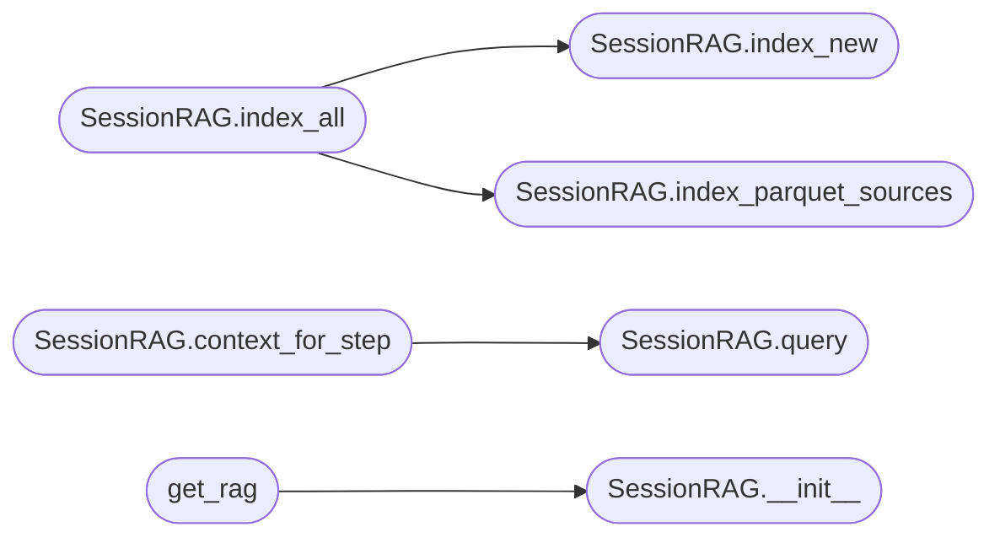

# `modules.session_rag`

> Source: [modules/session_rag.py:1](../../modules/session_rag.py#L1) | language `py` | coverage 70.0% | [API index](../index.md)

session_rag.py — ChromaDB-backed RAG over sessions/ artefacts.

Incrementally indexes every text artefact in sessions/:
  *.log, *.txt, *.csv, *.xml, *.json, *.nmap, *.md

State tracked in sessions/rag_state.json (mtime per file) so only
new or changed files are re-indexed on each call.

ChromaDB is optional — if not installed the module degrades gracefully
to keyword search (Python in-memory fallback).

Install:
    pip install chromadb

Public API
----------
get_rag() -> SessionRAG          singleton
SessionRAG.index_new()           incremental re-index (fast, cron-safe)
SessionRAG.index_all()           full re-index from scratch
SessionRAG.query(text, n)        semantic / keyword search
SessionRAG.context_for_step(phase, target, n)  -> str for prompt injection
SessionRAG.stats()               -> dict

## Contents

- **Classes:** [`SessionRAG`](#sessionrag)
- **Functions:** [`get_rag`](#get_rag)
- **Constants:** [`SESSIONS_DIR`](#sessions_dir), [`RAG_STATE_FILE`](#rag_state_file), [`FALLBACK_INDEX_FILE`](#fallback_index_file), [`CHROMA_DIR`](#chroma_dir), [`CHROMA_VERSION_FILE`](#chroma_version_file), [`COLLECTIONS`](#collections), [`CHUNK_SIZE`](#chunk_size), [`CHUNK_OVERLAP`](#chunk_overlap), [`MAX_FALLBACK_DOCS`](#max_fallback_docs), [`INDEXABLE_SUFFIXES`](#indexable_suffixes), [`SKIP_PATTERNS`](#skip_patterns)

## Call Graph

Solid arrows stay in this module, dashed arrows leave it.



## Classes

<a id="sessionrag"></a>

### `SessionRAG`

`class` | [modules/session_rag.py:188](../../modules/session_rag.py#L188)

```python
class SessionRAG
```

Semantic search over sessions/ artefacts using ChromaDB or keyword fallback.

**Members**

| Member | Kind | Summary |
|---|---|---|
| [`__init__`](#sessionrag-__init__) | constructor |  |
| [`index_new`](#sessionrag-index_new) | method | Incrementally index only new or changed files. |
| [`index_parquet_sources`](#sessionrag-index_parquet_sources) | method | Index knowledge-base parquets (techniques_enriched, binarios, lolbas_index) into the RAG store. |
| [`index_all`](#sessionrag-index_all) | method | Full re-index from scratch. |
| [`query`](#sessionrag-query) | method | Return top-n relevant chunks as dicts with keys: text, source, chunk, score. |
| [`context_for_step`](#sessionrag-context_for_step) | method | Return a compact RAG context string suitable for injection into an LLM prompt. |
| [`stats`](#sessionrag-stats) | method |  |

<a id="sessionrag-__init__"></a>

#### `SessionRAG.__init__`

`constructor` | [modules/session_rag.py:191](../../modules/session_rag.py#L191)

```python
def __init__(self) -> None
```

*Called by:* [`get_rag`](#get_rag)

<a id="sessionrag-index_new"></a>

#### `SessionRAG.index_new`

`method` | [modules/session_rag.py:301](../../modules/session_rag.py#L301)

```python
def index_new(self) -> dict[str, int]
```

Incrementally index only new or changed files.

**Returns:** `dict[str, int]`

*Called by:* [`SessionRAG.index_all`](#sessionrag-index_all)

<a id="sessionrag-index_parquet_sources"></a>

#### `SessionRAG.index_parquet_sources`

`method` | [modules/session_rag.py:322](../../modules/session_rag.py#L322)

```python
def index_parquet_sources(self, force: bool = False) -> dict[str, int]
```

Index knowledge-base parquets (techniques_enriched, binarios, lolbas_index) into the RAG store.

Each row is indexed as:  "<name>. <description_preview>  CMD: <command_preview>"
so queries like "bypass amsi windows" or "suid privilege escalation" resolve
to real Atomic Red Team commands and GTFOBins entries.

State is tracked in rag_state.json under the key "parquets/<stem>".

**Parameters**

| Name | Type | Default | Description |
|---|---|---|---|
| `force` | `bool` | `False` |  |

**Returns:** `dict[str, int]`

*Called by:* [`SessionRAG.index_all`](#sessionrag-index_all)

<a id="sessionrag-index_all"></a>

#### `SessionRAG.index_all`

`method` | [modules/session_rag.py:411](../../modules/session_rag.py#L411)

```python
def index_all(self) -> dict[str, int]
```

Full re-index from scratch.

**Returns:** `dict[str, int]`

*Calls:* [`SessionRAG.index_new`](#sessionrag-index_new), [`SessionRAG.index_parquet_sources`](#sessionrag-index_parquet_sources)

<a id="sessionrag-query"></a>

#### `SessionRAG.query`

`method` | [modules/session_rag.py:439](../../modules/session_rag.py#L439)

```python
def query(self, query_text: str, n: int = 5, collection: str = 'all') -> list[dict[str, Any]]
```

Return top-n relevant chunks as dicts with keys: text, source, chunk, score.

**Parameters**

| Name | Type | Default | Description |
|---|---|---|---|
| `query_text` | `str` |  |  |
| `n` | `int` | `5` |  |
| `collection` | `str` | `'all'` |  |

**Returns:** `list[dict[str, Any]]`

*Called by:* [`SessionRAG.context_for_step`](#sessionrag-context_for_step)

<a id="sessionrag-context_for_step"></a>

#### `SessionRAG.context_for_step`

`method` | [modules/session_rag.py:489](../../modules/session_rag.py#L489)

```python
def context_for_step(self, phase: str = '', target: str = '', cmd: str = '', n: int = 4) -> str
```

Return a compact RAG context string suitable for injection into an LLM prompt.

Queries with phase + target + command to retrieve the most relevant session artefacts.

**Parameters**

| Name | Type | Default | Description |
|---|---|---|---|
| `phase` | `str` | `''` |  |
| `target` | `str` | `''` |  |
| `cmd` | `str` | `''` |  |
| `n` | `int` | `4` |  |

**Returns:** `str`

*Calls:* [`SessionRAG.query`](#sessionrag-query)

<a id="sessionrag-stats"></a>

#### `SessionRAG.stats`

`method` | [modules/session_rag.py:509](../../modules/session_rag.py#L509)

```python
def stats(self) -> dict[str, Any]
```

**Returns:** `dict[str, Any]`

---

## Functions

<a id="get_rag"></a>

### `get_rag`

`function` | [modules/session_rag.py:535](../../modules/session_rag.py#L535)

```python
def get_rag() -> SessionRAG
```

**Returns:** `SessionRAG`

*Calls:* [`SessionRAG.__init__`](#sessionrag-__init__)

*Called by:* [`McpBridgeCommandSet.do_rag_query`](cli.commands.mcp_bridge.py.md#mcpbridgecommandset-do_rag_query)

---

## Constants

<a id="sessions_dir"></a>

### `SESSIONS_DIR`

`constant` | [modules/session_rag.py:53](../../modules/session_rag.py#L53)

```python
SESSIONS_DIR = Path(__file__).parent.parent / 'sessions'
```

---

<a id="rag_state_file"></a>

### `RAG_STATE_FILE`

`constant` | [modules/session_rag.py:54](../../modules/session_rag.py#L54)

```python
RAG_STATE_FILE = SESSIONS_DIR / 'rag_state.json'
```

---

<a id="fallback_index_file"></a>

### `FALLBACK_INDEX_FILE`

`constant` | [modules/session_rag.py:55](../../modules/session_rag.py#L55)

```python
FALLBACK_INDEX_FILE = SESSIONS_DIR / 'keyword_fallback_index.json'
```

---

<a id="chroma_dir"></a>

### `CHROMA_DIR`

`constant` | [modules/session_rag.py:56](../../modules/session_rag.py#L56)

```python
CHROMA_DIR = SESSIONS_DIR / 'chromadb'
```

---

<a id="chroma_version_file"></a>

### `CHROMA_VERSION_FILE`

`constant` | [modules/session_rag.py:57](../../modules/session_rag.py#L57)

```python
CHROMA_VERSION_FILE = CHROMA_DIR / '.version'
```

---

<a id="collections"></a>

### `COLLECTIONS`

`constant` | [modules/session_rag.py:58](../../modules/session_rag.py#L58)

```python
COLLECTIONS
```

---

<a id="chunk_size"></a>

### `CHUNK_SIZE`

`constant` | [modules/session_rag.py:63](../../modules/session_rag.py#L63)

```python
CHUNK_SIZE = 400
```

---

<a id="chunk_overlap"></a>

### `CHUNK_OVERLAP`

`constant` | [modules/session_rag.py:64](../../modules/session_rag.py#L64)

```python
CHUNK_OVERLAP = 50
```

---

<a id="max_fallback_docs"></a>

### `MAX_FALLBACK_DOCS`

`constant` | [modules/session_rag.py:65](../../modules/session_rag.py#L65)

```python
MAX_FALLBACK_DOCS = 5000
```

---

<a id="indexable_suffixes"></a>

### `INDEXABLE_SUFFIXES`

`constant` | [modules/session_rag.py:67](../../modules/session_rag.py#L67)

```python
INDEXABLE_SUFFIXES = {'.log', '.txt', '.csv', '.xml', '.json', '.nmap', '.md', '.html'}
```

---

<a id="skip_patterns"></a>

### `SKIP_PATTERNS`

`constant` | [modules/session_rag.py:79](../../modules/session_rag.py#L79)

```python
SKIP_PATTERNS
```

---
