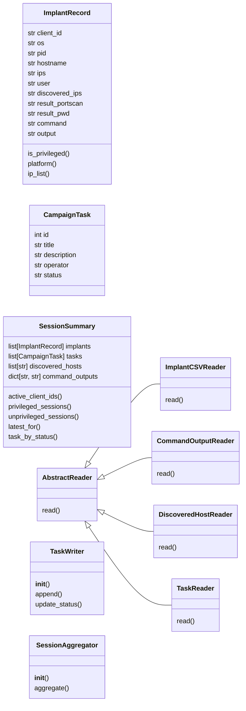
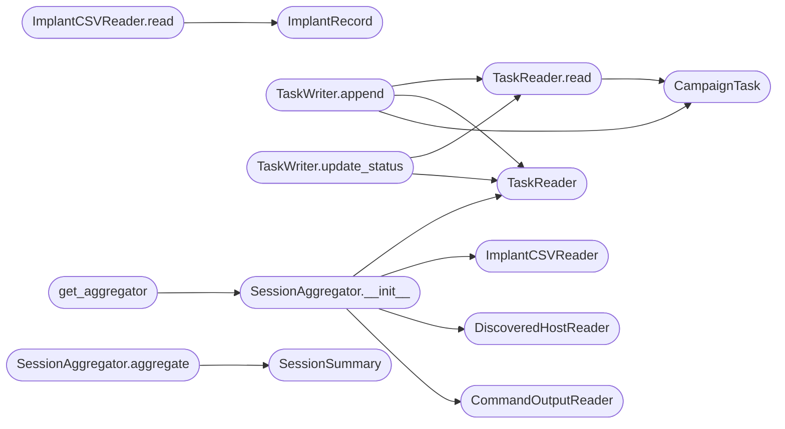

# `modules.session_reader`

> Source: [modules/session_reader.py:1](../../modules/session_reader.py#L1) | language `py` | coverage 33.3% | [API index](../index.md)

modules/session_reader.py ========================== Reads LazyOwn C2 session artefacts: - sessions/{client_id}.log  (implant CSV: os, pid, hostname, ips, user, discovered_ips, result_portscan, result_pwd, command, output) - sessions/logs/c2/         (per-command output text files) - sessions/implant_config_*.json - sessions/hostsdiscovery.txt - sessions/tasks.json       (campaign task board)

Design (SOLID)
--------------
- Single Responsibility : each Reader reads exactly one artefact type.
- Open/Closed           : new artefact types via new Reader subclass.
- Liskov                : all Reader subclasses honour the read() contract.
- Interface Segregation : SessionAggregator exposes only what callers need.
- Dependency Inversion  : SessionAggregator depends on AbstractReader.

## Contents

- **Classes:** [`ImplantRecord`](#implantrecord), [`CampaignTask`](#campaigntask), [`SessionSummary`](#sessionsummary), [`AbstractReader`](#abstractreader), [`ImplantCSVReader`](#implantcsvreader), [`CommandOutputReader`](#commandoutputreader), [`DiscoveredHostReader`](#discoveredhostreader), [`TaskReader`](#taskreader), [`TaskWriter`](#taskwriter), [`SessionAggregator`](#sessionaggregator)
- **Functions:** [`get_aggregator`](#get_aggregator)

## Type Diagram



## Call Graph

Solid arrows stay in this module, dashed arrows leave it.



## Classes

<a id="implantrecord"></a>

### `ImplantRecord`

`class` `dataclass` | [modules/session_reader.py:39](../../modules/session_reader.py#L39)

Decorators: `@dataclass`

```python
class ImplantRecord
```

One row from sessions/{client_id}.log.

**Attributes**

| Name | Type | Default | Description |
|---|---|---|---|
| [`client_id`](#implantrecord-client_id) | `str` |  |  |
| [`os`](#implantrecord-os) | `str` |  |  |
| [`pid`](#implantrecord-pid) | `str` |  |  |
| [`hostname`](#implantrecord-hostname) | `str` |  |  |
| [`ips`](#implantrecord-ips) | `str` |  |  |
| [`user`](#implantrecord-user) | `str` |  |  |
| [`discovered_ips`](#implantrecord-discovered_ips) | `str` |  |  |
| [`result_portscan`](#implantrecord-result_portscan) | `str` |  |  |
| [`result_pwd`](#implantrecord-result_pwd) | `str` |  |  |
| [`command`](#implantrecord-command) | `str` |  |  |
| [`output`](#implantrecord-output) | `str` |  |  |

**Members**

| Member | Kind | Summary |
|---|---|---|
| [`is_privileged`](#implantrecord-is_privileged) | property |  |
| [`platform`](#implantrecord-platform) | property |  |
| [`ip_list`](#implantrecord-ip_list) | property |  |

<a id="implantrecord-is_privileged"></a>

#### `ImplantRecord.is_privileged`

`property` | [modules/session_reader.py:55](../../modules/session_reader.py#L55)

Decorators: `@property`

```python
def is_privileged(self) -> bool
```

**Returns:** `bool`

<a id="implantrecord-platform"></a>

#### `ImplantRecord.platform`

`property` | [modules/session_reader.py:60](../../modules/session_reader.py#L60)

Decorators: `@property`

```python
def platform(self) -> str
```

**Returns:** `str`

<a id="implantrecord-ip_list"></a>

#### `ImplantRecord.ip_list`

`property` | [modules/session_reader.py:69](../../modules/session_reader.py#L69)

Decorators: `@property`

```python
def ip_list(self) -> list[str]
```

**Returns:** `list[str]`

---

<a id="campaigntask"></a>

### `CampaignTask`

`class` `dataclass` | [modules/session_reader.py:74](../../modules/session_reader.py#L74)

Decorators: `@dataclass`

```python
class CampaignTask
```

One task from sessions/tasks.json.

**Attributes**

| Name | Type | Default | Description |
|---|---|---|---|
| [`id`](#campaigntask-id) | `int` |  |  |
| [`title`](#campaigntask-title) | `str` |  |  |
| [`description`](#campaigntask-description) | `str` |  |  |
| [`operator`](#campaigntask-operator) | `str` |  |  |
| [`status`](#campaigntask-status) | `str` |  |  |

---

<a id="sessionsummary"></a>

### `SessionSummary`

`class` `dataclass` | [modules/session_reader.py:85](../../modules/session_reader.py#L85)

Decorators: `@dataclass`

```python
class SessionSummary
```

Aggregated view of all active sessions.

**Attributes**

| Name | Type | Default | Description |
|---|---|---|---|
| [`implants`](#sessionsummary-implants) | `list[ImplantRecord]` | `field(default_factory=list)` |  |
| [`tasks`](#sessionsummary-tasks) | `list[CampaignTask]` | `field(default_factory=list)` |  |
| [`discovered_hosts`](#sessionsummary-discovered_hosts) | `list[str]` | `field(default_factory=list)` |  |
| [`command_outputs`](#sessionsummary-command_outputs) | `dict[str, str]` | `field(default_factory=dict)` |  |

**Members**

| Member | Kind | Summary |
|---|---|---|
| [`active_client_ids`](#sessionsummary-active_client_ids) | property |  |
| [`privileged_sessions`](#sessionsummary-privileged_sessions) | property |  |
| [`unprivileged_sessions`](#sessionsummary-unprivileged_sessions) | property |  |
| [`latest_for`](#sessionsummary-latest_for) | method |  |
| [`task_by_status`](#sessionsummary-task_by_status) | method |  |

<a id="sessionsummary-active_client_ids"></a>

#### `SessionSummary.active_client_ids`

`property` | [modules/session_reader.py:94](../../modules/session_reader.py#L94)

Decorators: `@property`

```python
def active_client_ids(self) -> list[str]
```

**Returns:** `list[str]`

<a id="sessionsummary-privileged_sessions"></a>

#### `SessionSummary.privileged_sessions`

`property` | [modules/session_reader.py:101](../../modules/session_reader.py#L101)

Decorators: `@property`

```python
def privileged_sessions(self) -> list[ImplantRecord]
```

**Returns:** `list[ImplantRecord]`

<a id="sessionsummary-unprivileged_sessions"></a>

#### `SessionSummary.unprivileged_sessions`

`property` | [modules/session_reader.py:108](../../modules/session_reader.py#L108)

Decorators: `@property`

```python
def unprivileged_sessions(self) -> list[ImplantRecord]
```

**Returns:** `list[ImplantRecord]`

<a id="sessionsummary-latest_for"></a>

#### `SessionSummary.latest_for`

`method` | [modules/session_reader.py:114](../../modules/session_reader.py#L114)

```python
def latest_for(self, client_id: str) -> ImplantRecord | None
```

**Parameters**

| Name | Type | Default | Description |
|---|---|---|---|
| `client_id` | `str` |  |  |

**Returns:** `ImplantRecord | None`

<a id="sessionsummary-task_by_status"></a>

#### `SessionSummary.task_by_status`

`method` | [modules/session_reader.py:118](../../modules/session_reader.py#L118)

```python
def task_by_status(self, status: str) -> list[CampaignTask]
```

**Parameters**

| Name | Type | Default | Description |
|---|---|---|---|
| `status` | `str` |  |  |

**Returns:** `list[CampaignTask]`

---

<a id="abstractreader"></a>

### `AbstractReader`

`class` `abstract` | [modules/session_reader.py:127](../../modules/session_reader.py#L127)

```python
class AbstractReader(ABC)
```

Bases: `ABC`

Subclasses: [`CommandOutputReader`](#commandoutputreader), [`DiscoveredHostReader`](#discoveredhostreader), [`ImplantCSVReader`](#implantcsvreader), [`TaskReader`](#taskreader)

**Members**

| Member | Kind | Summary |
|---|---|---|
| [`read`](#abstractreader-read) | method |  |

<a id="abstractreader-read"></a>

#### `AbstractReader.read`

`method` `abstract` | [modules/session_reader.py:129](../../modules/session_reader.py#L129)

Decorators: `@abstractmethod`

```python
def read(self, sessions_dir: Path) -> Any
```

**Parameters**

| Name | Type | Default | Description |
|---|---|---|---|
| `sessions_dir` | `Path` |  |  |

**Returns:** `Any`

---

<a id="implantcsvreader"></a>

### `ImplantCSVReader`

`class` | [modules/session_reader.py:137](../../modules/session_reader.py#L137)

```python
class ImplantCSVReader(AbstractReader)
```

Bases: [`AbstractReader`](#abstractreader)

Reads all sessions/{client_id}.log CSV files.

Returns List[ImplantRecord] with all rows from all implants.

**Members**

| Member | Kind | Summary |
|---|---|---|
| [`read`](#implantcsvreader-read) | method |  |

<a id="implantcsvreader-read"></a>

#### `ImplantCSVReader.read`

`method` | [modules/session_reader.py:157](../../modules/session_reader.py#L157)

```python
def read(self, sessions_dir: Path) -> list[ImplantRecord]
```

**Parameters**

| Name | Type | Default | Description |
|---|---|---|---|
| `sessions_dir` | `Path` |  |  |

**Returns:** `list[ImplantRecord]`

*Calls:* [`ImplantRecord`](#implantrecord)

---

<a id="commandoutputreader"></a>

### `CommandOutputReader`

`class` | [modules/session_reader.py:193](../../modules/session_reader.py#L193)

```python
class CommandOutputReader(AbstractReader)
```

Bases: [`AbstractReader`](#abstractreader)

Reads sessions/logs/c2/command_*output*.txt files.

Returns Dict[str, str]: {filename_stem -> content}

**Members**

| Member | Kind | Summary |
|---|---|---|
| [`read`](#commandoutputreader-read) | method |  |

<a id="commandoutputreader-read"></a>

#### `CommandOutputReader.read`

`method` | [modules/session_reader.py:199](../../modules/session_reader.py#L199)

```python
def read(self, sessions_dir: Path) -> dict[str, str]
```

**Parameters**

| Name | Type | Default | Description |
|---|---|---|---|
| `sessions_dir` | `Path` |  |  |

**Returns:** `dict[str, str]`

---

<a id="discoveredhostreader"></a>

### `DiscoveredHostReader`

`class` | [modules/session_reader.py:214](../../modules/session_reader.py#L214)

```python
class DiscoveredHostReader(AbstractReader)
```

Bases: [`AbstractReader`](#abstractreader)

Reads sessions/hostsdiscovery.txt.

**Members**

| Member | Kind | Summary |
|---|---|---|
| [`read`](#discoveredhostreader-read) | method |  |

<a id="discoveredhostreader-read"></a>

#### `DiscoveredHostReader.read`

`method` | [modules/session_reader.py:217](../../modules/session_reader.py#L217)

```python
def read(self, sessions_dir: Path) -> list[str]
```

**Parameters**

| Name | Type | Default | Description |
|---|---|---|---|
| `sessions_dir` | `Path` |  |  |

**Returns:** `list[str]`

---

<a id="taskreader"></a>

### `TaskReader`

`class` | [modules/session_reader.py:232](../../modules/session_reader.py#L232)

```python
class TaskReader(AbstractReader)
```

Bases: [`AbstractReader`](#abstractreader)

Reads sessions/tasks.json.

**Members**

| Member | Kind | Summary |
|---|---|---|
| [`read`](#taskreader-read) | method |  |

<a id="taskreader-read"></a>

#### `TaskReader.read`

`method` | [modules/session_reader.py:235](../../modules/session_reader.py#L235)

```python
def read(self, sessions_dir: Path) -> list[CampaignTask]
```

**Parameters**

| Name | Type | Default | Description |
|---|---|---|---|
| `sessions_dir` | `Path` |  |  |

**Returns:** `list[CampaignTask]`

*Calls:* [`CampaignTask`](#campaigntask)

*Called by:* [`TaskWriter.append`](#taskwriter-append), [`TaskWriter.update_status`](#taskwriter-update_status)

---

<a id="taskwriter"></a>

### `TaskWriter`

`class` | [modules/session_reader.py:257](../../modules/session_reader.py#L257)

```python
class TaskWriter
```

Appends or updates tasks in sessions/tasks.json.

**Members**

| Member | Kind | Summary |
|---|---|---|
| [`__init__`](#taskwriter-__init__) | constructor |  |
| [`append`](#taskwriter-append) | method |  |
| [`update_status`](#taskwriter-update_status) | method |  |

<a id="taskwriter-__init__"></a>

#### `TaskWriter.__init__`

`constructor` | [modules/session_reader.py:260](../../modules/session_reader.py#L260)

```python
def __init__(self, sessions_dir: Path) -> None
```

**Parameters**

| Name | Type | Default | Description |
|---|---|---|---|
| `sessions_dir` | `Path` |  |  |

<a id="taskwriter-append"></a>

#### `TaskWriter.append`

`method` | [modules/session_reader.py:263](../../modules/session_reader.py#L263)

```python
def append(self, title: str, description: str, operator: str = 'agent', status: str = 'New') -> CampaignTask
```

**Parameters**

| Name | Type | Default | Description |
|---|---|---|---|
| `title` | `str` |  |  |
| `description` | `str` |  |  |
| `operator` | `str` | `'agent'` |  |
| `status` | `str` | `'New'` |  |

**Returns:** `CampaignTask`

*Calls:* [`CampaignTask`](#campaigntask), [`TaskReader`](#taskreader), [`TaskReader.read`](#taskreader-read)

<a id="taskwriter-update_status"></a>

#### `TaskWriter.update_status`

`method` | [modules/session_reader.py:288](../../modules/session_reader.py#L288)

```python
def update_status(self, task_id: int, status: str) -> bool
```

**Parameters**

| Name | Type | Default | Description |
|---|---|---|---|
| `task_id` | `int` |  |  |
| `status` | `str` |  |  |

**Returns:** `bool`

*Calls:* [`TaskReader`](#taskreader), [`TaskReader.read`](#taskreader-read)

---

<a id="sessionaggregator"></a>

### `SessionAggregator`

`class` | [modules/session_reader.py:313](../../modules/session_reader.py#L313)

```python
class SessionAggregator
```

Combines all readers into a single SessionSummary.

Dependency-injected readers allow substitution in tests.

**Members**

| Member | Kind | Summary |
|---|---|---|
| [`__init__`](#sessionaggregator-__init__) | constructor |  |
| [`aggregate`](#sessionaggregator-aggregate) | method |  |

<a id="sessionaggregator-__init__"></a>

#### `SessionAggregator.__init__`

`constructor` | [modules/session_reader.py:319](../../modules/session_reader.py#L319)

```python
def __init__(self, implant_reader: AbstractReader | None = None, output_reader: AbstractReader | None = None, host_reader: AbstractReader | None = None, task_reader: AbstractReader | None = None) -> None
```

**Parameters**

| Name | Type | Default | Description |
|---|---|---|---|
| `implant_reader` | `AbstractReader \| None` | `None` |  |
| `output_reader` | `AbstractReader \| None` | `None` |  |
| `host_reader` | `AbstractReader \| None` | `None` |  |
| `task_reader` | `AbstractReader \| None` | `None` |  |

*Calls:* [`CommandOutputReader`](#commandoutputreader), [`DiscoveredHostReader`](#discoveredhostreader), [`ImplantCSVReader`](#implantcsvreader), [`TaskReader`](#taskreader)

*Called by:* [`get_aggregator`](#get_aggregator)

<a id="sessionaggregator-aggregate"></a>

#### `SessionAggregator.aggregate`

`method` | [modules/session_reader.py:331](../../modules/session_reader.py#L331)

```python
def aggregate(self, sessions_dir: Path) -> SessionSummary
```

**Parameters**

| Name | Type | Default | Description |
|---|---|---|---|
| `sessions_dir` | `Path` |  |  |

**Returns:** `SessionSummary`

*Calls:* [`SessionSummary`](#sessionsummary)

---

## Functions

<a id="get_aggregator"></a>

### `get_aggregator`

`function` | [modules/session_reader.py:347](../../modules/session_reader.py#L347)

```python
def get_aggregator() -> SessionAggregator
```

**Returns:** `SessionAggregator`

*Calls:* [`SessionAggregator.__init__`](#sessionaggregator-__init__)

---
