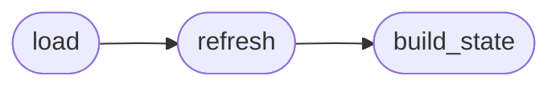

# `modules.session_state`

> Source: [modules/session_state.py:1](../../modules/session_state.py#L1) | language `py` | coverage 100.0% | [API index](../index.md)

LazyOwn Session State ===================== Aggregates live session data from multiple sources into a single sessions/session_state.json snapshot consumed by the recommender, timeline narrator, and MCP tools.

Sources:
  - payload.json          → active target, lhost, config
  - sessions/events.jsonl → rule-matched events (findings)
  - sessions/LazyOwn_session_report.csv → last N commands executed

Public API:
  build_state()  → dict   build and return state (does NOT write to disk)
  refresh()      → dict   build + write sessions/session_state.json
  load()         → dict   read the last written state (or build if missing)

## Contents

- **Functions:** [`build_state`](#build_state), [`refresh`](#refresh), [`load`](#load)
- **Constants:** [`BASE_DIR`](#base_dir), [`SESSIONS`](#sessions), [`PAYLOAD_FILE`](#payload_file), [`EVENTS_FILE`](#events_file), [`CSV_FILE`](#csv_file), [`STATE_FILE`](#state_file)

## Call Graph

Solid arrows stay in this module, dashed arrows leave it.



## Functions

<a id="build_state"></a>

### `build_state`

`function` | [modules/session_state.py:189](../../modules/session_state.py#L189)

```python
def build_state() -> dict
```

Assemble and return the current session state dict.

**Returns:** `dict`

*Called by:* [`refresh`](#refresh)

---

<a id="refresh"></a>

### `refresh`

`function` | [modules/session_state.py:240](../../modules/session_state.py#L240)

```python
def refresh() -> dict
```

Build state and persist to sessions/session_state.json.

**Returns:** `dict`

*Calls:* [`build_state`](#build_state)

*Called by:* [`load`](#load)

---

<a id="load"></a>

### `load`

`function` | [modules/session_state.py:251](../../modules/session_state.py#L251)

```python
def load() -> dict
```

Return the last written state, or build it fresh if stale/missing.

**Returns:** `dict`

*Calls:* [`refresh`](#refresh)

---

## Constants

<a id="base_dir"></a>

### `BASE_DIR`

`constant` | [modules/session_state.py:25](../../modules/session_state.py#L25)

```python
BASE_DIR = Path(__file__).parent.parent
```

---

<a id="sessions"></a>

### `SESSIONS`

`constant` | [modules/session_state.py:26](../../modules/session_state.py#L26)

```python
SESSIONS = BASE_DIR / 'sessions'
```

---

<a id="payload_file"></a>

### `PAYLOAD_FILE`

`constant` | [modules/session_state.py:27](../../modules/session_state.py#L27)

```python
PAYLOAD_FILE = BASE_DIR / 'payload.json'
```

---

<a id="events_file"></a>

### `EVENTS_FILE`

`constant` | [modules/session_state.py:28](../../modules/session_state.py#L28)

```python
EVENTS_FILE = SESSIONS / 'events.jsonl'
```

---

<a id="csv_file"></a>

### `CSV_FILE`

`constant` | [modules/session_state.py:29](../../modules/session_state.py#L29)

```python
CSV_FILE = SESSIONS / 'LazyOwn_session_report.csv'
```

---

<a id="state_file"></a>

### `STATE_FILE`

`constant` | [modules/session_state.py:30](../../modules/session_state.py#L30)

```python
STATE_FILE = SESSIONS / 'session_state.json'
```

---
