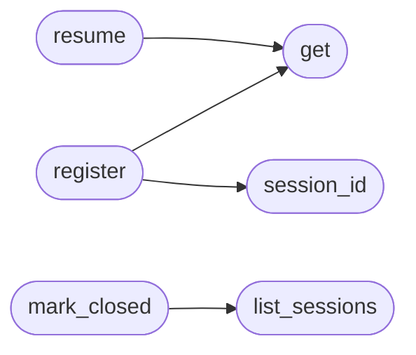

# `modules.shell_session_store`

> Source: [modules/shell_session_store.py:1](../../modules/shell_session_store.py#L1) | language `py` | coverage 100.0% | [API index](../index.md)

Resumable, hash-identified shell session descriptors.

A remote shell is a live socket that dies with the process that opened it, so
it cannot be serialized and reloaded. What survives is the *descriptor*: which
target yielded the shell, through which exploit primitive, on which port, from
which attacker address, and when. This module persists one JSON descriptor per
session under a content-hashed id and re-opens the shell through the recorded
primitive on [`resume`](#resume) -- the same reconnection model serious
post-exploitation frameworks use over non-persistent transports.

The store is deliberately decoupled from the transport: it imports
[`modules.atomic_exploit_bridge`](modules.atomic_exploit_bridge.py.md) lazily and only inside [`resume`](#resume), so
registering a descriptor never pulls the socket layer and cannot deadlock the
loop. Every public function is fail-open: persistence or I/O errors degrade to
an empty result instead of raising into a campaign.

## Contents

- **Functions:** [`session_id`](#session_id), [`register`](#register), [`get`](#get), [`list_sessions`](#list_sessions), [`mark_closed`](#mark_closed), [`resume`](#resume)
- **Constants:** [`ID_LENGTH`](#id_length), [`STATUS_LIVE`](#status_live), [`STATUS_STALE`](#status_stale), [`STATUS_CLOSED`](#status_closed)

## Call Graph

Solid arrows stay in this module, dashed arrows leave it.



## Functions

<a id="session_id"></a>

### `session_id`

`function` | [modules/shell_session_store.py:49](../../modules/shell_session_store.py#L49)

```python
def session_id(target: str, via: str, created_at: str) -> str
```

Return the stable content hash identifying a session.

**Parameters**

| Name | Type | Default | Description |
|---|---|---|---|
| `target` | `str` |  | Host that yielded the shell. |
| `via` | `str` |  | Exploit primitive identifier that produced the shell. |
| `created_at` | `str` |  | Not part of the identity; kept for signature symmetry with callers. Identity is ``target`` plus `[`via`](modules.emulation_runner.py.md#emulationreport-via)` so repeated shells on the same primitive map to one resumable descriptor. |

**Returns:** `str` - A [`ID_LENGTH`](#id_length)-character lowercase hex digest.

*Called by:* [`register`](#register)

---

<a id="register"></a>

### `register`

`function` | [modules/shell_session_store.py:80](../../modules/shell_session_store.py#L80)

```python
def register(target: str, via: str, port: int = 0, lhost: str = '127.0.0.1', evidence: str = '') -> dict[str, Any]
```

Create or refresh the resumable descriptor for an obtained shell.

Idempotent per ``(target, via)``: a second shell through the same
primitive refreshes ``last_seen`` and restores ``live`` status on the one
descriptor rather than forking a new id.

**Parameters**

| Name | Type | Default | Description |
|---|---|---|---|
| `target` | `str` |  | Host that yielded the shell. |
| `via` | `str` |  | Exploit primitive identifier. |
| `port` | `int` | `0` | Shell port on the target. |
| `lhost` | `str` | `'127.0.0.1'` | Attacker address used to trigger the primitive. |
| `evidence` | `str` | `''` | Optional short provenance note. |

**Returns:** `dict[str, Any]` - The persisted descriptor, or an empty dict on failure.

*Calls:* [`get`](#get), [`session_id`](#session_id)

---

<a id="get"></a>

### `get`

`function` | [modules/shell_session_store.py:123](../../modules/shell_session_store.py#L123)

```python
def get(session: str) -> dict[str, Any] | None
```

Return one descriptor by id, or None when absent or unreadable.

**Parameters**

| Name | Type | Default | Description |
|---|---|---|---|
| `session` | `str` |  |  |

**Returns:** `dict[str, Any] | None`

*Called by:* [`register`](#register), [`resume`](#resume)

---

<a id="list_sessions"></a>

### `list_sessions`

`function` | [modules/shell_session_store.py:134](../../modules/shell_session_store.py#L134)

```python
def list_sessions(target: str = '') -> list[dict[str, Any]]
```

Return persisted descriptors, newest first, optionally for one target.

Each row is enriched with ``live`` reflecting whether the transport layer
currently holds an in-process session for that ``(target, via)`` pair.

**Parameters**

| Name | Type | Default | Description |
|---|---|---|---|
| `target` | `str` | `''` |  |

**Returns:** `list[dict[str, Any]]`

*Called by:* [`CommandAndControlMigratedCommandSet.do_atomic_shell`](cli.commands.command_and_control_migrated.py.md#commandandcontrolmigratedcommandset-do_atomic_shell), [`mark_closed`](#mark_closed)

---

<a id="mark_closed"></a>

### `mark_closed`

`function` | [modules/shell_session_store.py:174](../../modules/shell_session_store.py#L174)

```python
def mark_closed(target: str, via: str = '') -> int
```

Mark matching descriptors closed.

Returns the count updated.

**Parameters**

| Name | Type | Default | Description |
|---|---|---|---|
| `target` | `str` |  |  |
| `via` | `str` | `''` |  |

**Returns:** `int`

*Calls:* [`list_sessions`](#list_sessions)

*Called by:* [`close_sessions`](modules.atomic_exploit_bridge.py.md#close_sessions)

---

<a id="resume"></a>

### `resume`

`function` | [modules/shell_session_store.py:214](../../modules/shell_session_store.py#L214)

```python
def resume(session: str) -> dict[str, Any]
```

Re-establish a persisted shell session through its recorded primitive.

**Parameters**

| Name | Type | Default | Description |
|---|---|---|---|
| `session` | `str` |  | The hashed session id. |

**Returns:** `dict[str, Any]` - ``{"ok": True, "target", "via", "id", "resume_count"}`` on success, or
``{"ok": False, "error": ...}``. A primitive that no longer answers
marks the descriptor ``stale`` so the operator sees it is not live.

*Calls:* [`get`](#get)

*Called by:* [`CommandAndControlMigratedCommandSet.do_atomic_shell`](cli.commands.command_and_control_migrated.py.md#commandandcontrolmigratedcommandset-do_atomic_shell)

---

## Constants

<a id="id_length"></a>

### `ID_LENGTH`

`constant` | [modules/shell_session_store.py:29](../../modules/shell_session_store.py#L29)

```python
ID_LENGTH = 16
```

---

<a id="status_live"></a>

### `STATUS_LIVE`

`constant` | [modules/shell_session_store.py:30](../../modules/shell_session_store.py#L30)

```python
STATUS_LIVE = 'live'
```

---

<a id="status_stale"></a>

### `STATUS_STALE`

`constant` | [modules/shell_session_store.py:31](../../modules/shell_session_store.py#L31)

```python
STATUS_STALE = 'stale'
```

---

<a id="status_closed"></a>

### `STATUS_CLOSED`

`constant` | [modules/shell_session_store.py:32](../../modules/shell_session_store.py#L32)

```python
STATUS_CLOSED = 'closed'
```

---
