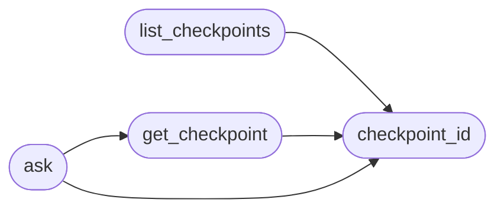

# `modules.sidequest`

> Source: [modules/sidequest.py:1](../../modules/sidequest.py#L1) | language `py` | coverage 100.0% | [API index](../index.md)

Read-only side questions against the loop's immutable decision checkpoints.

It lets an operator interrogate a frozen checkpoint of the autonomous loop
without owning an agent session or a tool executor, so asking a question can
never mutate the run it asks about.

The checkpoints are the rows already written to ``sessions/decisions.jsonl`` by
[`modules.loop.decision_log`](modules.loop.decision_log.py.md); each is immutable once written. Every
checkpoint is addressed by a content-derived ordinal rather than its position in
the file: a persisted ordinal, not an array offset, so restart, pagination and
failed requests cannot shift it, and a rotation or a partial read never
re-points an identifier at a different decision.

Answers are appended to a separate ``sessions/sidequests.jsonl`` ledger, keeping
the side channel auditable yet fully isolated from loop state. Nothing here
writes to the loop, and the module imports no loop runtime, so it stays
cycle-free.

## Contents

- **Functions:** [`checkpoint_id`](#checkpoint_id), [`list_checkpoints`](#list_checkpoints), [`get_checkpoint`](#get_checkpoint), [`ask`](#ask)

## Call Graph

Solid arrows stay in this module, dashed arrows leave it.



## Functions

<a id="checkpoint_id"></a>

### `checkpoint_id`

`function` | [modules/sidequest.py:38](../../modules/sidequest.py#L38)

```python
def checkpoint_id(row: dict[str, Any]) -> str
```

Return a stable, position-independent ordinal for one decision row.

The id is the digest of the fields that identify the decision (run, step,
context, chosen action and timestamp), so it survives ledger rotation and
pagination: the same decision always resolves to the same id, and no two
distinct decisions collide in practice.

**Parameters**

| Name | Type | Default | Description |
|---|---|---|---|
| `row` | `dict[str, Any]` |  | One decision ledger row. |

**Returns:** `str` - The checkpoint ordinal, or an empty string for an empty row.

*Called by:* [`ask`](#ask), [`get_checkpoint`](#get_checkpoint), [`list_checkpoints`](#list_checkpoints)

---

<a id="list_checkpoints"></a>

### `list_checkpoints`

`function` | [modules/sidequest.py:61](../../modules/sidequest.py#L61)

```python
def list_checkpoints(run_id: str = '', limit: int = _DEFAULT_LIMIT) -> list[dict[str, Any]]
```

Return recent decision checkpoints, newest last, each with its ordinal.

**Parameters**

| Name | Type | Default | Description |
|---|---|---|---|
| `run_id` | `str` | `''` | When set, only checkpoints from that loop run are returned. |
| `limit` | `int` | `_DEFAULT_LIMIT` | Maximum number of checkpoints to return. |

**Returns:** `list[dict[str, Any]]` - The checkpoints as summary dicts carrying their `[`checkpoint_id`](#checkpoint_id)` and
the fields an operator needs to choose one; an empty list when the
ledger is absent.

*Calls:* [`checkpoint_id`](#checkpoint_id)

---

<a id="get_checkpoint"></a>

### `get_checkpoint`

`function` | [modules/sidequest.py:99](../../modules/sidequest.py#L99)

```python
def get_checkpoint(ordinal: str) -> dict[str, Any] | None
```

Return the full frozen decision row for a checkpoint ordinal.

**Parameters**

| Name | Type | Default | Description |
|---|---|---|---|
| `ordinal` | `str` |  | The checkpoint id from [`list_checkpoints`](#list_checkpoints). |

**Returns:** `dict[str, Any] | None` - The decision row, or None when no checkpoint matches.

*Calls:* [`checkpoint_id`](#checkpoint_id)

*Called by:* [`ask`](#ask)

---

<a id="ask"></a>

### `ask`

`function` | [modules/sidequest.py:142](../../modules/sidequest.py#L142)

```python
def ask(ordinal: str, question: str, temperature: float = _SIDEQUEST_TEMPERATURE) -> dict[str, Any]
```

Answer a question about one frozen checkpoint, read-only.

The checkpoint is never mutated and the loop is never touched: the function
only reads the ledger, renders the frozen decision into context, queries the
model, and appends the exchange to the side-question ledger.

**Parameters**

| Name | Type | Default | Description |
|---|---|---|---|
| `ordinal` | `str` |  | The checkpoint id to interrogate. |
| `question` | `str` |  | The operator's question. |
| `temperature` | `float` | `_SIDEQUEST_TEMPERATURE` | Sampling temperature; greedy by default for a reproducible answer. |

**Returns:** `dict[str, Any]` - A result dict with `[`ok`](scripts.top_tier_check.py.md#ok)`, and either `[`answer`](modules.sidequestion.py.md#sidequestion-answer)` and `[`checkpoint_id`](#checkpoint_id)`
or an ``error`` describing why no answer was produced.

*Calls:* [`checkpoint_id`](#checkpoint_id), [`get_checkpoint`](#get_checkpoint)

---
