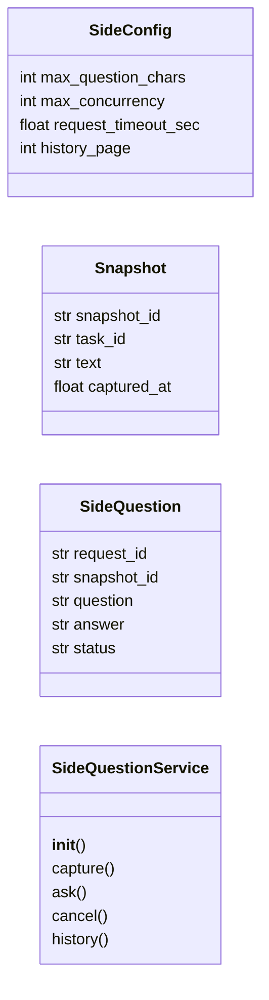
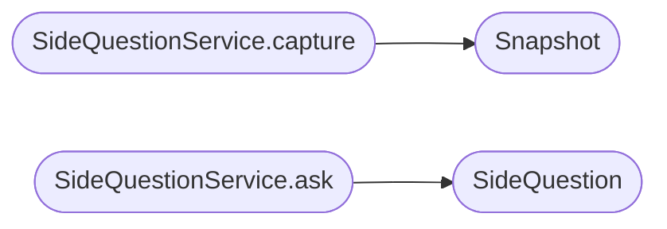

# `modules.sidequestion`

> Source: [modules/sidequestion.py:1](../../modules/sidequestion.py#L1) | language `py` | coverage 100.0% | [API index](../index.md)

Isolated side-question answering against immutable snapshots.

Ports the LAZY sidequestion contract. Operators ask follow-up
questions without mutating the main agent loop. Answers derive from
a captured snapshot plus recent successful exchanges under token and
concurrency budgets.

## Contents

- **Classes:** [`SideConfig`](#sideconfig), [`Snapshot`](#snapshot), [`SideQuestion`](#sidequestion), [`SideQuestionService`](#sidequestionservice)
- **Constants:** [`CONFIG`](#config)

## Type Diagram



## Call Graph

Solid arrows stay in this module, dashed arrows leave it.



## Classes

<a id="sideconfig"></a>

### `SideConfig`

`class` `dataclass` | [modules/sidequestion.py:19](../../modules/sidequestion.py#L19)

Decorators: `@dataclass(frozen=True, slots=True)`

```python
class SideConfig
```

Centralized constants for side-question behavior.

**Attributes**

| Name | Type | Default | Description |
|---|---|---|---|
| [`max_question_chars`](#sideconfig-max_question_chars) | `int` | `4000` |  |
| [`max_concurrency`](#sideconfig-max_concurrency) | `int` | `4` |  |
| [`request_timeout_sec`](#sideconfig-request_timeout_sec) | `float` | `120.0` |  |
| [`history_page`](#sideconfig-history_page) | `int` | `20` |  |

---

<a id="snapshot"></a>

### `Snapshot`

`class` `dataclass` | [modules/sidequestion.py:32](../../modules/sidequestion.py#L32)

Decorators: `@dataclass(frozen=True, slots=True)`

```python
class Snapshot
```

Immutable context captured from the main agent.

**Attributes**

| Name | Type | Default | Description |
|---|---|---|---|
| [`snapshot_id`](#snapshot-snapshot_id) | `str` |  |  |
| [`task_id`](#snapshot-task_id) | `str` |  |  |
| [`text`](#snapshot-text) | `str` |  |  |
| [`captured_at`](#snapshot-captured_at) | `float` |  |  |

---

<a id="sidequestion"></a>

### `SideQuestion`

`class` `dataclass` | [modules/sidequestion.py:42](../../modules/sidequestion.py#L42)

Decorators: `@dataclass`

```python
class SideQuestion
```

Single isolated question with accumulated answer.

**Attributes**

| Name | Type | Default | Description |
|---|---|---|---|
| [`request_id`](#sidequestion-request_id) | `str` |  |  |
| [`snapshot_id`](#sidequestion-snapshot_id) | `str` |  |  |
| [`question`](#sidequestion-question) | `str` |  |  |
| [`answer`](#sidequestion-answer) | `str` | `''` |  |
| [`status`](#sidequestion-status) | `str` | `'pending'` |  |

---

<a id="sidequestionservice"></a>

### `SideQuestionService`

`class` | [modules/sidequestion.py:52](../../modules/sidequestion.py#L52)

```python
class SideQuestionService
```

Bounded service for snapshot-scoped questions.

**Members**

| Member | Kind | Summary |
|---|---|---|
| [`__init__`](#sidequestionservice-__init__) | constructor | Initialize registries with an optional answer function. |
| [`capture`](#sidequestionservice-capture) | method | Freeze main-loop context into an immutable snapshot. |
| [`ask`](#sidequestionservice-ask) | method | Answer from a snapshot without touching main state. |
| [`cancel`](#sidequestionservice-cancel) | method | Mark a pending request cancelled. |
| [`history`](#sidequestionservice-history) | method | Page request history newest first. |

<a id="sidequestionservice-__init__"></a>

#### `SideQuestionService.__init__`

`constructor` | [modules/sidequestion.py:55](../../modules/sidequestion.py#L55)

```python
def __init__(self, answer_fn: Callable[[str, str], str] | None = None, config: SideConfig = CONFIG) -> None
```

Initialize registries with an optional answer function.

**Parameters**

| Name | Type | Default | Description |
|---|---|---|---|
| `answer_fn` | `Callable[[str, str], str] \| None` | `None` |  |
| `config` | `SideConfig` | `CONFIG` |  |

*Called by:* [`AiCommandSet.do_ask`](cli.commands.ai.py.md#aicommandset-do_ask)

<a id="sidequestionservice-capture"></a>

#### `SideQuestionService.capture`

`method` | [modules/sidequestion.py:66](../../modules/sidequestion.py#L66)

```python
def capture(self, task_id: str, text: str) -> Snapshot
```

Freeze main-loop context into an immutable snapshot.

**Parameters**

| Name | Type | Default | Description |
|---|---|---|---|
| `task_id` | `str` |  |  |
| `text` | `str` |  |  |

**Returns:** `Snapshot`

*Calls:* [`Snapshot`](#snapshot)

*Called by:* [`AiCommandSet.do_ask`](cli.commands.ai.py.md#aicommandset-do_ask)

<a id="sidequestionservice-ask"></a>

#### `SideQuestionService.ask`

`method` | [modules/sidequestion.py:75](../../modules/sidequestion.py#L75)

```python
def ask(self, snapshot_id: str, question: str) -> SideQuestion
```

Answer from a snapshot without touching main state.

**Parameters**

| Name | Type | Default | Description |
|---|---|---|---|
| `snapshot_id` | `str` |  |  |
| `question` | `str` |  |  |

**Returns:** `SideQuestion`

**Raises**

- `KeyError`: (raised in the body, not documented)
- `RuntimeError`: (raised in the body, not documented)
- `ValueError`: (raised in the body, not documented)

*Calls:* [`SideQuestion`](#sidequestion)

*Called by:* [`AiCommandSet.do_ask`](cli.commands.ai.py.md#aicommandset-do_ask)

<a id="sidequestionservice-cancel"></a>

#### `SideQuestionService.cancel`

`method` | [modules/sidequestion.py:104](../../modules/sidequestion.py#L104)

```python
def cancel(self, request_id: str) -> bool
```

Mark a pending request cancelled.

**Parameters**

| Name | Type | Default | Description |
|---|---|---|---|
| `request_id` | `str` |  |  |

**Returns:** `bool`

*Called by:* [`P.S.a.a.a.c.c.c.c.d.d.e.extends.extends.extends.extends.extends.extends.extends.extends.extends.extends.extends.extends.extends.extends.extends.h.i.i.i.k.l.l.n.n.n.n.n.n.o.o.o.o.r.r.s.s.t`](static.js.xterm.js.md#p-s-a-a-a-c-c-c-c-d-d-e-extends-extends-extends-extends-extends-extends-extends-extends-extends-extends-extends-extends-extends-extends-extends-h-i-i-i-k-l-l-n-n-n-n-n-n-o-o-o-o-r-r-s-s-t)

<a id="sidequestionservice-history"></a>

#### `SideQuestionService.history`

`method` | [modules/sidequestion.py:113](../../modules/sidequestion.py#L113)

```python
def history(self, limit: int = 20, before: float = 0.0) -> list[SideQuestion]
```

Page request history newest first.

**Parameters**

| Name | Type | Default | Description |
|---|---|---|---|
| `limit` | `int` | `20` |  |
| `before` | `float` | `0.0` |  |

**Returns:** `list[SideQuestion]`

---

## Constants

<a id="config"></a>

### `CONFIG`

`constant` | [modules/sidequestion.py:28](../../modules/sidequestion.py#L28)

```python
CONFIG = SideConfig()
```

---
