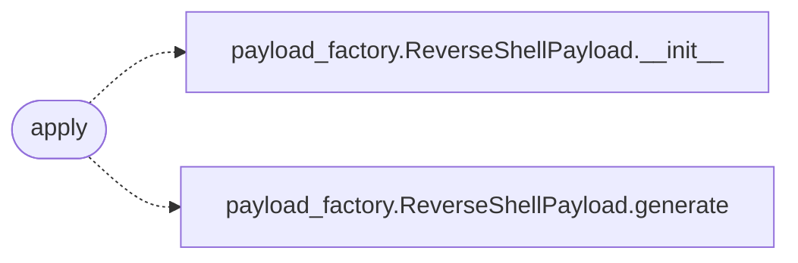

# `modules.sinks.beacon_dispatch`

> Source: [modules/sinks/beacon_dispatch.py:1](../../modules/sinks/beacon_dispatch.py#L1) | language `py` | coverage 100.0% | [API index](../index.md)

Beacon dispatch sink: on a foothold, stage the catch-back command.

When the loop or an exploit engine reports a shell on a host, the
operator needs the one-liner that connects that box back to the LazyOwn
C2 listener (``lhost:reverse_shell_port``). This sink stages a
host-tagged dispatch file, mirrors it to the C2 dashboard notes and —
only when ``loop_auto_beacon`` is enabled — copies the command to the
clipboard. Never executes anything on the target.

## Contents

- **Functions:** [`apply`](#apply)

## Call Graph

Solid arrows stay in this module, dashed arrows leave it.



## Functions

<a id="apply"></a>

### `apply`

`function` | [modules/sinks/beacon_dispatch.py:46](../../modules/sinks/beacon_dispatch.py#L46)

```python
def apply(event: OutcomeEvent) -> bool
```

Stage the catch-back command for one foothold outcome.

**Parameters**

| Name | Type | Default | Description |
|---|---|---|---|
| `event` | `OutcomeEvent` |  | Outcome to react to. |

**Returns:** `bool` - True when a dispatch file was written.

*Calls:* [`ReverseShellPayload.__init__`](modules.payload_factory.py.md#reverseshellpayload-__init__), [`ReverseShellPayload.generate`](modules.payload_factory.py.md#reverseshellpayload-generate)

---
