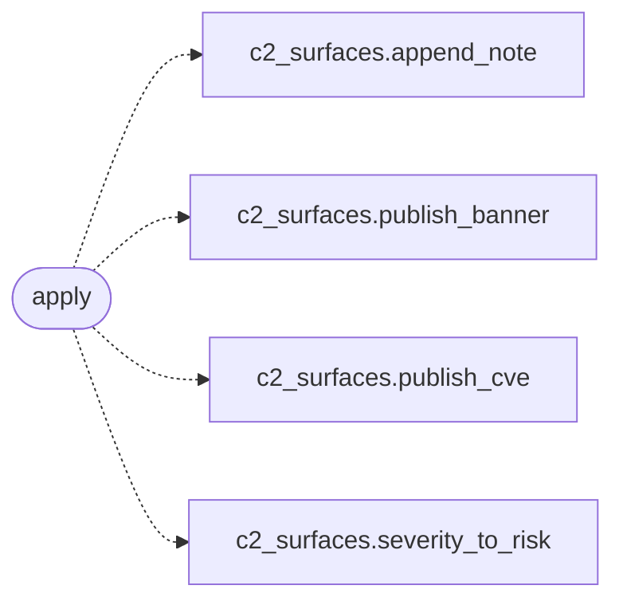

# `modules.sinks.c2_surfaces`

> Source: [modules/sinks/c2_surfaces.py:1](../../modules/sinks/c2_surfaces.py#L1) | language `py` | coverage 100.0% | [API index](../index.md)

C2 dashboard sink: banners, CVEs and operator notes.

## Contents

- **Functions:** [`apply`](#apply)

## Call Graph

Solid arrows stay in this module, dashed arrows leave it.



## Functions

<a id="apply"></a>

### `apply`

`function` | [modules/sinks/c2_surfaces.py:11](../../modules/sinks/c2_surfaces.py#L11)

```python
def apply(event: OutcomeEvent) -> bool
```

Write the operator-visible surfaces for one outcome.

**Parameters**

| Name | Type | Default | Description |
|---|---|---|---|
| `event` | `OutcomeEvent` |  | Outcome to publish. |

**Returns:** `bool` - True when at least one surface changed.

*Calls:* [`append_note`](modules.c2_surfaces.py.md#append_note), [`publish_banner`](modules.c2_surfaces.py.md#publish_banner), [`publish_cve`](modules.c2_surfaces.py.md#publish_cve), [`severity_to_risk`](modules.c2_surfaces.py.md#severity_to_risk)

---
