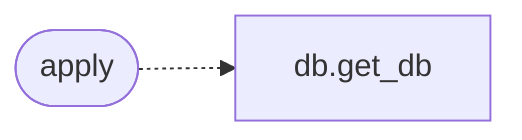

# `modules.sinks.campaign_db`

> Source: [modules/sinks/campaign_db.py:1](../../modules/sinks/campaign_db.py#L1) | language `py` | coverage 100.0% | [API index](../index.md)

Campaign database sink: opt-in host and vulnerability mirror.

## Contents

- **Functions:** [`apply`](#apply)

## Call Graph

Solid arrows stay in this module, dashed arrows leave it.



## Functions

<a id="apply"></a>

### `apply`

`function` | [modules/sinks/campaign_db.py:9](../../modules/sinks/campaign_db.py#L9)

```python
def apply(event: OutcomeEvent) -> bool
```

Mirror one outcome into the campaign database.

The sink is opt-in: it never runs unless the event names it or an
operator enables it, so routine loop traffic does not open SQLite.

**Parameters**

| Name | Type | Default | Description |
|---|---|---|---|
| `event` | `OutcomeEvent` |  | Outcome to mirror. |

**Returns:** `bool` - True when a host or vulnerability row was written.

*Calls:* [`get_db`](modules.db.py.md#get_db)

---
