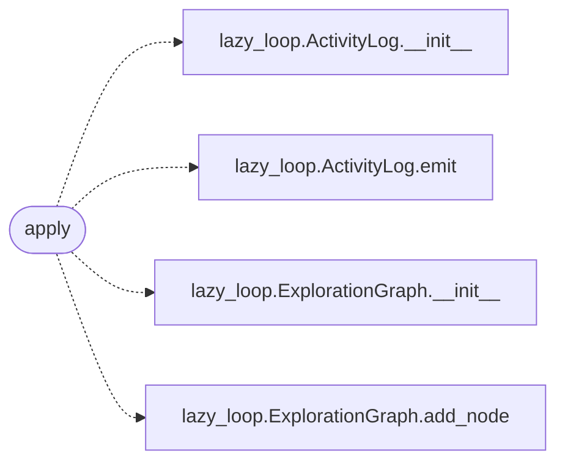

# `modules.sinks.chain_feed`

> Source: [modules/sinks/chain_feed.py:1](../../modules/sinks/chain_feed.py#L1) | language `py` | coverage 100.0% | [API index](../index.md)

Chain-feed sink: stream chain steps into the autonomous loop.

One adapter from the outcome bus to the loop task state. A running chain
publishes ``chain_step`` events; this sink appends a trace record to the
owning task's activity log and, for failures the chain cannot resolve
itself (the event carries ``metadata.steer``), plants a pending hint
node so the planner proposes an approach around the blocker on the next
wake. Failures already handled by the chain (`[`on_fail`](modules.chain_registry.py.md#chainstep-on_fail)` branches,
`[`continue_on_error`](modules.chain_registry.py.md#chainstep-continue_on_error)` steps, benign alternatives) never steer: the chain
keeps navigating them locally.

## Contents

- **Functions:** [`apply`](#apply)

## Call Graph

Solid arrows stay in this module, dashed arrows leave it.



## Functions

<a id="apply"></a>

### `apply`

`function` | [modules/sinks/chain_feed.py:22](../../modules/sinks/chain_feed.py#L22)

```python
def apply(event: OutcomeEvent) -> bool
```

Append one chain-step trace record and steer unhandled failures.

**Parameters**

| Name | Type | Default | Description |
|---|---|---|---|
| `event` | `OutcomeEvent` |  | Outcome carrying a ``chain_step`` payload with run id, chain name, step id, status and steer flag. |

**Returns:** `bool` - True when the task was fed (trace written even when steering is
skipped); False when the event is out of scope or the task state
could not be reached.

*Calls:* [`ActivityLog.__init__`](modules.lazy_loop.py.md#activitylog-__init__), [`ActivityLog.emit`](modules.lazy_loop.py.md#activitylog-emit), [`ExplorationGraph.__init__`](modules.lazy_loop.py.md#explorationgraph-__init__), [`ExplorationGraph.add_node`](modules.lazy_loop.py.md#explorationgraph-add_node)

---
