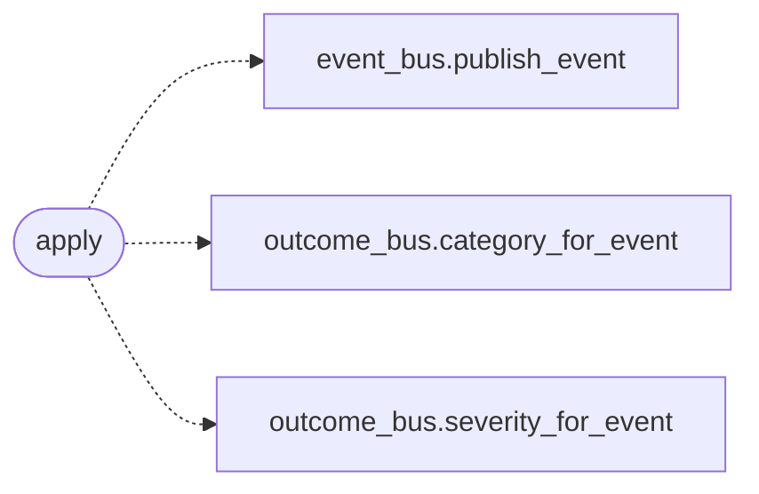

# `modules.sinks.event_bus`

> Source: [modules/sinks/event_bus.py:1](../../modules/sinks/event_bus.py#L1) | language `py` | coverage 100.0% | [API index](../index.md)

Unified event-bus sink: publish every outcome once.

## Contents

- **Functions:** [`apply`](#apply)

## Call Graph

Solid arrows stay in this module, dashed arrows leave it.



## Functions

<a id="apply"></a>

### `apply`

`function` | [modules/sinks/event_bus.py:9](../../modules/sinks/event_bus.py#L9)

```python
def apply(event: OutcomeEvent) -> bool
```

Publish one event to the unified bus.

**Parameters**

| Name | Type | Default | Description |
|---|---|---|---|
| `event` | `OutcomeEvent` |  | Outcome to publish. |

**Returns:** `bool` - True when the bus accepted the event.

*Calls:* [`publish_event`](modules.event_bus.py.md#publish_event), [`category_for_event`](modules.outcome_bus.py.md#category_for_event), [`severity_for_event`](modules.outcome_bus.py.md#severity_for_event)

---
