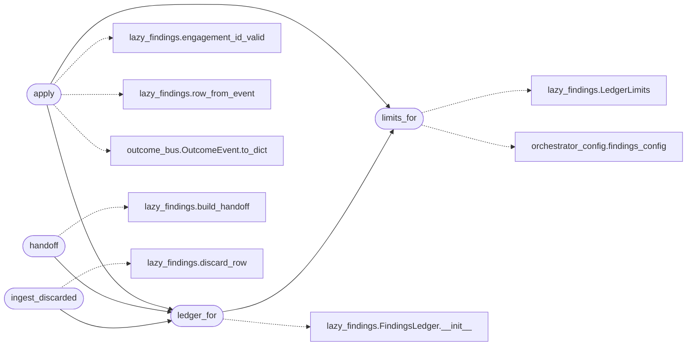

# `modules.sinks.findings`

> Source: [modules/sinks/findings.py:1](../../modules/sinks/findings.py#L1) | language `py` | coverage 100.0% | [API index](../index.md)

Findings sink: append engagement finding transitions to the ledger.

One adapter from the outcome bus to `[`modules.lazy_findings`](modules.lazy_findings.py.md)`. Every
finding-class outcome lands in the per-engagement JSONL ledger with its
evidence-backed state machine row; exploitation outcomes that carry a
command and verbatim output become `[`confirmed`](modules.world_model.py.md#credentialentry-confirmed)` rows because the artifact
of record is reproducible by construction.

## Contents

- **Functions:** [`limits_for`](#limits_for), [`apply`](#apply), [`ledger_for`](#ledger_for), [`handoff`](#handoff), [`ingest_discarded`](#ingest_discarded)
- **Constants:** [`LEDGER_MARKER`](#ledger_marker)

## Call Graph

Solid arrows stay in this module, dashed arrows leave it.



## Functions

<a id="limits_for"></a>

### `limits_for`

`function` | [modules/sinks/findings.py:22](../../modules/sinks/findings.py#L22)

```python
def limits_for() -> lazy_findings.LedgerLimits
```

Return the ledger limits resolved from operator configuration.

**Returns:** `lazy_findings.LedgerLimits` - LedgerLimits built from ``orchestrator_config.findings_config``.

*Calls:* [`LedgerLimits`](modules.lazy_findings.py.md#ledgerlimits), [`findings_config`](modules.orchestrator_config.py.md#findings_config)

*Called by:* [`apply`](#apply), [`ledger_for`](#ledger_for)

---

<a id="apply"></a>

### `apply`

`function` | [modules/sinks/findings.py:42](../../modules/sinks/findings.py#L42)

```python
def apply(event: OutcomeEvent) -> bool
```

Append one ledger row for a finding-class outcome.

Findings rows persist verbatim flow evidence; validation is fail
closed, including the reproducibility gate for `[`confirmed`](modules.world_model.py.md#credentialentry-confirmed)`. Logged
rejections never raise out of a sink.

**Parameters**

| Name | Type | Default | Description |
|---|---|---|---|
| `event` | `OutcomeEvent` |  | Outcome to translate into a ledger row. |

**Returns:** `bool` - True when a row was appended or the event is out of scope; False
when the row failed validation.

*Calls:* [`engagement_id_valid`](modules.lazy_findings.py.md#engagement_id_valid), [`row_from_event`](modules.lazy_findings.py.md#row_from_event), [`OutcomeEvent.to_dict`](modules.outcome_bus.py.md#outcomeevent-to_dict), [`ledger_for`](#ledger_for), [`limits_for`](#limits_for)

---

<a id="ledger_for"></a>

### `ledger_for`

`function` | [modules/sinks/findings.py:72](../../modules/sinks/findings.py#L72)

```python
def ledger_for(engagement_id: str) -> lazy_findings.FindingsLedger
```

Return one ledger bound to the sessions findings directory.

**Parameters**

| Name | Type | Default | Description |
|---|---|---|---|
| `engagement_id` | `str` |  | Engagement/task id that owns the ledger. |

**Returns:** `lazy_findings.FindingsLedger` - FindingsLedger for that engagement.

*Calls:* [`FindingsLedger.__init__`](modules.lazy_findings.py.md#findingsledger-__init__), [`limits_for`](#limits_for)

*Called by:* [`LazyQueueCommandSet.do_lazy_findings`](cli.commands.lazyloop.py.md#lazyqueuecommandset-do_lazy_findings), [`apply`](#apply), [`handoff`](#handoff), [`ingest_discarded`](#ingest_discarded)

---

<a id="handoff"></a>

### `handoff`

`function` | [modules/sinks/findings.py:88](../../modules/sinks/findings.py#L88)

```python
def handoff(engagement_id: str, status: str = '', rounds: int = 0) -> dict
```

Build the operator handoff from the durable ledger.

**Parameters**

| Name | Type | Default | Description |
|---|---|---|---|
| `engagement_id` | `str` |  | Engagement/task bound to the ledger. |
| `status` | `str` | `''` | Final loop status. |
| `rounds` | `int` | `0` | Completed rounds. |

**Returns:** `dict` - Handoff dict (states, confirmed evidence, discarded, decision).

*Calls:* [`build_handoff`](modules.lazy_findings.py.md#build_handoff), [`ledger_for`](#ledger_for)

---

<a id="ingest_discarded"></a>

### `ingest_discarded`

`function` | [modules/sinks/findings.py:107](../../modules/sinks/findings.py#L107)

```python
def ingest_discarded(engagement_id: str, entries: list[dict]) -> int
```

Record discarded vector rows for one engagement.

**Parameters**

| Name | Type | Default | Description |
|---|---|---|---|
| `engagement_id` | `str` |  | Engagement/task bound to the ledger. |
| `entries` | `list[dict]` |  | Discarded-route dicts from the progress ledger. |

**Returns:** `int` - Number of rows persisted.

*Calls:* [`discard_row`](modules.lazy_findings.py.md#discard_row), [`ledger_for`](#ledger_for)

---

## Constants

<a id="ledger_marker"></a>

### `LEDGER_MARKER`

`constant` | [modules/sinks/findings.py:19](../../modules/sinks/findings.py#L19)

```python
LEDGER_MARKER = 'findings_ledger'
```

---
