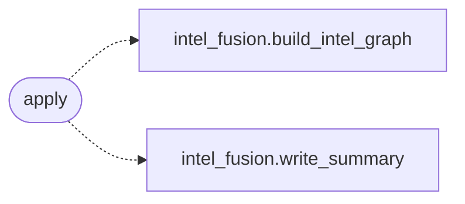

# `modules.sinks.intel_graph`

> Source: [modules/sinks/intel_graph.py:1](../../modules/sinks/intel_graph.py#L1) | language `py` | coverage 100.0% | [API index](../index.md)

Intel-graph sink: rebuild the fused graph after meaningful outcomes.

## Contents

- **Functions:** [`apply`](#apply)

## Call Graph

Solid arrows stay in this module, dashed arrows leave it.



## Functions

<a id="apply"></a>

### `apply`

`function` | [modules/sinks/intel_graph.py:13](../../modules/sinks/intel_graph.py#L13)

```python
def apply(event: OutcomeEvent) -> bool
```

Rebuild the intel graph and its summary.

**Parameters**

| Name | Type | Default | Description |
|---|---|---|---|
| `event` | `OutcomeEvent` |  | Outcome that may change the graph. |

**Returns:** `bool` - True when the graph was rebuilt.

*Calls:* [`build_intel_graph`](modules.intel_fusion.py.md#build_intel_graph), [`write_summary`](modules.intel_fusion.py.md#write_summary)

---
