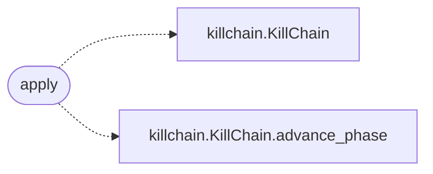

# `modules.sinks.killchain`

> Source: [modules/sinks/killchain.py:1](../../modules/sinks/killchain.py#L1) | language `py` | coverage 100.0% | [API index](../index.md)

Kill-chain sink: advance the unified phase from proven outcomes.

## Contents

- **Functions:** [`apply`](#apply)

## Call Graph

Solid arrows stay in this module, dashed arrows leave it.



## Functions

<a id="apply"></a>

### `apply`

`function` | [modules/sinks/killchain.py:11](../../modules/sinks/killchain.py#L11)

```python
def apply(event: OutcomeEvent) -> bool
```

Advance the kill-chain phase only when the outcome proves progress.

A failed exploit, a dry-run emulation and a plain finding must never
mark hosts as `[`EXPLOITED`](modules.world_model.py.md#hoststate-exploited)`. Shell access is the strongest signal;
otherwise an explicitly successful exploit/emulation/chain advances
the phase. Report events only advance the reporting phase.

**Parameters**

| Name | Type | Default | Description |
|---|---|---|---|
| `event` | `OutcomeEvent` |  | Outcome to classify. |

**Returns:** `bool` - True when the phase was advanced or already ahead.

*Calls:* [`KillChain`](modules.killchain.py.md#killchain), [`KillChain.advance_phase`](modules.killchain.py.md#killchain-advance_phase)

---
